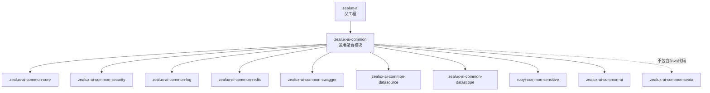
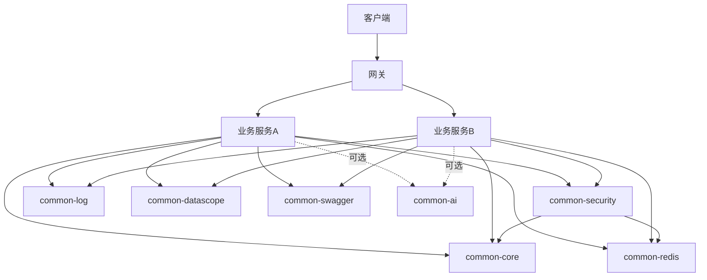
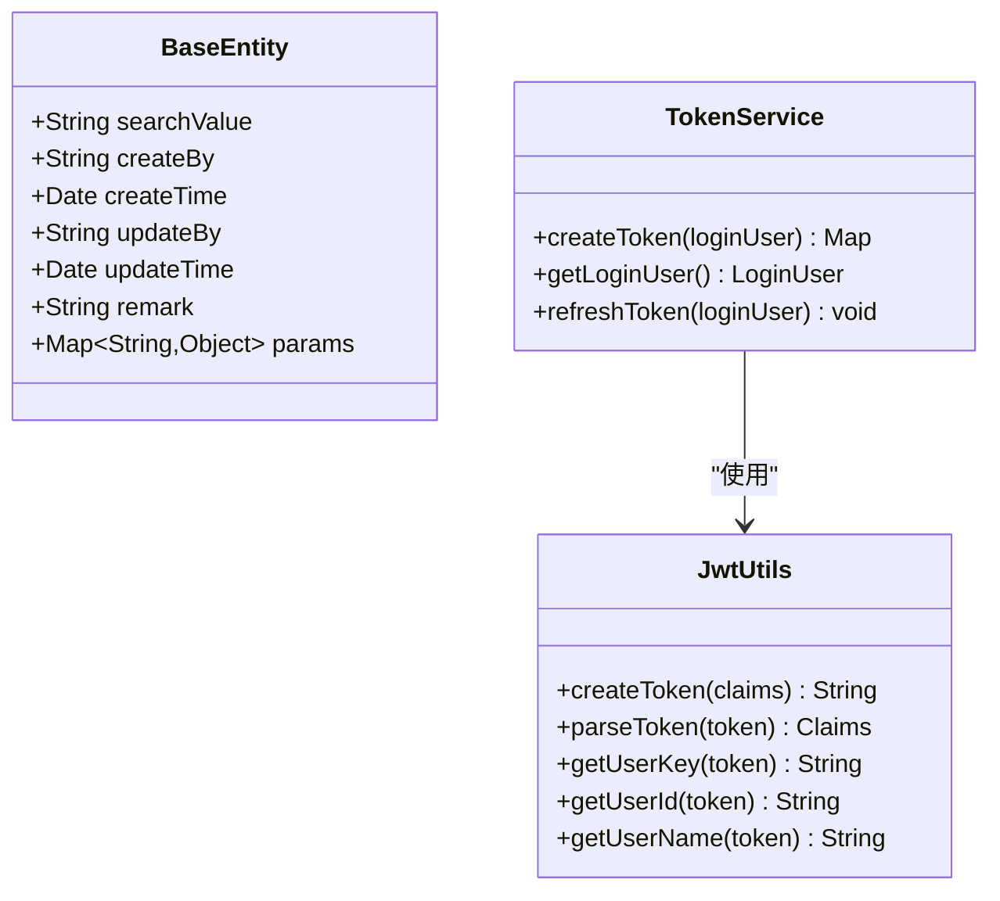
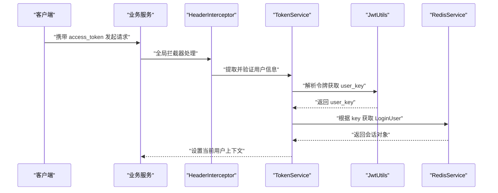
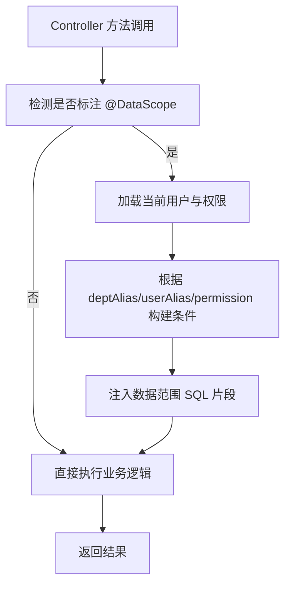
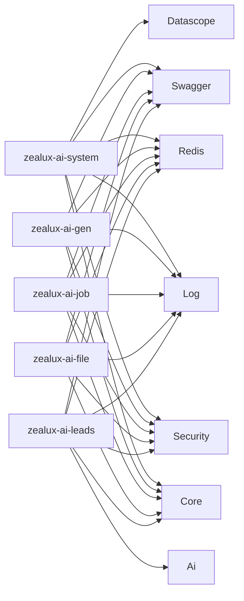

# 通用模块（Common）

<cite>
**本文引用的文件**   
- [zealux-ai-common/pom.xml](file://zealux-ai-master/zealux-ai-common/pom.xml)
- [BaseEntity.java](file://zealux-ai-master/zealux-ai-common/zealux-ai-common-core/src/main/java/com/zealux/common/core/web/domain/BaseEntity.java)
- [JwtUtils.java](file://zealux-ai-master/zealux-ai-common/zealux-ai-common-core/src/main/java/com/zealux/common/core/utils/JwtUtils.java)
- [RedisService.java](file://zealux-ai-master/zealux-ai-common/zealux-ai-common-redis/src/main/java/com/zealux/common/redis/service/RedisService.java)
- [DataScope.java](file://zealux-ai-master/zealux-ai-common/zealux-ai-common-datascope/src/main/java/com/zealux/common/datascope/annotation/DataScope.java)
- [Sensitive.java](file://zealux-ai-master/zealux-ai-common/ruoyi-common-sensitive/src/main/java/com/ruoyi/common/sensitive/annotation/Sensitive.java)
- [TokenService.java](file://zealux-ai-master/zealux-ai-common/zealux-ai-common-security/src/main/java/com/zealux/common/security/service/TokenService.java)
- [WebMvcConfig.java](file://zealux-ai-master/zealux-ai-common/zealux-ai-common-security/src/main/java/com/zealux/common/security/config/WebMvcConfig.java)
</cite>

## 目录
1. [引言](#引言)
2. [项目结构](#项目结构)
3. [核心组件](#核心组件)
4. [架构总览](#架构总览)
5. [详细组件分析](#详细组件分析)
6. [依赖关系与业务服务集成](#依赖关系与业务服务集成)
7. [版本升级兼容性注意事项](#版本升级兼容性注意事项)
8. [自定义扩展点](#自定义扩展点)
9. [故障排查指南](#故障排查指南)
10. [结论](#结论)

## 引言
本仓库的通用层基于开源 RuoYi-Cloud 3.6.5 进行重命名二次开发，根工程 artifactId 为 `zealux-ai`、版本 `3.6.5`；前端名称仍沿用 `ruoyi@3.6.5`。`zealux-ai-common` 是各业务服务的公共依赖，提供常量、基础实体、安全、日志、缓存、接口文档、数据权限、读写分离注解以及 AI 对话与向量检索配置。它不是自研框架，而是对 RuoYi-Cloud 通用能力的继承与扩展。

需要特别注意：
- `zealux-ai-common-seata` 子目录下没有 Java 源文件，不应作为独立功能模块描述。
- `ruoyi-common-sensitive` 包名仍保留 `com.ruoyi`，但位于 `zealux-ai-common` 下，属于通用敏感字段脱敏能力。
- 自动装配通过 Spring Boot 的 `META-INF/spring/org.springframework.boot.autoconfigure.AutoConfiguration.imports` 注册，而非仅依赖显式 `@Import`。

## 项目结构
`zealux-ai-common` 是一个 Maven 聚合模块，父工程为 `zealux-ai`。其 `pom.xml` 声明了 9 个非空子模块，并排除已注释的 sensitive 模块（实际存在但不参与构建列表）。

**图表来源**
- [zealux-ai-common/pom.xml:1-31](file://zealux-ai-master/zealux-ai-common/pom.xml#L1-L31)

**章节来源**
- [zealux-ai-common/pom.xml:1-31](file://zealux-ai-master/zealux-ai-common/pom.xml#L1-L31)

## 核心组件
通用模块按职责划分为以下单元：

| 模块 | 主要职责 | 关键类或配置 | 典型使用者 |
|---|---|---|---|
| core | 常量、异常、工具类、基础实体、分页、Excel、XSS、JWT 工具 | `BaseEntity`、`JwtUtils`、`SecurityConstants`、`CacheConstants`、各类 `*Exception` | 几乎所有后端服务 |
| security | 全局 Web 拦截、Feign 内部认证、鉴权注解与切面、Token 管理 | `WebMvcConfig`、`HeaderInterceptor`、`TokenService`、`RequiresPermissions`、`InnerAuth` | auth、system、gateway 下游服务 |
| log | 操作日志注解与异步记录切面 | `@Log`、`LogAspect`、`BusinessType`、`OperatorType` | system、gen、job、file 等业务模块 |
| redis | Redis 连接与序列化配置、统一缓存工具 | `RedisConfig`、`RedisService` | token 缓存、字典缓存、业务缓存 |
| swagger | springdoc-openapi 文档装配 | `SwaggerConfig`（由 AutoConfiguration 引入） | 所有对外暴露 API 的服务 |
| datasource | 主从数据源注解 | `Master`、`Slave` | 需要读写分离的业务模块 |
| datascope | 数据权限注解与 SQL 拼接切面 | `@DataScope`、`DataScopeAspect` | system、业务查询方法 |
| ruoyi-common-sensitive | 字段级 JSON 脱敏 | `@Sensitive`、`DesensitizedType`、`SensitiveJsonSerializer` | 用户信息、客户信息等响应对象 |
| ai | AI 对话客户端与 Redis 向量检索配置 | `ChatClientConfig`、`RedisVectorConfig` | zealux-ai-leads 等 AI 能力服务 |

这些模块共同构成后端微服务的“基础设施层”：core 提供基础类型和工具，security 负责认证授权，log 负责审计，redis 提供缓存，datascope 控制数据范围，datasource 辅助多数据源，swagger 生成文档，ai 接入外部 AI 能力。

**章节来源**
- [zealux-ai-common/pom.xml:1-31](file://zealux-ai-master/zealux-ai-common/pom.xml#L1-L31)
- [BaseEntity.java:1-122](file://zealux-ai-master/zealux-ai-common/zealux-ai-common-core/src/main/java/com/zealux/common/core/web/domain/BaseEntity.java#L1-L122)
- [JwtUtils.java:1-123](file://zealux-ai-master/zealux-ai-common/zealux-ai-common-core/src/main/java/com/zealux/common/core/utils/JwtUtils.java#L1-L123)
- [RedisService.java:1-268](file://zealux-ai-master/zealux-ai-common/zealux-ai-common-redis/src/main/java/com/zealux/common/redis/service/RedisService.java#L1-L268)
- [DataScope.java:1-33](file://zealux-ai-master/zealux-ai-common/zealux-ai-common-datascope/src/main/java/com/zealux/common/datascope/annotation/DataScope.java#L1-L33)
- [Sensitive.java:1-24](file://zealux-ai-master/zealux-ai-common/ruoyi-common-sensitive/src/main/java/com/ruoyi/common/sensitive/annotation/Sensitive.java#L1-L24)
- [TokenService.java:1-174](file://zealux-ai-master/zealux-ai-common/zealux-ai-common-security/src/main/java/com/zealux/common/security/service/TokenService.java#L1-L174)
- [WebMvcConfig.java:1-33](file://zealux-ai-master/zealux-ai-common/zealux-ai-common-security/src/main/java/com/zealux/common/security/config/WebMvcConfig.java#L1-L33)

## 架构总览
下图展示通用模块在微服务中的位置：业务服务通过 Maven 依赖引入通用模块；Spring Boot 启动时加载各模块的自动装配类；请求经网关进入业务服务后，由 security 的拦截器与鉴权注解完成身份校验；业务逻辑使用 core 的基础实体、redis 的缓存、datascope 的数据权限、log 的操作日志；对外 API 由 swagger 生成文档；AI 相关服务再额外依赖 ai 模块。

**图表来源**
- [WebMvcConfig.java:1-33](file://zealux-ai-master/zealux-ai-common/zealux-ai-common-security/src/main/java/com/zealux/common/security/config/WebMvcConfig.java#L1-L33)
- [TokenService.java:1-174](file://zealux-ai-master/zealux-ai-common/zealux-ai-common-security/src/main/java/com/zealux/common/security/service/TokenService.java#L1-L174)
- [RedisService.java:1-268](file://zealux-ai-master/zealux-ai-common/zealux-ai-common-redis/src/main/java/com/zealux/common/redis/service/RedisService.java#L1-L268)
- [JwtUtils.java:1-123](file://zealux-ai-master/zealux-ai-common/zealux-ai-common-core/src/main/java/com/zealux/common/core/utils/JwtUtils.java#L1-L123)

## 详细组件分析

### core：常量、基础实体与自动装配
core 模块提供系统广泛使用的常量、异常、工具类和基础领域模型。其中 `BaseEntity` 是所有持久化实体的基类，包含创建人、创建时间、更新人、更新时间、备注和可扩展参数；它还使用 MyBatis-Plus 的 `@TableField(exist = false)` 标注搜索参数和动态参数，避免映射到数据库列。

`JwtUtils` 是静态 JWT 工具，基于 JJWT 创建和解析令牌，密钥来自 `TokenConstants.SECRET`，Claims 键来自 `SecurityConstants`。它不持有状态，因此适合被其他模块复用。

**图表来源**
- [BaseEntity.java:1-122](file://zealux-ai-master/zealux-ai-common/zealux-ai-common-core/src/main/java/com/zealux/common/core/web/domain/BaseEntity.java#L1-L122)
- [JwtUtils.java:1-123](file://zealux-ai-master/zealux-ai-common/zealux-ai-common-core/src/main/java/com/zealux/common/core/utils/JwtUtils.java#L1-L123)
- [TokenService.java:1-174](file://zealux-ai-master/zealux-ai-common/zealux-ai-common-security/src/main/java/com/zealux/common/security/service/TokenService.java#L1-L174)

**章节来源**
- [BaseEntity.java:1-122](file://zealux-ai-master/zealux-ai-common/zealux-ai-common-core/src/main/java/com/zealux/common/core/web/domain/BaseEntity.java#L1-L122)
- [JwtUtils.java:1-123](file://zealux-ai-master/zealux-ai-common/zealux-ai-common-core/src/main/java/com/zealux/common/core/utils/JwtUtils.java#L1-L123)

### security：JWT 工具、Token 管理与全局安全配置
security 模块不负责实现完整的登录页面，而是提供：
- `WebMvcConfig`：注册全局 `HeaderInterceptor`，默认拦截所有路径，排除 `/login`、`/logout`、`/refresh`。
- `TokenService`：封装 Token 创建、刷新、过期判断、Redis 中用户会话存取。
- `JwtUtils`：位于 core，被 security 引用，负责 JWT 签名、解析和 Claims 读取。
- 鉴权注解与切面：如 `@RequiresPermissions`、`@RequiresRoles`、`@InnerAuth`、`PreAuthorizeAspect`、`InnerAuthAspect`。
- Feign 内部认证拦截器，用于微服务间调用时透传身份信息。

需要注意：源码中未发现名为 `JwtAuthenticationTokenFilter` 的类；JWT 处理主要由 `JwtUtils` 与 `TokenService` 承担，而请求头拦截由 `HeaderInterceptor` 完成。若团队约定称其为“JWT 过滤器”，应理解为 security 模块提供的认证拦截与 Token 管理能力，而不是一个名为 `JwtAuthenticationTokenFilter` 的现有类。

**图表来源**
- [WebMvcConfig.java:1-33](file://zealux-ai-master/zealux-ai-common/zealux-ai-common-security/src/main/java/com/zealux/common/security/config/WebMvcConfig.java#L1-L33)
- [TokenService.java:1-174](file://zealux-ai-master/zealux-ai-common/zealux-ai-common-security/src/main/java/com/zealux/common/security/service/TokenService.java#L1-L174)
- [JwtUtils.java:1-123](file://zealux-ai-master/zealux-ai-common/zealux-ai-common-core/src/main/java/com/zealux/common/core/utils/JwtUtils.java#L1-L123)
- [RedisService.java:1-268](file://zealux-ai-master/zealux-ai-common/zealux-ai-common-redis/src/main/java/com/zealux/common/redis/service/RedisService.java#L1-L268)

**章节来源**
- [WebMvcConfig.java:1-33](file://zealux-ai-master/zealux-ai-common/zealux-ai-common-security/src/main/java/com/zealux/common/security/config/WebMvcConfig.java#L1-L33)
- [TokenService.java:1-174](file://zealux-ai-master/zealux-ai-common/zealux-ai-common-security/src/main/java/com/zealux/common/security/service/TokenService.java#L1-L174)
- [JwtUtils.java:1-123](file://zealux-ai-master/zealux-ai-common/zealux-ai-common-core/src/main/java/com/zealux/common/core/utils/JwtUtils.java#L1-L123)

### log：@Operlog 注解与操作日志自动记录
log 模块提供 `@Log` 注解（对应需求中的 @Operlog）与 `LogAspect` 切面，支持按业务类型、操作类型、是否排除参数等方式记录操作日志。其枚举包括 `BusinessStatus`、`BusinessType`、`OperatorType`，并通过 `AsyncLogService` 异步落盘或入库。

使用时，通常在 Controller 方法上添加 `@Log`，指定模块名、业务类型和操作说明；切面会在方法执行前后采集入参、结果、耗时、操作人和 IP，并写入日志。

**章节来源**
- [Log.java](file://zealux-ai-master/zealux-ai-common/zealux-ai-common-log/src/main/java/com/zealux/common/log/annotation/Log.java)
- [LogAspect.java](file://zealux-ai-master/zealux-ai-common/zealux-ai-common-log/src/main/java/com/zealux/common/log/aspect/LogAspect.java)
- [BusinessStatus.java](file://zealux-ai-master/zealux-ai-common/zealux-ai-common-log/src/main/java/com/zealux/common/log/enums/BusinessStatus.java)
- [BusinessType.java](file://zealux-ai-master/zealux-ai-common/zealux-ai-common-log/src/main/java/com/zealux/common/log/enums/BusinessType.java)
- [OperatorType.java](file://zealux-ai-master/zealux-ai-common/zealux-ai-common-log/src/main/java/com/zealux/common/log/enums/OperatorType.java)
- [AsyncLogService.java](file://zealux-ai-master/zealux-ai-common/zealux-ai-common-log/src/main/java/com/zealux/common/log/service/AsyncLogService.java)

### redis：Redis 连接与缓存工具
redis 模块提供 `RedisConfig` 和 `FastJson2JsonRedisSerializer`，将 `RedisTemplate` 序列化为 Fastjson2；`RedisService` 则封装常用缓存操作，包括字符串、List、Set、Map 的读写、过期时间管理和批量删除。

`TokenService` 依赖 `RedisService` 存储登录会话，因此 redis 模块是 security 模块的运行时依赖之一。

**章节来源**
- [RedisService.java:1-268](file://zealux-ai-master/zealux-ai-common/zealux-ai-common-redis/src/main/java/com/zealux/common/redis/service/RedisService.java#L1-L268)
- [RedisConfig.java](file://zealux-ai-master/zealux-ai-common/zealux-ai-common-redis/src/main/java/com/zealux/common/redis/configure/RedisConfig.java)
- [FastJson2JsonRedisSerializer.java](file://zealux-ai-master/zealux-ai-common/zealux-ai-common-redis/src/main/java/com/zealux/common/redis/configure/FastJson2JsonRedisSerializer.java)

### swagger：启用 springdoc-openapi 文档
swagger 模块通过 `SwaggerConfig` 和 AutoConfiguration 启用 springdoc-openapi。业务服务只需引入该模块，即可生成 OpenAPI 文档。该模块不参与业务逻辑，只影响接口文档生成行为。

**章节来源**
- [SwaggerConfig.java](file://zealux-ai-master/zealux-ai-common/zealux-ai-common-swagger/src/main/java/com/zealux/common/swagger/config/SwaggerConfig.java)
- [AutoConfiguration.imports（swagger）](file://zealux-ai-master/zealux-ai-common/zealux-ai-common-swagger/src/main/resources/META-INF/spring/org.springframework.boot.autoconfigure.AutoConfiguration.imports)

### datasource：主从数据源注解
datasource 模块目前仅提供两个注解：`Master` 与 `Slave`。它们本身不实现路由逻辑，而是供上层数据源配置或切面识别目标数据源。实际路由策略应由业务服务或更高层配置决定。

**章节来源**
- [Master.java](file://zealux-ai-master/zealux-ai-common/zealux-ai-common-datasource/src/main/java/com/zealux/common/datasource/annotation/Master.java)
- [Slave.java](file://zealux-ai-master/zealux-ai-common/zealux-ai-common-datasource/src/main/java/com/zealux/common/datasource/annotation/Slave.java)

### datascope：数据权限注解
`@DataScope` 用于标记需要数据权限过滤的方法，可配置部门别名、用户别名和权限字符。`DataScopeAspect` 会读取当前用户权限，并在 SQL 拼接阶段附加部门或用户范围条件。

**图表来源**
- [DataScope.java:1-33](file://zealux-ai-master/zealux-ai-common/zealux-ai-common-datascope/src/main/java/com/zealux/common/datascope/annotation/DataScope.java#L1-L33)
- [DataScopeAspect.java](file://zealux-ai-master/zealux-ai-common/zealux-ai-common-datascope/src/main/java/com/zealux/common/datascope/aspect/DataScopeAspect.java)

**章节来源**
- [DataScope.java:1-33](file://zealux-ai-master/zealux-ai-common/zealux-ai-common-datascope/src/main/java/com/zealux/common/datascope/annotation/DataScope.java#L1-L33)
- [DataScopeAspect.java](file://zealux-ai-master/zealux-ai-common/zealux-ai-common-datascope/src/main/java/com/zealux/common/datascope/aspect/DataScopeAspect.java)

### ruoyi-common-sensitive：字段脱敏注解与工具
该模块定义 `@Sensitive` 注解，配合 `DesensitizedType` 枚举和 `SensitiveJsonSerializer`，在 JSON 序列化时对手机号、邮箱、身份证号等字段进行脱敏。由于 Jackson 注解与序列化器位于该模块内，业务实体只需在敏感字段上加注，无需在服务端手动替换值。

**章节来源**
- [Sensitive.java:1-24](file://zealux-ai-master/zealux-ai-common/ruoyi-common-sensitive/src/main/java/com/ruoyi/common/sensitive/annotation/Sensitive.java#L1-L24)
- [DesensitizedType.java](file://zealux-ai-master/zealux-ai-common/ruoyi-common-sensitive/src/main/java/com/ruoyi/common/sensitive/enums/DesensitizedType.java)
- [SensitiveJsonSerializer.java](file://zealux-ai-master/zealux-ai-common/ruoyi-common-sensitive/src/main/java/com/ruoyi/common/sensitive/config/SensitiveJsonSerializer.java)
- [DesensitizedUtil.java](file://zealux-ai-master/zealux-ai-common/ruoyi-common-sensitive/src/main/java/com/ruoyi/common/sensitive/utils/DesensitizedUtil.java)

### ai：AI 对话客户端与向量检索配置
ai 模块提供 `ChatClientConfig` 和 `RedisVectorConfig`，并注册 Spring Boot 自动装配。它是 AI 能力的基础设施层，供 `zealux-ai-leads` 等服务使用。当前 leads 模块仅有少量 Java 文件，且缺少前端、菜单、Nacos 配置和网关路由，本地 Redis 也缺 RediSearch 模块，因此该服务当前不可运行。

**章节来源**
- [ChatClientConfig.java](file://zealux-ai-master/zealux-ai-common/zealux-ai-common-ai/src/main/java/com/zealux/common/ai/config/ChatClientConfig.java)
- [RedisVectorConfig.java](file://zealux-ai-master/zealux-ai-common/zealux-ai-common-ai/src/main/java/com/zealux/common/ai/config/RedisVectorConfig.java)
- [AutoConfiguration.imports（ai）](file://zealux-ai-master/zealux-ai-common/zealux-ai-common-ai/src/main/resources/META-INF/spring/org.springframework.boot.autoconfigure.AutoConfiguration.imports)

## 依赖关系与业务服务集成
各业务服务通过 Maven 依赖引入需要的通用模块。典型依赖方向如下：

- **BaseEntity 的实际使用方式**：业务实体继承 `BaseEntity`，即可获得 `createBy`、`createTime`、`updateBy`、`updateTime`、`remark` 和 `params` 字段；MyBatis-Plus 会忽略 `searchValue` 和 `params` 的表映射。
- **JwtAuthenticationTokenFilter 的实际使用方式**：源码中没有该类的定义。应使用 security 模块提供的 `HeaderInterceptor`、`TokenService` 和 `JwtUtils` 完成 Token 解析与用户上下文设置。
- **RedisCache 的实际使用方式**：源码中提供的是 `RedisService`，而非名为 `RedisCache` 的类。业务服务通过注入 `RedisService` 调用 `setCacheObject`、`getCacheObject`、`expire`、`deleteObject` 等方法。
- **DataScope 的实际使用方式**：在需要数据权限控制的 Service 方法上标注 `@DataScope`，并配置部门别名、用户别名和权限字符；切面会根据当前用户权限生成 SQL 条件。
- **Sensitive 的实际使用方式**：在实体字段上标注 `@Sensitive(desensitizedType = ...)`，JSON 输出时由 `SensitiveJsonSerializer` 自动脱敏。

**图表来源**
- [BaseEntity.java:1-122](file://zealux-ai-master/zealux-ai-common/zealux-ai-common-core/src/main/java/com/zealux/common/core/web/domain/BaseEntity.java#L1-L122)
- [JwtUtils.java:1-123](file://zealux-ai-master/zealux-ai-common/zealux-ai-common-core/src/main/java/com/zealux/common/core/utils/JwtUtils.java#L1-L123)
- [RedisService.java:1-268](file://zealux-ai-master/zealux-ai-common/zealux-ai-common-redis/src/main/java/com/zealux/common/redis/service/RedisService.java#L1-L268)
- [DataScope.java:1-33](file://zealux-ai-master/zealux-ai-common/zealux-ai-common-datascope/src/main/java/com/zealux/common/datascope/annotation/DataScope.java#L1-L33)
- [Sensitive.java:1-24](file://zealux-ai-master/zealux-ai-common/ruoyi-common-sensitive/src/main/java/com/ruoyi/common/sensitive/annotation/Sensitive.java#L1-L24)

**章节来源**
- [BaseEntity.java:1-122](file://zealux-ai-master/zealux-ai-common/zealux-ai-common-core/src/main/java/com/zealux/common/core/web/domain/BaseEntity.java#L1-L122)
- [JwtUtils.java:1-123](file://zealux-ai-master/zealux-ai-common/zealux-ai-common-core/src/main/java/com/zealux/common/core/utils/JwtUtils.java#L1-L123)
- [RedisService.java:1-268](file://zealux-ai-master/zealux-ai-common/zealux-ai-common-redis/src/main/java/com/zealux/common/redis/service/RedisService.java#L1-L268)
- [DataScope.java:1-33](file://zealux-ai-master/zealux-ai-common/zealux-ai-common-datascope/src/main/java/com/zealux/common/datascope/annotation/DataScope.java#L1-L33)
- [Sensitive.java:1-24](file://zealux-ai-master/zealux-ai-common/ruoyi-common-sensitive/src/main/java/com/ruoyi/common/sensitive/annotation/Sensitive.java#L1-L24)

## 版本升级兼容性注意事项
1. **RuoYi-Cloud 继承关系**：该项目是 RuoYi-Cloud 3.6.5 的重命名二次开发，不应描述为完全自研。升级时应优先核对上游 RuoYi-Cloud 在 core、security、log、redis、swagger、datascope 上的变更。
2. **包名差异**：敏感脱敏模块包名仍为 `com.ruoyi.common.sensitive`，而通用模块其他部分多为 `com.zealux.common.*`。升级时需注意引用方是否因包名迁移产生编译错误。
3. **JWT 实现**：`JwtUtils` 使用 JJWT 的 HS512 算法和 `TokenConstants.SECRET`。若升级 JJWT 或更换密钥来源，需检查 `createToken`、`parseToken` 及所有 Claims 键。
4. **Redis 序列化**：`RedisService` 依赖 `RedisTemplate`，序列化由 `FastJson2JsonRedisSerializer` 处理。升级 Fastjson2 或 Redis 客户端时需验证旧缓存可读性。
5. **安全拦截排除路径**：`WebMvcConfig` 中排除 `/login`、`/logout`、`/refresh`。若新增免拦截路径，应在此处维护，避免意外触发鉴权。
6. **Token 缓存 Key**：`TokenService` 使用 `CacheConstants.LOGIN_TOKEN_KEY` 拼接 token 前缀。若修改该常量，需考虑历史缓存清理和跨服务一致性。
7. **seata 目录**：`zealux-ai-common-seata` 无 Java 源文件，不应视为分布式事务实现模块；若未来引入 Seata，应明确新增实现，而不是假设已有能力。

**章节来源**
- [JwtUtils.java:1-123](file://zealux-ai-master/zealux-ai-common/zealux-ai-common-core/src/main/java/com/zealux/common/core/utils/JwtUtils.java#L1-L123)
- [TokenService.java:1-174](file://zealux-ai-master/zealux-ai-common/zealux-ai-common-security/src/main/java/com/zealux/common/security/service/TokenService.java#L1-L174)
- [WebMvcConfig.java:1-33](file://zealux-ai-master/zealux-ai-common/zealux-ai-common-security/src/main/java/com/zealux/common/security/config/WebMvcConfig.java#L1-L33)
- [RedisService.java:1-268](file://zealux-ai-master/zealux-ai-common/zealux-ai-common-redis/src/main/java/com/zealux/common/redis/service/RedisService.java#L1-L268)

## 自定义扩展点
- **自定义注解处理器**：可在 log 模块基础上扩展新的业务日志注解，或在 datascope 模块中扩展新的数据权限规则；也可在 security 模块中添加新的鉴权注解和切面。
- **自定义缓存 Key 策略**：当前 `TokenService` 使用固定前缀加 token 的方式生成 Key。如需按租户、环境或服务名区分，应封装独立的 Key 生成策略，并评估历史缓存兼容。
- **自定义脱敏规则**：可通过扩展 `DesensitizedType` 和 `SensitiveJsonSerializer` 增加新的脱敏模式，例如银行卡号、营业执照号等。
- **自定义数据源路由**：datasource 模块仅提供注解，业务服务可结合 AOP 或动态数据源框架实现 `Master`/`Slave` 的路由策略。
- **自定义 Web 拦截器**：`WebMvcConfig` 提供全局拦截器注册入口，可在同一文件中追加自定义拦截器，同时注意保持 exclude 路径正确。

**章节来源**
- [Log.java](file://zealux-ai-master/zealux-ai-common/zealux-ai-common-log/src/main/java/com/zealux/common/log/annotation/Log.java)
- [LogAspect.java](file://zealux-ai-master/zealux-ai-common/zealux-ai-common-log/src/main/java/com/zealux/common/log/aspect/LogAspect.java)
- [DataScope.java:1-33](file://zealux-ai-master/zealux-ai-common/zealux-ai-common-datascope/src/main/java/com/zealux/common/datascope/annotation/DataScope.java#L1-L33)
- [DataScopeAspect.java](file://zealux-ai-master/zealux-ai-common/zealux-ai-common-datascope/src/main/java/com/zealux/common/datascope/aspect/DataScopeAspect.java)
- [Sensitive.java:1-24](file://zealux-ai-master/zealux-ai-common/ruoyi-common-sensitive/src/main/java/com/ruoyi/common/sensitive/annotation/Sensitive.java#L1-L24)
- [SensitiveJsonSerializer.java](file://zealux-ai-master/zealux-ai-common/ruoyi-common-sensitive/src/main/java/com/ruoyi/common/sensitive/config/SensitiveJsonSerializer.java)
- [WebMvcConfig.java:1-33](file://zealux-ai-master/zealux-ai-common/zealux-ai-common-security/src/main/java/com/zealux/common/security/config/WebMvcConfig.java#L1-L33)
- [TokenService.java:1-174](file://zealux-ai-master/zealux-ai-common/zealux-ai-common-security/src/main/java/com/zealux/common/security/service/TokenService.java#L1-L174)

## 故障排查指南
1. **无法加载通用模块自动装配**：检查各模块 `META-INF/spring/org.springframework.boot.autoconfigure.AutoConfiguration.imports` 是否存在，确认服务启动类扫描到通用模块包。
2. **Token 获取不到用户信息**：检查 `TokenService.getLoginUser` 是否正确解析 Header 中的 token，并查看 Redis 中对应 `LOGIN_TOKEN_KEY` 前缀的键是否过期或被清理。
3. **JWT 解析失败**：检查 `TokenConstants.SECRET` 是否与签发侧一致，并确认 JJWT 版本未破坏 `HS512` 解析。
4. **Redis 缓存乱码或反序列化失败**：检查 `FastJson2JsonRedisSerializer` 与业务实体序列化方式是否一致，尤其是泛型 List/Set/Map。
5. **数据权限未生效**：确认方法确实标注 `@DataScope`，且当前用户具备相应角色或权限；检查部门与用户表别名是否与 SQL 匹配。
6. **敏感字段未脱敏**：确认字段注解使用 `@Sensitive`，且响应对象经过 Jackson 序列化；若使用自定义 ObjectMapper，需确保注册了对应序列化器。
7. **日志未记录**：确认方法标注 `@Log`，且切面未被自定义 AOP 顺序覆盖；检查异步日志消费者是否正常运行。

**章节来源**
- [TokenService.java:1-174](file://zealux-ai-master/zealux-ai-common/zealux-ai-common-security/src/main/java/com/zealux/common/security/service/TokenService.java#L1-L174)
- [JwtUtils.java:1-123](file://zealux-ai-master/zealux-ai-common/zealux-ai-common-core/src/main/java/com/zealux/common/core/utils/JwtUtils.java#L1-L123)
- [RedisService.java:1-268](file://zealux-ai-master/zealux-ai-common/zealux-ai-common-redis/src/main/java/com/zealux/common/redis/service/RedisService.java#L1-L268)
- [DataScope.java:1-33](file://zealux-ai-master/zealux-ai-common/zealux-ai-common-datascope/src/main/java/com/zealux/common/datascope/annotation/DataScope.java#L1-L33)
- [Sensitive.java:1-24](file://zealux-ai-master/zealux-ai-common/ruoyi-common-sensitive/src/main/java/com/ruoyi/common/sensitive/annotation/Sensitive.java#L1-L24)
- [Log.java](file://zealux-ai-master/zealux-ai-common/zealux-ai-common-log/src/main/java/com/zealux/common/log/annotation/Log.java)

## 结论
`zealux-ai-common` 是 RuoYi-Cloud 通用层的继承与二次开发产物，核心职责是向各业务服务提供稳定、可复用的基础设施：core 提供基础类型与工具，security 提供认证授权与 Token 管理，log 提供操作审计，redis 提供缓存，datascope 提供数据权限，datasource 提供主从注解，swagger 提供文档，ai 提供 AI 与向量检索配置。业务服务应按需引入这些模块，并在升级时重点关注 JWT 密钥、Redis 序列化、安全拦截路径和数据权限规则的兼容性。seata 目录当前无 Java 实现，不应被视为已实现的分布式事务能力。