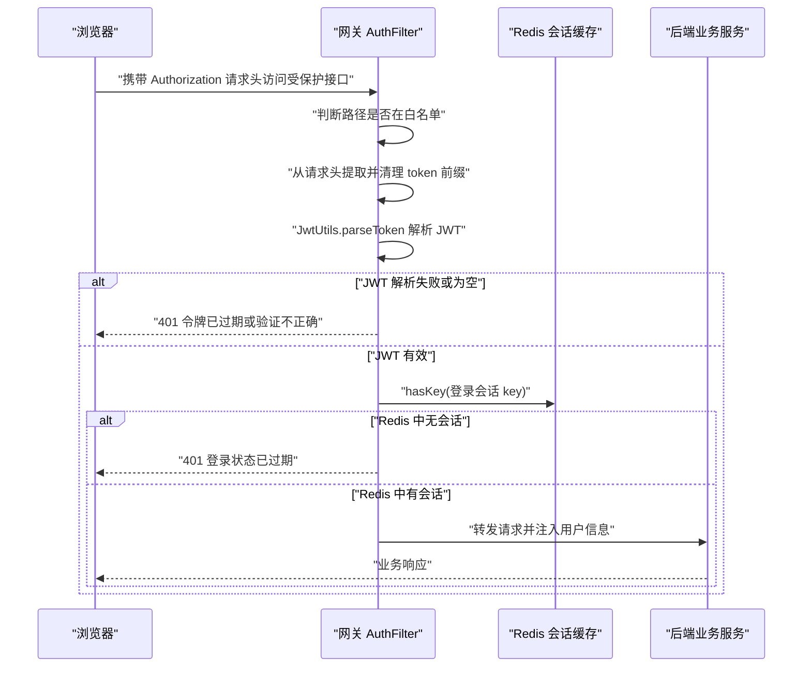
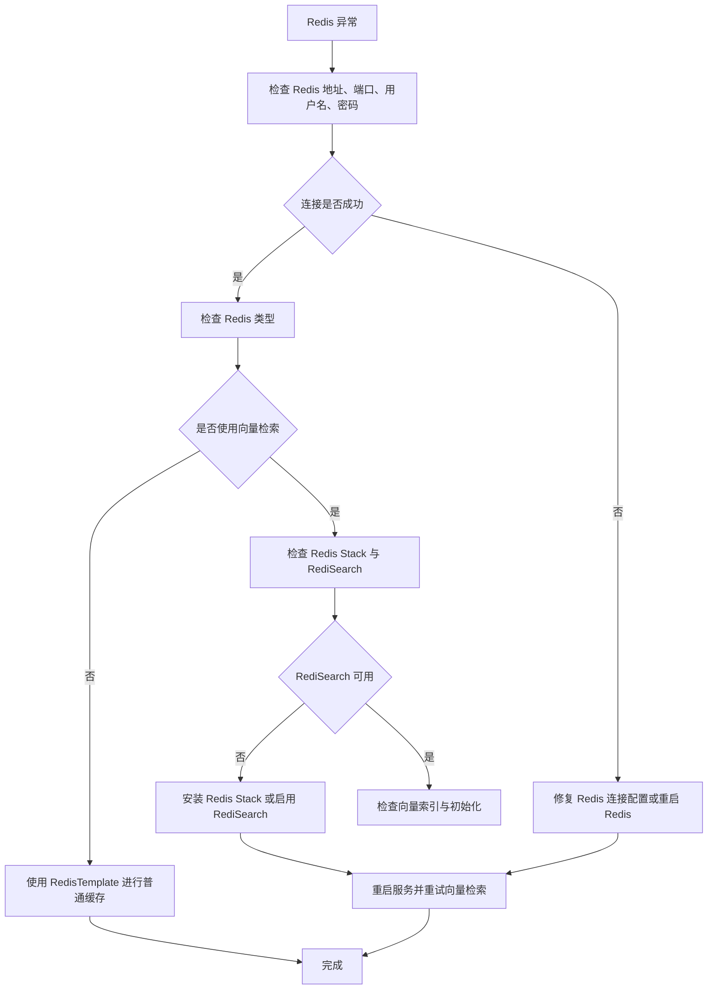
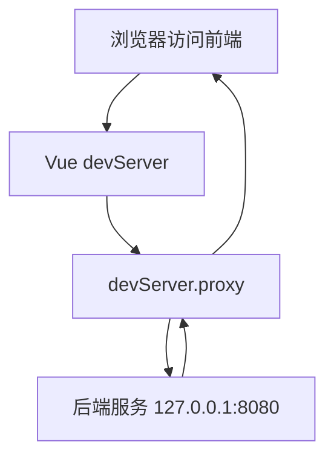
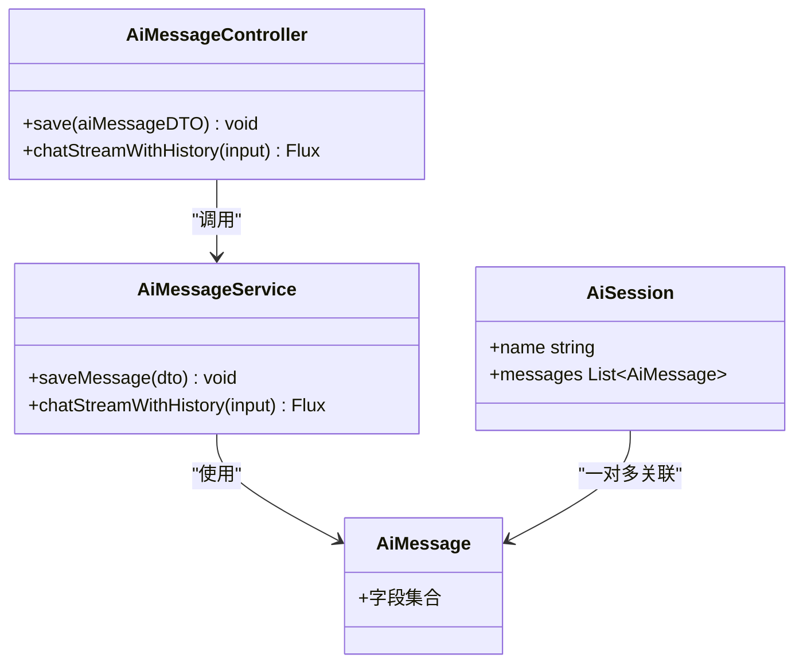

# 常见问题与排错

<cite>
**本文引用的文件**   
- [AuthFilter.java](file://zealux-ai-master/zealux-ai-gateway/src/main/java/com/zealux/gateway/filter/AuthFilter.java)
- [JwtUtils.java](file://zealux-ai-master/zealux-ai-common/zealux-ai-common-core/src/main/java/com/zealux/common/core/utils/JwtUtils.java)
- [TokenService.java](file://zealux-ai-master/zealux-ai-common/zealux-ai-common-security/src/main/java/com/zealux/common/security/service/TokenService.java)
- [SysLoginService.java](file://zealux-ai-master/zealux-ai-auth/src/main/java/com/zealux/auth/service/SysLoginService.java)
- [TokenController.java](file://zealux-ai-master/zealux-ai-auth/src/main/java/com/zealux/auth/controller/TokenController.java)
- [RedisConfig.java](file://zealux-ai-master/zealux-ai-common/zealux-ai-common-redis/src/main/java/com/zealux/common/redis/configure/RedisConfig.java)
- [RedisVectorConfig.java](file://zealux-ai-master/zealux-ai-common/zealux-ai-common-ai/src/main/java/com/zealux/common/ai/config/RedisVectorConfig.java)
- [RouterFunctionConfiguration.java](file://zealux-ai-master/zealux-ai-gateway/src/main/java/com/zealux/gateway/config/RouterFunctionConfiguration.java)
- [AiMessageController.java](file://zealux-ai-master/zealux-ai-modules/zealux-ai-leads/src/main/java/com/zealux/leads/controller/AiMessageController.java)
- [AiSession.java](file://zealux-ai-master/zealux-ai-modules/zealux-ai-leads/src/main/java/com/zealux/leads/domain/AiSession.java)
- [vue.config.js](file://zealux-ai-ui-master/vue.config.js)
- [quartz.sql](file://_setup/sql/quartz.sql)
</cite>

## 目录

1. [适用范围与排错原则](#适用范围与排错原则)
2. [认证与授权：网关 401/403 排查](#认证与授权网关-401403-排查)
3. [Nacos 配置拉取失败、dataId 不存在与命名空间错误](#nacos-配置拉取失败dataid-不存在与命名空间错误)
4. [Redis 连接失败与 AI 向量检索不可用](#redis-连接失败与-ai-向量检索不可用)
5. [MySQL 驱动、字符集与 Quartz 表缺失](#mysql-驱动字符集与-quartz-表缺失)
6. [前端 devServer 代理失败](#前端-devserver-代理失败)
7. [zealux-ai-leads 模块不能直接运行](#zealux-ai-leads-模块不能直接运行)
8. [日志定位与排查命令清单](#日志定位与排查命令清单)
9. [快速决策表](#快速决策表)
10. [总结](#总结)

## 适用范围与排错原则

本仓库是开源 RuoYi-Cloud 3.6.5 的重命名二次开发。根 `pom.xml` 的 artifactId 为 `zealux-ai`、版本为 `3.6.5`；前端 `package.json` 名称仍为 `ruoyi@3.6.5`；7 个原服务的启动类仍叫 `RuoYi*Application.java`；公共库子目录 `zealux-ai-common/ruoyi-common-sensitive` 连目录名都未改名，只有 `zealux-ai-leads` 使用 `Zealux*` 命名。因此描述架构时应承认这一继承关系，不要把它写成自研框架。

排查时请遵循以下规则：

- 只检查仓库源码和已落地的配置文件；不要把本地 `_setup` 下的 Nacos 数据、临时脚本或运行日志当作项目正式配置。
- 不得粘贴任何真实账号、口令、token、api-key。示例中统一使用占位值。
- 不得把尚未实现的 CRM 能力写成本系统已有功能。本地数据库没有 `crm_` 前缀表，CRM 建表方案也未在本工作区执行。
- 不得将 `logs` 目录中的内容作为源码引用；该目录是运行产物，可能包含敏感信息。
- 对“方案”或“建议”必须明确标注，例如「建议新增」或「待实现」。

## 认证与授权：网关 401/403 排查

### 核心结论

- 网关层拦截请求的是 `AuthFilter`，不是名为 `JwtAuthenticationTokenFilter` 的过滤器。
- `AuthFilter` 会读取请求头中的令牌，解析 JWT，再在 Redis 中校验登录会话是否仍然存在。
- 如果令牌为空、JWT 解析失败、Redis 中找不到登录 key，或用户 ID/用户名缺失，网关直接返回 401。
- 403 通常不是由 `AuthFilter` 直接返回；它更多来自后端服务权限校验，例如基于角色、权限注解或菜单路由守卫。

### 请求流程

**图表来源**
- [AuthFilter.java:28-135](file://zealux-ai-master/zealux-ai-gateway/src/main/java/com/zealux/gateway/filter/AuthFilter.java#L28-L135)
- [JwtUtils.java:20-123](file://zealux-ai-master/zealux-ai-common/zealux-ai-common-core/src/main/java/com/zealux/common/core/utils/JwtUtils.java#L20-L123)

### 常见原因与修复

| 现象 | 代码位置 | 可能原因 | 修复建议 |
|---|---|---|---|
| 所有接口返回 401 | `AuthFilter.unauthorizedResponse` | 请求头缺少 `Authorization` | 确认前端登录后保存了 token，并在后续请求中携带 |
| 提示令牌已过期或验证不正确 | `JwtUtils.parseToken` | JWT 签名密钥不一致、客户端篡改 token、服务端重启后密钥变化 | 重新登录；检查 JWT 签名配置 |
| 提示登录状态已过期 | `AuthFilter.getTokenKey` + Redis | Redis 中登录会话 key 不存在 | 检查 Redis 连接与 TTL；必要时重新登录 |
| 提示令牌验证失败 | `AuthFilter.filter` | JWT 中缺少用户 ID 或用户名 | 检查登录成功后 `TokenService.createToken` 写入的 claims |
| 403 无权限 | 后端权限切面 | 当前用户没有对应角色或权限 | 检查角色、权限、菜单及前端权限指令 |

### 诊断步骤

1. 在浏览器开发者工具的网络面板中查看登录响应，确认返回了 `access_token`。
2. 查看后续 API 请求是否携带 `Authorization` 请求头。
3. 确认请求头格式是否为 `Bearer <token>`，其中 `<token>` 是实际令牌占位值。
4. 检查网关日志中的鉴权异常信息，但不得粘贴真实日志内容。
5. 若确认 token 存在且未过期，检查 Redis 中是否存在对应登录会话 key。
6. 若仅某些接口 403，优先检查后端权限注解与前端路由守卫，而不是继续修改网关。

### 与 JwtAuthenticationTokenFilter 的关系说明

当前网关实现中没有名为 `JwtAuthenticationTokenFilter` 的组件。认证逻辑集中在 `AuthFilter`。如果排查日志中出现 `JwtAuthenticationTokenFilter`，应确认它来自其他依赖或服务，而不是本项目的网关实现。

**章节来源**
- [AuthFilter.java:28-135](file://zealux-ai-master/zealux-ai-gateway/src/main/java/com/zealux/gateway/filter/AuthFilter.java#L28-L135)
- [JwtUtils.java:20-123](file://zealux-ai-master/zealux-ai-common/zealux-ai-common-core/src/main/java/com/zealux/common/core/utils/JwtUtils.java#L20-L123)
- [TokenService.java:44-174](file://zealux-ai-master/zealux-ai-common/zealux-ai-common-security/src/main/java/com/zealux/common/security/service/TokenService.java#L44-L174)

## Nacos 配置拉取失败、dataId 不存在与命名空间错误

### 核心结论

- 本项目是微服务架构，服务通过 Nacos 获取配置和服务发现。
- 配置拉取失败通常由三类问题导致：Nacos 地址不可达、dataId 不存在、命名空间不匹配。
- dataId 一般与服务名组合，不同环境使用不同后缀，例如 `dev`、`prod`。
- 命名空间用于隔离多套环境配置；生产、测试、本地开发必须放在正确命名空间。
- 不要在正文中粘贴本地 `_setup/stack/nacos` 下生成的落盘副本路径或配置内容；只能写出服务名与 dataId 名称。

### 常见症状

| 症状 | 含义 | 优先检查项 |
|---|---|---|
| 启动时报 Nacos 连接超时或拒绝连接 | Nacos 地址、端口、用户名、密码错误，或 Nacos 未启动 | Nacos 服务地址、网络连通性 |
| 启动时报 dataId 不存在 | 服务名或 environment 与 Nacos 中 dataId 不一致 | 服务名、environment、dataId |
| 启动成功但配置未生效 | 命名空间错误或 dataId 放在默认命名空间 | 命名空间 ID、dataId 所在命名空间 |
| 某个服务能启动，另一个服务不能 | 各自的服务名或 dataId 配置不同 | 逐个服务核对配置 |

### 排查步骤

1. 确认 Nacos 服务可访问。
2. 登录 Nacos 控制台，查看目标命名空间。
3. 搜索服务对应的 dataId，确认 dataId 与服务名、environment 一致。
4. 确认本地或部署配置中的 `spring.application.name`、`spring.profiles.active`、`namespace` 与实际 dataId 匹配。
5. 若本地使用独立 Nacos，确认使用的是哪个实例，避免把本地临时 Nacos 与共享 Nacos 混为一谈。
6. 不要复制 `_setup/logs` 中的真实日志到文档中；只记录关键错误类型，例如连接失败、dataId 不存在、命名空间不匹配。

### 建议

- 为新服务添加 Nacos 配置时，应先确定服务名、环境后缀和命名空间。
- 不要把 `dev` 配置误放到生产命名空间。
- 不要把多个环境的 dataId 混在同一命名空间。
- 如果 dataId 确实不存在，应在 Nacos 中添加，而不是跳过配置启动。

**章节来源**
- [SysLoginService.java:1-155](file://zealux-ai-master/zealux-ai-auth/src/main/java/com/zealux/auth/service/SysLoginService.java#L1-L155)

## Redis 连接失败与 AI 向量检索不可用

### 核心结论

- 基础 Redis 连接失败会导致登录态、验证码、缓存等通用能力异常。
- AI 向量检索依赖 Spring AI 的 `RedisVectorStore`，底层使用 JedisPooled 连接 Redis。
- `RedisVectorConfig` 显式禁用了 Spring AI 自带的 `RedisVectorStoreAutoConfiguration`，以避免与项目自定义 Redis 配置冲突。
- 当前实现创建的是 `RedisVectorStore`，属于 Redis Stack / RediSearch 向量存储；普通 Redis 不包含向量检索能力。
- 本地 Redis 缺 RediSearch 模块时，AI 向量检索相关 Bean 无法正常使用，该模块当前不可运行。

### Redis 连接故障树

**图表来源**
- [RedisConfig.java:17-44](file://zealux-ai-master/zealux-ai-common/zealux-ai-common-redis/src/main/java/com/zealux/common/redis/configure/RedisConfig.java#L17-L44)
- [RedisVectorConfig.java:1-61](file://zealux-ai-master/zealux-ai-common/zealux-ai-common-ai/src/main/java/com/zealux/common/ai/config/RedisVectorConfig.java#L1-L61)

### 两类 Redis 配置的区别

| 能力 | 配置类 | 用途 | 依赖要求 |
|---|---|---|---|
| 通用缓存与会话 | `RedisConfig` | 提供 `RedisTemplate`，序列化 key/value 与 hash key/value | 普通 Redis 即可 |
| AI 向量检索 | `RedisVectorConfig` | 创建 `VectorStore`，用于文档向量化与相似检索 | Redis Stack / RediSearch |

### 诊断步骤

1. 先判断是普通 Redis 连接失败，还是向量检索失败。
2. 如果是登录、验证码、权限会话异常，优先检查 `RedisConfig` 使用的 Redis 连接。
3. 如果是文档 ETL、向量检索、语义搜索异常，检查是否启用了 `RedisVectorConfig`。
4. 确认 Redis 服务器支持 RediSearch。
5. 检查 Redis 主机、端口、用户名、密码是否与 `RedisVectorConfig` 读取的连接信息一致。
6. 如果仅需要普通缓存，不需要向量检索，应避免加载向量相关依赖。
7. 如果需要使用向量检索，请替换为支持 RediSearch 的 Redis Stack，而不是只改 Java 配置。

**章节来源**
- [RedisConfig.java:17-44](file://zealux-ai-master/zealux-ai-common/zealux-ai-common-redis/src/main/java/com/zealux/common/redis/configure/RedisConfig.java#L17-L44)
- [RedisVectorConfig.java:1-61](file://zealux-ai-master/zealux-ai-common/zealux-ai-common-ai/src/main/java/com/zealux/common/ai/config/RedisVectorConfig.java#L1-L61)

## MySQL 驱动、字符集与 Quartz 表缺失

### MySQL 驱动与字符集

- 如果服务启动报 JDBC 驱动类找不到，通常是 Maven 依赖缺失或数据库 URL 配置错误。
- 如果中文出现乱码，优先检查数据库、表、列字符集与连接参数。
- 如果插入或查询中文报错，可能是连接 URL 未指定字符集，或数据库实例默认字符集不支持中文。
- 如果事务或 DDL 执行失败，也可能是 MariaDB/MySQL 版本与驱动不匹配。

建议排查顺序：

1. 检查数据库 URL、用户名、密码。
2. 检查连接字符串是否包含正确的字符集参数。
3. 检查数据库实例字符集与排序规则。
4. 检查表结构是否使用 UTF-8 兼容字符集。
5. 不要复制 `_setup/data/mysql` 下的本地数据文件路径；只检查连接与字符集配置。

### Quartz 表缺失

定时任务依赖 Quartz 调度表。本地库由第三方初始化脚本准备，包括 `ry_20240629.sql`、`quartz.sql`、`ry_config_20240902.sql`。这些脚本属于 RuoYi-Cloud 与 Nacos 的第三方初始化脚本，不是本项目的数据库设计。

`quartz.sql` 中包含了 Quartz 的核心表，例如 `QRTZ_JOB_DETAILS`、`QRTZ_TRIGGERS`、`QRTZ_SIMPLE_TRIGGERS`、`QRTZ_CRON_TRIGGERS`、`QRTZ_BLOB_TRIGGERS`、`QRTZ_FIRED_TRIGGERS`、`QRTZ_PAUSED_TRIGGER_GRPS`、`QRTZ_CALENDARS`、`QRTZ_LOCKS`、`QRTZ_SCHEDULER_STATE` 等。

| 症状 | 可能原因 | 处理建议 |
|---|---|---|
| 定时任务无法启动 | Quartz 表缺失 | 在执行本服务 SQL 之前，先执行 Quartz 初始化脚本 |
| 任务重复执行或锁竞争 | Quartz 表结构不完整 | 检查是否漏执行 `quartz.sql` |
| 任务调度异常 | 表结构与驱动/版本不兼容 | 核对 Quartz 表结构与数据库版本 |
| 初始化脚本重复执行报错 | 表已存在 | 先备份数据后再重建，或删除已有 Quartz 表 |

**注意：** `_setup/sql` 下的脚本是第三方初始化脚本，不应被描述为本系统的数据库设计。

**章节来源**
- [quartz.sql:1-30](file://_setup/sql/quartz.sql#L1-L30)

## 前端 devServer 代理失败

### 核心结论

- 前端开发服务器位于 `zealux-ai-ui-master`，这是唯一应以前端源码为准的仓库。
- `zealux-ai-master/zealux-ai-ui` 是另一份源码拷贝，不在根 `pom.xml` 的构建模块中，也不参与构建，不应作为前端主源码。
- `vue.config.js` 的 `devServer.proxy` 将 `process.env.VUE_APP_BASE_API` 指向 `http://127.0.0.1:8080`。
- 如果后端没有监听 8080，或前端环境变量没有设置 `VUE_APP_BASE_API`，代理会失败。

### 常见现象

| 现象 | 原因 | 修复方法 |
|---|---|---|
| 前端页面能打开，API 请求 404 | 代理 target 未指向正确后端 | 确认后端服务运行在 8080，或修改 `target` |
| 请求跨域或被拒绝 | 代理未生效或后端跨域限制 | 检查 `changeOrigin` 与后端跨域配置 |
| 环境变量未生效 | 未设置 `VUE_APP_BASE_API` | 在前端环境中配置该变量 |
| 打包后接口地址错误 | 生产环境 `publicPath` 与部署路径不一致 | 检查 `publicPath` 与部署路径 |

### 代理流程

**图表来源**
- [vue.config.js:32-47](file://zealux-ai-ui-master/vue.config.js#L32-L47)

### 诊断步骤

1. 打开浏览器开发者工具，查看 API 请求的实际 URL。
2. 确认请求是否以 `VUE_APP_BASE_API` 的值开头。
3. 确认 `VUE_APP_BASE_API` 是否已定义。
4. 确认 `http://127.0.0.1:8080` 是否有后端服务监听。
5. 如果后端部署在网关或其他端口，调整 `target`。
6. 如果使用网关，则前端代理应指向网关地址，而不是直接指向某个后端服务。
7. 不要复制运行日志中的真实请求体或 token。

**章节来源**
- [vue.config.js:32-47](file://zealux-ai-ui-master/vue.config.js#L32-L47)

## zealux-ai-leads 模块不能直接运行

### 现状事实

`zealux-ai-leads` 模块（端口 9301）当前存在以下限制：

1. **Java 文件数量很少**：该模块只有少量 Java 文件，能力限于 AI 对话、文档 ETL 与向量检索。
2. **没有前端页面**：前端仓库 `zealux-ai-ui-master` 中未发现面向该模块的页面与菜单入口。
3. **Nacos 中没有对应配置**：本地未发现 `zealux-ai-leads-dev.yml`。
4. **网关没有 `/leads/**` 路由**：网关只配置了 `/auth/**`、`/system/**`、`/code/**`、`/schedule/**`、`/file/**` 五条前缀路由，不存在 `/leads/**` 路由。
5. **Redis 缺 RediSearch**：本地 Redis 缺少 RediSearch 模块，因此该服务当前不可运行。
6. **实体类不等于数据库表**：`AiSession` 只有实体类，没有对应的 Mapper 或完整持久化实现；`AiMessage` 相关接口也存在，但 `ai_message` 表是本地手工创建的，两份仓库内搜不到它的建表语句。

### 相关类关系

**图表来源**
- [AiMessageController.java:1-54](file://zealux-ai-master/zealux-ai-modules/zealux-ai-leads/src/main/java/com/zealux/leads/controller/AiMessageController.java#L1-L54)
- [AiSession.java:1-22](file://zealux-ai-master/zealux-ai-modules/zealux-ai-leads/src/main/java/com/zealux/leads/domain/AiSession.java#L1-L22)

### 为什么不能直接运行

| 缺失项 | 影响 | 修复方向 |
|---|---|---|
| 没有 Nacos 配置 | 服务无法拉取数据库、Redis、AI 模型等运行时配置 | 新增 `zealux-ai-leads-dev.yml` |
| 没有网关路由 | 外部请求无法通过网关访问 `/message/**` 等接口 | 新增 `/leads/**` 或 `/message/**` 路由 |
| 没有前端页面 | 用户无法通过界面发起 AI 对话或文档 ETL | 在前端新增页面与菜单 |
| Redis 缺 RediSearch | 向量检索 Bean 无法正常工作 | 使用 Redis Stack 或移除向量依赖 |
| 数据库表未稳定 | `ai_message` 表是本地手工创建，非仓库定义 | 补充建表语句并纳入版本管理 |
| 持久化不完整 | 部分实体只有领域模型，没有完整 Mapper/Service | 补齐 DAO 层与建表语句 |

### 建议方案

1. 先在 Nacos 中添加 `zealux-ai-leads-dev.yml`，配置数据库、Redis、AI 模型连接。
2. 在网关中新增 `/leads/**` 或 `/message/**` 路由，使其能转发到 leads 服务。
3. 在前端 `zealux-ai-ui-master` 中新增页面、路由与菜单入口。
4. 补齐 `AiMessage`、`AiSession` 的 Mapper、Service、DAO 与数据库建表语句。
5. 确保 Redis 支持 RediSearch，或改用其他向量存储实现。
6. 在正式落地前，明确哪些接口是「待实现」，避免把现有控制器描述成已完成能力。

**章节来源**
- [AiMessageController.java:1-54](file://zealux-ai-master/zealux-ai-modules/zealux-ai-leads/src/main/java/com/zealux/leads/controller/AiMessageController.java#L1-L54)
- [AiSession.java:1-22](file://zealux-ai-master/zealux-ai-modules/zealux-ai-leads/src/main/java/com/zealux/leads/domain/AiSession.java#L1-L22)
- [RouterFunctionConfiguration.java:1-31](file://zealux-ai-master/zealux-ai-gateway/src/main/java/com/zealux/gateway/config/RouterFunctionConfiguration.java#L1-L31)

## 日志定位与排查命令清单

### 安全提醒

- 不得粘贴 `zealux-ai-master/logs` 或 `_setup/logs` 中的真实日志。
- 不得粘贴真实账号、口令、token、api-key。
- 排查时可记录日志时间、模块名、错误类型、请求路径，但不要复制敏感字段。

### 网关 401/403

1. 查看网关日志中的鉴权异常信息。
2. 确认请求是否经过网关，而不是绕过网关直接访问后端。
3. 检查请求头是否携带 `Authorization`。
4. 检查 JWT 是否过期，Redis 中登录会话是否存在。
5. 如果仅部分接口 403，检查后端权限注解与角色权限。

### Nacos 配置

1. 确认 Nacos 控制台可访问。
2. 确认命名空间是否正确。
3. 确认 dataId 与服务名、environment 匹配。
4. 如果配置更新后未生效，检查服务是否重新拉取配置。

### Redis

1. 检查 Redis 是否启动。
2. 检查连接地址、端口、用户名、密码。
3. 如果是向量检索失败，检查是否使用 Redis Stack 并启用 RediSearch。
4. 区分 `RedisTemplate` 与 `RedisVectorStore` 的使用场景。

### MySQL 与 Quartz

1. 检查数据库连接、用户名、密码、URL。
2. 检查字符集与排序规则。
3. 检查 Quartz 表是否已执行 `quartz.sql`。
4. 不要直接使用 `_setup/sql` 中的脚本代替本项目的数据库设计；它们是第三方初始化脚本。

### 前端代理

1. 检查浏览器网络面板中的请求地址。
2. 检查 `VUE_APP_BASE_API` 是否设置。
3. 检查 `vue.config.js` 的 `target` 是否指向可达的后端地址。
4. 如果使用网关，前端代理应指向网关，而不是单个后端服务。

### 常用命令参考

| 目的 | 命令 | 说明 |
|---|---|---|
| 查看后端进程 | 根据服务名查找 Java 进程 | 确认服务是否启动 |
| 查看端口占用 | 查看 8080、9301、Nacos、Redis、MySQL 端口 | 排查端口冲突 |
| 连接 Redis | 使用 Redis CLI 连接本地或远程 Redis | 验证连接与 RediSearch |
| 连接 MySQL | 使用数据库客户端连接本地或远程 MySQL | 验证字符集与表结构 |
| 查看前端代理 | 打开浏览器开发者工具网络面板 | 查看实际请求地址 |
| 查看 Nacos | 打开 Nacos 控制台 | 检查 dataId 与命名空间 |

**章节来源**
- [AuthFilter.java:28-135](file://zealux-ai-master/zealux-ai-gateway/src/main/java/com/zealux/gateway/filter/AuthFilter.java#L28-L135)
- [RedisConfig.java:17-44](file://zealux-ai-master/zealux-ai-common/zealux-ai-common-redis/src/main/java/com/zealux/common/redis/configure/RedisConfig.java#L17-L44)
- [RedisVectorConfig.java:1-61](file://zealux-ai-master/zealux-ai-common/zealux-ai-common-ai/src/main/java/com/zealux/common/ai/config/RedisVectorConfig.java#L1-L61)
- [vue.config.js:32-47](file://zealux-ai-ui-master/vue.config.js#L32-L47)

## 快速决策表

| 问题 | 第一责任人 | 第一步 | 停止条件 |
|---|---|---|---|
| 网关返回 401 | 后端运维或网关负责人 | 检查请求头是否携带 token | 确认 JWT 解析与 Redis 会话均正常 |
| 网关返回 403 | 后端权限负责人 | 检查用户角色与权限 | 确认用户具备所需权限 |
| Nacos 配置拉取失败 | 配置管理员 | 检查 Nacos 地址与命名空间 | dataId 可在目标命名空间中找到 |
| Redis 连接失败 | 基础设施负责人 | 检查 Redis 连接配置 | Redis 可被应用连接 |
| AI 向量检索失败 | AI 平台负责人 | 检查是否使用 Redis Stack | RediSearch 可用且向量索引正常 |
| Quartz 任务异常 | 定时任务负责人 | 检查 Quartz 表是否存在 | `quartz.sql` 已执行且表结构完整 |
| 前端代理失败 | 前端负责人 | 检查 `VUE_APP_BASE_API` 与 `target` | 前端请求可代理到可达后端 |
| leads 模块不可用 | 模块负责人 | 补齐 Nacos 配置、网关路由、前端页面与依赖 | 四个缺失项全部补齐 |

## 总结

本系统的常见问题主要集中在五类边界：

1. **认证边界**：网关 `AuthFilter` 负责 JWT 与 Redis 会话校验；401 通常发生在网关层，403 通常发生在后端权限层。
2. **配置边界**：Nacos 的 dataId、服务名、environment、命名空间必须严格一致。
3. **中间件边界**：普通缓存走 `RedisConfig`，AI 向量检索走 `RedisVectorConfig`，后者依赖 Redis Stack 与 RediSearch。
4. **数据库边界**：Quartz 表由第三方初始化脚本准备；MySQL 驱动与字符集问题需分别检查连接与字符集。
5. **前端边界**：`zealux-ai-ui-master` 是唯一前端源码；`vue.config.js` 的 devServer 代理默认指向 `http://127.0.0.1:8080`。

排查时应按上述边界逐步缩小范围，避免把网关 401 误判为后端 403，也不要把 Redis 向量检索失败误判为普通缓存失败。对于尚未落地的 leads 模块、CRM 能力和 ai_message 表结构，应保持「待实现」表述，不得把它们描述成已上线能力。