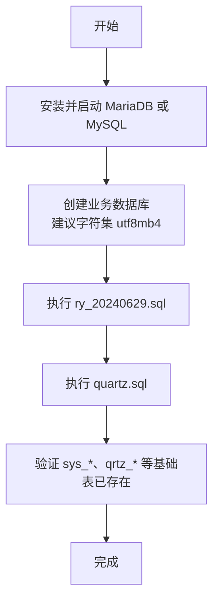
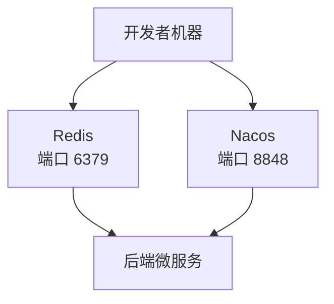
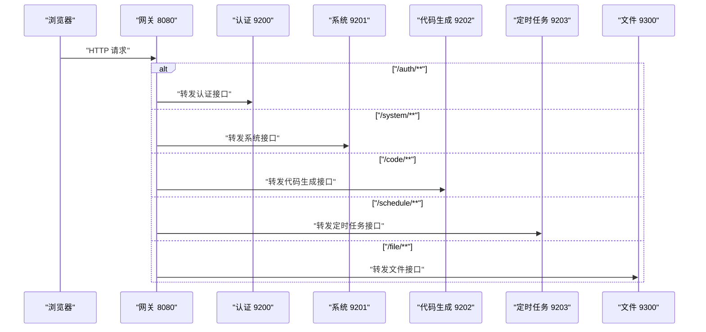
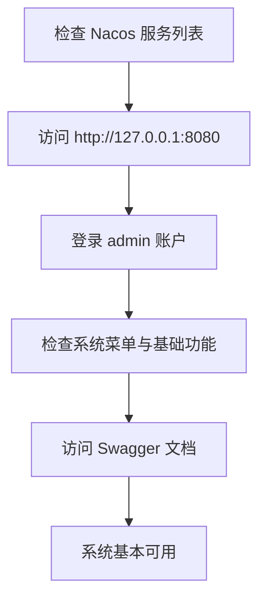

# 快速开始

<cite>
**本文引用的文件**   
- [zealux-ai-master/README.md](file://zealux-ai-master/README.md)
- [zealux-ai-master/pom.xml](file://zealux-ai-master/pom.xml)
- [zealux-ai-ui-master/package.json](file://zealux-ai-ui-master/package.json)
- [启动脚本 start-all.ps1](file://_setup/start-all.ps1)
- [Maven 镜像配置 maven-settings.xml](file://_setup/maven-settings.xml)
- [网关引导配置 bootstrap.yml](file://zealux-ai-master/zealux-ai-gateway/src/main/resources/bootstrap.yml)
- [认证服务引导配置 bootstrap.yml](file://zealux-ai-master/zealux-ai-auth/src/main/resources/bootstrap.yml)
- [系统服务引导配置 bootstrap.yml](file://zealux-ai-master/zealux-ai-modules/zealux-ai-system/src/main/resources/bootstrap.yml)
- [代码生成服务引导配置 bootstrap.yml](file://zealux-ai-master/zealux-ai-modules/zealux-ai-gen/src/main/resources/bootstrap.yml)
- [定时任务服务引导配置 bootstrap.yml](file://zealux-ai-master/zealux-ai-modules/zealux-ai-job/src/main/resources/bootstrap.yml)
- [文件服务引导配置 bootstrap.yml](file://zealux-ai-master/zealux-ai-modules/zealux-ai-file/src/main/resources/bootstrap.yml)
- [Nacos 共享配置 application-dev.yml](file://_setup/stack/nacos/nacos/data/config-data/DEFAULT_GROUP/application-dev.yml)
- [Nacos 系统服务配置 zealux-ai-system-dev.yml](file://_setup/stack/nacos/nacos/data/config-data/DEFAULT_GROUP/zealux-ai-system-dev.yml)
- [Nacos 认证服务配置 zealux-ai-auth-dev.yml](file://_setup/stack/nacos/nacos/data/config-data/DEFAULT_GROUP/zealux-ai-auth-dev.yml)
- [Nacos 网关路由配置 zealux-ai-gateway-dev.yml](file://_setup/stack/nacos/nacos/data/config-data/DEFAULT_GROUP/zealux-ai-gateway-dev.yml)
- [Nacos 文件服务配置 zealux-ai-file-dev.yml](file://_setup/stack/nacos/nacos/data/config-data/DEFAULT_GROUP/zealux-ai-file-dev.yml)
</cite>

## 目录
1. [简介](#简介)
2. [环境要求与本地开发目录说明](#环境要求与本地开发目录说明)
3. [初始化数据库与 Quartz 表](#初始化数据库与-quartz-表)
4. [初始化 Nacos 配置](#初始化-nacos-配置)
5. [启动依赖服务](#启动依赖服务)
6. [编译后端 Maven 聚合工程](#编译后端-maven-聚合工程)
7. [依次启动后端服务](#依次启动后端服务)
8. [安装前端依赖并运行 Vue2 开发服务器](#安装前端依赖并运行-vue2-开发服务器)
9. [默认端口与关键配置清单](#默认端口与关键配置清单)
10. [验证系统可用](#验证系统可用)
11. [最小可运行路径：只启动 system 服务](#最小可运行路径只启动-system-服务)
12. [常见启动失败排查](#常见启动失败排查)
13. [结论](#结论)

## 简介
本仓库是开源 RuoYi-Cloud 的重命名二次开发产物。根 `pom.xml` 的 `artifactId=zealux-ai / version=3.6.5`，前端 `package.json` 名称仍是 `ruoyi@3.6.5`，多个后端服务的启动类仍沿用 `RuoYi*Application.java`，公共库子目录也保留了原框架命名。因此，在描述架构时应将其视为基于 RuoYi-Cloud 的微服务后台，而不是从零自研框架。

项目采用前后端分离：
- 后端基于 Spring Boot、Spring Cloud & Spring Cloud Alibaba，注册中心与配置中心使用 Nacos，权限认证使用 Redis。
- 前端基于 Vue2、Element UI，通过网关转发到各微服务。

**章节来源**
- [zealux-ai-master/README.md:1-60](file://zealux-ai-master/README.md#L1-L60)
- [zealux-ai-master/pom.xml:1-40](file://zealux-ai-master/pom.xml#L1-L40)
- [zealux-ai-ui-master/package.json:1-15](file://zealux-ai-ui-master/package.json#L1-L15)

## 环境要求与本地开发目录说明
### 推荐环境
| 组件 | 版本 | 说明 |
|---|---|---|
| JDK | 17 | 后端构建与运行要求 Java 17 |
| Maven | 3.9.9 | 构建聚合工程 `zealux-ai` |
| MariaDB / MySQL | 11.4.4 或兼容版本 | 业务数据库与 Quartz 调度表 |
| Redis | 任意可连接版本 | 缓存、验证码、会话等；若部署 AI 相关能力需要 RediSearch |
| Nacos | 单机模式 | 服务注册与配置中心，默认端口 8848 |
| Node.js | 8.9 或以上 | 前端 Vue2 开发服务器 |
| npm | 3.0 或以上 | 前端依赖管理 |

后端根 `pom.xml` 声明了 `java.version=17`，并引入 Spring Boot 3.3.5、Spring Cloud 2023.0.3、Spring Cloud Alibaba 2023.0.1.2 等依赖。前端 `package.json` 明确依赖 `vue@2.6.12`、`element-ui@2.15.14`、`vue-cli-service@4.4.6`，属于 Vue2 + Element UI 的管理后台。

### _setup 目录的定位
`_setup` 目录下包含：
- `_setup/sql/ry_20240629.sql`、`quartz.sql`、`ry_config_20240902.sql`：第三方初始化脚本。
- `_setup/stack/`：JDK、MariaDB、Maven、Nacos、Redis 的本地安装包与数据目录。
- `_setup/start-all.ps1`、`gateway-watch.ps1`、`maven-settings.xml`：Windows 下本地开发使用的启动脚本与 Maven 镜像配置。
- `_setup/logs/`、`_setup/data/`、`_setup/pnpm-store/`：运行日志、数据库数据、pnpm 包缓存等本地产物。

这些内容属于**本地开发环境产物**，不是仓库源码的一部分。文档中不应把 `_setup` 下的运行日志、Nacos 落盘副本、`gateway_config.yml`、`app.yml`、`cfg/gateway.yml`、`zealux-ai-gen-dev.yml` 等称为生产配置。对 Nacos 配置应统一以服务名和 dataId 名称引用；对网关路由应引用 `zealux-ai-gateway/src/main/resources/` 中的配置文件。

**章节来源**
- [zealux-ai-master/pom.xml:12-22](file://zealux-ai-master/pom.xml#L12-L22)
- [zealux-ai-ui-master/package.json:35-88](file://zealux-ai-ui-master/package.json#L35-L88)
- [启动脚本 start-all.ps1:1-71](file://_setup/start-all.ps1#L1-L71)
- [Maven 镜像配置 maven-settings.xml:1-10](file://_setup/maven-settings.xml#L1-L10)

## 初始化数据库与 Quartz 表
### 第一步：准备 MariaDB / MySQL
本地工作区使用了 MariaDB 11.4.4，但应用驱动配置使用的是 MySQL 驱动类，因此只要数据库兼容 MySQL 协议即可。建议使用 UTF-8 字符集，例如 `utf8mb4`，并在连接参数中使用 `characterEncoding=utf8`。

### 第二步：执行业务初始化 SQL
以具备创建库与建表权限的数据库管理员账号登录数据库，先执行 `ry_20240629.sql`，再执行 `quartz.sql`。这两个脚本分别用于初始化 RuoYi 业务表和 Quartz 定时任务表。

注意：
- `ry_20240629.sql` 与 `quartz.sql` 是本地环境中由 RuoYi-Cloud 与 Quartz 初始化的第三方脚本，不能直接等同于本项目完整的数据库设计文档。
- 本地实测数据库中不存在任何 `crm_` 前缀的表；此前讨论过的 CRM 建表方案并未在本工作区的数据库上执行。
- 不要将脚本内容粘贴进文档正文，也不要在配置中粘贴真实账号口令。



**章节来源**
- [启动脚本 start-all.ps1:15-23](file://_setup/start-all.ps1#L15-L23)
- [Nacos 系统服务配置 zealux-ai-system-dev.yml:10-33](file://_setup/stack/nacos/nacos/data/config-data/DEFAULT_GROUP/zealux-ai-system-dev.yml#L10-L33)

## 初始化 Nacos 配置
### 第三步：导入 Nacos 配置
Nacos 作为服务注册中心和配置中心，默认地址为 `http://127.0.0.1:8848`。本地 Nacos 的持久化配置位于 `_setup/stack/nacos/nacos/data/config-data/DEFAULT_GROUP/`。如果 Nacos 是通过该目录恢复的本地副本，则以下 dataId 已经存在：

| dataId | groupId | 作用 |
|---|---|---|
| `application-dev.yml` | `DEFAULT_GROUP` | 共享配置，包括 Feign、Sentinel、监控端点暴露等 |
| `zealux-ai-system-dev.yml` | `DEFAULT_GROUP` | 系统服务的 Redis、Druid、动态数据源、MyBatis、springdoc 配置 |
| `zealux-ai-auth-dev.yml` | `DEFAULT_GROUP` | 认证服务的 Redis 配置 |
| `zealux-ai-gateway-dev.yml` | `DEFAULT_GROUP` | 网关路由、验证码、XSS、忽略白名单、Sentinel 配置 |
| `zealux-ai-file-dev.yml` | `DEFAULT_GROUP` | 本地文件上传路径、FastDFS、MinIO 配置 |

如果从干净 Nacos 启动，则需要把上述 dataId 的内容按相同分组导入。不要把 `_setup` 下的 Nacos 落盘副本当作源码模块；正确做法是在 Nacos 控制台或通过脚本导入对应 dataId。

### 第四步：确认 Nacos 已就绪
Nacos 启动后，访问 `http://127.0.0.1:8848/nacos`，使用默认控制台账号登录，检查 `DEFAULT_GROUP` 下是否存在上述 dataId。

**章节来源**
- [Nacos 共享配置 application-dev.yml:1-35](file://_setup/stack/nacos/nacos/data/config-data/DEFAULT_GROUP/application-dev.yml#L1-L35)
- [Nacos 系统服务配置 zealux-ai-system-dev.yml:1-55](file://_setup/stack/nacos/nacos/data/config-data/DEFAULT_GROUP/zealux-ai-system-dev.yml#L1-L55)
- [Nacos 认证服务配置 zealux-ai-auth-dev.yml:1-5](file://_setup/stack/nacos/nacos/data/config-data/DEFAULT_GROUP/zealux-ai-auth-dev.yml#L1-L5)
- [Nacos 网关路由配置 zealux-ai-gateway-dev.yml:1-74](file://_setup/stack/nacos/nacos/data/config-data/DEFAULT_GROUP/zealux-ai-gateway-dev.yml#L1-L74)
- [Nacos 文件服务配置 zealux-ai-file-dev.yml:1-19](file://_setup/stack/nacos/nacos/data/config-data/DEFAULT_GROUP/zealux-ai-file-dev.yml#L1-L19)

## 启动依赖服务
### 第五步：启动 Redis
Redis 默认监听 `6379`。本地启动脚本会检测该端口是否被占用，未占用时启动 Redis。Redis 必须能够被本机上的 Java 服务连接。

若后续要运行 `zealux-ai-leads` 模块，还需要确保 Redis 安装了 RediSearch 模块。当前本地 Redis 缺少 RediSearch，因此该模块在当前环境下不可运行。

### 第六步：启动 Nacos
Nacos 默认端口 `8848`。本地脚本使用单机模式 `-Dnacos.standalone=true` 启动，并把 `JAVA_HOME` 指向 `_setup/stack/jdk17/jdk-17.0.21+9`。



**章节来源**
- [启动脚本 start-all.ps1:25-48](file://_setup/start-all.ps1#L25-L48)

## 编译后端 Maven 聚合工程
### 第七步：设置 Java 与 Maven
确保系统环境变量 `JAVA_HOME` 指向 JDK 17，且 `mvn` 命令对应 Maven 3.9.9。根 `pom.xml` 使用 `<java.version>17</java.version>`，因此低版本 JDK 无法编译。

### 第八步：选择 Maven 镜像
本地 `maven-settings.xml` 配置了阿里云公共仓库镜像，有助于在国内网络环境下拉取依赖。可以在构建时指定该 settings 文件：

```text
mvn -s _setup/maven-settings.xml -pl !zealux-ai-leads clean install
```

排除 `zealux-ai-leads` 是为了让“最小调试路径”更快完成，因为该模块在当前本地 Redis 环境下不可运行。如果不排除它，完整构建命令为：

```text
mvn -s _setup/maven-settings.xml clean install
```

构建成功后，各服务的 JAR 位于对应模块的 `target/` 目录下。

**章节来源**
- [zealux-ai-master/pom.xml:12-22](file://zealux-ai-master/pom.xml#L12-L22)
- [Maven 镜像配置 maven-settings.xml:1-10](file://_setup/maven-settings.xml#L1-L10)
- [启动脚本 start-all.ps1:50-66](file://_setup/start-all.ps1#L50-L66)

## 依次启动后端服务
后端服务通过 Nacos 注册发现，网关根据 Nacos 中的路由配置转发请求。本地启动脚本的启动顺序为：system → auth → gateway → gen → job → file。

### 第九步：启动 system 服务
system 服务默认端口 `9201`。它是许多其他功能的基础，因此优先启动。

### 第十步：启动 auth 服务
auth 服务默认端口 `9200`，负责认证与登录。

### 第十一步：启动 gateway 服务
gateway 服务默认端口 `8080`，是所有外部 HTTP 请求的统一入口。

### 第十二步：启动 gen、job、file 服务
- code 生成服务：端口 `9202`
- 定时任务服务：端口 `9203`
- 文件服务：端口 `9300`



**图表来源**
- [Nacos 网关路由配置 zealux-ai-gateway-dev.yml:9-42](file://_setup/stack/nacos/nacos/data/config-data/DEFAULT_GROUP/zealux-ai-gateway-dev.yml#L9-L42)
- [网关引导配置 bootstrap.yml:3-16](file://zealux-ai-master/zealux-ai-gateway/src/main/resources/bootstrap.yml#L3-L16)

**章节来源**
- [启动脚本 start-all.ps1:50-66](file://_setup/start-all.ps1#L50-L66)
- [认证服务引导配置 bootstrap.yml:3-16](file://zealux-ai-master/zealux-ai-auth/src/main/resources/bootstrap.yml#L3-L16)
- [系统服务引导配置 bootstrap.yml:3-16](file://zealux-ai-master/zealux-ai-modules/zealux-ai-system/src/main/resources/bootstrap.yml#L3-L16)
- [代码生成服务引导配置 bootstrap.yml:3-16](file://zealux-ai-master/zealux-ai-modules/zealux-ai-gen/src/main/resources/bootstrap.yml#L3-L16)
- [定时任务服务引导配置 bootstrap.yml:3-16](file://zealux-ai-master/zealux-ai-modules/zealux-ai-job/src/main/resources/bootstrap.yml#L3-L16)
- [文件服务引导配置 bootstrap.yml:3-16](file://zealux-ai-master/zealux-ai-modules/zealux-ai-file/src/main/resources/bootstrap.yml#L3-L16)

## 安装前端依赖并运行 Vue2 开发服务器
前端源码应以独立仓库 `zealux-ai-ui-master` 为准。仓库内还有一份嵌入在后端的 `zealux-ai-master/zealux-ai-ui`，两者逐字节相同，但该目录不在根 `pom.xml` 的 `modules` 中，不参与后端构建，也不应被视为第二个前端模块。

### 第十三步：进入前端目录
```text
cd zealux-ai-ui-master
```

### 第十四步：安装依赖
推荐使用 pnpm 或 npm 安装依赖。由于本地工作区已有 `pnpm-lock.yaml`，如果使用 pnpm，可执行：

```text
pnpm install
```

如果使用 npm：

```text
npm install
```

### 第十五步：启动开发服务器
默认开发脚本为 `npm run dev`，即 `vue-cli-service serve`。本地脚本还会尝试在端口 `8081` 启动前端开发服务器。如果希望自定义端口，可以传入环境变量：

```text
set port=8081
npm run dev
```

前端启动后，通常访问 `http://localhost:8081`。

**章节来源**
- [zealux-ai-ui-master/package.json:5-13](file://zealux-ai-ui-master/package.json#L5-L13)
- [zealux-ai-ui-master/package.json:35-88](file://zealux-ai-ui-master/package.json#L35-L88)
- [启动脚本 start-all.ps1:68-71](file://_setup/start-all.ps1#L68-L71)

## 默认端口与关键配置清单
### 服务端口
| 服务 | 默认端口 | 主要用途 |
|---|---:|---|
| Nacos | 8848 | 服务注册与配置中心 |
| MariaDB / MySQL | 3306 | 业务数据库与 Quartz |
| Redis | 6379 | 缓存、验证码、会话 |
| 网关 gateway | 8080 | 外部请求入口 |
| 认证 auth | 9200 | 登录、鉴权 |
| 系统 system | 9201 | 用户、角色、菜单、字典等基础能力 |
| 代码生成 gen | 9202 | 前后端代码生成 |
| 定时任务 job | 9203 | 定时任务调度 |
| 文件服务 file | 9300 | 文件上传与访问 |
| 前端开发服务器 | 8081（本地脚本默认） | Vue2 开发调试 |

### Nacos 地址
所有后端服务的引导配置中，Nacos 的注册与配置地址均为 `127.0.0.1:8848`。

### 数据库连接
系统服务的 Nacos 配置中包含动态数据源的主库配置：
- 驱动类：`com.mysql.cj.jdbc.Driver`
- URL：指向 `127.0.0.1:3306` 的 `zealux-ai-cloud` 数据库
- 用户名与密码：本地配置中为占位示例，实际部署时应替换为安全凭据

### Redis 配置
认证服务和系统服务都通过 Nacos 配置 Redis：
- host：`127.0.0.1`
- port：`6379`
- password：本地配置为空

### 网关路由
网关只配置了 5 条前缀路由：
- `/auth/**` → `zealux-ai-auth`
- `/system/**` → `zealux-ai-system`
- `/code/**` → `zealux-ai-gen`
- `/schedule/**` → `zealux-ai-job`
- `/file/**` → `zealux-ai-file`

不存在 `/leads/**` 或任何 CRM 路由。

**章节来源**
- [网关引导配置 bootstrap.yml:3-16](file://zealux-ai-master/zealux-ai-gateway/src/main/resources/bootstrap.yml#L3-L16)
- [认证服务引导配置 bootstrap.yml:3-16](file://zealux-ai-master/zealux-ai-auth/src/main/resources/bootstrap.yml#L3-L16)
- [系统服务引导配置 bootstrap.yml:3-16](file://zealux-ai-master/zealux-ai-modules/zealux-ai-system/src/main/resources/bootstrap.yml#L3-L16)
- [代码生成服务引导配置 bootstrap.yml:3-16](file://zealux-ai-master/zealux-ai-modules/zealux-ai-gen/src/main/resources/bootstrap.yml#L3-L16)
- [定时任务服务引导配置 bootstrap.yml:3-16](file://zealux-ai-master/zealux-ai-modules/zealux-ai-job/src/main/resources/bootstrap.yml#L3-L16)
- [文件服务引导配置 bootstrap.yml:3-16](file://zealux-ai-master/zealux-ai-modules/zealux-ai-file/src/main/resources/bootstrap.yml#L3-L16)
- [Nacos 系统服务配置 zealux-ai-system-dev.yml:10-33](file://_setup/stack/nacos/nacos/data/config-data/DEFAULT_GROUP/zealux-ai-system-dev.yml#L10-L33)
- [Nacos 认证服务配置 zealux-ai-auth-dev.yml:1-5](file://_setup/stack/nacos/nacos/data/config-data/DEFAULT_GROUP/zealux-ai-auth-dev.yml#L1-L5)
- [Nacos 网关路由配置 zealux-ai-gateway-dev.yml:9-42](file://_setup/stack/nacos/nacos/data/config-data/DEFAULT_GROUP/zealux-ai-gateway-dev.yml#L9-L42)

## 验证系统可用
### 步骤一：检查 Nacos
访问 `http://127.0.0.1:8848/nacos`，确认控制台可登录，并查看服务列表中是否出现 `zealux-ai-gateway`、`zealux-ai-auth`、`zealux-ai-system` 等服务。

### 步骤二：检查网关
访问 `http://127.0.0.1:8080`。如果返回网关默认响应或空白页面，说明网关已成功启动并能解析服务。

### 步骤三：登录 admin 账户
admin 账户信息属于本地凭据，不应在此处公开。请查阅本地凭据记录或数据库初始化脚本中的用户数据。登录后，可在系统菜单中查看用户、角色、菜单、字典等功能是否正常。

### 步骤四：查看 Swagger 文档
网关路由忽略列表中包含 `/swagger-ui/**`、`/swagger-resources/**`、`/v3/api-docs/**`，系统服务的 springdoc 也已启用。可通过网关访问 Swagger 文档：

```text
http://127.0.0.1:8080/swagger-ui.html
```

如果 Swagger 页面不可用，先确认 system 服务已启动，并检查 Nacos 中 `zealux-ai-system-dev.yml` 的 springdoc 配置。



**章节来源**
- [Nacos 网关路由配置 zealux-ai-gateway-dev.yml:44-74](file://_setup/stack/nacos/nacos/data/config-data/DEFAULT_GROUP/zealux-ai-gateway-dev.yml#L44-L74)
- [Nacos 系统服务配置 zealux-ai-system-dev.yml:35-55](file://_setup/stack/nacos/nacos/data/config-data/DEFAULT_GROUP/zealux-ai-system-dev.yml#L35-L55)

## 最小可运行路径：只启动 system 服务
如果只想快速调试 system 服务，可以跳过完整服务链，只启动必要依赖和 system 本身。

### 前提条件
1. MariaDB / MySQL 已启动并可连接。
2. Redis 已启动并可连接。
3. Nacos 已启动，并且 `DEFAULT_GROUP` 下已存在 `zealux-ai-system-dev.yml`。
4. 已通过 `mvn -s _setup/maven-settings.xml -pl !zealux-ai-leads clean install` 编译出 system 服务 JAR。

### 启动命令
```text
java -jar zealux-ai-master/zealux-ai-modules/zealux-ai-system/target/zealux-ai-modules-system.jar
```

system 服务启动后会向 Nacos 注册自己，并读取 `zealux-ai-system-dev.yml` 中的 Redis、数据源、MyBatis 与 springdoc 配置。此时可以直接访问 system 服务自身的 Swagger 文档，例如：

```text
http://127.0.0.1:9201/swagger-ui.html
```

注意：该最小路径不包含网关和前端，因此不能走 `http://127.0.0.1:8080/system/**` 的路由转发。如果需要前端联调，再补充启动 gateway 和 frontend。

**章节来源**
- [系统服务引导配置 bootstrap.yml:3-16](file://zealux-ai-master/zealux-ai-modules/zealux-ai-system/src/main/resources/bootstrap.yml#L3-L16)
- [Nacos 系统服务配置 zealux-ai-system-dev.yml:1-55](file://_setup/stack/nacos/nacos/data/config-data/DEFAULT_GROUP/zealux-ai-system-dev.yml#L1-L55)

## 常见启动失败排查
### 端口冲突
**现象**：服务启动后立即退出，或日志中出现端口已被占用错误。  
**排查**：
- 使用 `netstat` 或任务管理器检查 3306、6379、8848、8080、9200、9201、9202、9203、9300、8081 等端口。
- 如果本地脚本已启动过旧进程，先关闭再重启。
- 修改端口时，需要同步更新对应服务的 `server.port` 和 Nacos 中的路由或服务发现地址。

**章节来源**
- [启动脚本 start-all.ps1:15-71](file://_setup/start-all.ps1#L15-L71)

### Nacos 连接失败
**现象**：服务启动时报 Nacos 连接超时、无法注册服务、找不到配置。  
**排查**：
- 确认 Nacos 控制台 `http://127.0.0.1:8848/nacos` 可访问。
- 确认各服务 `bootstrap.yml` 中 `spring.cloud.nacos.discovery.server-addr` 与 `config.server-addr` 指向正确的 Nacos 地址。
- 确认 Nacos 中已导入 `application-dev.yml` 和各服务的 `*-dev.yml`。
- 检查防火墙或代理是否拦截 8848 端口。

**章节来源**
- [网关引导配置 bootstrap.yml:9-16](file://zealux-ai-master/zealux-ai-gateway/src/main/resources/bootstrap.yml#L9-L16)
- [认证服务引导配置 bootstrap.yml:9-16](file://zealux-ai-master/zealux-ai-auth/src/main/resources/bootstrap.yml#L9-L16)
- [系统服务引导配置 bootstrap.yml:9-16](file://zealux-ai-master/zealux-ai-modules/zealux-ai-system/src/main/resources/bootstrap.yml#L9-L16)
- [Nacos 共享配置 application-dev.yml:1-35](file://_setup/stack/nacos/nacos/data/config-data/DEFAULT_GROUP/application-dev.yml#L1-L35)

### Redis 缺少 RediSearch
**现象**：AI 相关能力报错，提示 Redis 缺少相应模块。  
**排查**：
- 确认 Redis 已启动并可连接。
- 若使用 `zealux-ai-leads`，需要 Redis 安装 RediSearch。
- 本地 Redis 当前缺少 RediSearch，因此该模块不可运行。若不需要 leads 模块，可继续调试 system、auth、gateway 等其他服务。

**章节来源**
- [启动脚本 start-all.ps1:25-31](file://_setup/start-all.ps1#L25-L31)

### MySQL 字符集错误
**现象**：插入中文或特殊字符时报编码错误，或连接字符串中的字符集不匹配。  
**排查**：
- 检查数据库实例字符集是否为 `utf8mb4`。
- 检查连接 URL 中是否包含 `characterEncoding=utf8`。
- 检查 `zealux-ai-system-dev.yml` 中主库 URL 是否指向正确的数据库名、用户名和密码。

**章节来源**
- [Nacos 系统服务配置 zealux-ai-system-dev.yml:16-33](file://_setup/stack/nacos/nacos/data/config-data/DEFAULT_GROUP/zealux-ai-system-dev.yml#L16-L33)

### 前端 devServer 跨域
**现象**：前端能打开页面，但调用后端接口报跨域错误或 404。  
**排查**：
- 确认前端访问的是网关地址，而不是直接访问某个后端服务端口。
- 确认 Nacos 中 `zealux-ai-gateway-dev.yml` 的路由配置与实际服务端口一致。
- 确认前端开发服务器监听的端口与浏览器访问地址一致。
- 检查 `zealux-ai-system-dev.yml` 中 springdoc 的 `gatewayUrl` 是否与网关地址一致。

**章节来源**
- [Nacos 网关路由配置 zealux-ai-gateway-dev.yml:9-42](file://_setup/stack/nacos/nacos/data/config-data/DEFAULT_GROUP/zealux-ai-gateway-dev.yml#L9-L42)
- [Nacos 系统服务配置 zealux-ai-system-dev.yml:35-55](file://_setup/stack/nacos/nacos/data/config-data/DEFAULT_GROUP/zealux-ai-system-dev.yml#L35-L55)
- [启动脚本 start-all.ps1:68-71](file://_setup/start-all.ps1#L68-L71)

### 前端无法访问后端 API
**现象**：前端登录失败、菜单加载失败。  
**排查**：
- 确认 gateway、auth、system 都已启动并注册到 Nacos。
- 确认前端代理或请求地址指向 `http://127.0.0.1:8080`。
- 确认网关忽略白名单中包含 `/auth/login`、`/auth/captchaImage` 等登录相关路径。
- 检查浏览器控制台是否有 CORS、401、404 或网关 502 错误。

**章节来源**
- [Nacos 网关路由配置 zealux-ai-gateway-dev.yml:44-74](file://_setup/stack/nacos/nacos/data/config-data/DEFAULT_GROUP/zealux-ai-gateway-dev.yml#L44-L74)

## 结论
从零部署本系统的核心顺序是：安装 JDK 17 与 Maven 3.9.9，启动 MariaDB / MySQL 和 Redis，初始化 `ry_20240629.sql` 与 `quartz.sql`，再初始化 Nacos 配置，然后依次启动 Nacos、Redis、system、auth、gateway、gen、job、file，最后安装前端依赖并运行 Vue2 开发服务器。

部署时应严格区分两类内容：
- 仓库源码：`zealux-ai-master` 与 `zealux-ai-ui-master`。
- 本地开发环境产物：`_setup` 下的脚本、工具、Nacos 落盘副本、日志与缓存。

对于敏感信息，一律使用占位形式，不要在文档中粘贴真实账号、口令、token 或 api-key。若只需要快速调试，优先使用“只启动 system 服务”的最小路径；若要体验完整流程，则按网关 → 认证 → 系统 → 代码生成 → 定时任务 → 文件服务的顺序启动后端，再启动前端。