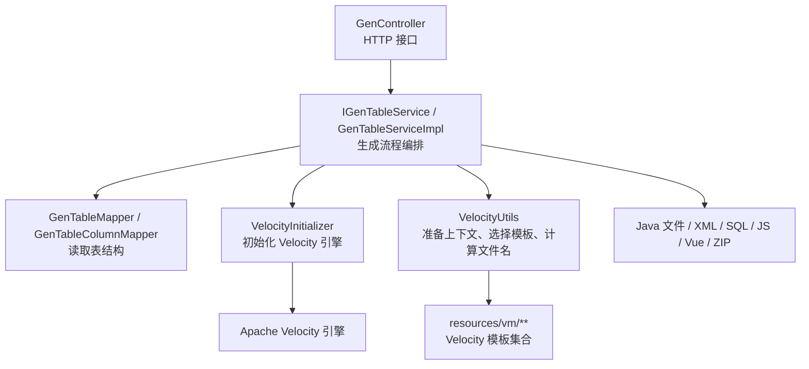
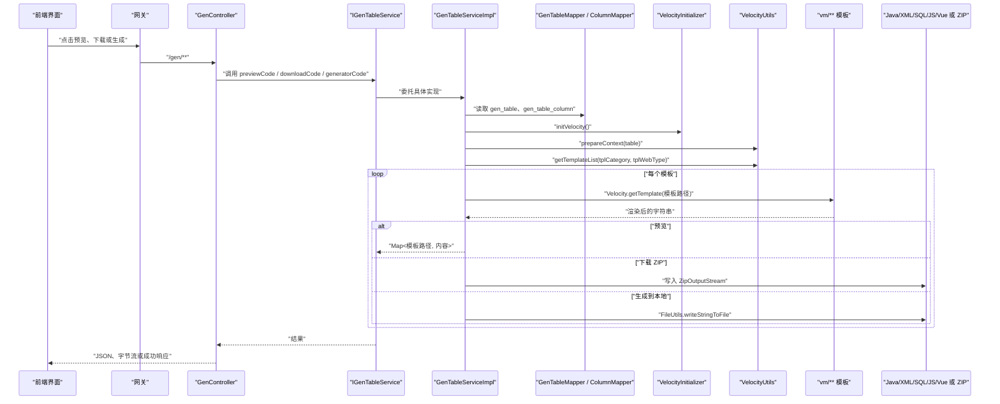
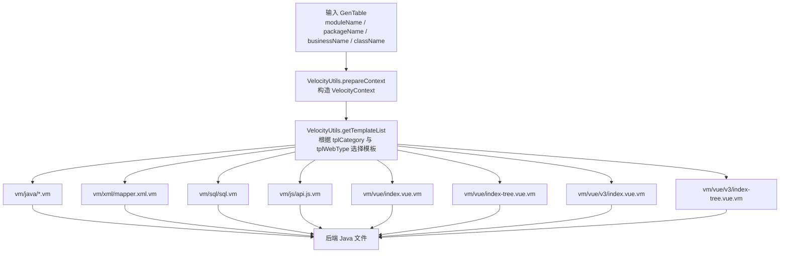

# 修改代码生成模板

<cite>
**本文引用的文件**   
- [GenController.java](file://zealux-ai-master/zealux-ai-modules/zealux-ai-gen/src/main/java/com/zealux/gen/controller/GenController.java)
- [IGenTableService.java](file://zealux-ai-master/zealux-ai-modules/zealux-ai-gen/src/main/java/com/zealux/gen/service/IGenTableService.java)
- [GenTableServiceImpl.java](file://zealux-ai-master/zealux-ai-modules/zealux-ai-gen/src/main/java/com/zealux/gen/service/GenTableServiceImpl.java)
- [VelocityUtils.java](file://zealux-ai-master/zealux-ai-modules/zealux-ai-gen/src/main/java/com/zealux/gen/util/VelocityUtils.java)
- [VelocityInitializer.java](file://zealux-ai-master/zealux-ai-modules/zealux-ai-gen/src/main/java/com/zealux/gen/util/VelocityInitializer.java)
- [GenConfig.java](file://zealux-ai-master/zealux-ai-modules/zealux-ai-gen/src/main/java/com/zealux/gen/config/GenConfig.java)
- [domain.java.vm](file://zealux-ai-master/zealux-ai-modules/zealux-ai-gen/src/main/resources/vm/java/domain.java.vm)
- [mapper.java.vm](file://zealux-ai-master/zealux-ai-modules/zealux-ai-gen/src/main/resources/vm/java/mapper.java.vm)
- [service.java.vm](file://zealux-ai-master/zealux-ai-modules/zealux-ai-gen/src/main/resources/vm/java/service.java.vm)
- [serviceImpl.java.vm](file://zealux-ai-master/zealux-ai-modules/zealux-ai-gen/src/main/resources/vm/java/serviceImpl.java.vm)
- [controller.java.vm](file://zealux-ai-master/zealux-ai-modules/zealux-ai-gen/src/main/resources/vm/java/controller.java.vm)
- [sub-domain.java.vm](file://zealux-ai-master/zealux-ai-modules/zealux-ai-gen/src/main/resources/vm/java/sub-domain.java.vm)
- [mapper.xml.vm](file://zealux-ai-master/zealux-ai-modules/zealux-ai-gen/src/main/resources/vm/xml/mapper.xml.vm)
- [sql.vm](file://zealux-ai-master/zealux-ai-modules/zealux-ai-gen/src/main/resources/vm/sql/sql.vm)
- [api.js.vm](file://zealux-ai-master/zealux-ai-modules/zealux-ai-gen/src/main/resources/vm/js/api.js.vm)
- [index.vue.vm](file://zealux-ai-master/zealux-ai-modules/zealux-ai-gen/src/main/resources/vm/vue/index.vue.vm)
- [index-tree.vue.vm](file://zealux-ai-master/zealux-ai-modules/zealux-ai-gen/src/main/resources/vm/vue/index-tree.vue.vm)
- [v3/index.vue.vm](file://zealux-ai-master/zealux-ai-modules/zealux-ai-gen/src/main/resources/vm/vue/v3/index.vue.vm)
- [v3/index-tree.vue.vm](file://zealux-ai-master/zealux-ai-modules/zealux-ai-gen/src/main/resources/vm/vue/v3/index-tree.vue.vm)
</cite>

## 目录

1. [引言](#引言)
2. [项目结构与模板定位](#项目结构与模板定位)
3. [核心职责边界：GenController 与 IGenTableService](#核心职责边界gencontroller--与-igentableservice)
4. [从数据库表到前后端文件的完整生成链路](#从数据库表到前后端文件的完整生成链路)
5. [Velocity 模板体系与关键变量](#velocity-模板体系与关键变量)
6. [按目标修改模板的实操指南](#按目标修改模板的实操指南)
7. [重新生成、下载 ZIP 与替换已有代码的流程](#重新生成下载-zip-与替换已有代码的流程)
8. [模板调试建议](#模板调试建议)
9. [版本兼容性与注意事项](#版本兼容性与注意事项)
10. [常见问题排查](#常见问题排查)
11. [总结](#总结)

## 引言

本指南面向需要修改 RuoYi-Cloud 代码生成器行为的技术人员。该系统是开源 RuoYi-Cloud 3.6.5 的重命名二次开发，根 Maven 模块为 `zealux-ai`、版本 `3.6.5`；前端源码以独立仓库 `zealux-ai-ui-master` 为准，而 `zealux-ai-master/zealux-ai-ui` 是同一份源码的重复拷贝，不参与构建。

代码生成器的核心能力不是手工编写业务接口，而是根据数据库中已配置的表结构信息，自动产出后端 Java 实体、Mapper、Service、Controller 和前端 Vue 页面、API 调用脚本。因此，修改模板的本质是调整“数据库元数据 → Velocity 上下文 → Velocity 模板 → 最终代码文件”这一流水线。

## 项目结构与模板定位

代码生成器位于 `zealux-ai-modules/zealux-ai-gen` 模块中，主要涉及三类文件：

| 类别 | 位置 | 作用 |
|---|---|---|
| 控制器入口 | `zealux-ai-modules/zealux-ai-gen/src/main/java/com/zealux/gen/controller/GenController.java` | 暴露 `/gen/**` 操作接口，接收预览、下载、生成、同步等请求 |
| 服务层 | `zealux-ai-modules/zealux-ai-gen/src/main/java/com/zealux/gen/service/IGenTableService.java` 与其实现类 | 封装表结构读取、校验、Velocity 渲染、ZIP 打包与本地写盘逻辑 |
| Velocity 模板 | `zealux-ai-modules/zealux-ai-gen/src/main/resources/vm/**` | 定义后端 Java、XML、SQL、JS 与前端 Vue 的代码结构 |
| 模板工具 | `util/VelocityUtils.java`、`util/VelocityInitializer.java` | 初始化 Velocity 引擎、构造模板上下文、选择模板列表与输出文件名 |
| 生成配置 | `config/GenConfig.java` | 提供作者、包名、表前缀、是否允许覆盖本地文件等运行时配置 |

**图表来源**
- [GenController.java:1-216](file://zealux-ai-master/zealux-ai-modules/zealux-ai-gen/src/main/java/com/zealux/gen/controller/GenController.java#L1-L216)
- [IGenTableService.java:1-121](file://zealux-ai-master/zealux-ai-modules/zealux-ai-gen/src/main/java/com/zealux/gen/service/IGenTableService.java#L1-L121)
- [GenTableServiceImpl.java:1-521](file://zealux-ai-master/zealux-ai-modules/zealux-ai-gen/src/main/java/com/zealux/gen/service/GenTableServiceImpl.java#L1-L521)
- [VelocityUtils.java:1-408](file://zealux-ai-master/zealux-ai-modules/zealux-ai-gen/src/main/java/com/zealux/gen/util/VelocityUtils.java#L1-L408)
- [VelocityInitializer.java:1-34](file://zealux-ai-master/zealux-ai-modules/zealux-ai-gen/src/main/java/com/zealux/gen/util/VelocityInitializer.java#L1-L34)

**章节来源**
- [GenController.java:1-216](file://zealux-ai-master/zealux-ai-modules/zealux-ai-gen/src/main/java/com/zealux/gen/controller/GenController.java#L1-L216)
- [VelocityUtils.java:130-224](file://zealux-ai-master/zealux-ai-modules/zealux-ai-gen/src/main/java/com/zealux/gen/util/VelocityUtils.java#L130-L224)
- [VelocityInitializer.java:17-33](file://zealux-ai-master/zealux-ai-modules/zealux-ai-gen/src/main/java/com/zealux/gen/util/VelocityInitializer.java#L17-L33)

## 核心职责边界：GenController 与 IGenTableService

### GenController：HTTP 路由与权限控制

`GenController` 是代码生成模块对外暴露的操作入口，所有生成相关请求都以 `/gen` 为根路径。它的主要职责包括：

- 接收前端对“代码生成列表、数据库表列表、字段列表、导入表结构、编辑保存、删除、预览、下载、生成到本地、同步数据库、批量生成”的请求。
- 使用 `@RequiresPermissions` 控制权限，例如 `tool:gen:list`、`tool:gen:query`、`tool:gen:import`、`tool:gen:edit`、`tool:gen:remove`、`tool:gen:preview`、`tool:gen:code`。
- 使用 `@Log` 记录导入、更新、删除、生成代码等操作日志。
- 不直接处理表结构查询或模板渲染，而是委托给 `IGenTableService` 与 `IGenTableColumnService`。

关键接口映射如下：

| 路径 | 方法 | 职责 |
|---|---|---|
| `/gen/list` | GET | 分页查询已配置的代码生成任务 |
| `/gen/{tableId}` | GET | 获取某个任务的详情、字段行与关联表 |
| `/gen/db/list` | GET | 分页查询数据库可导入的表 |
| `/gen/column/{tableId}` | GET | 查询某张表的字段信息 |
| `/gen/importTable` | POST | 导入数据库表结构并写入 `gen_table`、`gen_table_column` |
| `/gen` | PUT | 修改保存业务名称、包名、功能名、模板类型等生成参数 |
| `/gen/{tableIds}` | DELETE | 删除代码生成配置 |
| `/gen/preview/{tableId}` | GET | 预览生成的全部文件内容 |
| `/gen/download/{tableName}` | GET | 下载单个表的 ZIP 代码包 |
| `/gen/genCode/{tableName}` | GET | 将后端代码写到本地磁盘（受 `allowOverwrite` 控制） |
| `/gen/synchDb/{tableName}` | GET | 同步数据库表结构变更到生成配置 |
| `/gen/batchGenCode` | GET | 批量生成 ZIP 包 |

**章节来源**
- [GenController.java:1-216](file://zealux-ai-master/zealux-ai-modules/zealux-ai-gen/src/main/java/com/zealux/gen/controller/GenController.java#L1-L216)

### IGenTableService：生成流程编排与状态维护

`IGenTableService` 是代码生成服务的公开契约。它不包含 HTTP 注解，也不关心请求来自浏览器还是其他系统；它关注的是“给定一张表或一组表，如何把数据库元数据转换成代码”。

其核心方法分为四类：

| 分类 | 代表方法 | 职责 |
|---|---|---|
| 查询 | `selectGenTableList`、`selectDbTableList`、`selectGenTableById`、`selectGenTableAll` | 查询已配置任务、数据库表、单个任务 |
| 维护 | `updateGenTable`、`deleteGenTableByIds`、`importGenTable` | 更新生成配置、删除配置、导入表结构 |
| 生成 | `previewCode`、`downloadCode`、`generatorCode` | 预览、下载 ZIP、生成到本地磁盘 |
| 同步与校验 | `synchDb`、`validateEdit` | 同步数据库字段变化、校验树形或主子表配置 |

需要注意：**GenController 只负责把请求转发给 IGenTableService，真正的模板加载、Velocity 上下文构造、模板遍历、字节流与文件写入都在服务层完成。**

**章节来源**
- [IGenTableService.java:1-121](file://zealux-ai-master/zealux-ai-modules/zealux-ai-gen/src/main/java/com/zealux/gen/service/IGenTableService.java#L1-L121)

## 从数据库表到前后端文件的完整生成链路

### 整体流程图

**图表来源**
- [GenController.java:100-216](file://zealux-ai-master/zealux-ai-modules/zealux-ai-gen/src/main/java/com/zealux/gen/controller/GenController.java#L100-L216)
- [GenTableServiceImpl.java:200-521](file://zealux-ai-master/zealux-ai-modules/zealux-ai-gen/src/main/java/com/zealux/gen/service/GenTableServiceImpl.java#L200-L521)
- [VelocityUtils.java:130-224](file://zealux-ai-master/zealux-ai-modules/zealux-ai-gen/src/main/java/com/zealux/gen/util/VelocityUtils.java#L130-L224)
- [VelocityInitializer.java:17-33](file://zealux-ai-master/zealux-ai-modules/zealux-ai-gen/src/main/java/com/zealux/gen/util/VelocityInitializer.java#L17-L33)

### 关键阶段说明

1. **用户选择表并进入代码生成界面**  
   前端通过 `/gen/db/list` 拉取数据库表，或通过 `/gen/{tableId}` 拉取已保存的任务及其字段。

2. **导入表结构**  
   `/gen/importTable` 接收表名数组，调用 `selectDbTableListByNames` 获取数据库元数据，再调用 `importGenTable` 写入 `gen_table` 和 `gen_table_column`。这一步会把数据库列转换为生成器可用的 `GenTableColumn` 对象。

3. **预览代码**  
   `/gen/preview/{tableId}` 返回一个 Map，键是模板路径，值是渲染后的文本。这适合在浏览器中查看尚未落盘的代码。

4. **下载 ZIP**  
   `/gen/download/{tableName}` 调用 `downloadCode`，内部用 `ZipOutputStream` 把所有模板渲染结果打包成字节流返回。

5. **生成到本地**  
   `/gen/genCode/{tableName}` 会检查 `GenConfig.allowOverwrite`；如果未开启，直接拒绝。开启后，`generatorCode` 会跳过 SQL、JS 和部分 Vue 模板，把 Java、XML 等后端文件写入本地磁盘。

6. **同步数据库**  
   `/gen/synchDb/{tableName}` 比较 `gen_table_column` 与真实数据库列，新增、更新或删除字段，同时尽量保留用户之前设置的显示类型、必填项、字典类型等。

### 下载 ZIP 与生成到本地的差异

| 操作 | 输出目标 | 包含模板 | 适用场景 |
|---|---|---|---|
| 预览 | 内存中的 Map | 全部模板 | 调试模板、确认渲染结果 |
| 下载 ZIP | 浏览器下载的字节流 | 全部模板，包括 SQL、JS、Vue | 导出完整代码包 |
| 生成到本地 | 磁盘文件 | 排除 SQL、JS、部分 Vue，仅写 Java/XML 等后端文件 | 直接替换项目源码 |

**章节来源**
- [GenController.java:100-216](file://zealux-ai-master/zealux-ai-modules/zealux-ai-gen/src/main/java/com/zealux/gen/controller/GenController.java#L100-L216)
- [GenTableServiceImpl.java:200-521](file://zealux-ai-master/zealux-ai-modules/zealux-ai-gen/src/main/java/com/zealux/gen/service/GenTableServiceImpl.java#L200-L521)

## Velocity 模板体系与关键变量

### 模板位置

Velocity 模板统一位于 `zealux-ai-modules/zealux-ai-gen/src/main/resources/vm` 下。`VelocityInitializer` 使用 ClasspathResourceLoader 加载 classpath 下的 `.vm` 文件，因此部署时模板必须随模块一起编译进 `target/classes`。

模板目录与对应产物关系如下：

| 模板路径 | 生成目标 | 说明 |
|---|---|---|
| `vm/java/domain.java.vm` | 实体类 | 根据 `GenTableColumn` 生成属性、注释与常用注解 |
| `vm/java/mapper.java.vm` | MyBatis Mapper 接口 | 根据表名与类名生成接口 |
| `vm/java/service.java.vm` | Service 接口 | 通常继承公共基础接口 |
| `vm/java/serviceImpl.java.vm` | Service 实现类 | 包含 CRUD 实现 |
| `vm/java/controller.java.vm` | Spring Controller | 生成 REST 接口、权限、日志、分页等 |
| `vm/java/sub-domain.java.vm` | 主子表子实体 | 仅在 `tplCategory` 为主子表时生成 |
| `vm/xml/mapper.xml.vm` | MyBatis XML | 生成 SQL 映射 |
| `vm/sql/sql.vm` | 建表/初始化 SQL | 用于预览或导出，一般不直接覆盖业务库 |
| `vm/js/api.js.vm` | 前端 API 调用脚本 | 封装 axios 请求 |
| `vm/vue/index.vue.vm` | 普通表单列表页 | CRUD 或主子表模式 |
| `vm/vue/index-tree.vue.vm` | 树形列表页 | 树形菜单或层级数据 |
| `vm/vue/v3/index.vue.vm` | Element Plus Vue3 列表页 | 当 `tplWebType` 为 `element-plus` 时使用 |
| `vm/vue/v3/index-tree.vue.vm` | Element Plus Vue3 树形页 | 同上，但用于树形 |

**图表来源**
- [VelocityUtils.java:130-224](file://zealux-ai-master/zealux-ai-modules/zealux-ai-gen/src/main/java/com/zealux/gen/util/VelocityUtils.java#L130-L224)
- [VelocityInitializer.java:17-33](file://zealux-ai-master/zealux-ai-modules/zealux-ai-gen/src/main/java/com/zealux/gen/util/VelocityInitializer.java#L17-L33)

### VelocityContext 中的关键变量

`VelocityUtils.prepareContext` 是模板可访问变量的集中定义点。常见变量包括：

| 变量名 | 含义 | 常用于 |
|---|---|---|
| `tableName` | 数据库表名 | 生成类名前缀、包名、路径 |
| `className` / `classNameLower` | 实体类名与小写形式 | Java 类名、变量名 |
| `moduleName` | 模块名 | 分包路径、Vue 视图路径 |
| `packageName` / `basePackage` | 包名与包前缀 | import、注解包路径 |
| `businessName` / `BusinessName` | 业务名称 | Controller 路径、业务描述 |
| `functionName` | 功能名称 | 页面标题、注释 |
| `author` | 作者 | 类头注释 |
| `datetime` | 当前时间 | 类头注释 |
| `pkColumn` | 主键列 | 条件查询、ID 处理 |
| `columns` | 字段集合 | 循环生成属性、表单控件、校验规则 |
| `table` | 整个 `GenTable` | 模板中直接取表级配置 |
| `dicts` | 字典集合 | 下拉框、字典标签 |
| `parentMenuId` | 父菜单 ID | 菜单与权限前缀 |
| `treeCode` / `treeParentCode` / `treeName` | 树形字段 | 树形模板 |
| `subTable` / `subTableName` / `subTableFkName` | 主子表信息 | 主子表模板 |

模板中不应硬编码业务常量，而应优先使用这些上下文变量；如果需要新增变量，应在 `VelocityUtils.prepareContext` 中添加，而不是只在某个模板里局部赋值。

**章节来源**
- [VelocityUtils.java:20-128](file://zealux-ai-master/zealux-ai-modules/zealux-ai-gen/src/main/java/com/zealux/gen/util/VelocityUtils.java#L20-L128)

## 按目标修改模板的实操指南

### 修改实体类模板

如果要调整实体类的包名、字段注释、注解或 Lombok 使用方式，应修改 `vm/java/domain.java.vm`。

常见修改点：

- **包名与导入**：模板通常使用 `${packageName}`、`${basePackage}`、`${importList}`。若新增第三方依赖，可在 `VelocityUtils.importList` 中追加，或在模板中增加 import。
- **类注解**：如需添加 Swagger、MyBatis、审计或自定义注解，应放在类声明附近。
- **字段注解**：如 `@ApiModel`、`@ApiModelProperty`、`@Data`、`@TableField`、`@NotBlank`、`@NotNull` 等，应根据字段类型与业务规则插入。
- **主键策略**：参考 `pkColumn` 判断是否为主键，避免对非主键字段误用主键注解。
- **日期类型**：根据字段类型决定是否使用 `Date`、`LocalDateTime` 或格式化注解。

注意：不要直接改 `target/classes` 下的模板，应改源码目录中的 `src/main/resources/vm/java/domain.java.vm`，然后重新编译模块。

**章节来源**
- [domain.java.vm](file://zealux-ai-master/zealux-ai-modules/zealux-ai-gen/src/main/resources/vm/java/domain.java.vm)
- [VelocityUtils.java:20-128](file://zealux-ai-master/zealux-ai-modules/zealux-ai-gen/src/main/java/com/zealux/gen/util/VelocityUtils.java#L20-L128)

### 修改 Controller 模板

Controller 模板位于 `vm/java/controller.java.vm`。常见需求包括：

- **RequestMapping 路径**：通常由 `businessName` 或 `functionName` 决定。若需改为固定路径，应在此模板中调整。
- **Swagger 注解**：如 `@Api`、`@ApiOperation`、`@ApiParam`，应加在类与方法上。
- **权限前缀**：模板通常使用 `permissionPrefix`，来源于 `VelocityUtils.getPermissionPrefix(moduleName, businessName)`。
- **数据权限**：如 `@DataScope`，应在查询方法上加，确保列表查询自动附加数据权限过滤。
- **日志注解**：结合 `GenController` 中已有的 `@Log` 风格，在业务方法上添加操作日志。
- **分页参数**：确保列表查询继承或复用框架的分页逻辑。

如果新增的业务规则要求某些 Controller 方法必须带 `@DataScope`，应在模板中根据字段或业务名做条件判断，而不是在所有方法上都无条件添加。

**章节来源**
- [controller.java.vm](file://zealux-ai-master/zealux-ai-modules/zealux-ai-gen/src/main/resources/vm/java/controller.java.vm)
- [VelocityUtils.java:20-128](file://zealux-ai-master/zealux-ai-modules/zealux-ai-gen/src/main/java/com/zealux/gen/util/VelocityUtils.java#L20-L128)

### 修改 Service 与 ServiceImpl 模板

- `vm/java/service.java.vm` 生成 Service 接口。
- `vm/java/serviceImpl.java.vm` 生成 Service 实现类。

常见修改点：

- 是否需要注入额外依赖，如消息队列、外部服务、缓存。
- 是否在新增、更新、删除方法中加入事务、审计、幂等校验。
- 是否需要在 Service 层加入业务校验，而非只放在 Controller。
- 是否要复用公共 BaseService 或通用分页方法。
- 是否需要按租户、部门或数据范围组织查询。

注意：模板改动会影响所有后续生成的 Service，应优先保证向后兼容，避免为个别表引入强耦合分支。

**章节来源**
- [service.java.vm](file://zealux-ai-master/zealux-ai-modules/zealux-ai-gen/src/main/resources/vm/java/service.java.vm)
- [serviceImpl.java.vm](file://zealux-ai-master/zealux-ai-modules/zealux-ai-gen/src/main/resources/vm/java/serviceImpl.java.vm)

### 修改 Mapper 与 XML 模板

- `vm/java/mapper.java.vm` 生成 Mapper 接口。
- `vm/xml/mapper.xml.vm` 生成 MyBatis XML。

常见修改点：

- 是否使用分页插件、多数据源、读写分离。
- 是否需要根据业务表结构增加自定义 SQL。
- 是否需要在 XML 中增加软删除、版本控制、审计字段处理。
- 是否需要根据字段类型转换数据库类型与 Java 类型。

**章节来源**
- [mapper.java.vm](file://zealux-ai-master/zealux-ai-modules/zealux-ai-gen/src/main/resources/vm/java/mapper.java.vm)
- [mapper.xml.vm](file://zealux-ai-master/zealux-ai-modules/zealux-ai-gen/src/main/resources/vm/xml/mapper.xml.vm)

### 修改前端 API 调用模板

前端 API 模板位于 `vm/js/api.js.vm`。它通常会根据 `moduleName`、`businessName`、`className` 生成类似模块化的 JS 函数，供 Vue 页面调用。

常见修改点：

- API 基础路径，例如是否加 `/system`、`/business` 等前缀。
- 请求方法：GET、POST、PUT、DELETE。
- 参数命名：是否与后端 DTO 一致。
- 错误处理：是否统一包装 `AjaxResult` 或业务响应结构。
- 是否添加拦截器、鉴权头、重试机制。

如果前端存在两套源码，应以 `zealux-ai-ui-master/src/api` 为准；模板生成的 JS 应与该仓库的现有 API 风格保持一致。

**章节来源**
- [api.js.vm](file://zealux-ai-master/zealux-ai-modules/zealux-ai-gen/src/main/resources/vm/js/api.js.vm)

### 修改前端 Vue 页面模板

前端页面模板有两个分支：

- `vm/vue/index.vue.vm` 与 `vm/vue/index-tree.vue.vm`：适用于传统 Element UI 风格。
- `vm/vue/v3/index.vue.vm` 与 `vm/vue/v3/index-tree.vue.vm`：适用于 `element-plus` 的 Vue3 风格。

选择哪个分支由 `tplWebType` 决定：

| `tplWebType` | 使用的 Vue 模板 |
|---|---|
| 默认值 | `vm/vue/index.vue.vm` 或 `vm/vue/index-tree.vue.vm` |
| `element-plus` | `vm/vue/v3/index.vue.vm` 或 `vm/vue/v3/index-tree.vue.vm` |

常见修改点：

- **表单字段**：根据 `columns` 循环生成输入框、选择框、日期选择器、富文本等。
- **验证规则**：根据字段的必填、长度、正则、字典配置生成前端校验。
- **搜索栏**：根据查询类型生成查询条件。
- **按钮权限**：结合 `permissionPrefix` 控制新增、修改、删除、导出等按钮。
- **菜单与路由**：Vue 模板可能生成页面路径，但实际菜单注册应由系统菜单管理，不应仅靠模板。
- **组件引用**：如需要引入自定义组件，应保证模板中组件路径与 `zealux-ai-ui-master/src/components` 一致。

**章节来源**
- [index.vue.vm](file://zealux-ai-master/zealux-ai-modules/zealux-ai-gen/src/main/resources/vm/vue/index.vue.vm)
- [index-tree.vue.vm](file://zealux-ai-master/zealux-ai-modules/zealux-ai-gen/src/main/resources/vm/vue/index-tree.vue.vm)
- [v3/index.vue.vm](file://zealux-ai-master/zealux-ai-modules/zealux-ai-gen/src/main/resources/vm/vue/v3/index.vue.vm)
- [v3/index-tree.vue.vm](file://zealux-ai-master/zealux-ai-modules/zealux-ai-gen/src/main/resources/vm/vue/v3/index-tree.vue.vm)
- [VelocityUtils.java:130-159](file://zealux-ai-master/zealux-ai-modules/zealux-ai-gen/src/main/java/com/zealux/gen/util/VelocityUtils.java#L130-L159)

## 重新生成、下载 ZIP 与替换已有代码的流程

### 前置准备

1. 确认数据库中存在目标表，并已执行过“导入表结构”。
2. 在代码生成列表中打开该表，填写或确认以下字段：
   - 模块名 `moduleName`
   - 包名 `packageName`
   - 业务名 `businessName`
   - 功能名 `functionName`
   - 作者 `functionAuthor`
   - 模板类型 `tplCategory`：CRUD、树形、主子表
   - 前端类型 `tplWebType`：默认或 `element-plus`
   - 上级菜单、父子节点字段（树形模式）
   - 子表名与外键（主子表模式）
   - 生成路径 `genPath`：默认使用项目源码根目录下的相对路径。

### 步骤一：修改模板后重新编译

1. 修改 `src/main/resources/vm` 下的对应模板。
2. 在 `zealux-ai-modules/zealux-ai-gen` 模块中重新编译，使 `target/classes/vm` 与源码一致。
3. 重启 `zealux-ai-gen` 服务，确保 Velocity 引擎加载新模板。

### 步骤二：预览模板效果

1. 打开代码生成任务。
2. 点击“预览”。
3. 逐个查看实体类、Mapper、Service、Controller、XML、JS、Vue 的渲染结果。
4. 如发现字段缺失、注解错误或路径异常，回到模板修正，不要直接猜问题所在。

### 步骤三：下载 ZIP

1. 点击“生成代码”→“下载”。
2. 浏览器会收到一个 ZIP 文件。
3. 解压后检查：
   - Java 文件是否放入正确模块。
   - 包名是否与现有项目一致。
   - Controller 路径是否符合网关与服务约定。
   - Vue 页面路径是否与 `zealux-ai-ui-master/src/views` 一致。
   - API JS 是否被前端正确引用。

### 步骤四：替换已有代码

如果是“生成到本地”，则：

1. 确认 `GenConfig.allowOverwrite` 已启用。
2. 调用 `/gen/genCode/{tableName}`。
3. 根据 `VelocityUtils.getFileName` 计算出的路径找到生成的文件。
4. 手动或用版本控制系统覆盖已有代码。
5. 提交变更前，务必对比差异，避免误删手写业务逻辑。

注意：`generatorCode` 默认会跳过 SQL、JS、部分 Vue 模板，只写 Java/XML 等后端文件。如果需要同步前端，请使用“下载 ZIP”后再手动合并。

**章节来源**
- [GenController.java:140-216](file://zealux-ai-master/zealux-ai-modules/zealux-ai-gen/src/main/java/com/zealux/gen/controller/GenController.java#L140-L216)
- [GenTableServiceImpl.java:236-356](file://zealux-ai-master/zealux-ai-modules/zealux-ai-gen/src/main/java/com/zealux/gen/service/GenTableServiceImpl.java#L236-L356)
- [VelocityUtils.java:165-224](file://zealux-ai-master/zealux-ai-modules/zealux-ai-gen/src/main/java/com/zealux/gen/util/VelocityUtils.java#L165-L224)
- [GenConfig.java:1-79](file://zealux-ai-master/zealux-ai-modules/zealux-ai-gen/src/main/java/com/zealux/gen/config/GenConfig.java#L1-L79)

## 模板调试建议

### 使用预览模式

预览是最安全的调试方式。它不会写磁盘，也不会影响运行中的业务代码。建议每次模板改动都先预览，确认所有模板都符合预期后再下载 ZIP。

### 逐步缩小问题范围

- 如果实体类正常但 Controller 异常，优先检查 `controller.java.vm`。
- 如果后端正常但前端报错，优先检查 `api.js.vm` 与对应 Vue 模板。
- 如果 SQL 有问题，优先检查 `sql.vm` 和 `mapper.xml.vm`。
- 如果模板变量为空，检查 `VelocityUtils.prepareContext` 是否正确向 `VelocityContext` 写入。

### 检查模板变量来源

遇到模板无法解析的变量时，按以下顺序排查：

1. 变量是否在 `VelocityUtils.prepareContext` 中设置。
2. 变量是否属于 `GenTable`、`GenTableColumn`、`subTable` 等业务对象。
3. 变量是否只在特定 `tplCategory` 下可用，例如树形或主子表。
4. 模板是否使用了错误的变量名大小写。

### 区分模板路径与输出路径

`VelocityUtils.getTemplateList` 返回的是模板资源路径，例如 `vm/java/domain.java.vm`；  
`VelocityUtils.getFileName` 返回的是输出文件路径，例如 `main/java/com/.../domain/xxx.java`。  
不要把两者混淆：前者决定“读哪个模板”，后者决定“写到哪里”。

**章节来源**
- [VelocityUtils.java:130-224](file://zealux-ai-master/zealux-ai-modules/zealux-ai-gen/src/main/java/com/zealux/gen/util/VelocityUtils.java#L130-L224)
- [GenTableServiceImpl.java:200-235](file://zealux-ai-master/zealux-ai-modules/zealux-ai-gen/src/main/java/com/zealux/gen/service/GenTableServiceImpl.java#L200-L235)

## 版本兼容性与注意事项

### 继承自 RuoYi-Cloud 3.6.5

本项目是 RuoYi-Cloud 3.6.5 的重命名二次开发。文档中提到的架构、分层、注解风格、权限模型、菜单模型都应视为对 RuoYi-Cloud 的延续，而不是从零自研的系统。升级或迁移时应优先参考 RuoYi-Cloud 对应版本的变更，同时检查本项目的重命名差异。

### 前端源码以独立仓库为准

`zealux-ai-ui-master` 是权威前端源码；`zealux-ai-master/zealux-ai-ui` 是重复拷贝，不参与根 pom 的模块构建。修改前端模板时，应保证生成的内容与 `zealux-ai-ui-master/src` 的结构兼容。

### 没有 CRM 模块落地

工作区中没有 `crm_` 前缀的数据库表，也没有 CRM 模块、CRM 菜单或 CRM 网关路由。任何 CRM 相关设计都属于方案设想，不能当作已实现能力。模板修改不应假设存在 CRM 表或 CRM 接口。

### 模板加载机制

Velocity 使用 ClasspathResourceLoader 从 classpath 加载模板。这意味着：

- 模板必须存在于 `src/main/resources/vm`。
- 打包后模板会出现在 `target/classes/vm`。
- 修改模板后必须重新编译并重启服务。
- 不要在运行期期望动态热加载模板。

### 覆盖本地文件的风险

`/gen/genCode/{tableName}` 可以写本地磁盘，但受 `GenConfig.allowOverwrite` 控制。生产环境建议关闭覆盖，仅使用“下载 ZIP”人工合并，以避免自动化生成覆盖手写业务逻辑。

**章节来源**
- [VelocityInitializer.java:17-33](file://zealux-ai-master/zealux-ai-modules/zealux-ai-gen/src/main/java/com/zealux/gen/util/VelocityInitializer.java#L17-L33)
- [GenConfig.java:1-79](file://zealux-ai-master/zealux-ai-modules/zealux-ai-gen/src/main/java/com/zealux/gen/config/GenConfig.java#L1-L79)
- [GenController.java:170-216](file://zealux-ai-master/zealux-ai-modules/zealux-ai-gen/src/main/java/com/zealux/gen/controller/GenController.java#L170-L216)

## 常见问题排查

| 现象 | 可能原因 | 处理建议 |
|---|---|---|
| 预览时报模板不存在 | 模板路径不在 classpath，或未重新编译 | 检查 `src/main/resources/vm`，重新编译模块 |
| 生成的 Java 包名错误 | `packageName` 或 `moduleName` 配置不对 | 在代码生成任务中修正，或检查模板中对变量的使用 |
| Controller 缺少注解 | 模板未插入注解，或模板分支条件不满足 | 检查 `controller.java.vm` 及模板条件 |
| 前端页面找不到 API | `api.js.vm` 路径或函数名与 Vue 不一致 | 对照 `zealux-ai-ui-master/src/api` 风格修正模板 |
| Vue 模板样式不符合预期 | 选择了旧版 `vm/vue` 而非 `vm/vue/v3` | 将 `tplWebType` 改为 `element-plus`，或改用 v3 模板 |
| 下载 ZIP 中没有 Vue 文件 | “生成到本地”模式默认跳过部分前端模板 | 使用“下载 ZIP”，再手动合并前端文件 |
| 生成到本地失败 | `allowOverwrite` 未开启或路径无写权限 | 开启配置或改用下载 ZIP |
| 同步数据库后字段丢失 | 字段在数据库中被删除 | 确认是否真的要删除；必要时恢复备份 |
| 树形模板报缺少树编码 | 树形模式下未配置 `treeCode`、`treeParentCode`、`treeName` | 在任务配置中补全树形字段 |
| 主子表模板报缺少子表外键 | 未配置 `subTableName` 或 `subTableFkName` | 在主子表配置中补全 |

**章节来源**
- [GenTableServiceImpl.java:356-521](file://zealux-ai-master/zealux-ai-modules/zealux-ai-gen/src/main/java/com/zealux/gen/service/GenTableServiceImpl.java#L356-L521)
- [VelocityUtils.java:130-224](file://zealux-ai-master/zealux-ai-modules/zealux-ai-gen/src/main/java/com/zealux/gen/util/VelocityUtils.java#L130-L224)

## 总结

修改代码生成模板的核心原则是：

1. **明确职责边界**：`GenController` 负责 HTTP 接口与权限，`IGenTableService` 负责生成流程，`VelocityUtils` 负责模板上下文与模板选择，模板本身只负责代码结构。
2. **先预览再落盘**：模板调试优先使用预览，下载 ZIP 作为人工合并手段，谨慎使用“生成到本地”。
3. **优先改模板，不改业务代码**：模板修改影响所有后续生成，应保持通用性，避免为单表写死分支。
4. **变量驱动模板**：使用 `VelocityContext` 提供的变量，而不是硬编码表名、包名或路径。
5. **保持版本兼容**：承认本项目基于 RuoYi-Cloud 3.6.5，前端以独立仓库为准，不把尚未落地的 CRM 设想当成既有能力。

只要遵循上述边界与流程，就能安全地扩展实体类、Controller、Service、Mapper、Vue 页面与 API 调用的生成行为，同时降低模板变更带来的回归风险。