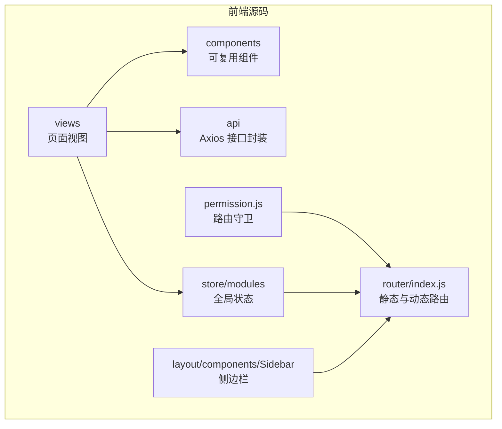
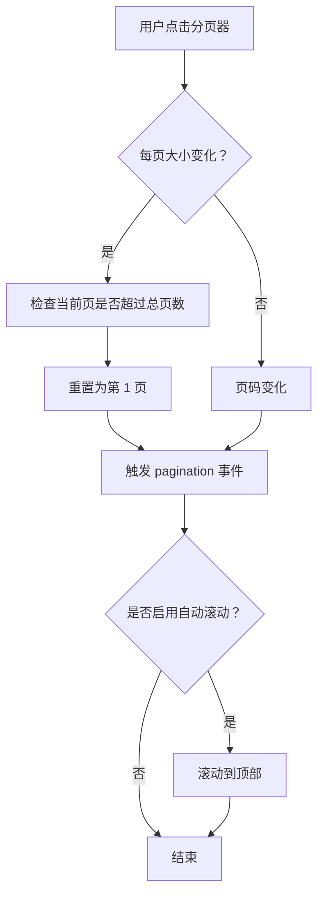
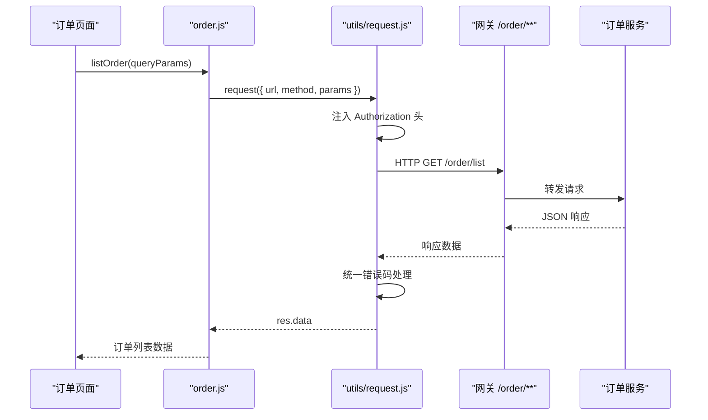
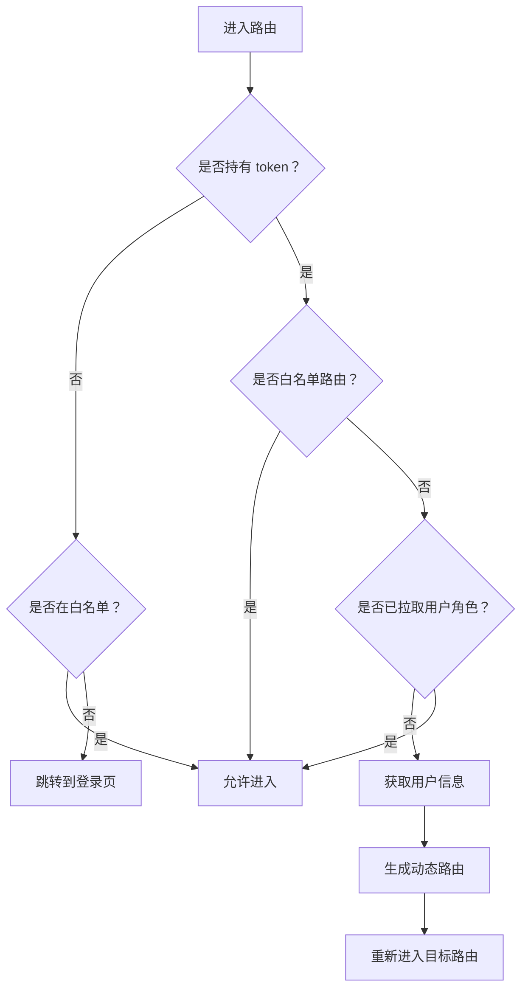
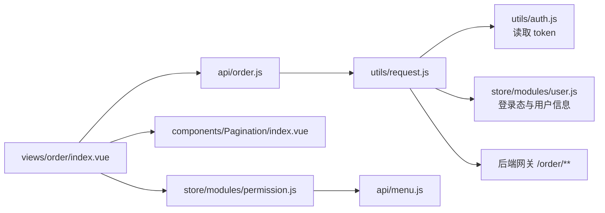
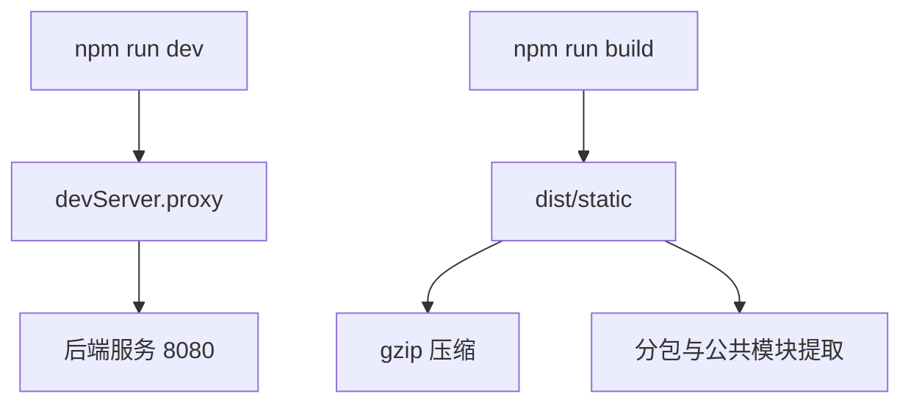

# 扩展前端组件与页面

<cite>
**本文引用的文件**   
- [zealux-ai-ui-master/src/components/Pagination/index.vue](file://zealux-ai-ui-master/src/components/Pagination/index.vue)
- [zealux-ai-ui-master/src/api/system/user.js](file://zealux-ai-ui-master/src/api/system/user.js)
- [zealux-ai-ui-master/src/store/modules/user.js](file://zealux-ai-ui-master/src/store/modules/user.js)
- [zealux-ai-ui-master/src/store/modules/permission.js](file://zealux-ai-ui-master/src/store/modules/permission.js)
- [zealux-ai-ui-master/src/router/index.js](file://zealux-ai-ui-master/src/router/index.js)
- [zealux-ai-ui-master/src/permission.js](file://zealux-ai-ui-master/src/permission.js)
- [zealux-ai-ui-master/src/utils/request.js](file://zealux-ai-ui-master/src/utils/request.js)
- [zealux-ai-ui-master/vue.config.js](file://zealux-ai-ui-master/vue.config.js)
- [zealux-ai-ui-master/src/views/system/user/index.vue](file://zealux-ai-ui-master/src/views/system/user/index.vue)
- [zealux-ai-ui-master/src/layout/components/Sidebar/SidebarItem.vue](file://zealux-ai-ui-master/src/layout/components/Sidebar/SidebarItem.vue)
</cite>

## 目录
1. [引言](#引言)
2. [项目结构定位](#项目结构定位)
3. [可复用组件开发规范](#可复用组件开发规范)
4. [分页组件实现分析](#分页组件实现分析)
5. [新增业务页面完整流程](#新增业务页面完整流程)
6. [菜单与路由配置](#菜单与路由配置)
7. [依赖关系与数据流](#依赖关系与数据流)
8. [性能与打包特征](#性能与打包特征)
9. [调试与常见问题](#调试与常见问题)
10. [结论](#结论)

## 引言
本指南面向在 zealux-ai-ui-master 中新增前端组件与业务页面的开发者。仓库中的前端源码存在两份完全相同的拷贝：独立仓库 `zealux-ai-ui-master`，以及后端工程内的 `zealux-ai-master/zealux-ai-ui`。构建时不参与根模块列表的嵌套拷贝不应被视为第二个前端模块；本文以后者为准，统一以 `zealux-ai-ui-master/src` 作为工作路径。

本项目是 RuoYi-Cloud 的前端二次开发产物，其前端采用 Vue 2 + Element UI + vue-router + Vuex 架构，并通过后端系统菜单动态生成路由、侧边栏与权限。因此，“新增页面”不仅是创建视图文件，还涉及 API 封装、Vuex 状态、路由注册、菜单配置和权限控制。

## 项目结构定位
需要重点关注的目录如下：

| 目录 | 职责 | 典型文件 |
|---|---|---|
| `src/components` | 可复用业务或展示组件 | `Pagination/index.vue`、`FileUpload/index.vue` |
| `src/views` | 页面级视图，通常按业务域分目录 | `system/user/index.vue`、`monitor/job/index.vue` |
| `src/api` | Axios 请求封装，通常一个后端模块对应一个 JS 文件 | `system/user.js`、`login.js` |
| `src/store/modules` | Vuex 模块，维护用户、权限、字典等全局状态 | `user.js`、`permission.js` |
| `src/router/index.js` | 静态路由与动态路由常量定义 | `constantRoutes`、`dynamicRoutes` |
| `src/permission.js` | 全局路由守卫，处理登录态、权限拦截与动态路由加载 | 路由前置守卫 |
| `vue.config.js` | 开发代理、端口、别名、分包等构建配置 | `devServer.proxy` |
| `src/layout/components/Sidebar/SidebarItem.vue` | 侧边栏菜单渲染逻辑 | 递归渲染子路由 |

**图表来源**
- [zealux-ai-ui-master/src/components/Pagination/index.vue:1-113](file://zealux-ai-ui-master/src/components/Pagination/index.vue#L1-L113)
- [zealux-ai-ui-master/src/router/index.js:1-183](file://zealux-ai-ui-master/src/router/index.js#L1-L183)
- [zealux-ai-ui-master/src/permission.js:1-63](file://zealux-ai-ui-master/src/permission.js#L1-L63)
- [zealux-ai-ui-master/src/store/modules/permission.js:1-122](file://zealux-ai-ui-master/src/store/modules/permission.js#L1-L122)

**章节来源**
- [zealux-ai-ui-master/src/router/index.js:1-183](file://zealux-ai-ui-master/src/router/index.js#L1-L183)
- [zealux-ai-ui-master/src/permission.js:1-63](file://zealux-ai-ui-master/src/permission.js#L1-L63)

## 可复用组件开发规范
在 `zealux-ai-ui-master/src/components` 下新建组件时，建议遵循以下约定：

| 维度 | 建议 |
|---|---|
| 目录命名 | 使用 PascalCase，如 `MyTable`、`SearchForm` |
| 入口文件 | 每个组件放在同名子目录下的 `index.vue` |
| Props | 使用显式 `type`、`default`、`required`，避免隐式类型推断 |
| 事件 | 通过 `$emit` 向父组件传递数据变更，不要直接修改父组件数据 |
| 样式 | 使用 `<style scoped>` 隔离样式；复杂主题可使用 CSS 变量或 BEM 命名 |
| 插槽 | 若需要插槽，应同时提供默认插槽与作用域插槽，并在文档中说明作用域字段 |
| 第三方依赖 | 尽量只依赖 Element UI、工具库与轻量库；业务重逻辑留在页面层 |
| 可测试性 | 暴露稳定 props、事件与计算属性，便于单元测试 |
| 命名 | `name` 字段用于调试栈与组件树识别，应与目录名一致 |

推荐组件契约表：

| 名称 | 类型 | 默认值 | 含义 |
|---|---|---:|---|
| `total` | Number | 必填 | 数据总量 |
| `page` | Number | `1` | 当前页码 |
| `limit` | Number | `20` | 每页条数 |
| `pageSizes` | Array | `[10,20,30,50]` | 可选每页大小 |
| `pagerCount` | Number | 响应式阈值 | 移动端与桌面端页码按钮数量不同 |
| `layout` | String | Element Pagination 布局字符串 | 控制分页器显示项 |
| `background` | Boolean | `true` | 是否使用背景色 |
| `autoScroll` | Boolean | `true` | 切换分页后是否滚动到顶部 |
| `hidden` | Boolean | `false` | 是否隐藏容器 |

**章节来源**
- [zealux-ai-ui-master/src/components/Pagination/index.vue:1-113](file://zealux-ai-ui-master/src/components/Pagination/index.vue#L1-L113)

## 分页组件实现分析
`Pagination/index.vue` 是对 Element UI `el-pagination` 的轻封装。它把分页相关状态集中在组件内部，并通过 `update:page`、`update:limit` 双向绑定父组件传入的 `page` 与 `limit`，同时通过 `pagination` 事件通知父组件发起查询。

### 关键设计点
1. **双向绑定**  
   - `currentPage` 计算属性的 getter 返回 `page`，setter 触发 `update:page`。  
   - `pageSize` 计算属性的 getter 返回 `limit`，setter 触发 `update:limit`。  
   这使得父组件可以使用 `.sync` 语法与分页器同步状态。

2. **事件契约**  
   - `size-change` 与 `current-change` 最终统一触发 `pagination` 事件，携带 `{ page, limit }`。  
   - 父组件监听该事件并调用查询函数，例如 `getList(queryParams)`。

3. **用户体验优化**  
   - 当改变每页大小导致当前页超出总页数时，自动回退到第 1 页。  
   - 切换分页后根据 `autoScroll` 调用 `scrollTo` 滚动到页面顶部，提升长列表体验。

4. **样式隔离**  
   - 使用 `scoped` 样式，仅影响自身容器；通过 `hidden` 类控制整体隐藏。

**图表来源**
- [zealux-ai-ui-master/src/components/Pagination/index.vue:1-113](file://zealux-ai-ui-master/src/components/Pagination/index.vue#L1-L113)

### 在页面中使用分页组件
现有用户管理页面展示了标准用法：
- 模板中使用 `<pagination>`，并将 `total`、`page.sync`、`limit.sync` 绑定到查询参数对象。
- 监听 `@pagination`，回调中重新调用列表查询方法。
- 分页器只在 `total > 0` 时显示，避免空数据出现无意义控件。

**章节来源**
- [zealux-ai-ui-master/src/components/Pagination/index.vue:1-113](file://zealux-ai-ui-master/src/components/Pagination/index.vue#L1-L113)
- [zealux-ai-ui-master/src/views/system/user/index.vue:1-200](file://zealux-ai-ui-master/src/views/system/user/index.vue#L1-L200)

## 新增业务页面完整流程
下面以一个“订单管理”页面为例，说明从后端接口到前端展示的完整步骤。实际项目中请替换领域名词与接口地址。

### 第一步：定义 API
在 `src/api/order.js` 中封装 Axios 请求。参考用户模块 `src/api/system/user.js` 的结构：

| 方法 | HTTP 方法 | URL | 用途 |
|---|---:|---|---|
| `listOrder(query)` | GET | `/order/list` | 分页查询订单 |
| `getOrder(id)` | GET | `/order/{id}` | 查询订单详情 |
| `addOrder(data)` | POST | `/order` | 新增订单 |
| `updateOrder(data)` | PUT | `/order` | 修改订单 |
| `deleteOrder(id)` | DELETE | `/order/{id}` | 删除订单 |

API 文件应保持“纯函数风格”，只负责构造请求参数与返回 Promise，不直接操作 DOM。

**章节来源**
- [zealux-ai-ui-master/src/api/system/user.js:1-136](file://zealux-ai-ui-master/src/api/system/user.js#L1-L136)

### 第二步：组织视图目录
在 `src/views/order/` 下创建 `index.vue`。如果页面包含多个弹窗或子功能，可在同目录下增加 `form.vue`、`detail.vue` 等文件，保持页面目录内聚。

典型页面状态包括：
- `queryParams`：查询条件，包含分页字段。
- `loading`：表格加载标志。
- `orderList`：列表数据。
- `total`：总数。
- `open`：表单对话框可见性。
- `form`：表单数据。
- `rules`：表单校验规则。

### 第三步：封装 Axios 请求
所有网络请求都经过 `src/utils/request.js` 创建的 axios 实例。它具备以下能力：
- 自动从 `utils/auth` 读取 token 并写入 `Authorization: Bearer {token}`。
- GET 请求将 params 序列化为 URL 查询串。
- 对 POST/PUT 做短时间重复提交防抖。
- 统一处理 401、500、601 等业务错误码。
- 提供二进制下载方法。

**图表来源**
- [zealux-ai-ui-master/src/utils/request.js:1-152](file://zealux-ai-ui-master/src/utils/request.js#L1-L152)
- [zealux-ai-ui-master/src/api/system/user.js:1-136](file://zealux-ai-ui-master/src/api/system/user.js#L1-L136)

### 第四步：维护状态
对于简单页面，可以直接在页面组件中维护本地状态；对于跨页面共享的状态，应放入 `src/store/modules`。例如：
- `user.js` 维护登录态、角色、权限、头像等信息。
- `permission.js` 维护动态生成的路由、侧边栏路由与顶部路由。
- `dict.js`、`app.js`、`settings.js`、`tagsView.js` 分别维护字典、设备信息、应用设置与标签页。

若新增订单模块需要全局缓存最近订单、搜索历史或批量选择状态，可新建 `store/modules/order.js`。

**章节来源**
- [zealux-ai-ui-master/src/store/modules/user.js:1-122](file://zealux-ai-ui-master/src/store/modules/user.js#L1-L122)
- [zealux-ai-ui-master/src/store/modules/permission.js:1-122](file://zealux-ai-ui-master/src/store/modules/permission.js#L1-L122)

### 第五步：引入组件与 API
在订单页面中：
- 从 `@/api/order.js` 导入列表、新增、修改、删除方法。
- 从 `@/components/Pagination` 引入分页组件。
- 在生命周期钩子中调用列表查询方法。
- 在表单提交成功后刷新列表并关闭对话框。

### 第六步：接入后端菜单
后端系统菜单配置完成后，前端会在登录后调用菜单接口，由 `permission.js` 中的 `GenerateRoutes` action 解析后端返回的路由结构，并把 `Layout`、`ParentView`、`InnerLink` 等字符串组件映射为真实 Vue 组件。

这意味着：**新增页面不仅要在前端创建视图文件，还要在后端菜单表中添加一条记录，否则动态路由不会生成。**

**章节来源**
- [zealux-ai-ui-master/src/store/modules/permission.js:1-122](file://zealux-ai-ui-master/src/store/modules/permission.js#L1-L122)

## 菜单与路由配置
RuoYi 前端的菜单机制分为三层：

| 层级 | 文件 | 行为 |
|---|---|---|
| 公共静态路由 | `router/index.js` 中的 `constantRoutes` | 登录、注册、404、401、首页、个人中心等基础路由 |
| 前端动态路由 | `router/index.js` 中的 `dynamicRoutes` | 已硬编码在前端且受 `permissions` 或 `roles` 过滤的附加路由 |
| 后端动态路由 | 后端系统菜单表 + `store/modules/permission.js` | 登录后拉取菜单树，转换为可访问路由 |

### 路由白名单与权限拦截
`src/permission.js` 的全局前置守卫定义了免登录白名单 `/login`、`/register`。当用户已有 token 但目标路由不在白名单时：
1. 若用户尚未获取用户信息与角色，先调用 `GetInfo`。
2. 再调用 `GenerateRoutes` 生成可访问路由。
3. 通过 `router.addRoutes` 动态追加路由。
4. 使用 `next({ ...to, replace: true })` 重新进入目标路由。

若没有 token 且目标路由不在白名单，则跳转到 `/login?redirect={原路径}`。

**图表来源**
- [zealux-ai-ui-master/src/permission.js:1-63](file://zealux-ai-ui-master/src/permission.js#L1-L63)
- [zealux-ai-ui-master/src/store/modules/permission.js:1-122](file://zealux-ai-ui-master/src/store/modules/permission.js#L1-L122)

### 如何把新页面加入菜单
1. 在后端系统菜单管理中新增菜单条目，确保：
   - 路由路径与前端视图路径一致。
   - 组件路径指向 `views/order/index.vue`。
   - 权限标识与按钮级权限一致。
2. 若该页面不需要侧边栏显示，可将菜单标记为隐藏，但仍保留路由以便通过链接跳转。
3. 若需要在 `dynamicRoutes` 中预置隐藏页面，需为其配置 `permissions` 或 `roles`，并由 `filterDynamicRoutes` 判断是否保留。

侧边栏渲染逻辑位于 `SidebarItem.vue`，它会递归遍历路由树，并根据 `hidden`、`alwaysShow`、子路由数量决定显示为普通菜单项还是子菜单。

**章节来源**
- [zealux-ai-ui-master/src/permission.js:1-63](file://zealux-ai-ui-master/src/permission.js#L1-L63)
- [zealux-ai-ui-master/src/router/index.js:1-183](file://zealux-ai-ui-master/src/router/index.js#L1-L183)
- [zealux-ai-ui-master/src/store/modules/permission.js:1-122](file://zealux-ai-ui-master/src/store/modules/permission.js#L1-L122)
- [zealux-ai-ui-master/src/layout/components/Sidebar/SidebarItem.vue:1-99](file://zealux-ai-ui-master/src/layout/components/Sidebar/SidebarItem.vue#L1-L99)

## 依赖关系与数据流
从 API 定义到页面展示的典型依赖链如下：

**图表来源**
- [zealux-ai-ui-master/src/utils/request.js:1-152](file://zealux-ai-ui-master/src/utils/request.js#L1-L152)
- [zealux-ai-ui-master/src/store/modules/user.js:1-122](file://zealux-ai-ui-master/src/store/modules/user.js#L1-L122)
- [zealux-ai-ui-master/src/store/modules/permission.js:1-122](file://zealux-ai-ui-master/src/store/modules/permission.js#L1-L122)
- [zealux-ai-ui-master/src/components/Pagination/index.vue:1-113](file://zealux-ai-ui-master/src/components/Pagination/index.vue#L1-L113)

## 性能与打包特征
- 开发服务器端口由环境变量或 `vue.config.js` 中的 `port` 决定。
- 开发模式开启 `devServer.proxy`，将 `VUE_APP_BASE_API` 代理到 `http://127.0.0.1:8080`，并启用 `changeOrigin`。
- 生产构建输出到 `dist`，静态资源放在 `static`。
- 非开发环境下启用了 gzip 压缩插件，并对 `node_modules`、Element UI、公共组件进行分包。
- 动态路由在开发环境使用 `require`，生产环境使用 `import()`，以实现懒加载。

**图表来源**
- [zealux-ai-ui-master/vue.config.js:1-131](file://zealux-ai-ui-master/vue.config.js#L1-L131)
- [zealux-ai-ui-master/src/store/modules/permission.js:1-122](file://zealux-ai-ui-master/src/store/modules/permission.js#L1-L122)

**章节来源**
- [zealux-ai-ui-master/vue.config.js:1-131](file://zealux-ai-ui-master/vue.config.js#L1-L131)

## 调试与常见问题

### 跨域问题
- 本地开发时，浏览器请求会走 `vue.config.js` 中的 `devServer.proxy`，代理到 `http://127.0.0.1:8080`。
- 如果后端实际端口不是 8080，应调整代理目标。
- 生产部署时不应依赖开发代理，应由 Nginx、网关或反向代理处理跨域。

**排查要点**
- 确认环境变量 `VUE_APP_BASE_API` 的值。
- 检查浏览器 Network 面板中实际请求 URL。
- 检查代理配置中 `pathRewrite` 是否会把前缀正确去掉。

**章节来源**
- [zealux-ai-ui-master/vue.config.js:1-131](file://zealux-ai-ui-master/vue.config.js#L1-L131)

### Token 丢失
常见原因包括：
- 未登录就访问需要 token 的路由，被 `permission.js` 拦截并重定向到登录页。
- 登录后未成功保存 token，或 `setToken` 失败。
- 后端返回 401，request 拦截器弹出重新登录提示。
- 手动清理了浏览器存储中的 token。

**排查要点**
- 打开浏览器 Application/Storage 查看 token 是否存在。
- 检查登录成功后 `user.js` 的 `Login` action 是否调用了 `setToken`。
- 检查请求头中是否包含 `Authorization: Bearer {token}`。
- 关注 401 响应时的重新登录交互。

**章节来源**
- [zealux-ai-ui-master/src/permission.js:1-63](file://zealux-ai-ui-master/src/permission.js#L1-L63)
- [zealux-ai-ui-master/src/store/modules/user.js:1-122](file://zealux-ai-ui-master/src/store/modules/user.js#L1-L122)
- [zealux-ai-ui-master/src/utils/request.js:1-152](file://zealux-ai-ui-master/src/utils/request.js#L1-L152)

### 路由权限拦截
症状：页面能访问，但侧边栏不显示；或登录后刷新后路由消失。

可能原因：
- 后端菜单未配置或菜单路由路径与前端不一致。
- 菜单对应的组件路径无法解析。
- 动态路由尚未完成加载就访问了目标路由。
- 菜单权限标识与前端按钮权限不一致。

**排查要点**
- 登录后检查 Vuex 中 `permission` 模块是否生成了 `routes` 与 `sidebarRouters`。
- 检查后端返回的菜单树是否能被 `filterAsyncRouter` 正确转换为 Vue 组件。
- 确认 `dynamicRoutes` 中的隐藏路由是否正确配置了 `permissions`。
- 检查 `SidebarItem.vue` 是否因为 `hidden` 或子路由为空而隐藏菜单。

**章节来源**
- [zealux-ai-ui-master/src/store/modules/permission.js:1-122](file://zealux-ai-ui-master/src/store/modules/permission.js#L1-L122)
- [zealux-ai-ui-master/src/layout/components/Sidebar/SidebarItem.vue:1-99](file://zealux-ai-ui-master/src/layout/components/Sidebar/SidebarItem.vue#L1-L99)

### 分页异常
症状：翻页后数据不刷新，或页面跳动。

可能原因：
- 父组件没有监听 `pagination` 事件。
- `page.sync` 与 `limit.sync` 绑定的不是 `queryParams`。
- `total` 始终为 0，导致分页器隐藏。
- 切换每页大小时未校验当前页是否越界。

**排查要点**
- 确认页面模板中使用了 `<pagination :total="total" :page.sync="queryParams.pageNum" :limit.sync="queryParams.pageSize" @pagination="getList" />`。
- 确认 `getList` 会根据 `queryParams` 调用 API。
- 观察 `Pagination` 组件是否触发了 `pagination` 事件。

**章节来源**
- [zealux-ai-ui-master/src/components/Pagination/index.vue:1-113](file://zealux-ai-ui-master/src/components/Pagination/index.vue#L1-L113)
- [zealux-ai-ui-master/src/views/system/user/index.vue:1-200](file://zealux-ai-ui-master/src/views/system/user/index.vue#L1-L200)

### 接口报错与通用错误
- 401：会话过期，弹出重新登录提示。
- 500：服务端错误，显示 Message 错误提示。
- 601：警告类错误。
- 其他非 200 状态：使用 Notification 显示错误标题。
- 网络错误、超时、HTTP 状态码异常：统一包装为中文提示。

**章节来源**
- [zealux-ai-ui-master/src/utils/request.js:1-152](file://zealux-ai-ui-master/src/utils/request.js#L1-L152)

## 结论
在 zealux-ai-ui-master 中扩展前端，核心思路是：
- 组件放在 `src/components`，用明确的 props、事件与 scoped 样式封装。
- 页面放在 `src/views`，按业务域组织目录。
- 接口放在 `src/api`，通过 `utils/request.js` 统一处理 token、错误与下载。
- 全局状态放在 `src/store/modules`，页面优先使用局部状态，跨页面再抽离到 Vuex。
- 菜单必须通过后端系统菜单配置，前端通过 `permission.js` 与 `store/modules/permission.js` 动态生成路由与侧边栏。
- 开发期借助 `vue.config.js` 的代理解决跨域，生产期由网关或反向代理负责。

这套模式在用户管理、部门管理、字典管理等现有页面中已经形成稳定范式。新增业务时，只需按照 API → 页面 → 状态 → 路由 → 菜单 → 权限的顺序逐步补齐即可。