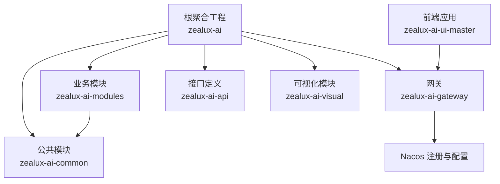
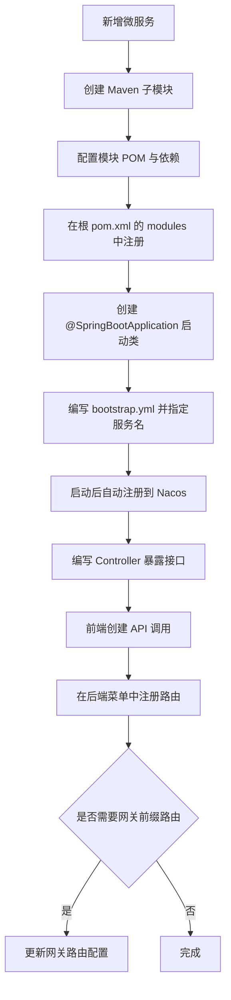
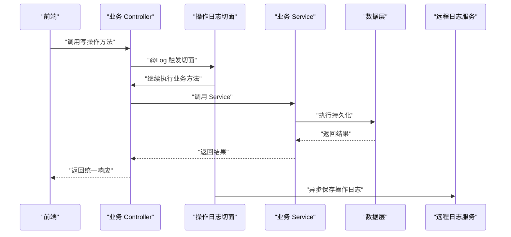
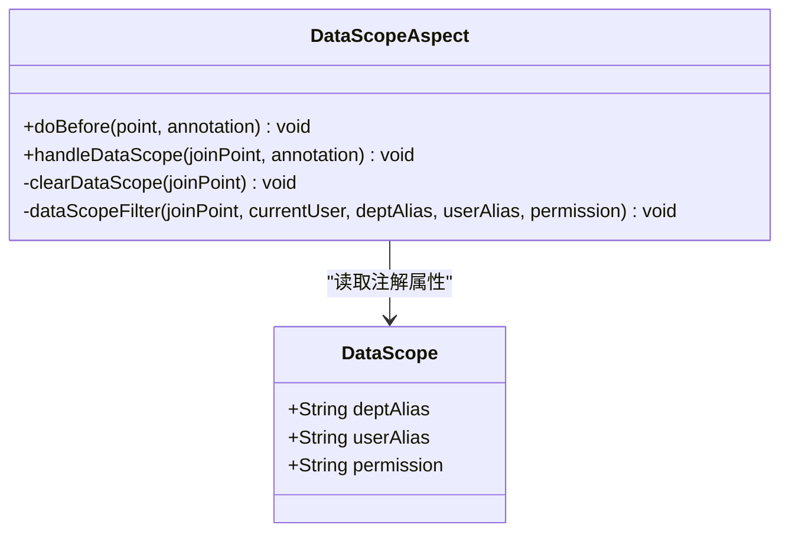
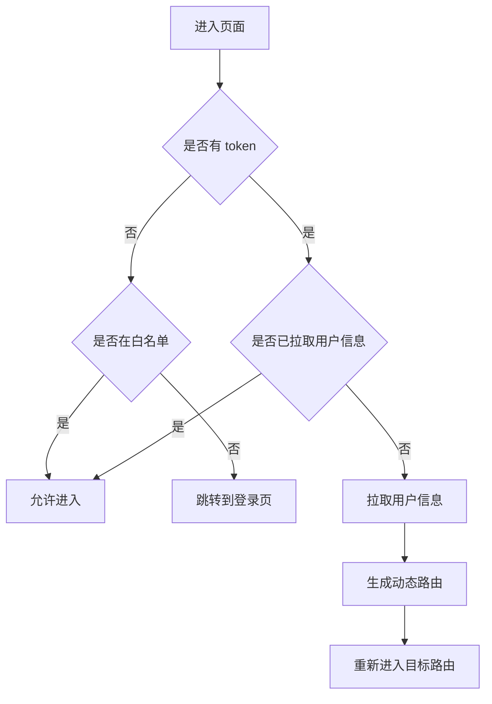
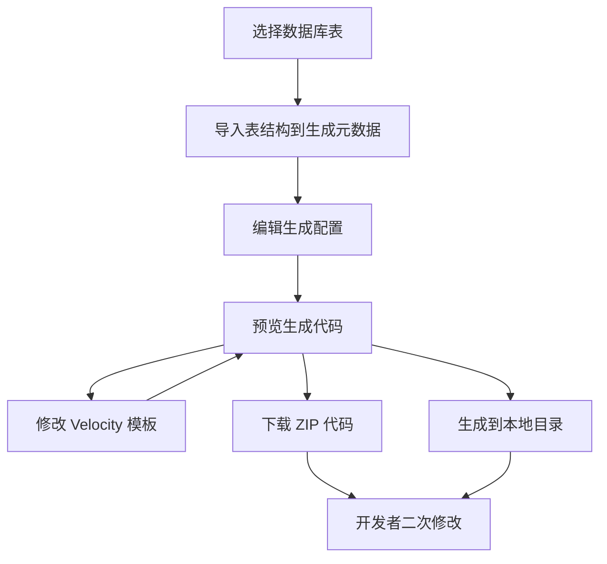
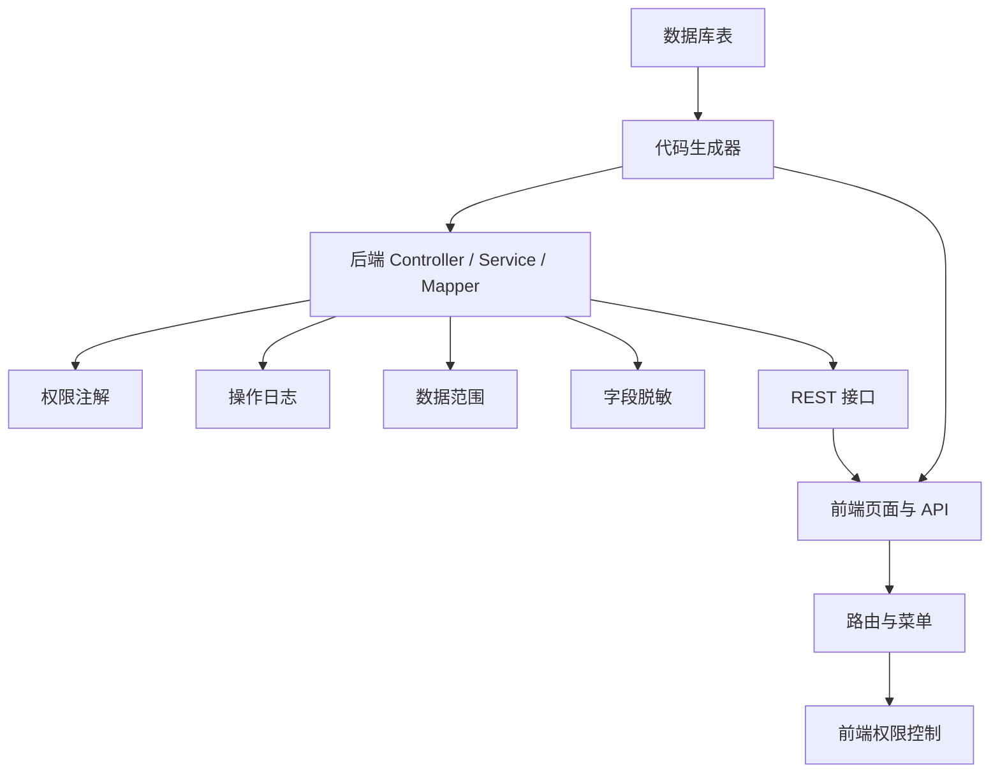
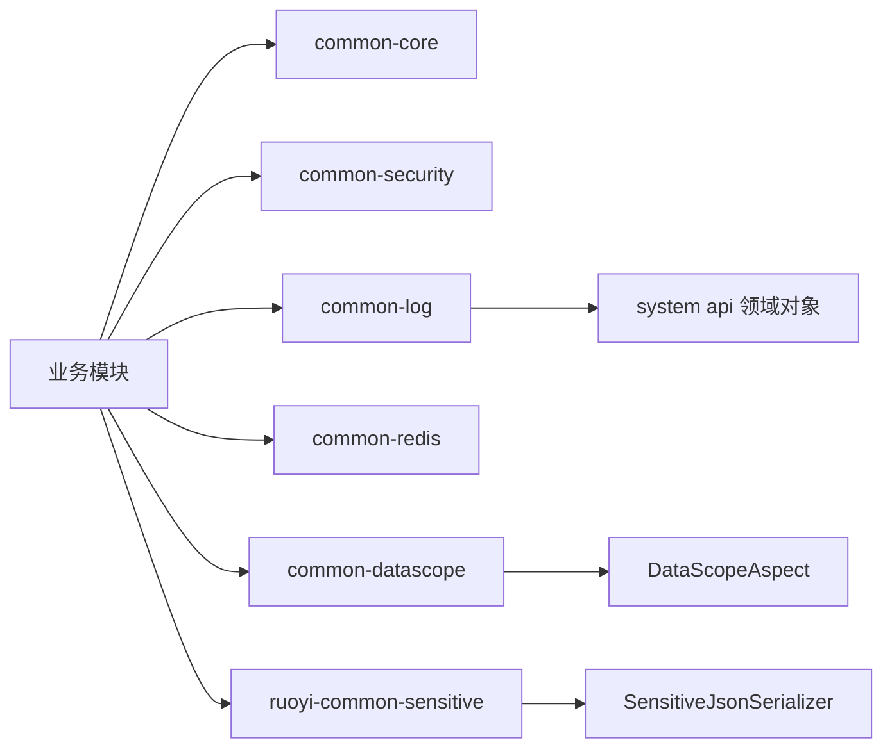

# 扩展开发指南

<cite>
**本文引用的文件**   
- [根聚合工程 pom.xml](file://zealux-ai-master/pom.xml)
- [网关引导配置 bootstrap.yml](file://zealux-ai-master/zealux-ai-gateway/src/main/resources/bootstrap.yml)
- [网关路由配置 RouterFunctionConfiguration.java](file://zealux-ai-master/zealux-ai-gateway/src/main/java/com/zealux/gateway/config/RouterFunctionConfiguration.java)
- [前端包配置 package.json](file://zealux-ai-ui-master/package.json)
- [前端主路由 index.js](file://zealux-ai-ui-master/src/router/index.js)
- [前端全局权限 permission.js](file://zealux-ai-ui-master/src/permission.js)
- [前端动态路由 store permission.js](file://zealux-ai-ui-master/src/store/modules/permission.js)
- [菜单 API menu.js](file://zealux-ai-ui-master/src/api/system/menu.js)
- [代码生成控制器 GenController.java](file://zealux-ai-master/zealux-ai-modules/zealux-ai-gen/src/main/java/com/zealux/gen/controller/GenController.java)
- [代码生成服务实现 GenTableServiceImpl.java](file://zealux-ai-master/zealux-ai-modules/zealux-ai-gen/src/main/java/com/zealux/gen/service/GenTableServiceImpl.java)
- [后端模板目录 vm](file://zealux-ai-master/zealux-ai-modules/zealux-ai-gen/src/main/resources/vm)
- [数据范围注解 DataScope.java](file://zealux-ai-master/zealux-ai-common/zealux-ai-common-datascope/src/main/java/com/zealux/common/datascope/annotation/DataScope.java)
- [数据范围切面 DataScopeAspect.java](file://zealux-ai-master/zealux-ai-common/zealux-ai-common-datascope/src/main/java/com/zealux/common/datascope/aspect/DataScopeAspect.java)
- [脱敏注解 Sensitive.java](file://zealux-ai-master/zealux-ai-common/ruoyi-common-sensitive/src/main/java/com/ruoyi/common/sensitive/annotation/Sensitive.java)
- [脱敏序列化器 SensitiveJsonSerializer.java](file://zealux-ai-master/zealux-ai-common/ruoyi-common-sensitive/src/main/java/com/ruoyi/common/sensitive/config/SensitiveJsonSerializer.java)
- [操作日志注解 Log.java](file://zealux-ai-master/zealux-ai-common/zealux-ai-common-log/src/main/java/com/zealux/common/log/annotation/Log.java)
- [操作日志切面 LogAspect.java](file://zealux-ai-master/zealux-ai-common/zealux-ai-common-log/src/main/java/com/zealux/common/log/aspect/LogAspect.java)
- [MyBatis-Plus Mapper 示例 AiMessageMapper.java](file://zealux-ai-master/zealux-ai-modules/zealux-ai-leads/src/main/java/com/zealux/leads/mapper/AiMessageMapper.java)
</cite>

## 目录
1. [引言](#引言)
2. [项目结构总览](#项目结构总览)
3. [新增微服务](#新增微服务)
4. [复用通用模块](#复用通用模块)
5. [扩展 MyBatis-Plus、事务与日志](#扩展-mybatis-plus事务与日志)
6. [扩展权限模型与数据权限](#扩展权限模型与数据权限)
7. [自定义前端组件与页面](#自定义前端组件与页面)
8. [修改代码生成模板](#修改代码生成模板)
9. [从数据库表到前后端完整流程](#从数据库表到前后端完整流程)
10. [依赖关系分析](#依赖关系分析)
11. [性能与可维护性建议](#性能与可维护性建议)
12. [常见问题排查](#常见问题排查)
13. [结语](#结语)

## 引言
本指南面向二次开发者，说明如何在当前基于 RuoYi-Cloud 的 Maven 多模块工程中新增业务微服务、扩展通用能力、编写前端页面、调整代码生成模板，以及使用系统内置的权限、数据范围、脱敏和日志能力。

需要特别注意：
- 该仓库是开源 RuoYi-Cloud 3.6.5 的重命名二次开发；根 `pom.xml` 的 `artifactId=zealux-ai`、`version=3.6.5`，但多个启动类仍沿用 `RuoYi*Application.java`，公共库中也保留 `ruoyi-common-sensitive` 等历史目录名。
- 前端存在两份相同源码拷贝：独立仓库 `zealux-ai-ui-master` 与后端内的 `zealux-ai-master/zealux-ai-ui`。文档以 `zealux-ai-ui-master` 为准。
- 系统中不存在 CRM 相关表或已实现的 CRM 模块；任何 CRM 描述只能作为方案出现，不能作为现有能力。
- 网关当前只通过 Java 配置暴露 `/code/**` 等静态路由；Nacos 共享配置中可能还包含前缀路由，但不得把本地临时 Nacos 落盘副本当作仓库配置来源。

## 项目结构总览
后端采用 Maven 聚合工程，核心分组如下：
- 根模块 `zealux-ai`：统一管理 Spring Boot、Spring Cloud、MyBatis-Plus、Hutool、Fastjson2、Velocity 等版本，并声明内部公共模块依赖。
- `zealux-ai-common`：公共能力，包括核心工具、安全、Redis、日志、Swagger、数据源、数据范围、脱敏、AI 能力等子模块。
- `zealux-ai-modules`：业务微服务，如文件、代码生成、定时任务、线索、系统管理。
- `zealux-ai-gateway`：网关，负责验证码路由、Sentinel 配置、Nacos 配置中心与注册中心接入。
- `zealux-ai-api`：跨服务接口定义。
- `zealux-ai-visual`：可视化监控等附加模块。
- `zealux-ai-ui-master`：Vue 2 + Element UI 管理前端。

**图表来源**
- [根聚合工程 pom.xml:1-20](file://zealux-ai-master/pom.xml#L1-L20)
- [根聚合工程 pom.xml:257-262](file://zealux-ai-master/pom.xml#L257-L262)
- [网关引导配置 bootstrap.yml:1-44](file://zealux-ai-master/zealux-ai-gateway/src/main/resources/bootstrap.yml#L1-L44)

**章节来源**
- [根聚合工程 pom.xml:1-20](file://zealux-ai-master/pom.xml#L1-L20)
- [根聚合工程 pom.xml:257-262](file://zealux-ai-master/pom.xml#L257-L262)
- [网关引导配置 bootstrap.yml:1-44](file://zealux-ai-master/zealux-ai-gateway/src/main/resources/bootstrap.yml#L1-L44)

## 新增微服务
在 Maven 聚合工程中新增一个业务微服务，通常应完成以下动作：

1. **创建 Maven 子模块**
   - 在 `zealux-ai-modules` 下新建模块目录，例如 `zealux-ai-example`。
   - 在该模块中添加 `pom.xml`，继承父工程，并引入需要的 `zealux-ai-common-*` 依赖。
   - 在根 `pom.xml` 的 `<modules>` 中新增该模块，使聚合构建能识别它。

2. **创建 Spring Boot 启动类**
   - 参考其他业务模块，将启动类放在业务包根路径下，并使用 `@SpringBootApplication`。
   - 当前项目中很多服务启动类仍命名为 `RuoYi*Application.java`，这是历史命名遗留，不应误认为是新规范。

3. **编写 `bootstrap.yml`**
   - 设置 `spring.application.name`，确保 Nacos 能按服务名发现实例。
   - 保持 Nacos 的 `server-addr`、`file-extension` 与网关一致。
   - 如果需要本地覆盖数据库或 Redis 地址，应在对应环境 profile 中处理，而不是直接硬编码到公共配置。

4. **注册到 Nacos**
   - 通过 Spring Cloud Alibaba 的 `nacos.discovery.server-addr` 自动注册。
   - 如果服务未出现在 Nacos 控制台，优先检查服务名、端口、网络连通性和 Nacos 是否启动。

5. **暴露 REST 接口**
   - 使用 `@RestController` 和 `@RequestMapping` 暴露接口。
   - 返回统一响应体时，可复用 `AjaxResult`、`TableDataInfo` 等公共封装。

6. **添加前端页面**
   - 在 `zealux-ai-ui-master/src/views` 下创建页面。
   - 在 `src/api` 下创建模块 API。
   - 在后端菜单接口返回的菜单结构中注册路由。
   - 如果需要前端白名单访问，可在 `permission.js` 的免登录白名单中添加路径。

7. **网关路由**
   - 若需要通过网关统一前缀转发，需修改网关路由配置。
   - 当前仓库中的网关 Java 配置只显式暴露了 `/code` 验证码路由；其余前缀路由通常由 Nacos 配置中心提供。
   - 不要把 `_setup` 下的本地 Nacos 落盘文件当成仓库配置来源。

**章节来源**
- [根聚合工程 pom.xml:257-262](file://zealux-ai-master/pom.xml#L257-L262)
- [网关引导配置 bootstrap.yml:1-44](file://zealux-ai-master/zealux-ai-gateway/src/main/resources/bootstrap.yml#L1-L44)
- [网关路由配置 RouterFunctionConfiguration.java:1-31](file://zealux-ai-master/zealux-ai-gateway/src/main/java/com/zealux/gateway/config/RouterFunctionConfiguration.java#L1-L31)

## 复用通用模块
`zealux-ai-common` 提供了九类非空公共能力，二次开发时应优先复用，而不是在每个业务模块中重复实现：

| 模块 | 主要用途 | 典型用法 |
|---|---|---|
| `zealux-ai-common-core` | 常量、异常、上下文、通用 Web 响应、工具类 | 使用 `AjaxResult`、`TableDataInfo`、全局异常、线程上下文 |
| `zealux-ai-common-security` | 鉴权、权限注解、用户上下文 | 使用 `@RequiresPermissions`、获取当前用户信息 |
| `zealux-ai-common-log` | 操作日志注解与异步保存 | 使用 `@Log` 记录业务操作 |
| `zealux-ai-common-redis` | Redis 封装与自动装配 | 使用缓存、分布式锁、限流等能力 |
| `zealux-ai-common-swagger` | Springdoc/OpenAPI 集成 | 生成接口文档 |
| `zealux-ai-common-datasource` | 多数据源注解 | 使用 `@Master`、`@Slave` 切换数据源 |
| `zealux-ai-common-datascope` | 数据范围过滤 | 使用 `@DataScope` 控制部门/用户数据可见范围 |
| `ruoyi-common-sensitive` | 字段级 JSON 脱敏 | 在实体字段上使用 `@Sensitive` |
| `zealux-ai-common-ai` | AI 聊天客户端与向量配置 | 在 AI 相关模块中使用 |

最佳实践：
- 只在业务模块的 `pom.xml` 中引入需要的 common 子模块，避免无意义耦合。
- 不要在业务模块里重新实现日志、脱敏、权限校验等横切逻辑。
- 对公共行为进行扩展时，优先通过注解、切面、AutoConfiguration 机制，而不是侵入业务代码。

**章节来源**
- [根聚合工程 pom.xml:179-242](file://zealux-ai-master/pom.xml#L179-L242)

## 扩展 MyBatis-Plus、事务与日志
### 扩展 BaseMapper
系统已引入 MyBatis-Plus，并在部分模块中使用 `BaseMapper`。新增实体时：
- 创建实体类映射数据库表。
- 创建 Mapper 接口继承 `BaseMapper<实体>`。
- 如需自定义查询，可在 Mapper 接口或 XML 中追加 SQL。

示例路径：
- [AiMessageMapper.java:1-8](file://zealux-ai-master/zealux-ai-modules/zealux-ai-leads/src/main/java/com/zealux/leads/mapper/AiMessageMapper.java#L1-L8)

注意：`AiMessageMapper` 所在模块当前缺少配套表、Service、前端和网关路由，因此不能把它描述为已上线功能。

### 在 Service 中使用事务
对于涉及多表写入、导入导出、批量删除的业务方法，应在 Service 实现类上标注 `@Transactional`。代码生成模块已经给出标准用法：
- 修改生成配置时使用 `@Transactional(rollbackFor = Exception.class)`。
- 删除生成元数据时同时删除表与列信息。
- 导入表结构时逐表插入并回滚失败分支。

参考路径：
- [GenTableServiceImpl.java:120-170](file://zealux-ai-master/zealux-ai-modules/zealux-ai-gen/src/main/java/com/zealux/gen/service/GenTableServiceImpl.java#L120-L170)

### 通过 `@Log` 记录操作日志
操作日志注解位于 `zealux-ai-common-log`，支持方法级和参数级注解。典型场景：
- 在 Controller 的增删改接口上加 `@Log(title="...", businessType=BusinessType.XXX)`。
- 切面会解析请求参数、目标方法和返回值，并通过远程服务保存系统操作日志。
- 代码生成模块的导入、编辑、删除、预览、下载、同步、批量生成等方法都使用了该注解。

参考路径：
- [操作日志注解 Log.java:17-20](file://zealux-ai-master/zealux-ai-common/zealux-ai-common-log/src/main/java/com/zealux/common/log/annotation/Log.java#L17-L20)
- [操作日志切面 LogAspect.java:32-41](file://zealux-ai-master/zealux-ai-common/zealux-ai-common-log/src/main/java/com/zealux/common/log/aspect/LogAspect.java#L32-L41)
- [代码生成控制器 GenController.java:80-200](file://zealux-ai-master/zealux-ai-modules/zealux-ai-gen/src/main/java/com/zealux/gen/controller/GenController.java#L80-L200)

**图表来源**
- [操作日志注解 Log.java:17-20](file://zealux-ai-master/zealux-ai-common/zealux-ai-common-log/src/main/java/com/zealux/common/log/annotation/Log.java#L17-L20)
- [操作日志切面 LogAspect.java:32-41](file://zealux-ai-master/zealux-ai-common/zealux-ai-common-log/src/main/java/com/zealux/common/log/aspect/LogAspect.java#L32-L41)
- [代码生成控制器 GenController.java:80-200](file://zealux-ai-master/zealux-ai-modules/zealux-ai-gen/src/main/java/com/zealux/gen/controller/GenController.java#L80-L200)

**章节来源**
- [AiMessageMapper.java:1-8](file://zealux-ai-master/zealux-ai-modules/zealux-ai-leads/src/main/java/com/zealux/leads/mapper/AiMessageMapper.java#L1-L8)
- [GenTableServiceImpl.java:120-170](file://zealux-ai-master/zealux-ai-modules/zealux-ai-gen/src/main/java/com/zealux/gen/service/GenTableServiceImpl.java#L120-L170)
- [操作日志注解 Log.java:17-20](file://zealux-ai-master/zealux-ai-common/zealux-ai-common-log/src/main/java/com/zealux/common/log/annotation/Log.java#L17-L20)
- [操作日志切面 LogAspect.java:32-41](file://zealux-ai-master/zealux-ai-common/zealux-ai-common-log/src/main/java/com/zealux/common/log/aspect/LogAspect.java#L32-L41)
- [代码生成控制器 GenController.java:80-200](file://zealux-ai-master/zealux-ai-modules/zealux-ai-gen/src/main/java/com/zealux/gen/controller/GenController.java#L80-L200)

## 扩展权限模型与数据权限
### 接口权限
系统通过 `@RequiresPermissions` 控制接口访问。代码生成模块中大量接口使用权限字符，例如 `tool:gen:list`、`tool:gen:edit`、`tool:gen:delete`、`tool:gen:preview`、`tool:gen:code` 等。

二次开发时：
- 为每个写操作分配唯一权限字符。
- 在前端按钮或菜单中使用相同权限字符进行显示控制。
- 不要把权限字符写成任意字符串，应与菜单权限保持一致。

参考路径：
- [代码生成控制器 GenController.java:30-200](file://zealux-ai-master/zealux-ai-modules/zealux-ai-gen/src/main/java/com/zealux/gen/controller/GenController.java#L30-L200)

### 数据范围
`@DataScope` 用于限制用户只能看到自己部门、下级部门、自定义范围的数据。其关键属性包括：
- `deptAlias`：部门表别名。
- `userAlias`：用户表别名。
- `permission`：权限字符，可与 `@RequiresPermissions` 配合。

数据范围由切面 `DataScopeAspect` 在执行方法前拦截，并根据当前用户角色计算数据范围条件。

**图表来源**
- [数据范围注解 DataScope.java:1-33](file://zealux-ai-master/zealux-ai-common/zealux-ai-common-datascope/src/main/java/com/zealux/common/datascope/annotation/DataScope.java#L1-L33)
- [数据范围切面 DataScopeAspect.java:59-105](file://zealux-ai-master/zealux-ai-common/zealux-ai-common-datascope/src/main/java/com/zealux/common/datascope/aspect/DataScopeAspect.java#L59-L105)

**章节来源**
- [数据范围注解 DataScope.java:1-33](file://zealux-ai-master/zealux-ai-common/zealux-ai-common-datascope/src/main/java/com/zealux/common/datascope/annotation/DataScope.java#L1-L33)
- [数据范围切面 DataScopeAspect.java:59-105](file://zealux-ai-master/zealux-ai-common/zealux-ai-common-datascope/src/main/java/com/zealux/common/datascope/aspect/DataScopeAspect.java#L59-L105)
- [代码生成控制器 GenController.java:30-200](file://zealux-ai-master/zealux-ai-modules/zealux-ai-gen/src/main/java/com/zealux/gen/controller/GenController.java#L30-L200)

## 自定义前端组件与页面
前端基于 Vue 2、Element UI、vue-router、vuex 和 axios。新增功能应覆盖以下层次：

| 层次 | 位置 | 职责 |
|---|---|---|
| API 层 | `src/api` | 封装 HTTP 请求，统一 baseURL、token、错误处理 |
| 视图层 | `src/views` | 页面组件，按业务模块划分目录 |
| 状态层 | `src/store/modules` | 用户、字典、权限、标签页等全局状态 |
| 路由层 | `src/router/index.js` | 常量路由与动态路由定义 |
| 权限层 | `src/permission.js` | 全局路由守卫、登录态校验、白名单 |
| 组件层 | `src/components` | 可复用的 UI 组件 |
| 布局层 | `src/layout` | 侧边栏、顶部导航、内容区、标签页等布局 |

### 新增页面与 API
1. 在 `src/api/<module>/xxx.js` 中封装 API。
2. 在 `src/views/<module>/xxx/index.vue` 中实现页面。
3. 如果是后台动态菜单驱动，需要在后端菜单接口返回对应路由结构。
4. 如果是前端固定路由，则在 `router/index.js` 的常量路由或动态路由中添加。

参考路径：
- [菜单 API menu.js:1-60](file://zealux-ai-ui-master/src/api/system/menu.js#L1-L60)
- [前端主路由 index.js:1-183](file://zealux-ai-ui-master/src/router/index.js#L1-L183)

### 路由白名单与登录跳转
`permission.js` 定义了全局路由守卫：
- 白名单路径默认包含 `/login`、`/register`。
- 有 token 但未拉取用户信息时，先拉取用户信息，再生成动态路由并重新进入目标路由。
- 没有 token 且不在白名单时，跳转到登录页并携带 redirect。

**图表来源**
- [前端全局权限 permission.js:1-63](file://zealux-ai-ui-master/src/permission.js#L1-L63)
- [前端主路由 index.js:1-183](file://zealux-ai-ui-master/src/router/index.js#L1-L183)

### 动态菜单加载
`store/modules/permission.js` 会从后端菜单接口拉取路由数据，并转换为前端可渲染的路由树：
- 后端返回 `Layout`、`ParentView`、`InnerLink` 等组件标识会被替换为真实组件。
- 动态路由会合并 `dynamicRoutes` 中定义的隐藏子路由。
- 最终通过 `router.addRoutes` 注入可访问路由。

参考路径：
- [前端动态路由 store permission.js:1-122](file://zealux-ai-ui-master/src/store/modules/permission.js#L1-L122)

**章节来源**
- [前端包配置 package.json:1-90](file://zealux-ai-ui-master/package.json#L1-L90)
- [前端主路由 index.js:1-183](file://zealux-ai-ui-master/src/router/index.js#L1-L183)
- [前端全局权限 permission.js:1-63](file://zealux-ai-ui-master/src/permission.js#L1-L63)
- [前端动态路由 store permission.js:1-122](file://zealux-ai-ui-master/src/store/modules/permission.js#L1-L122)
- [菜单 API menu.js:1-60](file://zealux-ai-ui-master/src/api/system/menu.js#L1-L60)

## 修改代码生成模板
代码生成器位于 `zealux-ai-modules/zealux-ai-gen`，使用 Velocity 模板生成后端、前端、SQL 和 JS API 代码。

### 模板目录结构
- `vm/java/`：Controller、Domain、Mapper、Service、ServiceImpl、子实体模板。
- `vm/vue/`：Vue 页面模板，含 v2 和 v3 两种目录。
- `vm/js/`：前端 API 模板。
- `vm/xml/`：MyBatis XML 模板。
- `vm/sql/`：初始化 SQL 模板。

参考路径：
- [后端模板目录 vm](file://zealux-ai-master/zealux-ai-modules/zealux-ai-gen/src/main/resources/vm)

### 常见修改点
- 在 `vm/java/controller.java.vm` 中调整 `@RequestMapping`、权限字符、日志标题和业务类型。
- 在 `vm/java/domain.java.vm` 中调整实体字段注释、类型、是否必填、表单展示规则。
- 在 `vm/vue/index.vue.vm` 中调整搜索表单、列表列、弹窗字段、导出和权限按钮。
- 在 `vm/js/api.js.vm` 中调整前端 API 路径与方法。
- 在 `vm/sql/sql.vm` 中调整建表语句、索引、注释。

### 代码生成入口
`GenController` 提供以下关键能力：
- 查询数据库表列表。
- 查询表结构与字段。
- 导入表结构。
- 修改生成配置。
- 预览生成的代码。
- 下载 ZIP 代码。
- 生成到本地目录。
- 同步数据库结构。
- 批量生成。

参考路径：
- [代码生成控制器 GenController.java:1-216](file://zealux-ai-master/zealux-ai-modules/zealux-ai-gen/src/main/java/com/zealux/gen/controller/GenController.java#L1-L216)

**章节来源**
- [代码生成控制器 GenController.java:1-216](file://zealux-ai-master/zealux-ai-modules/zealux-ai-gen/src/main/java/com/zealux/gen/controller/GenController.java#L1-L216)
- [代码生成服务实现 GenTableServiceImpl.java:1-200](file://zealux-ai-master/zealux-ai-modules/zealux-ai-gen/src/main/java/com/zealux/gen/service/GenTableServiceImpl.java#L1-L200)
- [后端模板目录 vm](file://zealux-ai-master/zealux-ai-modules/zealux-ai-gen/src/main/resources/vm)

## 从数据库表到前后端完整流程
以下流程以“新增一个带分页、权限、日志、脱敏的业务模块”为例：

1. **设计数据库表**
   - 明确主键、业务字段、状态字段、审计字段。
   - 为常用查询字段加索引。
   - 如需脱敏字段，先在实体字段上使用 `@Sensitive`。

2. **使用代码生成器生成基础代码**
   - 通过 `GenController` 的数据库列表接口导入表结构。
   - 调整字段映射、业务类型、生成路径。
   - 预览并下载代码，或在允许覆盖时直接生成到本地。

3. **完善后端 Service 与事务**
   - 对写操作增加 `@Transactional`。
   - 对写操作增加 `@Log`。
   - 对查询列表增加 `@DataScope`（如需要）。
   - 在返回对象字段上使用 `@Sensitive` 进行脱敏。

4. **补充权限与菜单**
   - 在后端菜单表中新增菜单项，并绑定权限字符。
   - 在 Controller 上使用 `@RequiresPermissions`。
   - 前端根据后端菜单动态渲染路由。

5. **补充前端页面**
   - 在 `src/views` 下新增页面。
   - 在 `src/api` 下新增 API。
   - 如需白名单访问，在 `permission.js` 中添加路径。

6. **验证端到端链路**
   - 前端登录后能看到菜单。
   - 点击菜单能打开页面。
   - 前端 API 能经过网关到达业务服务。
   - 操作日志能保存到系统日志。
   - 敏感字段能被脱敏。
   - 数据范围能按角色限制。

**章节来源**
- [代码生成控制器 GenController.java:1-216](file://zealux-ai-master/zealux-ai-modules/zealux-ai-gen/src/main/java/com/zealux/gen/controller/GenController.java#L1-L216)
- [脱敏注解 Sensitive.java:1-24](file://zealux-ai-master/zealux-ai-common/ruoyi-common-sensitive/src/main/java/com/ruoyi/common/sensitive/annotation/Sensitive.java#L1-L24)
- [脱敏序列化器 SensitiveJsonSerializer.java:13-42](file://zealux-ai-master/zealux-ai-common/ruoyi-common-sensitive/src/main/java/com/ruoyi/common/sensitive/config/SensitiveJsonSerializer.java#L13-L42)
- [数据范围注解 DataScope.java:1-33](file://zealux-ai-master/zealux-ai-common/zealux-ai-common-datascope/src/main/java/com/zealux/common/datascope/annotation/DataScope.java#L1-L33)
- [前端动态路由 store permission.js:1-122](file://zealux-ai-ui-master/src/store/modules/permission.js#L1-L122)

## 依赖关系分析
后端模块依赖关系可以理解为：
- 所有业务模块依赖 `zealux-ai-common-*`。
- 日志模块依赖系统接口定义中的操作日志领域对象。
- 数据范围模块通过 Spring AutoConfiguration 注册切面。
- 脱敏模块通过 Jackson 序列化器作用于字段。

**图表来源**
- [根聚合工程 pom.xml:179-242](file://zealux-ai-master/pom.xml#L179-L242)
- [数据范围切面 DataScopeAspect.java:59-105](file://zealux-ai-master/zealux-ai-common/zealux-ai-common-datascope/src/main/java/com/zealux/common/datascope/aspect/DataScopeAspect.java#L59-L105)
- [脱敏序列化器 SensitiveJsonSerializer.java:13-42](file://zealux-ai-master/zealux-ai-common/ruoyi-common-sensitive/src/main/java/com/ruoyi/common/sensitive/config/SensitiveJsonSerializer.java#L13-L42)

**章节来源**
- [根聚合工程 pom.xml:179-242](file://zealux-ai-master/pom.xml#L179-L242)

## 性能与可维护性建议
- 优先复用 common 模块，避免在每个服务中复制日志、脱敏、权限、Web 响应封装。
- 对写操作必须加事务边界，防止部分成功导致数据不一致。
- 对高频读接口考虑 Redis 缓存，但要处理好缓存失效和一致性。
- 对大数据量查询必须分页，不要一次性返回全表。
- 对敏感字段在返回层脱敏，而不是在查询层构造多个 DTO。
- 对复杂查询使用 `@DataScope` 时，确保 SQL 别名与注解配置一致。
- 对代码生成模板的修改要谨慎，避免破坏已有业务代码。
- 新增前端页面后，务必验证菜单、权限、路由、接口四者是否一致。

[本节为通用建议，不直接分析具体文件]

## 常见问题排查
| 问题 | 可能原因 | 排查建议 |
|---|---|---|
| 新服务未在 Nacos 中注册 | 服务名配置错误、Nacos 地址错误、端口冲突 | 检查 `bootstrap.yml` 中的 `spring.application.name` 和 `nacos.discovery.server-addr` |
| 前端页面无法访问 | 菜单未注册、权限字符不一致、路由未加载 | 检查后端菜单返回、`@RequiresPermissions`、`permission.js` 白名单、`router/index.js` |
| 接口 401 或未授权 | 未登录、token 失效、权限不足 | 检查前端 token、后端鉴权、菜单权限字符 |
| 操作日志未记录 | 忘记加 `@Log`、切面未生效、远程日志服务不可用 | 检查注解、依赖、日志异步保存链路 |
| 数据范围无效 | `@DataScope` 的别名或权限配置不正确 | 检查部门/用户表别名、角色权限、SQL 拼接逻辑 |
| 敏感字段未脱敏 | 未引入 sensitive 模块、字段未加 `@Sensitive`、序列化器未生效 | 检查依赖、注解、Jackson 序列化配置 |
| 代码生成后前端路径错误 | 模板中组件路径或 API 路径未调整 | 检查 `vm/vue` 和 `vm/js` 模板 |
| 网关无法访问业务接口 | 网关路由未配置或服务名不匹配 | 检查网关 Java 配置或 Nacos 配置中心的前缀路由 |

**章节来源**
- [网关路由配置 RouterFunctionConfiguration.java:1-31](file://zealux-ai-master/zealux-ai-gateway/src/main/java/com/zealux/gateway/config/RouterFunctionConfiguration.java#L1-L31)
- [前端全局权限 permission.js:1-63](file://zealux-ai-ui-master/src/permission.js#L1-L63)
- [操作日志注解 Log.java:17-20](file://zealux-ai-master/zealux-ai-common/zealux-ai-common-log/src/main/java/com/zealux/common/log/annotation/Log.java#L17-L20)
- [数据范围注解 DataScope.java:1-33](file://zealux-ai-master/zealux-ai-common/zealux-ai-common-datascope/src/main/java/com/zealux/common/datascope/annotation/DataScope.java#L1-L33)
- [脱敏注解 Sensitive.java:1-24](file://zealux-ai-master/zealux-ai-common/ruoyi-common-sensitive/src/main/java/com/ruoyi/common/sensitive/annotation/Sensitive.java#L1-L24)

## 结语
本指南围绕当前仓库的实际结构展开：后端是 Maven 聚合的微服务架构，前端是 Vue 2 管理后台，公共能力集中在 `zealux-ai-common`，代码生成器位于 `zealux-ai-gen`。二次开发时，应优先复用现有通用模块、遵循现有注解约定、保持前后端权限一致，并通过代码生成器降低样板代码成本。对于尚未落地的能力，例如 CRM 模块、CRM 路由、`AiSession` 表等，不得描述为系统已具备的功能。

[本节为总结性内容，不直接分析具体文件]