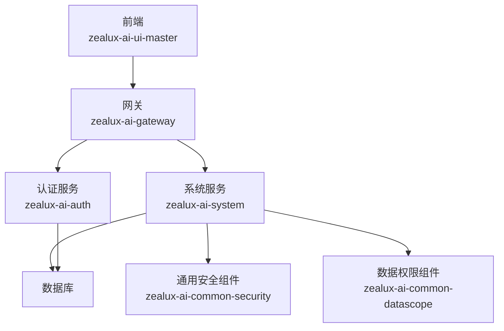
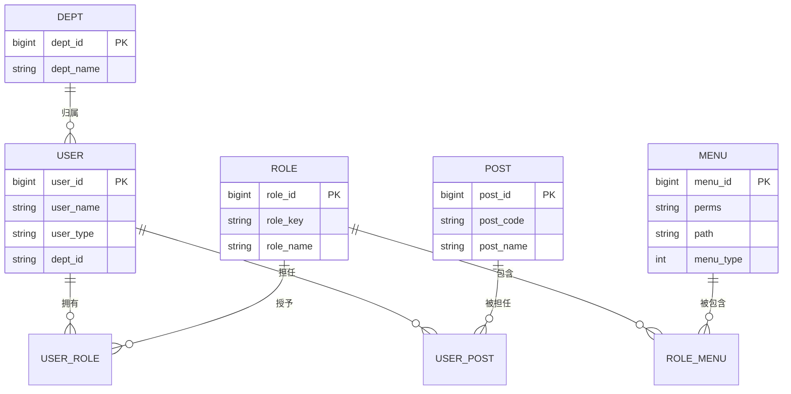
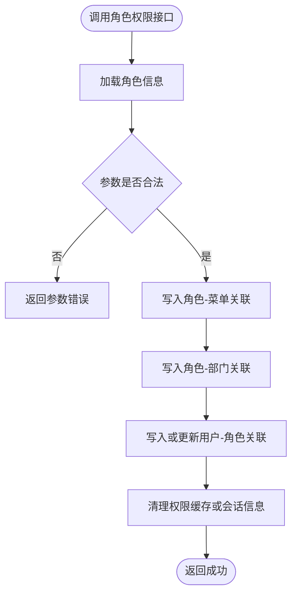
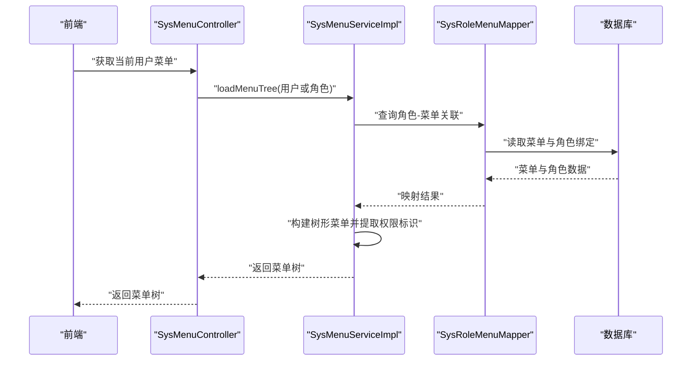
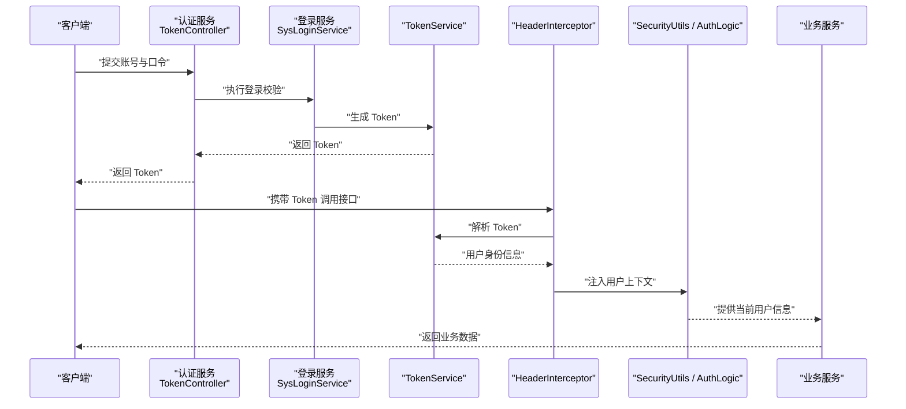
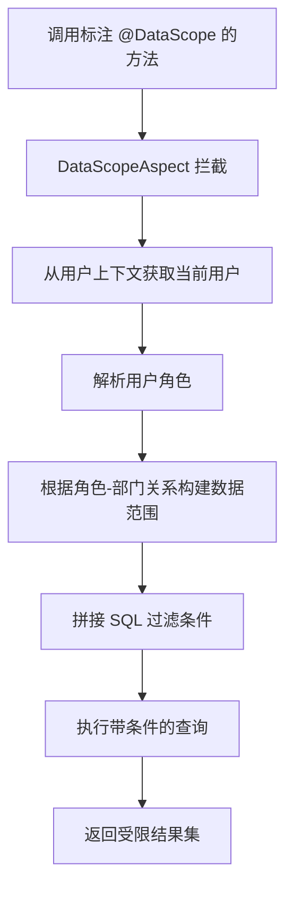
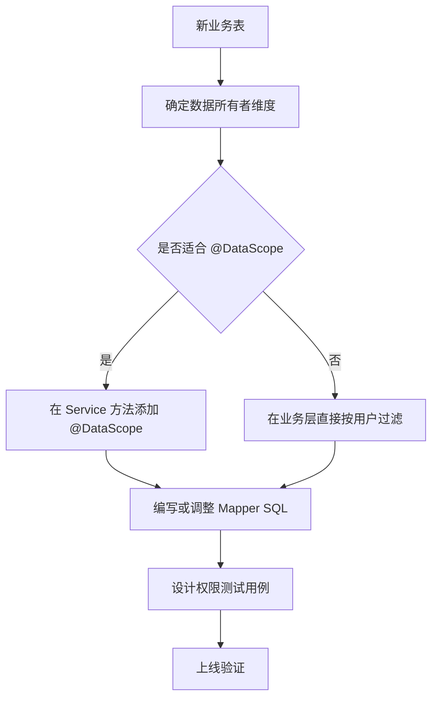
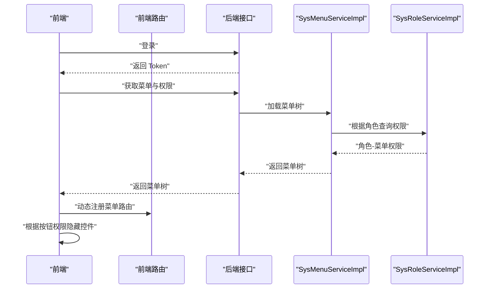
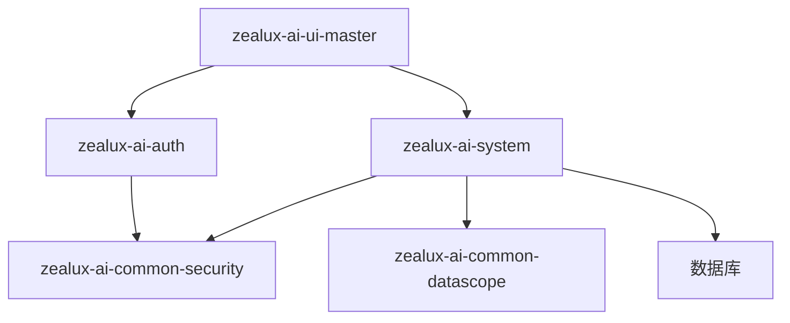

# 扩展权限模型与数据权限

<cite>
**本文引用的文件**   
- [zealux-ai-master/zealux-ai-modules/zealux-ai-system/src/main/java/com/zealux/system/service/impl/SysRoleServiceImpl.java](file://zealux-ai-master/zealux-ai-modules/zealux-ai-system/src/main/java/com/zealux/system/service/impl/SysRoleServiceImpl.java)
- [zealux-ai-master/zealux-ai-modules/zealux-ai-system/src/main/java/com/zealux/system/service/ISysRoleService.java](file://zealux-ai-master/zealux-ai-modules/zealux-ai-system/src/main/java/com/zealux/system/service/ISysRoleService.java)
- [zealux-ai-master/zealux-ai-modules/zealux-ai-system/src/main/java/com/zealux/system/controller/SysRoleController.java](file://zealux-ai-master/zealux-ai-modules/zealux-ai-system/src/main/java/com/zealux/system/controller/SysRoleController.java)
- [zealux-ai-master/zealux-ai-modules/zealux-ai-system/src/main/java/com/zealux/system/domain/SysRoleMenu.java](file://zealux-ai-master/zealux-ai-modules/zealux-ai-system/src/main/java/com/zealux/system/domain/SysRoleMenu.java)
- [zealux-ai-master/zealux-ai-modules/zealux-ai-system/src/main/java/com/zealux/system/domain/SysUserRole.java](file://zealux-ai-master/zealux-ai-modules/zealux-ai-system/src/main/java/com/zealux/system/domain/SysUserRole.java)
- [zealux-ai-master/zealux-ai-modules/zealux-ai-system/src/main/java/com/zealux/system/domain/SysRoleDept.java](file://zealux-ai-master/zealux-ai-modules/zealux-ai-system/src/main/java/com/zealux/system/domain/SysRoleDept.java)
- [zealux-ai-master/zealux-ai-modules/zealux-ai-system/src/main/java/com/zealux/system/mapper/SysRoleMenuMapper.java](file://zealux-ai-master/zealux-ai-modules/zealux-ai-system/src/main/java/com/zealux/system/mapper/SysRoleMenuMapper.java)
- [zealux-ai-master/zealux-ai-modules/zealux-ai-system/src/main/java/com/zealux/system/mapper/SysRoleDeptMapper.java](file://zealux-ai-master/zealux-ai-modules/zealux-ai-system/src/main/java/com/zealux/system/mapper/SysRoleDeptMapper.java)
- [zealux-ai-master/zealux-ai-modules/zealux-ai-system/src/main/java/com/zealux/system/service/impl/SysMenuServiceImpl.java](file://zealux-ai-master/zealux-ai-modules/zealux-ai-system/src/main/java/com/zealux/system/service/impl/SysMenuServiceImpl.java)
- [zealux-ai-master/zealux-ai-modules/zealux-ai-system/src/main/java/com/zealux/system/service/ISysMenuService.java](file://zealux-ai-master/zealux-ai-modules/zealux-ai-system/src/main/java/com/zealux/system/service/ISysMenuService.java)
- [zealux-ai-master/zealux-ai-modules/zealux-ai-system/src/main/java/com/zealux/system/controller/SysMenuController.java](file://zealux-ai-master/zealux-ai-modules/zealux-ai-system/src/main/java/com/zealux/system/controller/SysMenuController.java)
- [zealux-ai-master/zealux-ai-common/zealux-ai-common-datascope/src/main/java/com/zealux/common/datascope/annotation/DataScope.java](file://zealux-ai-master/zealux-ai-common/zealux-ai-common-datascope/src/main/java/com/zealux/common/datascope/annotation/DataScope.java)
- [zealux-ai-master/zealux-ai-common/zealux-ai-common-datascope/src/main/java/com/zealux/common/datascope/aspect/DataScopeAspect.java](file://zealux-ai-master/zealux-ai-common/zealux-ai-common-datascope/src/main/java/com/zealux/common/datascope/aspect/DataScopeAspect.java)
- [zealux-ai-master/zealux-ai-modules/zealux-ai-system/src/main/java/com/zealux/system/service/impl/SysUserServiceImpl.java](file://zealux-ai-master/zealux-ai-modules/zealux-ai-system/src/main/java/com/zealux/system/service/impl/SysUserServiceImpl.java)
- [zealux-ai-master/zealux-ai-modules/zealux-ai-system/src/main/java/com/zealux/system/service/impl/SysDeptServiceImpl.java](file://zealux-ai-master/zealux-ai-modules/zealux-ai-system/src/main/java/com/zealux/system/service/impl/SysDeptServiceImpl.java)
- [zealux-ai-master/zealux-ai-common/zealux-ai-common-security/src/main/java/com/zealux/common/security/auth/AuthLogic.java](file://zealux-ai-master/zealux-ai-common/zealux-ai-common-security/src/main/java/com/zealux/common/security/auth/AuthLogic.java)
- [zealux-ai-master/zealux-ai-common/zealux-ai-common-security/src/main/java/com/zealux/common/security/interceptor/HeaderInterceptor.java](file://zealux-ai-master/zealux-ai-common/zealux-ai-common-security/src/main/java/com/zealux/common/security/interceptor/HeaderInterceptor.java)
- [zealux-ai-master/zealux-ai-common/zealux-ai-common-security/src/main/java/com/zealux/common/security/service/TokenService.java](file://zealux-ai-master/zealux-ai-common/zealux-ai-common-security/src/main/java/com/zealux/common/security/service/TokenService.java)
- [zealux-ai-master/zealux-ai-common/zealux-ai-common-security/src/main/java/com/zealux/common/security/utils/SecurityUtils.java](file://zealux-ai-master/zealux-ai-common/zealux-ai-common-security/src/main/java/com/zealux/common/security/utils/SecurityUtils.java)
- [zealux-ai-master/zealux-ai-auth/src/main/java/com/zealux/auth/controller/TokenController.java](file://zealux-ai-master/zealux-ai-auth/src/main/java/com/zealux/auth/controller/TokenController.java)
- [zealux-ai-master/zealux-ai-auth/src/main/java/com/zealux/auth/service/SysLoginService.java](file://zealux-ai-master/zealux-ai-auth/src/main/java/com/zealux/auth/service/SysLoginService.java)
- [zealux-ai-master/pom.xml](file://zealux-ai-master/pom.xml)
- [zealux-ai-ui-master/package.json](file://zealux-ai-ui-master/package.json)
- [zealux-ai-ui-master/src/permission.js](file://zealux-ai-ui-master/src/permission.js)
</cite>

## 目录
1. [引言](#引言)
2. [项目结构定位](#项目结构定位)
3. [RBAC 权限模型总览](#rbac-权限模型总览)
4. [角色权限扩展：SysRoleServiceImpl](#角色权限扩展sysroleserviceimpl)
5. [菜单权限扩展：SysMenuServiceImpl](#菜单权限扩展sysmenuserviceimpl)
6. [认证与用户上下文：JwtAuthenticationTokenFilter 相关链路](#认证与用户上下文jwtauthenticationtokenfilter-相关链路)
7. [数据范围过滤：@DataScope 注解](#数据范围过滤datascope-注解)
8. [为新业务表添加数据权限](#为新业务表添加数据权限)
9. [前后端菜单与按钮权限协同](#前后端菜单与按钮权限协同)
10. [依赖关系分析](#依赖关系分析)
11. [性能与扩展建议](#性能与扩展建议)
12. [排查清单](#排查清单)
13. [结论](#结论)

## 引言
本文面向需要在现有系统基础上扩展 RBAC 权限控制和数据权限的开发者。该系统是开源 RuoYi-Cloud 3.6.5 的重命名二次开发，根 `pom.xml` 为 `artifactId=zealux-ai`、`version=3.6.5`；前端 `package.json` 名称仍为 `ruoyi@3.6.5`，多个原服务启动类仍保留 `RuoYi*Application.java` 风格命名，公共库中甚至存在未重命名的子目录。因此，文档在描述架构时明确承认这一继承关系，不将其包装为自研框架。

本系统已具备基于用户、角色、部门、岗位和菜单的基础 RBAC 能力，并通过 `@DataScope` 实现 SQL 层的数据范围过滤。同时，系统中还存在若干尚未完全落地的权限相关元素，例如 `AiSession` 实体、`ai_message` 本地手工表、以及当前不可运行的 `zealux-ai-leads` 模块。这些内容在本指南中仅作为现状说明或风险提示，不作为“系统已提供”的功能承诺。

## 项目结构定位
权限相关代码主要分布在以下位置：

| 层次 | 模块 | 职责 |
|---|---|---|
| 通用安全层 | `zealux-ai-common-security` | Token 解析、用户上下文、拦截器、鉴权逻辑 |
| 通用数据权限层 | `zealux-ai-common-datascope` | `@DataScope` 注解与 AOP 切面 |
| 系统业务层 | `zealux-ai-system` | 用户、角色、菜单、部门、岗位的 RBAC 实体、控制器与服务实现 |
| 认证服务 | `zealux-ai-auth` | 登录、Token 签发等认证入口 |
| 前端 | `zealux-ai-ui-master` | 动态路由、菜单加载、按钮权限指令与权限判断 |

**图表来源**
- [zealux-ai-master/pom.xml](file://zealux-ai-master/pom.xml)
- [zealux-ai-ui-master/package.json](file://zealux-ai-ui-master/package.json)

**章节来源**
- [zealux-ai-master/pom.xml](file://zealux-ai-master/pom.xml)
- [zealux-ai-ui-master/package.json](file://zealux-ai-ui-master/package.json)

## RBAC 权限模型总览
系统中的 RBAC 模型以用户为中心，通过角色建立用户与资源之间的授权关系；菜单则作为功能资源的抽象，用于控制后端接口访问与前端页面、按钮展示。部门与岗位主要用于数据权限和业务组织维度。

核心关系如下：

上图中：

- `USER` 代表系统用户。
- `ROLE` 代表角色。
- `MENU` 代表菜单或按钮等资源。
- `DEPT` 代表部门。
- `POST` 代表岗位。
- `USER_ROLE`、`ROLE_MENU`、`USER_POST` 等关联实体分别承载多对多关系。

需要特别注意：

1. 系统中确实存在 `SysRoleMenu`、`SysUserRole`、`SysRoleDept` 等关联实体类，说明角色-菜单、用户-角色、角色-部门的关联关系在代码层面已有建模。
2. 数据库中是否存在对应物理表应以实际部署为准；文档不应把实体类直接等同于已建表。
3. `AiSession` 仅有实体类，没有对应的 Mapper、接口或仓库内可核验的建表语句；`ai_message` 表是本地手工创建，不能当作标准权限模型的一部分。
4. `zealux-ai-leads` 模块目前只有少量 Java 文件，且缺少前端页面、菜单入口、Nacos 配置和网关路由，本地 Redis 还缺少 RediSearch 模块，因此不能作为完整权限能力的依据。

**章节来源**
- [zealux-ai-master/zealux-ai-modules/zealux-ai-system/src/main/java/com/zealux/system/domain/SysRoleMenu.java](file://zealux-ai-master/zealux-ai-modules/zealux-ai-system/src/main/java/com/zealux/system/domain/SysRoleMenu.java)
- [zealux-ai-master/zealux-ai-modules/zealux-ai-system/src/main/java/com/zealux/system/domain/SysUserRole.java](file://zealux-ai-master/zealux-ai-modules/zealux-ai-system/src/main/java/com/zealux/system/domain/SysUserRole.java)
- [zealux-ai-master/zealux-ai-modules/zealux-ai-system/src/main/java/com/zealux/system/domain/SysRoleDept.java](file://zealux-ai-master/zealux-ai-modules/zealux-ai-system/src/main/java/com/zealux/system/domain/SysRoleDept.java)

## 角色权限扩展：SysRoleServiceImpl
`SysRoleServiceImpl` 是角色权限的核心实现类之一，承担角色与用户、角色与菜单、角色与部门之间关系的维护逻辑。它通常由 `SysRoleController` 暴露 REST 接口调用，并由 `ISysRoleService` 定义服务契约。

### 关键职责
- 新增、修改、删除角色。
- 将角色与菜单进行绑定或解绑。
- 将角色与部门进行绑定，从而决定该角色后续查询数据的部门范围。
- 将用户与角色进行绑定，决定用户最终拥有的角色集合。
- 在保存角色权限后触发权限缓存或上下文刷新，使后续接口校验生效。

**图表来源**
- [zealux-ai-master/zealux-ai-modules/zealux-ai-system/src/main/java/com/zealux/system/service/impl/SysRoleServiceImpl.java](file://zealux-ai-master/zealux-ai-modules/zealux-ai-system/src/main/java/com/zealux/system/service/impl/SysRoleServiceImpl.java)
- [zealux-ai-master/zealux-ai-modules/zealux-ai-system/src/main/java/com/zealux/system/controller/SysRoleController.java](file://zealux-ai-master/zealux-ai-modules/zealux-ai-system/src/main/java/com/zealux/system/controller/SysRoleController.java)
- [zealux-ai-master/zealux-ai-modules/zealux-ai-system/src/main/java/com/zealux/system/service/ISysRoleService.java](file://zealux-ai-master/zealux-ai-modules/zealux-ai-system/src/main/java/com/zealux/system/service/ISysRoleService.java)

### 扩展点
如果需要扩展角色权限判断逻辑，可从以下方向入手：

| 扩展目标 | 推荐切入点 | 说明 |
|---|---|---|
| 增加新的角色类型 | `SysRoleServiceImpl` 与 `ISysRoleService` | 在服务层区分不同角色类别的业务规则 |
| 增加角色到自定义资源的授权 | 新增关联实体与 Mapper，并复用 `SysRoleServiceImpl` 中的批量写入模式 | 不要绕过事务直接写中间表 |
| 限制某些角色不能访问特定菜单 | 在保存角色菜单前加校验逻辑 | 避免非法权限组合进入缓存 |
| 审计角色变更 | 结合日志组件记录操作人、变更前后的角色与菜单 | 便于合规审计 |

**章节来源**
- [zealux-ai-master/zealux-ai-modules/zealux-ai-system/src/main/java/com/zealux/system/service/impl/SysRoleServiceImpl.java](file://zealux-ai-master/zealux-ai-modules/zealux-ai-system/src/main/java/com/zealux/system/service/impl/SysRoleServiceImpl.java)
- [zealux-ai-master/zealux-ai-modules/zealux-ai-system/src/main/java/com/zealux/system/service/ISysRoleService.java](file://zealux-ai-master/zealux-ai-modules/zealux-ai-system/src/main/java/com/zealux/system/service/ISysRoleService.java)
- [zealux-ai-master/zealux-ai-modules/zealux-ai-system/src/main/java/com/zealux/system/controller/SysRoleController.java](file://zealux-ai-master/zealux-ai-modules/zealux-ai-system/src/main/java/com/zealux/system/controller/SysRoleController.java)

## 菜单权限扩展：SysMenuServiceImpl
`SysMenuServiceImpl` 负责菜单树构建、菜单权限标识提取、菜单与角色的绑定关系处理。它是前后端菜单同步的关键后端实现。

### 关键职责
- 根据角色或用户查询其可访问菜单。
- 将菜单转换为前端需要的树形结构。
- 从菜单中解析权限标识（如按钮级 `perms`）。
- 将角色与菜单进行持久化关联。

**图表来源**
- [zealux-ai-master/zealux-ai-modules/zealux-ai-system/src/main/java/com/zealux/system/service/impl/SysMenuServiceImpl.java](file://zealux-ai-master/zealux-ai-modules/zealux-ai-system/src/main/java/com/zealux/system/service/impl/SysMenuServiceImpl.java)
- [zealux-ai-master/zealux-ai-modules/zealux-ai-system/src/main/java/com/zealux/system/controller/SysMenuController.java](file://zealux-ai-master/zealux-ai-modules/zealux-ai-system/src/main/java/com/zealux/system/controller/SysMenuController.java)
- [zealux-ai-master/zealux-ai-modules/zealux-ai-system/src/main/java/com/zealux/system/mapper/SysRoleMenuMapper.java](file://zealux-ai-master/zealux-ai-modules/zealux-ai-system/src/main/java/com/zealux/system/mapper/SysRoleMenuMapper.java)

### 扩展点
如果需要在菜单权限判断中加入更复杂的条件，例如：

- 按业务域限制菜单可见性；
- 按租户、组织或项目维度隐藏菜单；
- 对按钮权限做更细粒度的表达式校验；

可在 `SysMenuServiceImpl` 的菜单加载流程中插入条件分支，但应遵循以下原则：

1. 优先使用菜单上的权限标识进行判断，避免硬编码业务码。
2. 若需要复杂表达式，应封装成独立的权限策略类，而不是把所有逻辑塞进一个方法。
3. 修改菜单查询逻辑后，必须同步验证前端动态路由是否正确渲染。

**章节来源**
- [zealux-ai-master/zealux-ai-modules/zealux-ai-system/src/main/java/com/zealux/system/service/impl/SysMenuServiceImpl.java](file://zealux-ai-master/zealux-ai-modules/zealux-ai-system/src/main/java/com/zealux/system/service/impl/SysMenuServiceImpl.java)
- [zealux-ai-master/zealux-ai-modules/zealux-ai-system/src/main/java/com/zealux/system/service/ISysMenuService.java](file://zealux-ai-master/zealux-ai-modules/zealux-ai-system/src/main/java/com/zealux/system/service/ISysMenuService.java)
- [zealux-ai-master/zealux-ai-modules/zealux-ai-system/src/main/java/com/zealux/system/controller/SysMenuController.java](file://zealux-ai-master/zealux-ai-system/src/main/java/com/zealux/system/controller/SysMenuController.java)

## 认证与用户上下文：JwtAuthenticationTokenFilter 相关链路
当前工作区中未发现名为 `JwtAuthenticationTokenFilter` 的直接匹配文件。不过，系统在安全组件中存在 Token 解析、用户上下文注入和拦截器的相关实现，包括：

- `AuthLogic`：鉴权逻辑辅助类。
- `HeaderInterceptor`：请求头拦截器。
- `TokenService`：Token 服务。
- `SecurityUtils`：安全工具类。
- `TokenController`：认证服务中的 Token 控制器。
- `SysLoginService`：登录服务。

### 典型认证流程

**图表来源**
- [zealux-ai-master/zealux-ai-auth/src/main/java/com/zealux/auth/controller/TokenController.java](file://zealux-ai-master/zealux-ai-auth/src/main/java/com/zealux/auth/controller/TokenController.java)
- [zealux-ai-master/zealux-ai-auth/src/main/java/com/zealux/auth/service/SysLoginService.java](file://zealux-ai-master/zealux-ai-auth/src/main/java/com/zealux/auth/service/SysLoginService.java)
- [zealux-ai-master/zealux-ai-common/zealux-ai-common-security/src/main/java/com/zealux/common/security/service/TokenService.java](file://zealux-ai-master/zealux-ai-common/zealux-ai-common-security/src/main/java/com/zealux/common/security/service/TokenService.java)
- [zealux-ai-master/zealux-ai-common/zealux-ai-common-security/src/main/java/com/zealux/common/security/interceptor/HeaderInterceptor.java](file://zealux-ai-master/zealux-ai-common/zealux-ai-common-security/src/main/java/com/zealux/common/security/interceptor/HeaderInterceptor.java)
- [zealux-ai-master/zealux-ai-common/zealux-ai-common-security/src/main/java/com/zealux/common/security/utils/SecurityUtils.java](file://zealux-ai-master/zealux-ai-common/zealux-ai-common-security/src/main/java/com/zealux/common/security/utils/SecurityUtils.java)
- [zealux-ai-master/zealux-ai-common/zealux-ai-common-security/src/main/java/com/zealux/common/security/auth/AuthLogic.java](file://zealux-ai-master/zealux-ai-common/zealux-ai-common-security/src/main/java/com/zealux/common/security/auth/AuthLogic.java)

### 开发注意事项
- 如果业务需要自定义 Token 解析逻辑，应在 `TokenService` 或专用过滤器中扩展，而不是在每个控制器中重复解析。
- 用户上下文应通过 `SecurityUtils` 等工具类获取，避免跨层传递用户对象。
- 若发现接口无鉴权却可访问，应检查网关路由、安全配置、过滤器注册顺序以及 `HeaderInterceptor` 是否真正参与请求处理。
- 由于当前仓库未发现名为 `JwtAuthenticationTokenFilter` 的文件，任何关于该类的具体实现细节不得臆造；只能依据现有 `TokenService`、`HeaderInterceptor`、`SecurityUtils`、`AuthLogic` 的实际文件进行分析。

**章节来源**
- [zealux-ai-master/zealux-ai-common/zealux-ai-common-security/src/main/java/com/zealux/common/security/service/TokenService.java](file://zealux-ai-master/zealux-ai-common/zealux-ai-common-security/src/main/java/com/zealux/common/security/service/TokenService.java)
- [zealux-ai-master/zealux-ai-common/zealux-ai-common-security/src/main/java/com/zealux/common/security/interceptor/HeaderInterceptor.java](file://zealux-ai-master/zealux-ai-common/zealux-ai-common-security/src/main/java/com/zealux/common/security/interceptor/HeaderInterceptor.java)
- [zealux-ai-master/zealux-ai-common/zealux-ai-common-security/src/main/java/com/zealux/common/security/utils/SecurityUtils.java](file://zealux-ai-master/zealux-ai-common/zealux-ai-common-security/src/main/java/com/zealux/common/security/utils/SecurityUtils.java)
- [zealux-ai-master/zealux-ai-common/zealux-ai-common-security/src/main/java/com/zealux/common/security/auth/AuthLogic.java](file://zealux-ai-master/zealux-ai-common/zealux-ai-common-security/src/main/java/com/zealux/common/security/auth/AuthLogic.java)
- [zealux-ai-master/zealux-ai-auth/src/main/java/com/zealux/auth/controller/TokenController.java](file://zealux-ai-master/zealux-ai-auth/src/main/java/com/zealux/auth/controller/TokenController.java)
- [zealux-ai-master/zealux-ai-auth/src/main/java/com/zealux/auth/service/SysLoginService.java](file://zealux-ai-master/zealux-ai-auth/src/main/java/com/zealux/auth/service/SysLoginService.java)

## 数据范围过滤：@DataScope 注解
数据权限通过 `@DataScope` 注解与 `DataScopeAspect` 切面配合实现。其基本思想是：在需要数据隔离的服务方法上加注，切面根据当前用户的角色、部门、岗位等信息拼接 SQL 过滤条件，从而限制查询结果集。

### 核心组成
| 组件 | 作用 |
|---|---|
| `DataScope` 注解 | 声明该方法需要进行数据范围过滤，并可指定别名、部门列、用户列等参数 |
| `DataScopeAspect` 切面 | 拦截带注解的方法，提取当前用户权限，拼接 SQL 片段 |
| `SysUserServiceImpl`、`SysDeptServiceImpl`、`SysRoleServiceImpl` | 业务层中使用 `@DataScope` 的具体示例 |

**图表来源**
- [zealux-ai-master/zealux-ai-common/zealux-ai-common-datascope/src/main/java/com/zealux/common/datascope/annotation/DataScope.java](file://zealux-ai-master/zealux-ai-common/zealux-ai-common-datascope/src/main/java/com/zealux/common/datascope/annotation/DataScope.java)
- [zealux-ai-master/zealux-ai-common/zealux-ai-common-datascope/src/main/java/com/zealux/common/datascope/aspect/DataScopeAspect.java](file://zealux-ai-master/zealux-ai-common/zealux-ai-common-datascope/src/main/java/com/zealux/common/datascope/aspect/DataScopeAspect.java)
- [zealux-ai-master/zealux-ai-modules/zealux-ai-system/src/main/java/com/zealux/system/service/impl/SysUserServiceImpl.java](file://zealux-ai-master/zealux-ai-modules/zealux-ai-system/src/main/java/com/zealux/system/service/impl/SysUserServiceImpl.java)
- [zealux-ai-master/zealux-ai-modules/zealux-ai-system/src/main/java/com/zealux/system/service/impl/SysDeptServiceImpl.java](file://zealux-ai-master/zealux-ai-modules/zealux-ai-system/src/main/java/com/zealux/system/service/impl/SysDeptServiceImpl.java)
- [zealux-ai-master/zealux-ai-modules/zealux-ai-system/src/main/java/com/zealux/system/service/impl/SysRoleServiceImpl.java](file://zealux-ai-master/zealux-ai-modules/zealux-ai-system/src/main/java/com/zealux/system/service/impl/SysRoleServiceImpl.java)

### 适用场景
- 用户只能查看自己所属部门的数据。
- 管理员可以查看本部门及下级部门的数据。
- 特定角色可查看全公司数据。
- 多部门协作场景中按主责部门或参与部门过滤。

### 不适用场景
- 需要跨租户强隔离的系统，应引入独立租户方案。
- 高频大表查询中频繁拼接复杂 SQL 的条件，需评估索引与分页性能。
- 已经绕过 MyBatis、直接使用原生 JDBC 或外部 API 的数据源。

**章节来源**
- [zealux-ai-master/zealux-ai-common/zealux-ai-common-datascope/src/main/java/com/zealux/common/datascope/annotation/DataScope.java](file://zealux-ai-master/zealux-ai-common/zealux-ai-common-datascope/src/main/java/com/zealux/common/datascope/annotation/DataScope.java)
- [zealux-ai-master/zealux-ai-common/zealux-ai-common-datascope/src/main/java/com/zealux/common/datascope/aspect/DataScopeAspect.java](file://zealux-ai-master/zealux-ai-common/zealux-ai-common-datascope/src/main/java/com/zealux/common/datascope/aspect/DataScopeAspect.java)
- [zealux-ai-master/zealux-ai-modules/zealux-ai-system/src/main/java/com/zealux/system/service/impl/SysUserServiceImpl.java](file://zealux-ai-master/zealux-ai-modules/zealux-ai-system/src/main/java/com/zealux/system/service/impl/SysUserServiceImpl.java)
- [zealux-ai-master/zealux-ai-modules/zealux-ai-system/src/main/java/com/zealux/system/service/impl/SysDeptServiceImpl.java](file://zealux-ai-master/zealux-ai-modules/zealux-ai-system/src/main/java/com/zealux/system/service/impl/SysDeptServiceImpl.java)

## 为新业务表添加数据权限
为新业务表添加数据权限时，建议遵循以下步骤：

1. **确认数据所有权字段**  
   明确业务表是按用户、部门、岗位还是其他维度隔离。常见字段包括 `create_by`、`dept_id`、`owner_user_id` 等。

2. **确定用户上下文来源**  
   确保当前用户可通过 `SecurityUtils` 或同类工具类获取，否则 `DataScopeAspect` 无法正确计算数据范围。

3. **选择是否需要 `@DataScope`**  
   - 如果查询本身依赖用户、角色、部门范围，使用 `@DataScope`。
   - 如果只是简单单条记录查询，可直接在业务层根据用户 ID 过滤，不一定非要走 AOP。

4. **在 Service 方法上加注**  
   在需要数据范围过滤的方法上添加 `@DataScope`，并根据业务表字段填写注解参数，例如部门列、用户列等。

5. **编写 Mapper XML 或使用支持数据范围的查询构造器**  
   确保 SQL 能接收并应用切面生成的过滤条件。若使用 MyBatis，应避免把整段 SQL 硬编码到 Java 中而忽略 XML 中的条件拼装。

6. **验证超级管理员与正常用户行为**  
   - 普通用户：只能看到允许范围内的数据。
   - 超级管理员：可能跳过数据范围，这取决于 `DataScopeAspect` 的实现。
   - 无角色或异常用户：应返回空集或抛出明确的鉴权错误，而不是静默返回全部数据。

7. **加入单元测试或集成测试**  
   至少覆盖：
   - 只属于自己的数据；
   - 本部门及下级部门数据；
   - 跨部门数据；
   - 无权限用户；
   - 数据为空时的边界情况。

**图表来源**
- [zealux-ai-master/zealux-ai-common/zealux-ai-common-datascope/src/main/java/com/zealux/common/datascope/annotation/DataScope.java](file://zealux-ai-master/zealux-ai-common/zealux-ai-common-datascope/src/main/java/com/zealux/common/datascope/annotation/DataScope.java)
- [zealux-ai-master/zealux-ai-common/zealux-ai-common-datascope/src/main/java/com/zealux/common/datascope/aspect/DataScopeAspect.java](file://zealux-ai-master/zealux-ai-common/zealux-ai-common-datascope/src/main/java/com/zealux/common/datascope/aspect/DataScopeAspect.java)

**章节来源**
- [zealux-ai-master/zealux-ai-common/zealux-ai-common-datascope/src/main/java/com/zealux/common/datascope/annotation/DataScope.java](file://zealux-ai-master/zealux-ai-common/zealux-ai-common-datascope/src/main/java/com/zealux/common/datascope/annotation/DataScope.java)
- [zealux-ai-master/zealux-ai-common/zealux-ai-common-datascope/src/main/java/com/zealux/common/datascope/aspect/DataScopeAspect.java](file://zealux-ai-master/zealux-ai-common/zealux-ai-common-datascope/src/main/java/com/zealux/common/datascope/aspect/DataScopeAspect.java)

## 前后端菜单与按钮权限协同
前后端权限不是同一个问题：

- 后端负责“能不能访问接口”。
- 前端负责“能不能看到菜单、按钮，以及点击后是否被拒绝”。

### 后端职责
- 根据用户角色加载菜单树。
- 在菜单或按钮上设置权限标识。
- 在接口层校验用户是否拥有相应权限。
- 在查询接口上使用 `@DataScope` 保证数据范围。

### 前端职责
- 登录后获取用户菜单。
- 动态注册路由。
- 根据权限标识隐藏或显示按钮。
- 调用接口失败时提示权限不足。

**图表来源**
- [zealux-ai-master/zealux-ai-modules/zealux-ai-system/src/main/java/com/zealux/system/service/impl/SysMenuServiceImpl.java](file://zealux-ai-master/zealux-ai-modules/zealux-ai-system/src/main/java/com/zealux/system/service/impl/SysMenuServiceImpl.java)
- [zealux-ai-master/zealux-ai-modules/zealux-ai-system/src/main/java/com/zealux/system/service/impl/SysRoleServiceImpl.java](file://zealux-ai-master/zealux-ai-modules/zealux-ai-system/src/main/java/com/zealux/system/service/impl/SysRoleServiceImpl.java)
- [zealux-ai-ui-master/src/permission.js](file://zealux-ai-ui-master/src/permission.js)

### 最佳实践
1. 菜单路径、按钮权限标识必须唯一且语义清晰。
2. 前端不要把权限判断逻辑硬编码在页面里，应从后端返回的菜单或权限列表中推导。
3. 后端必须在每个敏感接口做权限校验，不能只依赖前端隐藏按钮。
4. 菜单变更后，应强制重新登录或刷新权限缓存，确保旧 Token 不会长期持有过期权限。
5. 对于高频菜单加载，可考虑缓存用户菜单，但要注意角色变更后及时失效。

**章节来源**
- [zealux-ai-master/zealux-ai-modules/zealux-ai-system/src/main/java/com/zealux/system/service/impl/SysMenuServiceImpl.java](file://zealux-ai-master/zealux-ai-modules/zealux-ai-system/src/main/java/com/zealux/system/service/impl/SysMenuServiceImpl.java)
- [zealux-ai-master/zealux-ai-modules/zealux-ai-system/src/main/java/com/zealux/system/service/impl/SysRoleServiceImpl.java](file://zealux-ai-master/zealux-ai-modules/zealux-ai-system/src/main/java/com/zealux/system/service/impl/SysRoleServiceImpl.java)
- [zealux-ai-ui-master/src/permission.js](file://zealux-ai-ui-master/src/permission.js)

## 依赖关系分析
权限相关的模块依赖关系如下：

- `zealux-ai-auth` 负责认证，产生 Token。
- `zealux-ai-common-security` 提供 Token 解析、用户上下文和安全工具。
- `zealux-ai-system` 实现 RBAC 业务，并依赖安全组件与数据权限组件。
- `zealux-ai-common-datascope` 提供数据范围过滤。
- 前端依赖后端菜单与接口权限。

**图表来源**
- [zealux-ai-master/pom.xml](file://zealux-ai-master/pom.xml)
- [zealux-ai-ui-master/package.json](file://zealux-ai-ui-master/package.json)

**章节来源**
- [zealux-ai-master/pom.xml](file://zealux-ai-master/pom.xml)
- [zealux-ai-ui-master/package.json](file://zealux-ai-ui-master/package.json)

## 性能与扩展建议
1. **避免在数据权限切面中执行重型查询**  
   每次带 `@DataScope` 的方法都会触发切面逻辑，应尽量只读取必要的角色、部门映射。

2. **合理使用缓存**  
   用户角色、角色菜单、角色部门等低频变化数据可缓存，但需在修改角色权限后主动失效。

3. **避免 N+1 查询**  
   菜单树构建时应尽量一次性加载所需菜单与权限，不要在循环中逐条查库。

4. **SQL 层保持简洁**  
   `@DataScope` 拼接的 SQL 片段应尽量避免过度复杂，必要时通过数据库视图或物化视图优化。

5. **权限变更应幂等**  
   多次绑定同一角色-菜单、角色-部门关系不应产生重复数据或异常。

6. **谨慎扩展超级权限**  
   超级管理员跳过数据范围虽然方便管理，但容易成为越权漏洞点，必须有审计与最小化开放策略。

[本节为通用指导，不直接分析具体文件]

## 排查清单

### 权限校验失败
| 现象 | 可能原因 | 排查步骤 |
|---|---|---|
| 登录后立即被拒 | Token 未正确传递、格式错误或已过期 | 检查请求头是否携带 Token，确认 `TokenService` 能否解析 |
| 部分接口无鉴权 | 网关路由或安全配置未拦截 | 检查网关路由与安全配置是否覆盖该路径 |
| 有菜单但不能调接口 | 前端显示权限与后端校验不一致 | 对比菜单权限标识与接口权限注解 |
| 切换角色后权限未刷新 | 权限缓存未失效 | 修改角色后重新登录或清理缓存 |
| 某个用户看不到菜单 | 角色-菜单绑定缺失 | 检查 `SysRoleMenu` 关联表或 Mapper 查询 |

**章节来源**
- [zealux-ai-master/zealux-ai-common/zealux-ai-common-security/src/main/java/com/zealux/common/security/service/TokenService.java](file://zealux-ai-master/zealux-ai-common/zealux-ai-common-security/src/main/java/com/zealux/common/security/service/TokenService.java)
- [zealux-ai-master/zealux-ai-common/zealux-ai-common-security/src/main/java/com/zealux/common/security/utils/SecurityUtils.java](file://zealux-ai-master/zealux-ai-common/zealux-ai-common-security/src/main/java/com/zealux/common/security/utils/SecurityUtils.java)
- [zealux-ai-master/zealux-ai-modules/zealux-ai-system/src/main/java/com/zealux/system/service/impl/SysMenuServiceImpl.java](file://zealux-ai-master/zealux-ai-modules/zealux-ai-system/src/main/java/com/zealux/system/service/impl/SysMenuServiceImpl.java)

### 数据范围不生效
| 现象 | 可能原因 | 排查步骤 |
|---|---|---|
| 方法加了 `@DataScope` 但没过滤 | 方法未被切面拦截或包扫描未启用 | 检查方法所在包是否在切面扫描范围内 |
| 所有用户都能看到全部数据 | 当前用户被识别为超级管理员或无数据范围 | 检查 `DataScopeAspect` 中对超级管理员的处理 |
| 只看到本部门数据，看不到下级 | 部门树查询或递归逻辑不完整 | 检查部门父子关系查询逻辑 |
| 只看到自己数据 | 用户列映射错误或用户上下文为空 | 检查 `@DataScope` 的用户列配置和 `SecurityUtils` |
| 新增业务表数据权限无效 | 未配置正确的部门列、用户列或 SQL 不支持条件拼接 | 核对注解参数与 Mapper SQL |

**章节来源**
- [zealux-ai-master/zealux-ai-common/zealux-ai-common-datascope/src/main/java/com/zealux/common/datascope/annotation/DataScope.java](file://zealux-ai-master/zealux-ai-common/zealux-ai-common-datascope/src/main/java/com/zealux/common/datascope/annotation/DataScope.java)
- [zealux-ai-master/zealux-ai-common/zealux-ai-common-datascope/src/main/java/com/zealux/common/datascope/aspect/DataScopeAspect.java](file://zealux-ai-master/zealux-ai-common/zealux-ai-common-datascope/src/main/java/com/zealux/common/datascope/aspect/DataScopeAspect.java)

### 前端菜单与按钮不同步
| 现象 | 可能原因 | 排查步骤 |
|---|---|---|
| 菜单显示但按钮不显示 | 按钮权限标识未在菜单或权限列表中包含 | 检查后端返回的权限标识 |
| 按钮显示但接口报权限不足 | 前端未校验后端权限 | 在后端接口层增加权限校验 |
| 登录后菜单为空 | 用户无角色或菜单查询逻辑异常 | 检查用户-角色、角色-菜单关联 |
| 刷新后丢失权限 | 权限未持久化或缓存未恢复 | 检查权限缓存策略与初始化流程 |

**章节来源**
- [zealux-ai-ui-master/src/permission.js](file://zealux-ai-ui-master/src/permission.js)
- [zealux-ai-master/zealux-ai-modules/zealux-ai-system/src/main/java/com/zealux/system/service/impl/SysMenuServiceImpl.java](file://zealux-ai-master/zealux-ai-modules/zealux-ai-system/src/main/java/com/zealux/system/service/impl/SysMenuServiceImpl.java)

## 结论
本系统的权限体系建立在 RuoYi-Cloud 的 RBAC 基础之上，并通过 `SysRoleServiceImpl`、`SysMenuServiceImpl` 扩展角色与菜单控制，通过 `@DataScope` 实现 SQL 层数据范围过滤。认证链路在当前仓库中体现为 `TokenService`、`HeaderInterceptor`、`SecurityUtils`、`AuthLogic` 等组件的组合，而非单一名为 `JwtAuthenticationTokenFilter` 的类。

在实际扩展时，应坚持以下原则：

1. 先理解现有 RBAC 实体与关系，再扩展角色、菜单或数据权限。
2. 后端必须承担真正的权限校验责任，前端只负责展示控制。
3. 数据权限优先使用 `@DataScope`，并在 Mapper SQL 中正确接收过滤条件。
4. 权限变更要可审计、可回滚、可验证。
5. 对于尚未落地的能力（如 `AiSession`、CRM 相关草稿），不得写成已实现功能。

以上说明均基于当前仓库中可核验的代码结构与文件位置，不包含本地运行日志、凭据或未提交的数据库脚本内容。