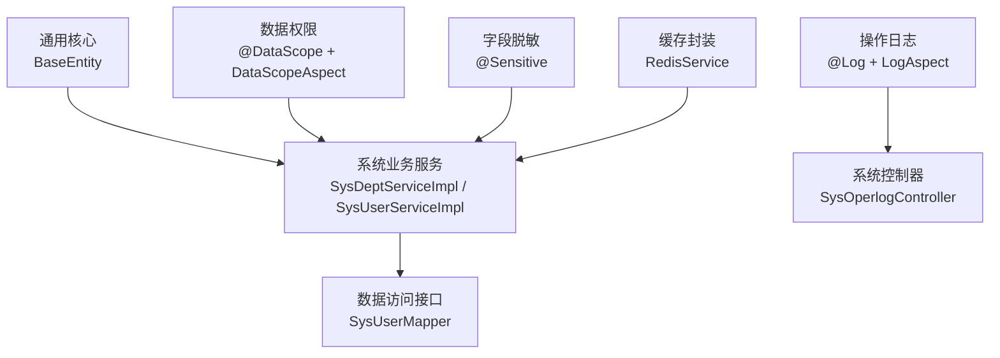
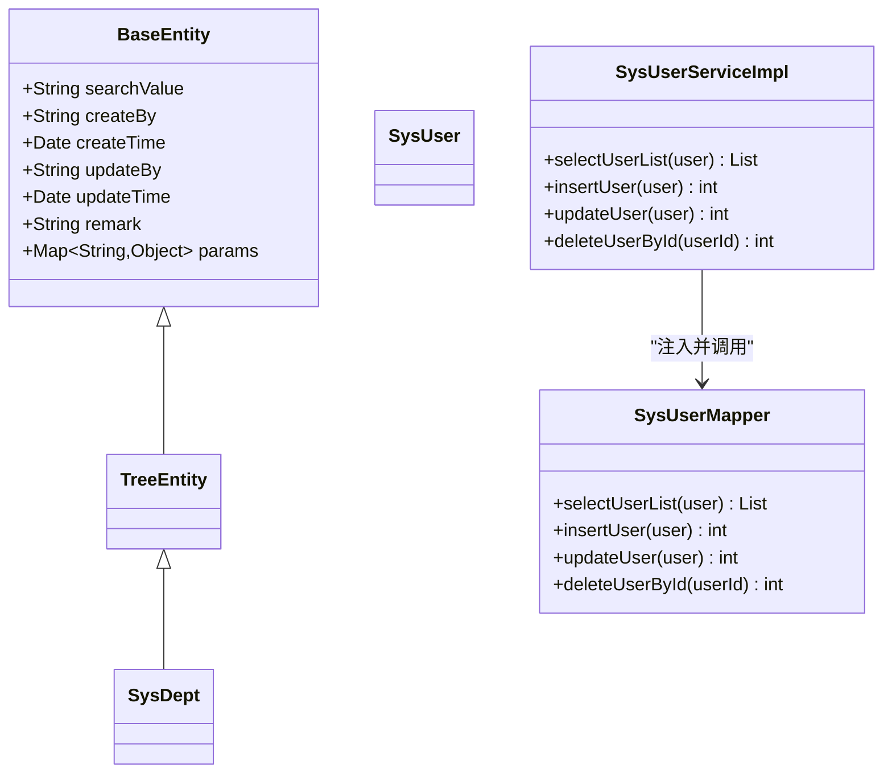
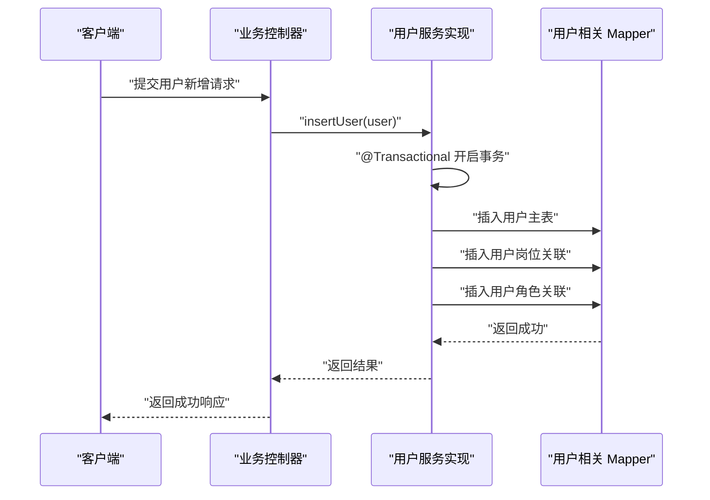
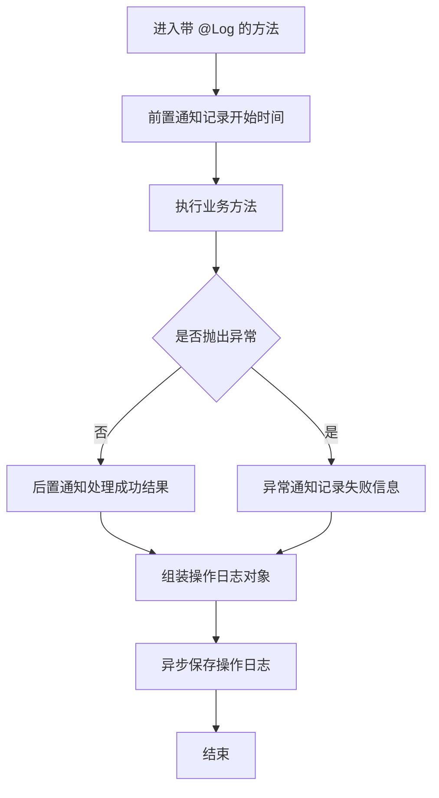
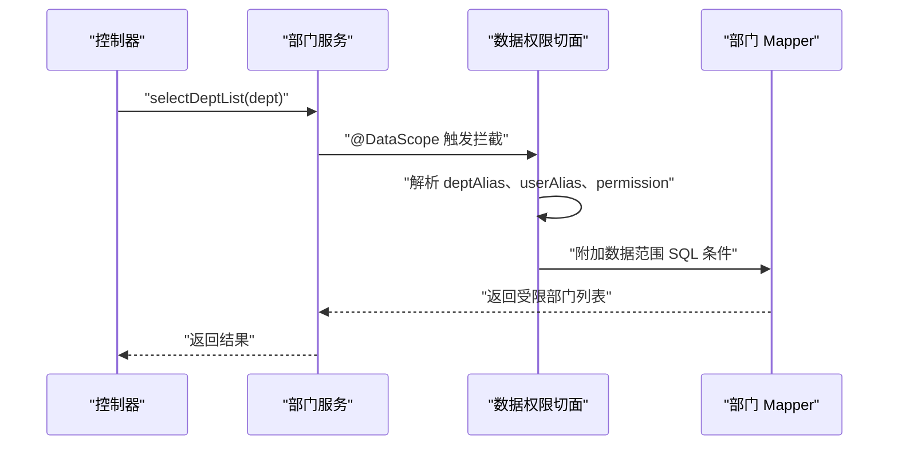
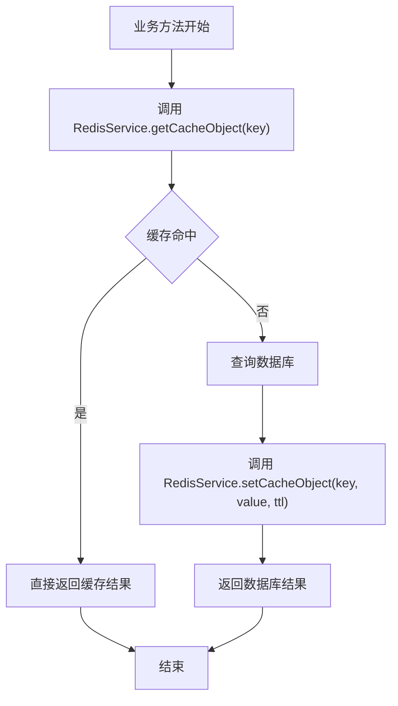
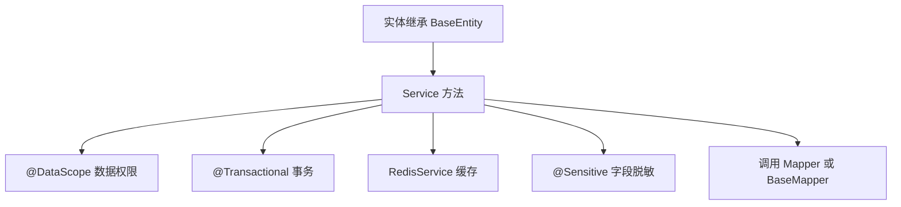

# 扩展通用模块

<cite>
**本文引用的文件**   
- [BaseEntity.java](file://zealux-ai-master/zealux-ai-common/zealux-ai-common-core/src/main/java/com/zealux/common/core/web/domain/BaseEntity.java)
- [DataScope.java](file://zealux-ai-master/zealux-ai-common/zealux-ai-common-datascope/src/main/java/com/zealux/common/datascope/annotation/DataScope.java)
- [DataScopeAspect.java](file://zealux-ai-master/zealux-ai-common/zealux-ai-common-datascope/src/main/java/com/zealux/common/datascope/aspect/DataScopeAspect.java)
- [LogAspect.java](file://zealux-ai-master/zealux-ai-common/zealux-ai-common-log/src/main/java/com/zealux/common/log/aspect/LogAspect.java)
- [SysOperlogController.java](file://zealux-ai-master/zealux-ai-modules/zealux-ai-system/src/main/java/com/zealux/system/controller/SysOperlogController.java)
- [Sensitive.java](file://zealux-ai-master/zealux-ai-common/ruoyi-common-sensitive/src/main/java/com/ruoyi/common/sensitive/annotation/Sensitive.java)
- [RedisService.java](file://zealux-ai-master/zealux-ai-common/zealux-ai-common-redis/src/main/java/com/zealux/common/redis/service/RedisService.java)
- [SysDeptServiceImpl.java](file://zealux-ai-master/zealux-ai-modules/zealux-ai-system/src/main/java/com/zealux/system/service/impl/SysDeptServiceImpl.java)
- [SysUserServiceImpl.java](file://zealux-ai-master/zealux-ai-modules/zealux-ai-system/src/main/java/com/zealux/system/service/impl/SysUserServiceImpl.java)
- [SysUserMapper.java](file://zealux-ai-master/zealux-ai-modules/zealux-ai-system/src/main/java/com/zealux/system/mapper/SysUserMapper.java)
</cite>

## 目录

1. [引言](#引言)
2. [项目结构定位](#项目结构定位)
3. [核心扩展组件总览](#核心扩展组件总览)
4. [实体基类与 MyBatis-Plus 集成方式](#实体基类与-mybatis-plus-集成方式)
5. [事务管理：@Transactional](#事务管理transactional)
6. [操作日志：@Log 注解与切面](#操作日志log-注解与切面)
7. [数据权限过滤：@DataScope](#数据权限过滤datascope)
8. [返回字段脱敏：@Sensitive](#返回字段脱敏sensitive)
9. [缓存工具 RedisService 的使用](#缓存工具-redisservice-的使用)
10. [典型组合用法](#典型组合用法)
11. [常见错误与排查](#常见错误与排查)
12. [结论](#结论)

## 引言

本文面向业务开发者，聚焦本仓库中可复用的通用能力：**实体基类、数据权限、操作日志、字段脱敏和 Redis 缓存封装**。文档会结合系统内已实现的部门管理与用户管理代码，说明在 Service、Controller、Mapper 层应如何组合使用这些能力。

需要特别注意：本仓库是开源 RuoYi-Cloud 的重命名二次开发，根 `pom.xml` 的 artifactId 为 `zealux-ai`、版本为 `3.6.5`；前端名称仍保留 `ruoyi@3.6.5`，公共库子目录仍沿用 `ruoyi-common-sensitive` 等历史命名。因此，本文在描述通用模块时，应以源码中的实际包名与路径为准，而不是假设所有名称都改为 `zealux-*`。

此外，仓库中存在两份逐字节相同的前端源码拷贝：独立仓库 `zealux-ai-ui-master` 与后端内的 `zealux-ai-master/zealux-ai-ui`。本文仅关注后端通用模块，不涉及前端页面构建细节。

## 项目结构定位

扩展通用模块主要分布在以下位置：

| 功能 | 所在模块 | 关键路径 |
|---|---|---|
| 实体基类 | `zealux-ai-common-core` | `com.zealux.common.core.web.domain.BaseEntity` |
| 数据权限注解与切面 | `zealux-ai-common-datascope` | `com.zealux.common.datascope.annotation.DataScope`、`com.zealux.common.datascope.aspect.DataScopeAspect` |
| 操作日志注解与切面 | `zealux-ai-common-log` | `com.zealux.common.log.annotation.Log`、`com.zealux.common.log.aspect.LogAspect` |
| 字段脱敏注解 | `ruoyi-common-sensitive` | `com.ruoyi.common.sensitive.annotation.Sensitive` |
| Redis 封装 | `zealux-ai-common-redis` | `com.zealux.common.redis.service.RedisService` |
| 示例 Service | `zealux-ai-modules/zealux-ai-system` | `SysDeptServiceImpl`、`SysUserServiceImpl` |
| 日志控制器示例 | `zealux-ai-modules/zealux-ai-system` | `SysOperlogController` |

**图表来源**
- [BaseEntity.java:1-122](file://zealux-ai-master/zealux-ai-common/zealux-ai-common-core/src/main/java/com/zealux/common/core/web/domain/BaseEntity.java#L1-L122)
- [DataScope.java:1-33](file://zealux-ai-master/zealux-ai-common/zealux-ai-common-datascope/src/main/java/com/zealux/common/datascope/annotation/DataScope.java#L1-L33)
- [LogAspect.java:1-200](file://zealux-ai-master/zealux-ai-common/zealux-ai-common-log/src/main/java/com/zealux/common/log/aspect/LogAspect.java#L1-L200)
- [Sensitive.java:1-24](file://zealux-ai-master/zealux-ai-common/ruoyi-common-sensitive/src/main/java/com/ruoyi/common/sensitive/annotation/Sensitive.java#L1-L24)
- [RedisService.java:1-200](file://zealux-ai-master/zealux-ai-common/zealux-ai-common-redis/src/main/java/com/zealux/common/redis/service/RedisService.java#L1-L200)
- [SysDeptServiceImpl.java:1-200](file://zealux-ai-master/zealux-ai-modules/zealux-ai-system/src/main/java/com/zealux/system/service/impl/SysDeptServiceImpl.java#L1-L200)
- [SysUserServiceImpl.java:1-200](file://zealux-ai-master/zealux-ai-modules/zealux-ai-system/src/main/java/com/zealux/system/service/impl/SysUserServiceImpl.java#L1-L200)
- [SysOperlogController.java:1-78](file://zealux-ai-master/zealux-ai-modules/zealux-ai-system/src/main/java/com/zealux/system/controller/SysOperlogController.java#L1-L78)
- [SysUserMapper.java:1-127](file://zealux-ai-master/zealux-ai-modules/zealux-ai-system/src/main/java/com/zealux/system/mapper/SysUserMapper.java#L1-L127)

**章节来源**
- [BaseEntity.java:1-122](file://zealux-ai-master/zealux-ai-common/zealux-ai-common-core/src/main/java/com/zealux/common/core/web/domain/BaseEntity.java#L1-L122)
- [DataScope.java:1-33](file://zealux-ai-master/zealux-ai-common/zealux-ai-common-datascope/src/main/java/com/zealux/common/datascope/annotation/DataScope.java#L1-L33)
- [LogAspect.java:1-200](file://zealux-ai-master/zealux-ai-common/zealux-ai-common-log/src/main/java/com/zealux/common/log/aspect/LogAspect.java#L1-L200)
- [RedisService.java:1-200](file://zealux-ai-master/zealux-ai-common/zealux-ai-common-redis/src/main/java/com/zealux/common/redis/service/RedisService.java#L1-L200)
- [SysDeptServiceImpl.java:1-200](file://zealux-ai-master/zealux-ai-modules/zealux-ai-system/src/main/java/com/zealux/system/service/impl/SysDeptServiceImpl.java#L1-L200)
- [SysUserServiceImpl.java:1-200](file://zealux-ai-master/zealux-ai-modules/zealux-ai-system/src/main/java/com/zealux/system/service/impl/SysUserServiceImpl.java#L1-L200)
- [SysOperlogController.java:1-78](file://zealux-ai-master/zealux-ai-modules/zealux-ai-system/src/main/java/com/zealux/system/controller/SysOperlogController.java#L1-L78)
- [SysUserMapper.java:1-127](file://zealux-ai-master/zealux-ai-modules/zealux-ai-system/src/main/java/com/zealux/system/mapper/SysUserMapper.java#L1-L127)

## 核心扩展组件总览

| 组件 | 类型 | 作用 | 适用层级 |
|---|---|---|---|
| `BaseEntity` | Java 基类 | 提供创建人、创建时间、更新人、更新时间、备注和扩展参数等通用字段 | 实体类 |
| `@DataScope` | 方法级注解 | 声明该查询方法需要按当前用户的部门或角色进行数据范围过滤 | Service 查询方法 |
| `@Log` | 方法级注解 | 标记 Controller 方法，由切面记录操作日志 | Controller 方法 |
| `@Sensitive` | 字段级注解 | 对 JSON 序列化时的敏感字段进行脱敏 | VO/DTO/实体返回字段 |
| `RedisService` | Spring 组件 | 封装 RedisTemplate 的常用缓存读写操作 | Service 层 |
| `@Transactional` | Spring 事务注解 | 保证多个数据库操作在同一事务中提交或回滚 | Service 方法 |

这些组件分别来自不同的公共子模块：`zealux-ai-common-core`、`zealux-ai-common-datascope`、`zealux-ai-common-log`、`ruoyi-common-sensitive` 和 `zealux-ai-common-redis`。业务模块通过依赖引入后，即可在 Service、Controller 和实体中使用。

**章节来源**
- [BaseEntity.java:1-122](file://zealux-ai-master/zealux-ai-common/zealux-ai-common-core/src/main/java/com/zealux/common/core/web/domain/BaseEntity.java#L1-L122)
- [DataScope.java:1-33](file://zealux-ai-master/zealux-ai-common/zealux-ai-common-datascope/src/main/java/com/zealux/common/datascope/annotation/DataScope.java#L1-L33)
- [LogAspect.java:1-200](file://zealux-ai-master/zealux-ai-common/zealux-ai-common-log/src/main/java/com/zealux/common/log/aspect/LogAspect.java#L1-L200)
- [Sensitive.java:1-24](file://zealux-ai-master/zealux-ai-common/ruoyi-common-sensitive/src/main/java/com/ruoyi/common/sensitive/annotation/Sensitive.java#L1-L24)
- [RedisService.java:1-200](file://zealux-ai-master/zealux-ai-common/zealux-ai-common-redis/src/main/java/com/zealux/common/redis/service/RedisService.java#L1-L200)

## 实体基类与 MyBatis-Plus 集成方式

### BaseEntity 的作用

`BaseEntity` 定义了跨表通用的审计字段：

| 字段 | 用途 | 特殊行为 |
|---|---|---|
| `searchValue` | 通用搜索条件 | 被 Jackson 忽略，不参与序列化 |
| `createBy` | 创建人标识 | 常规属性 |
| `createTime` | 创建时间 | 使用日期格式化注解输出 |
| `updateBy` | 最后更新人 | 常规属性 |
| `updateTime` | 最后更新时间 | 使用日期格式化注解输出 |
| `remark` | 备注信息 | 常规属性 |
| `params` | 扩展请求参数 | 默认懒加载空 Map，非空序列化 |

`BaseEntity` 还使用 MyBatis 的 `@TableField(exist = false)` 标注非数据库字段（如 `searchValue`、`params`），避免 ORM 映射报错。

### 是否继承 BaseEntity

在本仓库中，部分领域对象确实继承了通用基类。例如部门、菜单、通知、岗位等实体继承自 `TreeEntity`，而 `TreeEntity` 又基于 `BaseEntity`。这说明通用审计字段是通过实体继承链向上复用，而不是每个实体单独复制。

### 与 MyBatis-Plus 的关系

需要明确区分：

1. `BaseEntity` 是本项目自定义的实体基类，不是 MyBatis-Plus 的基类。
2. 本仓库的 `SysUserMapper` 是一个普通接口，没有继承 MyBatis-Plus 的 `BaseMapper`。
3. 本仓库的 `ISysUserService` 也没有继承 MyBatis-Plus 的 `IService`。
4. 项目中确实存在 `BaseEntity`、`@Transactional`、`@DataScope`、`@Log`、`@Sensitive` 和 `RedisService`，但并未在 `SysUserMapper` 或 `ISysUserService` 中看到直接继承 `BaseMapper` 或 `IService` 的代码。

因此，若你的目标是“在本仓库中遵循现有风格”，应优先参考 `SysUserServiceImpl` 直接注入 Mapper、手动调用 Mapper 方法的模式；若目标是“改用 MyBatis-Plus 的标准 `BaseMapper`/`IService` 模式”，则需要在新的业务模块中显式改造接口定义，不能假定现有代码已经实现了该模式。

**图表来源**
- [BaseEntity.java:1-122](file://zealux-ai-master/zealux-ai-common/zealux-ai-common-core/src/main/java/com/zealux/common/core/web/domain/BaseEntity.java#L1-L122)
- [SysUserMapper.java:1-127](file://zealux-ai-master/zealux-ai-modules/zealux-ai-system/src/main/java/com/zealux/system/mapper/SysUserMapper.java#L1-L127)
- [SysUserServiceImpl.java:1-200](file://zealux-ai-master/zealux-ai-modules/zealux-ai-system/src/main/java/com/zealux/system/service/impl/SysUserServiceImpl.java#L1-L200)

**章节来源**
- [BaseEntity.java:1-122](file://zealux-ai-master/zealux-ai-common/zealux-ai-common-core/src/main/java/com/zealux/common/core/web/domain/BaseEntity.java#L1-L122)
- [SysUserMapper.java:1-127](file://zealux-ai-master/zealux-ai-modules/zealux-ai-system/src/main/java/com/zealux/system/mapper/SysUserMapper.java#L1-L127)
- [SysUserServiceImpl.java:1-200](file://zealux-ai-master/zealux-ai-modules/zealux-ai-system/src/main/java/com/zealux/system/service/impl/SysUserServiceImpl.java#L1-L200)

## 事务管理：@Transactional

### 现有实现模式

`SysUserServiceImpl` 在多个涉及多表写入的方法上使用了 `@Transactional(rollbackFor = Exception.class)`：

| 方法 | 事务语义 |
|---|---|
| `insertUser` | 新增用户、岗位关联、角色关联在一个事务中完成 |
| `updateUser` | 删除旧角色、新增新角色、删除旧岗位、新增新岗位在一个事务中完成 |
| `insertUserAuth` | 删除用户原有角色后再批量分配 |
| `deleteUserById` | 删除用户角色、岗位和用户主记录 |
| `deleteUserByIds` | 批量删除用户及其关联数据 |

这种写法的核心原则是：**把一次业务操作对应的多次数据库写入放在同一个事务里**，任一失败就整体回滚。

### 设计要点

1. **只加在 Service 层**：Controller 只做请求接入，数据库事务应下沉到 Service。
2. **指定回滚异常**：示例使用 `Exception.class`，使受检与非受检异常都能触发回滚。
3. **避免自调用失效**：如果事务方法内部再调用同类其他事务方法，需要通过 AOP 代理调用，否则可能无法开启新事务。
4. **不要覆盖全局配置而不加说明**：如果团队希望只回滚运行时异常，应在统一规范中明确，而不是随意修改默认行为。

### 典型调用流程

**图表来源**
- [SysUserServiceImpl.java:260-318](file://zealux-ai-master/zealux-ai-modules/zealux-ai-system/src/main/java/com/zealux/system/service/impl/SysUserServiceImpl.java#L260-L318)

**章节来源**
- [SysUserServiceImpl.java:260-318](file://zealux-ai-master/zealux-ai-modules/zealux-ai-system/src/main/java/com/zealux/system/service/impl/SysUserServiceImpl.java#L260-L318)
- [SysUserServiceImpl.java:445-469](file://zealux-ai-master/zealux-ai-modules/zealux-ai-system/src/main/java/com/zealux/system/service/impl/SysUserServiceImpl.java#L445-L469)

## 操作日志：@Log 注解与切面

### 注解名称澄清

仓库中没有名为 `@Operlog` 的注解。实际用于 Controller 操作日志的注解是 `@Log`，其全限定包位于日志公共模块中。`SysOperlogController` 中导入了 `com.zealux.common.log.annotation.Log`，并在导出、删除、清理等方法上使用它。

因此，业务开发者在 Controller 方法上应使用 `@Log`，而不是自行发明一个不存在的 `@Operlog`。

### 日志切面工作原理

`LogAspect` 是一个 AspectJ 切面，通过 `@Before`、`@AfterReturning`、`@AfterThrowing` 拦截带有 `@Log` 注解的方法，并执行以下逻辑：

1. 记录请求开始时间。
2. 获取远程 IP、请求 URI、用户名。
3. 设置方法签名和 HTTP 方法。
4. 从注解读取业务类型、标题、操作人类型等信息。
5. 根据配置决定是否保存请求参数和响应体。
6. 计算耗时。
7. 通过异步日志服务写入操作日志。

**图表来源**
- [LogAspect.java:1-200](file://zealux-ai-master/zealux-ai-common/zealux-ai-common-log/src/main/java/com/zealux/common/log/aspect/LogAspect.java#L1-L200)

### 控制器中的使用方式

`SysOperlogController` 展示了三种典型用法：

| 场景 | 注解组合 | 说明 |
|---|---|---|
| 导出操作日志 | `@Log(title="操作日志", businessType=EXPORT)` + `@RequiresPermissions` | 记录导出动作 |
| 删除操作日志 | `@Log(title="操作日志", businessType=DELETE)` + `@RequiresPermissions` | 记录删除动作 |
| 清理操作日志 | `@Log(title="操作日志", businessType=CLEAN)` + `@RequiresPermissions` | 记录清理动作 |

**章节来源**
- [LogAspect.java:1-200](file://zealux-ai-master/zealux-ai-common/zealux-ai-common-log/src/main/java/com/zealux/common/log/aspect/LogAspect.java#L1-L200)
- [SysOperlogController.java:1-78](file://zealux-ai-master/zealux-ai-modules/zealux-ai-system/src/main/java/com/zealux/system/controller/SysOperlogController.java#L1-L78)

## 数据权限过滤：@DataScope

### 注解定义

`@DataScope` 是一个方法级注解，包含三个主要属性：

| 属性 | 默认值 | 含义 |
|---|---:|---|
| `deptAlias` | 空字符串 | 部门表别名 |
| `userAlias` | 空字符串 | 用户表别名 |
| `permission` | 空字符串 | 权限字符，多个用逗号分隔 |

注解目标为 `METHOD`，运行期可见，属于标准 Java 注解。

### 在 Service 中的用法

`SysDeptServiceImpl.selectDeptList` 在方法上加了 `@DataScope(deptAlias = "d")`，表示该查询需要根据当前登录用户的数据权限，限制只能看到其有权访问的部门。

`SysUserServiceImpl` 中多个用户查询方法也使用了 `@DataScope(deptAlias = "d", userAlias = "u")`，同时绑定部门表和用户表别名，从而支持更复杂的部门与用户关联权限。

### 切面执行机制

`DataScopeAspect` 是数据权限的实际拦截器。当 Service 方法被调用时，它会解析 `@DataScope` 的属性，并结合当前安全上下文生成 SQL 片段，最终应用到 Mapper 的查询语句中。

**图表来源**
- [DataScope.java:1-33](file://zealux-ai-master/zealux-ai-common/zealux-ai-common-datascope/src/main/java/com/zealux/common/datascope/annotation/DataScope.java#L1-L33)
- [SysDeptServiceImpl.java:1-200](file://zealux-ai-master/zealux-ai-modules/zealux-ai-system/src/main/java/com/zealux/system/service/impl/SysDeptServiceImpl.java#L1-L200)
- [SysUserServiceImpl.java:1-200](file://zealux-ai-master/zealux-ai-modules/zealux-ai-system/src/main/java/com/zealux/system/service/impl/SysUserServiceImpl.java#L1-L200)

### 注意事项

1. 必须确保 Mapper SQL 中使用的表别名与 `deptAlias`、`userAlias` 一致。
2. 如果查询没有使用部门或用户表别名，注解可能无法正确拼接权限条件。
3. 数据权限切面依赖于安全上下文；未登录或上下文缺失时，权限判断可能不符合预期。
4. 不要在不需要数据权限过滤的地方滥用 `@DataScope`，否则会增加 SQL 复杂度。

**章节来源**
- [DataScope.java:1-33](file://zealux-ai-master/zealux-ai-common/zealux-ai-common-datascope/src/main/java/com/zealux/common/datascope/annotation/DataScope.java#L1-L33)
- [SysDeptServiceImpl.java:1-200](file://zealux-ai-master/zealux-ai-modules/zealux-ai-system/src/main/java/com/zealux/system/service/impl/SysDeptServiceImpl.java#L1-L200)
- [SysUserServiceImpl.java:1-200](file://zealux-ai-master/zealux-ai-modules/zealux-ai-system/src/main/java/com/zealux/system/service/impl/SysUserServiceImpl.java#L1-L200)

## 返回字段脱敏：@Sensitive

### 注解定义

`@Sensitive` 是一个字段级注解，位于 `ruoyi-common-sensitive` 模块中。它通过 Jackson 序列化处理器 `SensitiveJsonSerializer` 实现返回数据的脱敏。注解要求指定一个 `DesensitizedType`，用于选择脱敏策略。

### 使用场景

适合放在对用户隐私敏感的字段上，例如手机号、身份证号、邮箱、银行卡号等。字段脱敏发生在 JSON 序列化阶段，也就是说：

- 数据库中可以存储明文；
- Service 层拿到的是完整对象；
- 只有返回给前端时才按策略脱敏。

### 建议

1. 不要把 `@Sensitive` 加到所有字段，只对真正敏感字段添加。
2. 如果需要管理员查看明文，可通过不同 VO 或 API 控制脱敏策略。
3. 脱敏只是展示层保护，不应替代数据库加密、传输加密和权限控制。

**章节来源**
- [Sensitive.java:1-24](file://zealux-ai-master/zealux-ai-common/ruoyi-common-sensitive/src/main/java/com/ruoyi/common/sensitive/annotation/Sensitive.java#L1-L24)

## 缓存工具 RedisService 的使用

### 提供的能力

`RedisService` 封装了 Spring Data Redis 的常用操作，包括：

| 类别 | 方法示例 | 用途 |
|---|---|---|
| 基本对象 | `setCacheObject(key, value)` | 缓存字符串、数字、实体等 |
| 带过期时间 | `setCacheObject(key, value, timeout, timeUnit)` | 设置 TTL |
| 过期时间 | `expire(key, timeout)` | 更新已有 key 的过期时间 |
| 存在性检查 | `hasKey(key)` | 判断 key 是否存在 |
| 获取对象 | `getCacheObject(key)` | 从缓存读取 |
| 删除 | `deleteObject(key)` | 删除单个 key |
| 集合 | `setCacheSet/getCacheSet` | 缓存无序集合 |
| 列表 | `setCacheList/getCacheList` | 缓存有序列表 |
| 哈希 | `setCacheMap/getCacheMap` | 缓存键值对 |

### 推荐 Key 设计

缓存 key 应满足以下条件：

1. **唯一性**：不同业务、不同维度不能冲突。
2. **可读性**：便于运维定位，建议使用冒号或点号分层，例如业务前缀、资源类型、业务主键。
3. **稳定性**：key 变化会导致缓存失效，频繁变化的 key 会降低命中率。
4. **长度控制**：避免过长 key 增加网络开销和内存占用。
5. **避免敏感信息**：不要把密码、token 明文放入 key。

### 使用建议

1. 读多写少场景优先考虑缓存。
2. 写操作后及时删除或更新对应缓存，避免脏数据。
3. 为易过期数据设置合理 TTL。
4. 对大对象谨慎缓存，注意序列化体积。
5. 连接 Redis 前确认 Nacos 配置和 Redis 服务可用。

**图表来源**
- [RedisService.java:1-200](file://zealux-ai-master/zealux-ai-common/zealux-ai-common-redis/src/main/java/com/zealux/common/redis/service/RedisService.java#L1-L200)

**章节来源**
- [RedisService.java:1-200](file://zealux-ai-master/zealux-ai-common/zealux-ai-common-redis/src/main/java/com/zealux/common/redis/service/RedisService.java#L1-L200)

## 典型组合用法

### Service 层：实体基类、数据权限、事务、缓存

以用户或部门相关业务为例，推荐的组合方式是：

1. 实体继承 `BaseEntity`，获得通用审计字段。
2. Service 方法使用 `@DataScope` 做数据权限过滤。
3. 涉及多表写入的方法使用 `@Transactional(rollbackFor = Exception.class)`。
4. 读多写少的查询可先查 `RedisService`，未命中再查数据库并回填缓存。
5. 返回给前端的对象上对敏感字段使用 `@Sensitive`。

[本图为概念组合图，不直接映射具体源码文件]

### Controller 层：操作日志与权限

Controller 应：

1. 使用 `@Log` 标注需要记录的操作。
2. 使用权限注解控制访问。
3. 把复杂业务交给 Service。
4. 返回统一的响应结构。

`SysOperlogController` 就是这一模式的体现：导出、删除、清理等操作都通过 `@Log` 记录业务类型和标题。

### 推荐的最小实现清单

| 层级 | 必须检查项 |
|---|---|
| 实体 | 是否继承合适的基类、是否标注非数据库字段 |
| Service | 是否加 `@DataScope`、是否加 `@Transactional`、是否正确使用 `RedisService` |
| Controller | 是否加 `@Log`、是否加权限控制 |
| Mapper | SQL 中表别名是否与 `@DataScope` 一致 |
| 返回对象 | 敏感字段是否加 `@Sensitive` |
| 环境 | Redis 是否可连接、日志切面是否启用 |

**章节来源**
- [SysDeptServiceImpl.java:1-200](file://zealux-ai-master/zealux-ai-modules/zealux-ai-system/src/main/java/com/zealux/system/service/impl/SysDeptServiceImpl.java#L1-L200)
- [SysUserServiceImpl.java:1-200](file://zealux-ai-master/zealux-ai-modules/zealux-ai-system/src/main/java/com/zealux/system/service/impl/SysUserServiceImpl.java#L1-L200)
- [SysOperlogController.java:1-78](file://zealux-ai-master/zealux-ai-modules/zealux-ai-system/src/main/java/com/zealux/system/controller/SysOperlogController.java#L1-L78)

## 常见错误与排查

### 1. 误以为注解叫 `@Operlog`

仓库中没有名为 `@Operlog` 的注解。Controller 操作日志使用的是 `@Log`。若编译时报找不到 `@Operlog`，请检查导入包是否为 `com.zealux.common.log.annotation.Log`。

**排查建议**：对照 `SysOperlogController` 中的导入和方法注解。

**章节来源**
- [SysOperlogController.java:1-78](file://zealux-ai-master/zealux-ai-modules/zealux-ai-system/src/main/java/com/zealux/system/controller/SysOperlogController.java#L1-L78)

### 2. 日志没有落库

可能原因：

- 切面类没有被 Spring 扫描为组件。
- 方法上没有加 `@Log`。
- 切面未被 AOP 生效。
- 异步日志服务不可用或写入失败。

**排查建议**：确认 `LogAspect` 已被加载，并检查 `SysOperlogController` 中方法是否加了 `@Log`。

**章节来源**
- [LogAspect.java:1-200](file://zealux-ai-master/zealux-ai-common/zealux-ai-common-log/src/main/java/com/zealux/common/log/aspect/LogAspect.java#L1-L200)
- [SysOperlogController.java:1-78](file://zealux-ai-master/zealux-ai-modules/zealux-ai-system/src/main/java/com/zealux/system/controller/SysOperlogController.java#L1-L78)

### 3. 数据权限没有生效

可能原因：

- 方法上没有加 `@DataScope`。
- `deptAlias`、`userAlias` 与 Mapper SQL 中的表别名不一致。
- 当前用户没有有效的安全上下文。
- Mapper SQL 没有包含必要的部门或用户关联条件。

**排查建议**：从 `SysDeptServiceImpl` 和 `SysUserServiceImpl` 中对比注解属性与 SQL 表别名。

**章节来源**
- [DataScope.java:1-33](file://zealux-ai-master/zealux-ai-common/zealux-ai-common-datascope/src/main/java/com/zealux/common/datascope/annotation/DataScope.java#L1-L33)
- [SysDeptServiceImpl.java:1-200](file://zealux-ai-master/zealux-ai-modules/zealux-ai-system/src/main/java/com/zealux/system/service/impl/SysDeptServiceImpl.java#L1-L200)
- [SysUserServiceImpl.java:1-200](file://zealux-ai-master/zealux-ai-modules/zealux-ai-system/src/main/java/com/zealux/system/service/impl/SysUserServiceImpl.java#L1-L200)

### 4. 事务没有回滚

可能原因：

- 没有在 Service 方法上加 `@Transactional`。
- 异常类型不在回滚范围内。
- 同类内部自调用导致事务未生效。
- 捕获了异常但没有重新抛出。

**排查建议**：参考 `SysUserServiceImpl` 中 `insertUser`、`updateUser`、`deleteUserById` 等方法的写法。

**章节来源**
- [SysUserServiceImpl.java:260-318](file://zealux-ai-master/zealux-ai-modules/zealux-ai-system/src/main/java/com/zealux/system/service/impl/SysUserServiceImpl.java#L260-L318)
- [SysUserServiceImpl.java:445-469](file://zealux-ai-master/zealux-ai-modules/zealux-ai-system/src/main/java/com/zealux/system/service/impl/SysUserServiceImpl.java#L445-L469)

### 5. Redis 未连接或缓存不可用

可能原因：

- Redis 服务未启动。
- Nacos 中 Redis 配置不正确。
- 本地 Redis 缺少 RediSearch 或其他必要模块。
- key 不存在时没有正确处理空值。

**排查建议**：确认 `RedisService` 能正常注入，并使用 `hasKey`、`getCacheObject` 验证连接状态。

**章节来源**
- [RedisService.java:1-200](file://zealux-ai-master/zealux-ai-common/zealux-ai-common-redis/src/main/java/com/zealux/common/redis/service/RedisService.java#L1-L200)

### 6. 敏感字段没有脱敏

可能原因：

- 没有给字段加 `@Sensitive`。
- 返回的不是被 Jackson 序列化的对象。
- 自定义序列化逻辑覆盖了脱敏处理器。

**排查建议**：确认字段上添加了 `@Sensitive`，并检查返回对象的序列化路径。

**章节来源**
- [Sensitive.java:1-24](file://zealux-ai-master/zealux-ai-common/ruoyi-common-sensitive/src/main/java/com/ruoyi/common/sensitive/annotation/Sensitive.java#L1-L24)

## 结论

本仓库的扩展通用模块提供了业务系统常见的横切能力：

- 通过 `BaseEntity` 统一实体审计字段；
- 通过 `@DataScope` 实现部门级数据权限过滤；
- 通过 `@Log` 与切面记录 Controller 操作方法日志；
- 通过 `@Sensitive` 对返回字段进行脱敏；
- 通过 `RedisService` 简化 Redis 缓存操作；
- 通过 `@Transactional` 保证多表写入的一致性。

在实际业务开发中，应优先参考 `SysDeptServiceImpl`、`SysUserServiceImpl` 和 `SysOperlogController` 的实现方式，确保注解、切面、Mapper 别名和事务边界保持一致。同时要避免把尚未实现的 CRM 能力、CRM 路由或 CRM 表结构当作系统已具备的功能。