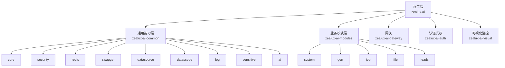
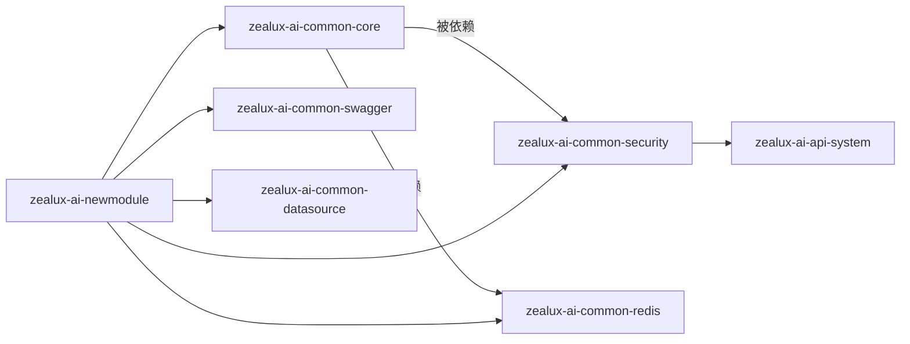
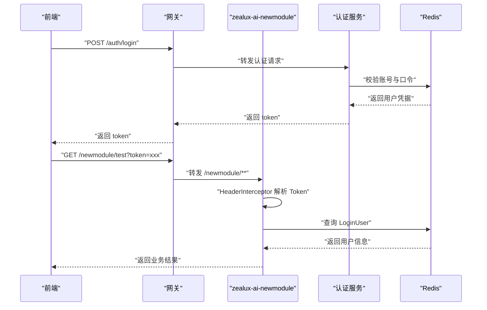

# 新增微服务模块

<cite>
**本文引用的文件**   
- [zealux-ai-master/pom.xml](file://zealux-ai-master/pom.xml)
- [zealux-ai-master/zealux-ai-modules/pom.xml](file://zealux-ai-master/zealux-ai-modules/pom.xml)
- [zealux-ai-master/zealux-ai-common/pom.xml](file://zealux-ai-master/zealux-ai-common/pom.xml)
- [zealux-ai-master/zealux-ai-modules/zealux-ai-system/pom.xml](file://zealux-ai-master/zealux-ai-modules/zealux-ai-system/pom.xml)
- [zealux-ai-master/zealux-ai-modules/zealux-ai-system/src/main/java/com/zealux/system/RuoYiSystemApplication.java](file://zealux-ai-master/zealux-ai-modules/zealux-ai-system/src/main/java/com/zealux/system/RuoYiSystemApplication.java)
- [zealux-ai-master/zealux-ai-auth/src/main/java/com/zealux/auth/RuoYiAuthApplication.java](file://zealux-ai-master/zealux-ai-auth/src/main/java/com/zealux/auth/RuoYiAuthApplication.java)
- [zealux-ai-master/zealux-ai-modules/zealux-ai-system/src/main/resources/bootstrap.yml](file://zealux-ai-master/zealux-ai-modules/zealux-ai-system/src/main/resources/bootstrap.yml)
- [zealux-ai-master/zealux-ai-auth/src/main/resources/bootstrap.yml](file://zealux-ai-master/zealux-ai-auth/src/main/resources/bootstrap.yml)
- [zealux-ai-master/zealux-ai-gateway/src/main/resources/bootstrap.yml](file://zealux-ai-master/zealux-ai-gateway/src/main/resources/bootstrap.yml)
- [zealux-ai-master/zealux-ai-gateway/src/main/java/com/zealux/gateway/config/RouterFunctionConfiguration.java](file://zealux-ai-master/zealux-ai-gateway/src/main/java/com/zealux/gateway/config/RouterFunctionConfiguration.java)
- [zealux-ai-master/zealux-ai-common/zealux-ai-common-core/pom.xml](file://zealux-ai-master/zealux-ai-common/zealux-ai-common-core/pom.xml)
- [zealux-ai-master/zealux-ai-common/zealux-ai-common-security/pom.xml](file://zealux-ai-master/zealux-ai-common/zealux-ai-common-security/pom.xml)
- [zealux-ai-master/zealux-ai-common/zealux-ai-common-redis/pom.xml](file://zealux-ai-master/zealux-ai-common/zealux-ai-common-redis/pom.xml)
- [zealux-ai-master/zealux-ai-common/zealux-ai-common-core/src/main/java/com/zealux/common/core/constant/ServiceNameConstants.java](file://zealux-ai-master/zealux-ai-common/zealux-ai-common-core/src/main/java/com/zealux/common/core/constant/ServiceNameConstants.java)
- [zealux-ai-master/zealux-ai-common/zealux-ai-common-security/src/main/java/com/zealux/common/security/interceptor/HeaderInterceptor.java](file://zealux-ai-master/zealux-ai-common/zealux-ai-common-security/src/main/java/com/zealux/common/security/interceptor/HeaderInterceptor.java)
</cite>

## 目录
1. [引言](#引言)
2. [项目结构总览](#项目结构总览)
3. [新增模块的完整步骤](#新增模块的完整步骤)
4. [依赖与通用能力复用](#依赖与通用能力复用)
5. [网关路由与鉴权拦截](#网关路由与鉴权拦截)
6. [最小可运行示例说明](#最小可运行示例说明)
7. [本地启动与验证](#本地启动与验证)
8. [常见问题排查](#常见问题排查)
9. [结论](#结论)

## 引言
本指南面向需要在当前基于 RuoYi-Cloud 二次开发的 zealux-ai 项目中新增一个微服务模块的开发者。项目根 Maven 工程 artifactId 为 `zealux-ai`、版本为 `3.6.5`，采用 Spring Cloud Alibaba + Nacos 作为注册中心与配置中心，前端以独立仓库 `zealux-ai-ui-master` 为准。

需要特别说明的是：虽然业务包名和若干类仍沿用 RuoYi 风格（例如部分启动类名为 `RuoYi*Application.java`），但根工程的坐标、公共库分组均为 `com.zealux`，因此新增模块应遵循本仓库现有的命名和依赖约定，而不是复制 RuoYi 原始仓库结构。



**图示来源**
- [zealux-ai-master/pom.xml](file://zealux-ai-master/pom.xml)
- [zealux-ai-master/zealux-ai-common/pom.xml](file://zealux-ai-master/zealux-ai-common/pom.xml)
- [zealux-ai-master/zealux-ai-modules/pom.xml](file://zealux-ai-master/zealux-ai-modules/pom.xml)

**章节来源**
- [zealux-ai-master/pom.xml:1-20](file://zealux-ai-master/pom.xml#L1-L20)
- [zealux-ai-master/zealux-ai-common/pom.xml:1-31](file://zealux-ai-master/zealux-ai-common/pom.xml#L1-L31)
- [zealux-ai-master/zealux-ai-modules/pom.xml:1-26](file://zealux-ai-master/zealux-ai-modules/pom.xml#L1-L26)

## 项目结构总览
zealux-ai 是聚合 Maven 工程，核心分层如下：

| 层级 | 路径 | 职责 |
|---|---|---|
| 根工程 | `zealux-ai-master/pom.xml` | 统一 Java 17、Spring Boot 3.3.5、Spring Cloud 2023.0.3、Spring Cloud Alibaba 2023.0.1.2、MyBatis-Plus、Fastjson2、JWT 等依赖版本，并声明公共模块坐标 |
| 通用能力层 | `zealux-ai-master/zealux-ai-common` | 提供 core、security、redis、swagger、datasource、datascope、log、sensitive、ai 九个非空子模块 |
| 业务模块层 | `zealux-ai-master/zealux-ai-modules` | 聚合 system、gen、job、file、leads 等业务服务 |
| 网关 | `zealux-ai-master/zealux-ai-gateway` | 暴露 `/auth/**`、`/system/**`、`/code/**`、`/schedule/**`、`/file/**` 等前缀路由 |
| 认证授权 | `zealux-ai-master/zealux-ai-auth` | 登录、令牌签发、验证码校验等鉴权能力 |
| 可视化监控 | `zealux-ai-master/zealux-ai-visual` | 监控相关子服务 |
| 前端 | `zealux-ai-ui-master` | Vue 前端源码；后端内嵌的 `zealux-ai-ui` 是重复拷贝，不应视为第二个前端模块 |

**章节来源**
- [zealux-ai-master/zealux-ai-common/pom.xml:10-29](file://zealux-ai-master/zealux-ai-common/pom.xml#L10-L29)
- [zealux-ai-master/zealux-ai-modules/pom.xml:12-21](file://zealux-ai-master/zealux-ai-modules/pom.xml#L12-L21)
- [zealux-ai-master/zealux-ai-gateway/src/main/resources/bootstrap.yml:1-44](file://zealux-ai-master/zealux-ai-gateway/src/main/resources/bootstrap.yml#L1-L44)

## 新增模块的完整步骤
假设新增一个名为 `zealux-ai-newmodule` 的微服务，端口为 `9302`，对外暴露前缀 `/newmodule/**`。

### 第一步：在根工程中声明模块
根工程 `zealux-ai-master/pom.xml` 已经声明了 Spring Cloud、Nacos、MyBatis-Plus、Swagger、JWT 等依赖管理。新增模块通常不需要修改根工程依赖版本，只需让新模块继承该父工程即可。

### 第二步：在 zealux-ai-modules 下创建 Maven 子模块
在 `zealux-ai-master/zealux-ai-modules/pom.xml` 中新增 `<module>` 条目，使 Maven 能构建该服务。参考现有 system 模块：

```xml
<modules>
    <module>zealux-ai-system</module>
    <module>zealux-ai-gen</module>
    <module>zealux-ai-job</module>
    <module>zealux-ai-file</module>
    <module>zealux-ai-leads</module>
    <module>zealux-ai-newmodule</module>
</modules>
```

**章节来源**
- [zealux-ai-master/zealux-ai-modules/pom.xml:12-21](file://zealux-ai-master/zealux-ai-modules/pom.xml#L12-L21)

### 第三步：编写模块 pom.xml
新建 `zealux-ai-master/zealux-ai-modules/zealux-ai-newmodule/pom.xml`，parent 指向 `zealux-ai-modules`，artifactId 使用 `zealux-ai-modules-newmodule`，并引入所需依赖。最小依赖建议如下：

| 依赖 | 用途 |
|---|---|
| `spring-cloud-starter-alibaba-nacos-discovery` | 向 Nacos 注册服务 |
| `spring-cloud-starter-alibaba-nacos-config` | 从 Nacos 拉取配置 |
| `spring-boot-starter-web` | Web 容器 |
| `zealux-ai-common-core` | 基础常量、异常、工具、分页、Feign 基础 |
| `zealux-ai-common-security` | 鉴权注解、全局异常、Token 解析、Feign 请求头拦截 |
| `zealux-ai-common-swagger` | Swagger/OpenAPI 文档 |
| `zealux-ai-common-datasource` | 数据源自动装配 |
| `zealux-ai-common-redis` | Redis 缓存能力 |
| `mysql-connector-j` | MySQL 驱动 |
| `spring-boot-starter-actuator` | 健康检查与监控端点 |

参考 system 模块的依赖结构：

**章节来源**
- [zealux-ai-master/zealux-ai-modules/zealux-ai-system/pom.xml:1-93](file://zealux-ai-master/zealux-ai-modules/zealux-ai-system/pom.xml#L1-L93)

### 第四步：编写 Spring Boot 启动类
新建启动类，例如 `com.zealux.newmodule.ZealuxNewModuleApplication`，要求：

1. 使用 `@SpringBootApplication`。
2. 添加 `@EnableCustomConfig`，启用安全模块提供的自定义配置。
3. 添加 `@EnableRyFeignClients`，启用 Feign 客户端扫描。
4. 通过 `SpringApplication.run(...)` 启动应用。

现有 system 模块的启动类是最直接参考：

```java
@EnableCustomConfig
@EnableRyFeignClients
@SpringBootApplication
public class RuoYiSystemApplication {
    public static void main(String[] args) {
        SpringApplication.run(RuoYiSystemApplication.class, args);
    }
}
```

认证模块 `RuoYiAuthApplication` 则排除了数据源自动装配，因为认证服务本身不直接访问业务数据库。新增模块若需要数据库，应保留默认装配；若只是纯 API 网关转发或轻量服务，可参考认证模块排除数据源。

**章节来源**
- [zealux-ai-master/zealux-ai-modules/zealux-ai-system/src/main/java/com/zealux/system/RuoYiSystemApplication.java:1-32](file://zealux-ai-master/zealux-ai-modules/zealux-ai-system/src/main/java/com/zealux/system/RuoYiSystemApplication.java#L1-L32)
- [zealux-ai-master/zealux-ai-auth/src/main/java/com/zealux/auth/RuoYiAuthApplication.java:1-31](file://zealux-ai-master/zealux-ai-auth/src/main/java/com/zealux/auth/RuoYiAuthApplication.java#L1-L31)

### 第五步：创建 bootstrap.yml 并连接 Nacos
新建 `src/main/resources/bootstrap.yml`，至少包含：

| 配置项 | 说明 |
|---|---|
| `server.port` | 服务端口，例如 `9302` |
| `spring.application.name` | 服务名，例如 `zealux-ai-newmodule` |
| `spring.profiles.active` | 环境，例如 `dev` |
| `spring.cloud.nacos.discovery.server-addr` | Nacos 注册地址，例如 `127.0.0.1:8848` |
| `spring.cloud.nacos.config.server-addr` | Nacos 配置地址 |
| `spring.cloud.nacos.config.file-extension` | 配置文件扩展名，代码中为 `yml` |
| `spring.cloud.nacos.config.shared-configs` | 共享配置，加载 `application-{profile}.yml` |

参考 system 和 auth 模块的 `bootstrap.yml`：

**章节来源**
- [zealux-ai-master/zealux-ai-modules/zealux-ai-system/src/main/resources/bootstrap.yml:1-25](file://zealux-ai-master/zealux-ai-modules/zealux-ai-system/src/main/resources/bootstrap.yml#L1-L25)
- [zealux-ai-master/zealux-ai-auth/src/main/resources/bootstrap.yml:1-25](file://zealux-ai-master/zealux-ai-auth/src/main/resources/bootstrap.yml#L1-L25)

### 第六步：在 Nacos 中添加服务配置 dataId
Nacos 中新增一个 dataId，名称通常为 `{service}-dev.yml`。对于新服务，dataId 应为：

| dataId | groupId | 作用 |
|---|---|---|
| `zealux-ai-newmodule-dev.yml` | 默认组 | 新服务的开发环境配置 |
| `application-dev.yml` | 默认组 | 共享配置，由 `shared-configs` 加载 |

`application-dev.yml` 中应包含：

| 配置键 | 示例值 | 说明 |
|---|---|---|
| `spring.datasource.url` | `jdbc:mysql://...` | 数据库连接 |
| `spring.datasource.username` | 占位账号 | 数据库用户名 |
| `spring.datasource.password` | 占位口令 | 数据库密码 |
| `spring.redis.host` | `127.0.0.1` | Redis 主机 |
| `spring.redis.port` | `6379` | Redis 端口 |
| `springdoc.swagger-ui.path` | `/swagger-ui.html` | Swagger UI 路径 |
| `springdoc.api-docs.path` | `/v3/api-docs` | OpenAPI JSON 路径 |
| `feign.client.config.default.connect-timeout-millis` | 数值 | Feign 超时时间 |
| `feign.client.config.default.read-timeout-millis` | 数值 | Feign 读取超时 |

注意：不要在工作区日志或本地临时文件中粘贴真实账号、口令或 token。

**章节来源**
- [zealux-ai-master/zealux-ai-modules/zealux-ai-system/src/main/resources/bootstrap.yml:10-25](file://zealux-ai-master/zealux-ai-modules/zealux-ai-system/src/main/resources/bootstrap.yml#L10-L25)
- [zealux-ai-master/zealux-ai-gateway/src/main/resources/bootstrap.yml:10-30](file://zealux-ai-master/zealux-ai-gateway/src/main/resources/bootstrap.yml#L10-L30)

## 依赖与通用能力复用
新增模块应优先复用通用模块，避免在每个服务中重复实现相同逻辑。

### 通用模块清单

| 通用模块 | 主要能力 | 新增模块是否通常需要 |
|---|---|---|
| `zealux-ai-common-core` | 基础常量、异常体系、工具类、分页、Feign 基础、Jackson、Hutool、JWT 工具等 | 通常是 |
| `zealux-ai-common-security` | 鉴权注解、全局异常处理器、Header 拦截器、Token 解析、Feign 请求头拦截 | 通常需要 |
| `zealux-ai-common-redis` | Redis 自动装配，依赖 `spring-boot-starter-data-redis` 与 core | 需要缓存时 |
| `zealux-ai-common-swagger` | Swagger/OpenAPI 文档集成 | 需要接口文档时 |
| `zealux-ai-common-datasource` | 数据源自动装配 | 需要数据库时 |
| `zealux-ai-common-datascope` | 数据权限范围 | 需要数据权限时 |
| `zealux-ai-common-log` | 操作日志等通用日志能力 | 通常需要 |
| `zealux-ai-common-sensitive` | 数据脱敏 | 需要敏感字段脱敏时 |
| `zealux-ai-common-ai` | AI 相关能力 | 仅 AI 业务模块需要 |
| `zealux-ai-common-seata` | 分布式事务 | 仅在涉及 Seata 的场景使用 |

### 关键依赖关系图



**图示来源**
- [zealux-ai-master/zealux-ai-common/zealux-ai-common-core/pom.xml:1-147](file://zealux-ai-master/zealux-ai-common/zealux-ai-common-core/pom.xml#L1-L147)
- [zealux-ai-master/zealux-ai-common/zealux-ai-common-security/pom.xml:1-39](file://zealux-ai-master/zealux-ai-common/zealux-ai-common-security/pom.xml#L1-L39)
- [zealux-ai-master/zealux-ai-common/zealux-ai-common-redis/pom.xml:1-33](file://zealux-ai-master/zealux-ai-common/zealux-ai-common-redis/pom.xml#L1-L33)
- [zealux-ai-master/zealux-ai-modules/zealux-ai-system/pom.xml:24-88](file://zealux-ai-master/zealux-ai-modules/zealux-ai-system/pom.xml#L24-L88)

**章节来源**
- [zealux-ai-master/zealux-ai-common/pom.xml:10-29](file://zealux-ai-master/zealux-ai-common/pom.xml#L10-L29)
- [zealux-ai-master/zealux-ai-common/zealux-ai-common-core/pom.xml:1-147](file://zealux-ai-master/zealux-ai-common/zealux-ai-common-core/pom.xml#L1-L147)
- [zealux-ai-master/zealux-ai-common/zealux-ai-common-security/pom.xml:1-39](file://zealux-ai-master/zealux-ai-common/zealux-ai-common-security/pom.xml#L1-L39)
- [zealux-ai-master/zealux-ai-common/zealux-ai-common-redis/pom.xml:1-33](file://zealux-ai-master/zealux-ai-common/zealux-ai-common-redis/pom.xml#L1-L33)

## 网关路由与鉴权拦截
### 网关已存在的前缀路由
当前网关只配置了以下前缀路由：

| 前缀 | 目标服务 |
|---|---|
| `/auth/**` | 认证服务 |
| `/system/**` | 系统管理服务 |
| `/code/**` | 验证码相关 |
| `/schedule/**` | 定时任务相关 |
| `/file/**` | 文件服务 |

如果需要新增 `/newmodule/**` 路由，应在网关的配置中添加一条路由规则，将匹配 `/newmodule/**` 的请求转发到 `zealux-ai-newmodule` 服务。由于当前工作区中网关的 `bootstrap.yml` 未展示动态路由内容，新增时应以网关实际的路由配置文件为准，确保 dataId 与服务名一致。

此外，`RouterFunctionConfiguration` 中还定义了一个固定路由 `/code`，用于验证码处理，这说明网关既支持动态路由，也支持静态路由函数。

**章节来源**
- [zealux-ai-master/zealux-ai-gateway/src/main/java/com/zealux/gateway/config/RouterFunctionConfiguration.java:1-31](file://zealux-ai-master/zealux-ai-gateway/src/main/java/com/zealux/gateway/config/RouterFunctionConfiguration.java#L1-L31)
- [zealux-ai-master/zealux-ai-gateway/src/main/resources/bootstrap.yml:10-30](file://zealux-ai-master/zealux-ai-gateway/src/main/resources/bootstrap.yml#L10-L30)

### 鉴权拦截机制
当新模块引入了 `zealux-ai-common-security`，请求进入 Controller 之前会经过安全模块的拦截链。`HeaderInterceptor` 负责：

1. 从请求头中提取用户标识、用户名和用户 key。
2. 如果请求携带 token，则调用认证能力解析 `LoginUser`。
3. 校验登录用户有效期并刷新过期时间。
4. 将用户信息写入 `SecurityContextHolder`。
5. 请求完成后清理上下文。

这意味着：

- 前端必须先调用认证服务获取 token。
- 后续请求必须把 token 放入请求头。
- 未携带有效 token 的请求可能被拒绝。
- 新增模块的 Controller 可通过安全上下文获取当前登录用户。



**图示来源**
- [zealux-ai-master/zealux-ai-common/zealux-ai-common-security/src/main/java/com/zealux/common/security/interceptor/HeaderInterceptor.java:1-54](file://zealux-ai-master/zealux-ai-common/zealux-ai-common-security/src/main/java/com/zealux/common/security/interceptor/HeaderInterceptor.java#L1-L54)
- [zealux-ai-master/zealux-ai-gateway/src/main/java/com/zealux/gateway/filter/ValidateCodeFilter.java:29-29](file://zealux-ai-master/zealux-ai-gateway/src/main/java/com/zealux/gateway/filter/ValidateCodeFilter.java#L29-L29)

**章节来源**
- [zealux-ai-master/zealux-ai-common/zealux-ai-common-security/src/main/java/com/zealux/common/security/interceptor/HeaderInterceptor.java:1-54](file://zealux-ai-master/zealux-ai-common/zealux-ai-common-security/src/main/java/com/zealux/common/security/interceptor/HeaderInterceptor.java#L1-L54)

## 最小可运行示例说明
下面给出一个最小可运行 Controller 的设计说明，不包含具体代码内容，仅说明结构和行为。

### Controller 设计要点
1. 类上标注 REST 控制器注解。
2. 类级别路径为 `/newmodule`。
3. 方法级路径为 `/test`。
4. 返回类型为 common-core 中的统一响应对象。
5. 方法体返回成功状态码和测试数据。

### 推荐依赖
- `zealux-ai-common-core`：提供 `R` 等统一响应类型。
- `zealux-ai-common-security`：提供鉴权与全局异常处理。
- `zealux-ai-common-swagger`：提供接口文档注解。
- `spring-boot-starter-web`：提供 Web 容器。

### 访问方式
- 通过网关访问：`http://网关地址/newmodule/test`
- 直接访问服务：`http://localhost:9302/newmodule/test`

### 鉴权行为
- 如果启用了安全拦截且接口需要认证，则请求头中必须携带有效 token。
- 如果接口不需要认证，可参考现有模块对匿名接口的处理方式，但不得绕过整个安全链路。

**章节来源**
- [zealux-ai-master/zealux-ai-common/zealux-ai-common-core/src/main/java/com/zealux/common/core/domain/R.java](file://zealux-ai-master/zealux-ai-common/zealux-ai-common-core/src/main/java/com/zealux/common/core/domain/R.java)
- [zealux-ai-master/zealux-ai-modules/zealux-ai-system/pom.xml:24-88](file://zealux-ai-master/zealux-ai-modules/zealux-ai-system/pom.xml#L24-L88)

## 本地启动与验证
### 前置条件
- JDK 17
- Maven 3.9.9
- MariaDB 或 MySQL
- Redis
- Nacos 单机
- Node.js（如需前端）

这些环境在本工作区的 `_setup` 目录下有安装脚本与二进制副本，但该目录属于本地运行环境产物，不属于仓库源码，也不应作为生产配置引用。

### 启动顺序
1. 启动 Nacos。
2. 初始化数据库与配置：
   - 数据库可由本地第三方脚本初始化。
   - Nacos 中导入或创建 `application-dev.yml`、`zealux-ai-newmodule-dev.yml` 等 dataId。
3. 启动网关 `zealux-ai-gateway`。
4. 启动认证服务 `zealux-ai-auth`。
5. 启动新增服务 `zealux-ai-newmodule`。
6. 可选：启动前端 `zealux-ai-ui-master`。

### 验证步骤
| 步骤 | 操作 | 预期结果 |
|---|---|---|
| 1 | 查看 Nacos 服务列表 | 能看到 `zealux-ai-gateway`、`zealux-ai-auth`、`zealux-ai-newmodule` |
| 2 | 调用认证接口 | 返回 token |
| 3 | 调用新模块接口 | 返回统一成功响应 |
| 4 | 不带 token 调用受保护接口 | 返回未认证或无权限错误 |
| 5 | 打开 Swagger | 能看到新模块接口文档 |
| 6 | 修改 Nacos 配置后重启服务 | 新配置生效 |

### 本地启动命令参考
```bash
cd zealux-ai-master
mvn clean install
mvn spring-boot:run -pl zealux-ai-gateway -am
mvn spring-boot:run -pl zealux-ai-auth -am
mvn spring-boot:run -pl zealux-ai-modules/zealux-ai-newmodule -am
```

其中 `-am` 表示同时构建依赖模块。

**章节来源**
- [zealux-ai-master/zealux-ai-gateway/src/main/resources/bootstrap.yml:1-12](file://zealux-ai-master/zealux-ai-gateway/src/main/resources/bootstrap.yml#L1-L12)
- [zealux-ai-master/zealux-ai-modules/zealux-ai-system/src/main/resources/bootstrap.yml:1-12](file://zealux-ai-master/zealux-ai-modules/zealux-ai-system/src/main/resources/bootstrap.yml#L1-L12)

## 常见问题排查
| 问题 | 可能原因 | 排查方法 |
|---|---|---|
| 服务无法注册到 Nacos | Nacos 地址错误或未启动 | 检查 `bootstrap.yml` 中 discovery server-addr |
| 配置未生效 | Nacos dataId 或 group 不正确 | 确认 dataId 为 `{service}-dev.yml`，并与 application name 一致 |
| 端口冲突 | 多个服务配置了相同端口 | 检查各服务 `server.port` |
| 数据库连接失败 | URL、账号、口令或驱动不一致 | 检查 `application-dev.yml` 中的 datasource 配置 |
| Redis 连接失败 | Redis 未启动或地址端口错误 | 检查 Redis 服务及 `spring.redis.*` 配置 |
| 网关 404 | 缺少路由前缀 | 在网关中添加 `/newmodule/**` 路由 |
| 接口返回未认证 | 请求头缺少 token | 先调用认证接口获取 token，并在后续请求头中携带 |
| Swagger 不可用 | 未引入 common-swagger 或文档路径未配置 | 检查依赖与 `springdoc.*` 配置 |
| Feign 调用失败 | 目标服务未注册或超时配置过短 | 检查 Nacos 服务列表与 Feign 超时配置 |

**章节来源**
- [zealux-ai-master/zealux-ai-modules/zealux-ai-system/src/main/resources/bootstrap.yml:10-25](file://zealux-ai-master/zealux-ai-modules/zealux-ai-system/src/main/resources/bootstrap.yml#L10-L25)
- [zealux-ai-master/zealux-ai-gateway/src/main/java/com/zealux/gateway/config/RouterFunctionConfiguration.java:18-30](file://zealux-ai-master/zealux-ai-gateway/src/main/java/com/zealux/gateway/config/RouterFunctionConfiguration.java#L18-L30)

## 结论
新增 zealux-ai 微服务模块的核心流程可以概括为六步：

1. 在 `zealux-ai-modules/pom.xml` 中声明 module。
2. 创建 Maven 子模块目录与 `pom.xml`。
3. 编写 Spring Boot 启动类，启用自定义配置与 Feign 客户端。
4. 创建 `bootstrap.yml`，配置服务名、端口与 Nacos。
5. 在 Nacos 中添加 `application-dev.yml` 与 `{service}-dev.yml`。
6. 在网关中添加 `/newmodule/**` 路由，并通过 token 完成鉴权验证。

通过复用 `common-core`、`common-security`、`common-redis`、`common-swagger` 等通用模块，可以避免重复实现基础能力，保持架构一致性。新增模块应以现有 system 模块为参考模板，同时严格区分“代码中存在”的能力与“方案建议”。