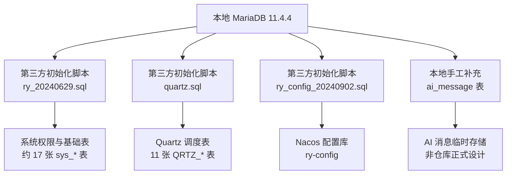
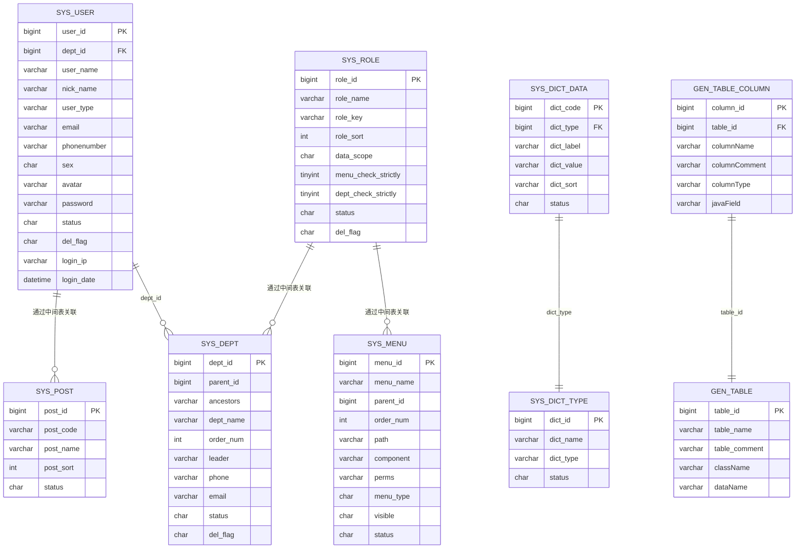
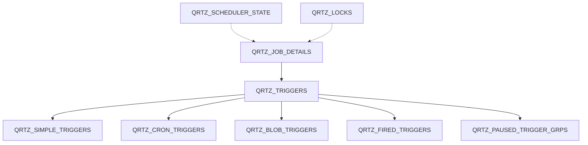

# 数据库设计

<cite>
**本文引用的文件**   
- [ry_20240629.sql](file://_setup/sql/ry_20240629.sql)
- [quartz.sql](file://_setup/sql/quartz.sql)
- [ry_config_20240902.sql](file://_setup/sql/ry_config_20240902.sql)
</cite>

## 目录
1. [引言](#引言)
2. [项目结构与数据来源说明](#项目结构与数据来源说明)
3. [数据库表分类与规模](#数据库表分类与规模)
4. [核心实体关系图](#核心实体关系图)
5. [系统权限表结构说明](#系统权限表结构说明)
6. [Quartz 调度表结构说明](#quartz-调度表结构说明)
7. [代码生成表结构说明](#代码生成表结构说明)
8. [AI 消息表现状](#ai-消息表现状)
9. [索引策略与典型查询模式](#索引策略与典型查询模式)
10. [备份恢复建议](#备份恢复建议)
11. [分库分表扩展建议](#分库分表扩展建议)
12. [SQL 审计与慢查询优化](#sql-审计与慢查询优化)
13. [结论](#结论)

## 引言
本仓库是开源 RuoYi-Cloud 3.6.5 的重命名二次开发产物，根工程 artifactId 为 `zealux-ai`、版本 `3.6.5`；前端包名仍为 `ruoyi@3.6.5`，多个服务启动类仍沿用 `RuoYi*Application.java`。因此，当前本地数据库并非由本项目从零设计的业务库，而是由 RuoYi-Cloud 第三方初始化脚本创建的系统基础库，并在本地运行过程中手工追加了 AI 消息相关数据。

需要特别强调：
- `_setup/sql/ry_20240629.sql`、`_setup/sql/quartz.sql`、`_setup/sql/ry_config_20240902.sql` 属于第三方初始化脚本和本地重建件，不是本项目的自研表结构设计。
- 不得把这些脚本描述成系统的正式数据库设计，也不得为它们单独生成页面。
- 当前本地库中不存在任何 `crm_` 前缀的表，也没有已落地的 CRM 模块能力。
- `ai_message` 表是本地手工创建的，仓库内没有其建表语句；实体类 `AiSession` 只有模型定义，没有对应 Mapper、接口或数据库映射。

## 项目结构与数据来源说明
本地 MariaDB 11.4.4 实例由以下三个脚本依次初始化：

| 脚本 | 作用 | 产生的对象 |
|---|---|---|
| `_setup/sql/ry_20240629.sql` | RuoYi-Cloud 系统基础表与初始数据 | `sys_dept`、`sys_user`、`sys_post`、`sys_role`、`sys_menu`、`sys_user_role`、`sys_role_menu`、`sys_role_dept`、`sys_user_post`、`sys_oper_log`、`sys_dict_type`、`sys_dict_data`、`sys_config`、`sys_logininfor`、`sys_job`、`sys_job_log`、`sys_notice`、`gen_table`、`gen_table_column` |
| `_setup/sql/quartz.sql` | Quartz 分布式任务调度基础表 | 11 张 `QRTZ_*` 表 |
| `_setup/sql/ry_config_20240902.sql` | Nacos 配置中心 `ry-config` 数据库 | `config_info`、`config_info_aggr`、`config_info_beta`、`config_info_tag`、`config_tags_relation`、`group_capacity` 等 |

此外，本地运行环境中手工创建了 `ai_message` 表，用于保存 AI 会话消息；但该表不在仓库 SQL 脚本中，也不应被视作系统正式设计。

**图表来源**  
- [ry_20240629.sql:1-182](file://_setup/sql/ry_20240629.sql#L1-L182)  
- [quartz.sql:1-150](file://_setup/sql/quartz.sql#L1-L150)  
- [ry_config_20240902.sql:1-129](file://_setup/sql/ry_config_20240902.sql#L1-L129)

**章节来源**  
- [ry_20240629.sql:1-697](file://_setup/sql/ry_20240629.sql#L1-L697)  
- [quartz.sql:1-174](file://_setup/sql/quartz.sql#L1-L174)  
- [ry_config_20240902.sql:1-219](file://_setup/sql/ry_config_20240902.sql#L1-L219)

## 数据库表分类与规模
根据本地库实测，当前数据库中共有 31 张表，分类如下：

| 分类 | 数量 | 主要表前缀 | 来源 |
|---|---:|---|---|
| 系统权限与基础表 | 17 | `sys_*` | `ry_20240629.sql` |
| Quartz 调度表 | 11 | `QRTZ_*` | `quartz.sql` |
| 代码生成表 | 2 | `gen_*` | `ry_20240629.sql` |
| AI 消息表 | 1 | `ai_message` | 本地手工创建 |
| Nacos 配置库表 | 未计入上述 31 张 | `config_*` | `ry_config_20240902.sql`（独立数据库） |

需要注意：
- `sys_*` 表中包含部门、用户、岗位、角色、菜单、字典、参数、登录日志、操作日志、定时任务、通知公告和代码生成元数据。
- `QRTZ_*` 表由 Quartz 管理，通常由框架自动维护。
- `gen_*` 表是代码生成器使用的元数据表。
- `ai_message` 表不在仓库 SQL 中，不能据此推断存在 `AiSessionMapper`、持久层接口或 ORM 映射。

**章节来源**  
- [ry_20240629.sql:7-696](file://_setup/sql/ry_20240629.sql#L7-L696)  
- [quartz.sql:1-174](file://_setup/sql/quartz.sql#L1-L174)

## 核心实体关系图
本节聚焦系统权限与基础业务中最常用的核心实体，包括部门、用户、岗位、角色、菜单、字典类型、字典数据和代码生成表。

**图表来源**  
- [ry_20240629.sql:7-696](file://_setup/sql/ry_20240629.sql#L7-L696)

### 字段含义与主外键关系要点
- **部门表 `sys_dept`**：以 `dept_id` 为主键，`parent_id` 表示上级部门，`ancestors` 记录祖级路径，便于按树形结构查询。
- **用户表 `sys_user`**：以 `user_id` 为主键，`dept_id` 指向部门，`user_name` 是登录账号，`password` 使用加密存储。
- **岗位表 `sys_post`**：以 `post_id` 为主键，`post_code` 表示岗位编码，`post_name` 表示岗位名称。
- **角色表 `sys_role`**：以 `role_id` 为主键，`role_key` 作为权限标识，`data_scope` 控制数据范围。
- **菜单表 `sys_menu`**：以 `menu_id` 为主键，`parent_id` 构成菜单树，`perms` 表示按钮或接口权限标识。
- **字典类型 `sys_dict_type` 与字典数据 `sys_dict_data`**：通过 `dict_type` 建立一对多关系，前者定义字典类别，后者定义具体枚举值。
- **代码生成表 `gen_table` 与 `gen_table_column`**：通过 `table_id` 建立一对多关系，前者记录待生成表的元信息，后者记录字段元信息。

### 中间关系表
系统权限采用中间表解耦多对多关系：
- `sys_user_role`：用户与角色关联，联合主键 `(user_id, role_id)`。
- `sys_role_menu`：角色与菜单关联，联合主键 `(role_id, menu_id)`。
- `sys_role_dept`：角色与部门关联，联合主键 `(role_id, dept_id)`。
- `sys_user_post`：用户与岗位关联，联合主键 `(user_id, post_id)`。

这些中间表的主键组合天然具备唯一性约束，避免重复授权。

**章节来源**  
- [ry_20240629.sql:7-696](file://_setup/sql/ry_20240629.sql#L7-L696)

## 系统权限表结构说明
系统权限体系围绕“用户—角色—菜单—部门—岗位”展开，同时配合字典、参数、操作日志、登录日志和通知公告。

| 表名 | 主键 | 关键字段 | 用途 |
|---|---|---|---|
| `sys_dept` | `dept_id` | `parent_id`、`ancestors`、`dept_name`、`status` | 组织部门树 |
| `sys_user` | `user_id` | `dept_id`、`user_name`、`password`、`status` | 系统用户 |
| `sys_post` | `post_id` | `post_code`、`post_name`、`status` | 岗位管理 |
| `sys_role` | `role_id` | `role_name`、`role_key`、`data_scope`、`status` | 角色与数据范围 |
| `sys_menu` | `menu_id` | `parent_id`、`perms`、`menu_type`、`visible` | 菜单与按钮权限 |
| `sys_user_role` | `(user_id, role_id)` | 用户角色关联 | 多对多授权 |
| `sys_role_menu` | `(role_id, menu_id)` | 角色菜单关联 | 多对多授权 |
| `sys_role_dept` | `(role_id, dept_id)` | 角色部门关联 | 数据范围扩展 |
| `sys_user_post` | `(user_id, post_id)` | 用户岗位关联 | 多对多授权 |
| `sys_dict_type` | `dict_id` | `dict_name`、`dict_type` | 字典分类 |
| `sys_dict_data` | `dict_code` | `dict_type`、`dict_label`、`dict_value` | 字典值 |
| `sys_config` | `config_id` | `config_key`、`config_value` | 系统参数 |
| `sys_oper_log` | `oper_id` | `business_type`、`status`、`oper_time` | 操作日志 |
| `sys_logininfor` | `info_id` | `status`、`access_time` | 登录日志 |
| `sys_notice` | `notice_id` | `notice_title`、`notice_content` | 通知公告 |

### 典型查询模式
- **按用户查角色**：从 `sys_user` 经 `sys_user_role` 到 `sys_role`。
- **按角色查菜单**：从 `sys_role` 经 `sys_role_menu` 到 `sys_menu`。
- **按部门查下级部门**：利用 `ancestors` 字段进行前缀匹配。
- **按字典类型查字典项**：用 `sys_dict_type.dict_type = sys_dict_data.dict_type` 关联。
- **按业务类型和时间范围查操作日志**：使用 `sys_oper_log.business_type` 与 `oper_time` 条件。

**章节来源**  
- [ry_20240629.sql:7-696](file://_setup/sql/ry_20240629.sql#L7-L696)

## Quartz 调度表结构说明
Quartz 使用 11 张表完成作业、触发器、日历、锁和调度器状态管理。核心关系如下：

| 表名 | 主键 | 作用 |
|---|---|---|
| `QRTZ_JOB_DETAILS` | `(sched_name, job_name, job_group)` | 任务详情 |
| `QRTZ_TRIGGERS` | `(sched_name, trigger_name, trigger_group)` | 触发器总表 |
| `QRTZ_SIMPLE_TRIGGERS` | `(sched_name, trigger_name, trigger_group)` | 简单重复触发器 |
| `QRTZ_CRON_TRIGGERS` | `(sched_name, trigger_name, trigger_group)` | Cron 触发器 |
| `QRTZ_BLOB_TRIGGERS` | `(sched_name, trigger_name, trigger_group)` | Blob 触发器 |
| `QRTZ_CALENDARS` | `(sched_name, calendar_name)` | 日历 |
| `QRTZ_PAUSED_TRIGGER_GRPS` | `(sched_name, trigger_group)` | 暂停组 |
| `QRTZ_FIRED_TRIGGERS` | `(sched_name, entry_id)` | 已触发记录 |
| `QRTZ_SCHEDULER_STATE` | `(sched_name, instance_name)` | 调度器状态 |
| `QRTZ_LOCKS` | `(sched_name, lock_name)` | 悲观锁 |
| `QRTZ_SIMPROP_TRIGGERS` | 复合主键 | 简单属性触发器 |

**图表来源**  
- [quartz.sql:1-150](file://_setup/sql/quartz.sql#L1-L150)

Quartz 表通常由框架自动写入和清理，业务代码不应直接修改。若出现调度异常，应优先检查触发器状态、Cron 表达式、时区设置以及集群环境下的锁竞争。

**章节来源**  
- [quartz.sql:1-174](file://_setup/sql/quartz.sql#L1-L174)

## 代码生成表结构说明
`gen_table` 与 `gen_table_column` 是代码生成器的元数据存储表，不直接承载业务数据。

| 表名 | 主键 | 关键字段 | 说明 |
|---|---|---|---|
| `gen_table` | `table_id` | `table_name`、`table_comment`、`className`、`dataName` | 待生成表的元信息 |
| `gen_table_column` | `column_id` | `table_id`、`columnName`、`columnComment`、`columnType`、`javaField` | 字段元信息 |

典型流程：
1. 将目标业务表导入 `gen_table`。
2. 扫描表结构后填充 `gen_table_column`。
3. 使用代码生成器基于这两张表生成 Java、XML、Vue 等模板代码。
4. 生成完成后，业务表本身才是实际数据表，`gen_*` 仅保留元数据。

**章节来源**  
- [ry_20240629.sql:643-696](file://_setup/sql/ry_20240629.sql#L643-L696)

## AI 消息表现状
本地环境中存在 `ai_message` 表，用于保存 AI 对话或消息记录。但仓库中没有该表的建表语句，也没有对应的 Mapper、Service 或 Controller。实体类 `AiSession` 只定义了对象结构，不代表数据库中存在同名实体表。

因此，在文档中只能陈述事实：
- `ai_message` 表是本地手工创建的。
- 它不属于 RuoYi-Cloud 第三方脚本产物。
- 不能依据实体类名称推断已有完整持久化实现。
- 若后续要将其纳入系统设计，应先明确表结构、字段语义、生命周期、归档策略以及与 AI 会话上下文的关系。

**章节来源**  
- [ry_20240629.sql:1-697](file://_setup/sql/ry_20240629.sql#L1-L697)  
- [quartz.sql:1-174](file://_setup/sql/quartz.sql#L1-L174)

## 索引策略与典型查询模式
当前脚本中显式定义的索引主要集中在日志类和维度查找场景：

| 表 | 现有索引或约束 | 典型查询 |
|---|---|---|
| `sys_oper_log` | 主键 `oper_id`；`business_type`、`status`、`oper_time` 普通索引 | 按业务类型、状态、时间范围查询操作日志 |
| `sys_logininfor` | 主键 `info_id`；`status`、`access_time` 普通索引 | 按登录状态、访问时间查询登录日志 |
| `sys_user_role` | 联合主键 `(user_id, role_id)` | 按用户查角色、去重授权 |
| `sys_role_menu` | 联合主键 `(role_id, menu_id)` | 按角色查菜单 |
| `sys_role_dept` | 联合主键 `(role_id, dept_id)` | 按角色查授权部门 |
| `sys_user_post` | 联合主键 `(user_id, post_id)` | 按用户查岗位 |
| `sys_dict_data` | 主键 `dict_code`；`dict_type` 参与逻辑关联 | 按字典类型查字典值 |

### 建议补充的索引方向
以下为扩展建议，不是当前脚本中已有的实现：
- 为 `sys_user.dept_id`、`user_name`、`status` 增加合适索引，以支持按部门筛选、按账号登录和按状态过滤。
- 为 `sys_menu.parent_id`、`perms`、`menu_type` 增加索引，以支持菜单树构建和权限标识快速匹配。
- 为 `sys_role.data_scope`、`status` 增加索引，以支持数据范围与状态筛选。
- 为 `sys_dept.ancestors` 使用前缀查询时注意 MySQL 下前缀索引的限制；若频繁按祖先路径查询，可考虑应用层缓存或物化视图方案。
- 对 `ai_message` 表，应根据实际查询维度增加索引，例如会话 ID、用户 ID、时间范围、消息方向等。

**章节来源**  
- [ry_20240629.sql:419-446](file://_setup/sql/ry_20240629.sql#L419-L446)  
- [ry_20240629.sql:558-573](file://_setup/sql/ry_20240629.sql#L558-L573)

## 备份恢复建议
由于本数据库由第三方脚本初始化，并叠加了本地手工数据，建议区分三类备份：

| 备份类型 | 内容 | 恢复方式 |
|---|---|---|
| 系统基础表备份 | `ry_20240629.sql` 生成的 `sys_*`、`gen_*` 表 | 重新执行第三方脚本或导出增量数据 |
| 调度表备份 | `QRTZ_*` 表 | 一般由框架重建，重要任务状态需单独归档 |
| 本地业务数据备份 | `ai_message` 及后续新增业务表 | 单独导出，不参与第三方脚本覆盖 |
| Nacos 配置库备份 | `ry-config` 中的 `config_info` 等表 | 单独备份，避免误删配置 |

推荐做法：
- 不要在生产恢复时直接重新执行 `DROP TABLE IF EXISTS` 类型的第三方脚本，除非确认整库重建。
- 对 `sys_oper_log`、`sys_logininfor` 等大体积日志表，先做历史归档再备份。
- 对 `ai_message` 表，建议按月或按会话周期归档，避免单表无限增长。
- 所有凭据（用户名、密码、token、API Key）在备份文件中都应脱敏，示例中统一使用占位形式，例如「账号与口令见本地凭据记录」。

**章节来源**  
- [ry_20240629.sql:1-697](file://_setup/sql/ry_20240629.sql#L1-L697)  
- [quartz.sql:1-174](file://_setup/sql/quartz.sql#L1-L174)

## 分库分表扩展建议
当前 31 张表体量较小，适合单库部署。当业务持续增长时，可按以下原则拆分：

| 阶段 | 建议 | 影响范围 |
|---|---|---|
| 初期 | 单库单实例 | 简化运维，降低一致性成本 |
| 中期 | 读写分离 | 将读多写少的日志表、字典表、配置表分到从库 |
| 后期 | 水平分表 | 对 `sys_oper_log`、`sys_logininfor`、`ai_message` 按时间或租户分片 |
| 跨服务 | 共享基础表 | `sys_*` 基础权限表可由系统服务集中维护，其他服务通过 API 访问 |
| 高可用 | 主从 + 备份 | 结合 MariaDB 主从复制与定期快照 |

分表注意事项：
- 避免跨分片事务；将强一致操作下沉到同一分片。
- 分片键应覆盖高频查询条件，例如 `oper_time`、`user_id`、`session_id`。
- 历史表与在线表分离，便于归档和压缩。
- 对于字典、菜单、角色等低频变更数据，优先考虑 Redis 或本地缓存，减轻数据库压力。

**章节来源**  
- [ry_20240629.sql:419-696](file://_setup/sql/ry_20240629.sql#L419-L696)

## SQL 审计与慢查询优化
### SQL 审计
建议在应用层与数据库层共同实现：
- 应用层：使用日志模块记录关键 SQL、参数、耗时和执行上下文。
- 数据库层：开启 MariaDB/MySQL 通用日志或慢查询日志，并结合外部审计工具采集。
- 安全要求：日志中不得记录真实账号、口令、token 或 API Key，敏感字段必须脱敏。

### 慢查询优化方法
1. **定位慢查询**  
   - 启用慢查询日志，设置合理阈值。
   - 结合业务监控观察高频慢查询。
2. **分析执行计划**  
   - 对涉及 `sys_oper_log`、`sys_logininfor`、`ai_message` 的大表查询重点分析。
   - 检查是否发生全表扫描、临时表、文件排序。
3. **优化索引**  
   - 优先使用复合索引覆盖常用查询条件。
   - 避免在索引列上使用函数或隐式类型转换。
4. **分页与查询改写**  
   - 大表分页避免深分页，可改用游标或基于主键范围查询。
   - 减少 `SELECT *`，只取必要字段。
5. **日志与历史数据分离**  
   - 对操作日志、登录日志、AI 消息等增长型表进行分区或归档。
6. **缓存热点数据**  
   - 将字典、菜单、角色、部门等热数据放入 Redis，降低数据库压力。

**章节来源**  
- [ry_20240629.sql:419-573](file://_setup/sql/ry_20240629.sql#L419-L573)

## 结论
本项目的本地数据库本质上是 RuoYi-Cloud 第三方初始化结果，而非从零设计的业务数据库。当前 31 张表主要由 17 张系统权限表、11 张 Quartz 调度表和 2 张代码生成表组成，另加本地手工创建的 1 张 AI 消息表。

在实际使用中应遵守以下边界：
- 把 `_setup/sql` 下的脚本视为第三方初始化脚本和本地重建件。
- 不把 `crm_` 表、CRM 路由或 CRM 能力描述为已实现功能。
- 不把 `ai_message` 表或 `AiSession` 实体当作已有完整数据库与持久层实现。
- 后续扩展应以当前表结构为基础，逐步完善索引、备份、归档、分片和审计策略。