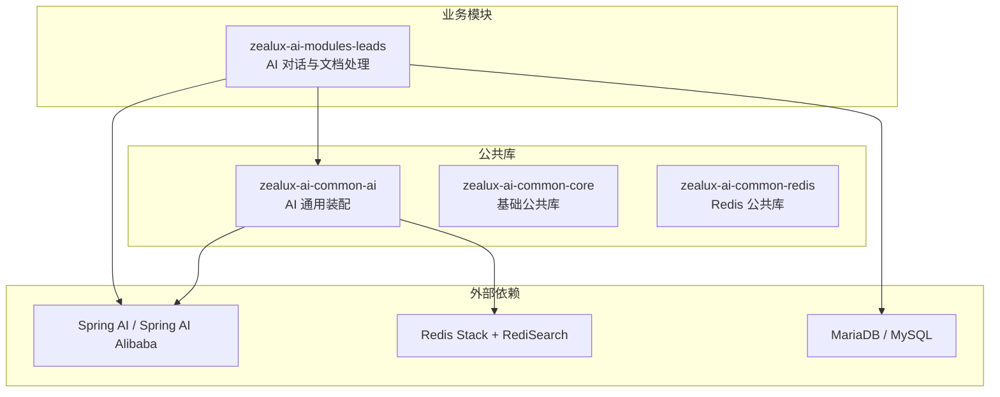
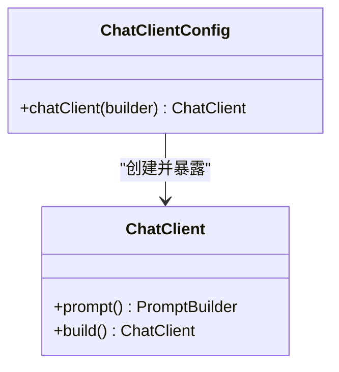
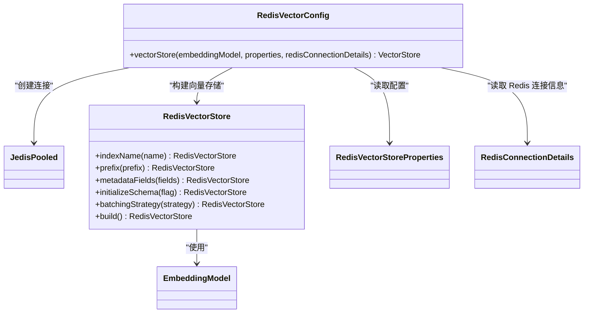
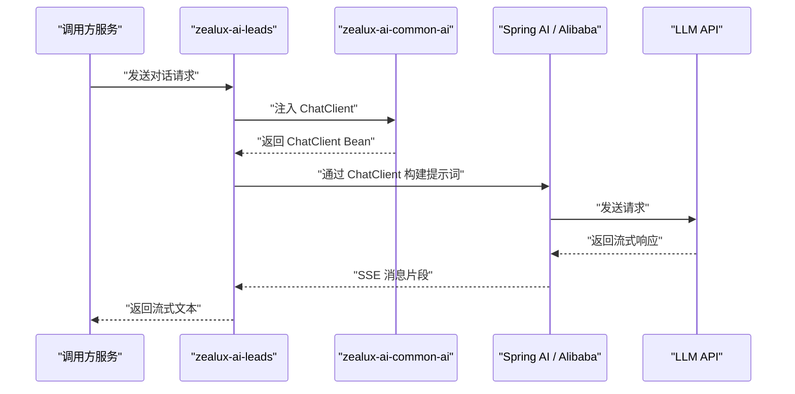
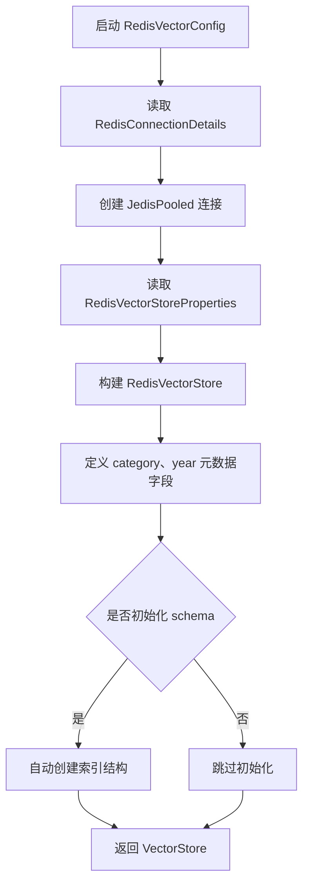
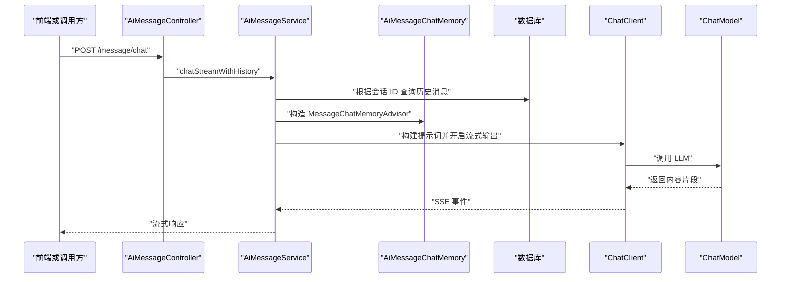
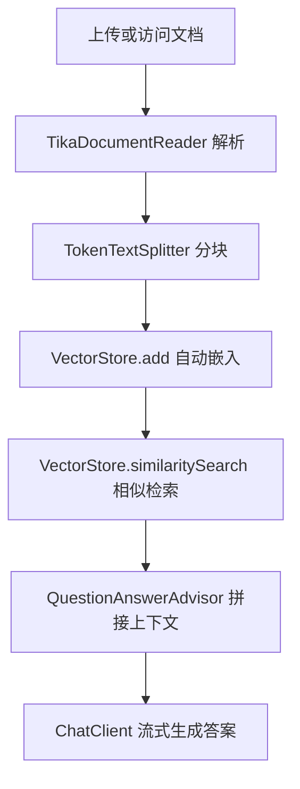
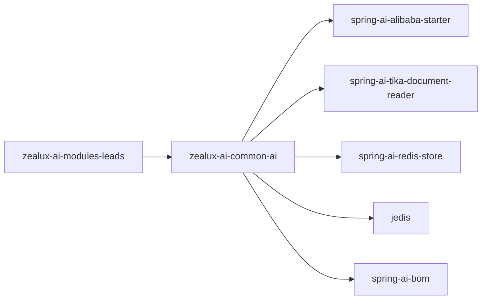

# ai 通用 AI 模块

<cite>
**本文引用的文件**   
- [ChatClientConfig.java](file://zealux-ai-master/zealux-ai-common/zealux-ai-common-ai/src/main/java/com/zealux/common/ai/config/ChatClientConfig.java)
- [RedisVectorConfig.java](file://zealux-ai-master/zealux-ai-common/zealux-ai-common-ai/src/main/java/com/zealux/common/ai/config/RedisVectorConfig.java)
- [pom.xml（common-ai）](file://zealux-ai-master/zealux-ai-common/zealux-ai-common-ai/pom.xml)
- [AutoConfiguration.imports](file://zealux-ai-master/zealux-ai-common/zealux-ai-common-ai/src/main/resources/META-INF/spring/org.springframework.boot.autoconfigure.AutoConfiguration.imports)
- [AiMessageController.java](file://zealux-ai-master/zealux-ai-modules/zealux-ai-leads/src/main/java/com/zealux/leads/controller/AiMessageController.java)
- [ETLController.java](file://zealux-ai-master/zealux-ai-modules/zealux-ai-leads/src/main/java/com/zealux/leads/controller/ETLController.java)
- [DocumentService.java](file://zealux-ai-master/zealux-ai-modules/zealux-ai-leads/src/main/java/com/zealux/leads/service/DocumentService.java)
- [AiMessageService.java](file://zealux-ai-master/zealux-ai-modules/zealux-ai-leads/src/main/java/com/zealux/leads/service/impl/AiMessageService.java)
- [AiMessageChatMemory.java](file://zealux-ai-master/zealux-ai-modules/zealux-ai-leads/src/main/java/com/zealux/leads/memory/AiMessageChatMemory.java)
- [AiMessageMapper.java](file://zealux-ai-master/zealux-ai-modules/zealux-ai-leads/src/main/java/com/zealux/leads/mapper/AiMessageMapper.java)
- [AiMessage.java](file://zealux-ai-master/zealux-ai-modules/zealux-ai-leads/src/main/java/com/zealux/leads/domain/AiMessage.java)
- [AiSession.java](file://zealux-ai-master/zealux-ai-modules/zealux-ai-leads/src/main/java/com/zealux/leads/domain/AiSession.java)
- [pom.xml（leads）](file://zealux-ai-master/zealux-ai-modules/zealux-ai-leads/pom.xml)
</cite>

## 目录

1. [引言](#引言)
2. [模块定位与当前状态](#模块定位与当前状态)
3. [项目结构](#项目结构)
4. [核心配置类](#核心配置类)
5. [AI 对话装配流程](#ai-对话装配流程)
6. [Redis 向量检索装配流程](#redis-向量检索装配流程)
7. [业务复用层：zealux-ai-leads](#业务复用层zealux-ai-leads)
8. [在其他服务中引入 common-ai](#在其他服务中引入-common-ai)
9. [依赖关系分析](#依赖关系分析)
10. [生产运行要求](#生产运行要求)
11. [常见问题与排查](#常见问题与排查)
12. [结论](#结论)

## 引言

本模块是 RuoYi-Cloud 3.6.5 二次开发仓库中的 **通用 AI 能力装配层**。它不直接面向最终用户，而是为 `zealux-ai-leads` 等业务模块提供两个基础能力：

- 基于 Spring AI / Spring AI Alibaba 的 LLM 对话客户端装配；
- 基于 Redis Stack 与 RediSearch 的向量存储装配。

需要特别强调：**该仓库是开源 RuoYi-Cloud 的重命名二开版本**，根 `pom.xml` 的 `artifactId=zealux-ai`、版本 `3.6.5`，但大量实现仍沿用 RuoYi-Cloud 的结构和命名习惯。因此，在描述架构时应明确这是继承关系，而不是自研框架。

## 模块定位与当前状态

### 已存在的内容

| 类别 | 当前状态 |
|---|---|
| `zealux-ai-common-ai` | 包含 `ChatClientConfig`、`RedisVectorConfig` 及 Spring Boot 自动装配入口 |
| LLM 客户端装配 | 已暴露 `ChatClient` Bean，默认系统提示词使用 Spring AI Alibaba |
| 向量检索装配 | 已暴露 `VectorStore` Bean，基于 JedisPooled + RedisVectorStore |
| leads 业务模块 | 存在少量控制器、实体、服务与记忆适配器，但能力不完整 |
| 前端页面 | 不存在 leads 或 AI 专属前端页面 |
| 网关路由 | 未暴露 `/leads/**` 或任何 AI 专用路由 |
| 数据库表 | 没有 `crm_*` 前缀表；`ai_message` 表是本地手工创建，非仓库脚本定义 |

### 缺失的能力

1. **对话控制器**：`zealux-ai-common-ai` 本身不包含对话控制器；对话相关代码位于 `zealux-ai-leads` 中，但该模块当前不能独立稳定运行。
2. **持久化实体表**：`AiSession` 只有实体类，没有对应的 Mapper 与表结构；`AiMessage` 虽由 `AiMessageMapper` 引用，但建表语句不在仓库中。
3. **前端页面**：`zealux-ai-ui-master/src` 中没有 leads 或 AI 专属视图。
4. **网关路由**：网关只配置了 `/auth/**`、`/system/**`、`/code/**`、`/schedule/**`、`/file/**` 五类前缀路由。
5. **完整的 ETL 与向量检索实现**：leads 模块中存在若干 ETL 控制器，但受限于 Redis RediSearch 未启用、Nacos 配置缺失等问题，无法在生产环境直接使用。

因此，本模块当前更准确的描述是：**通用 AI 配置基础设施 + leads 业务能力的半成品**。

**章节来源**
- [ChatClientConfig.java:1-15](file://zealux-ai-master/zealux-ai-common/zealux-ai-common-ai/src/main/java/com/zealux/common/ai/config/ChatClientConfig.java#L1-L15)
- [RedisVectorConfig.java:1-61](file://zealux-ai-master/zealux-ai-common/zealux-ai-common-ai/src/main/java/com/zealux/common/ai/config/RedisVectorConfig.java#L1-L61)
- [AiMessageController.java:1-54](file://zealux-ai-master/zealux-ai-modules/zealux-ai-leads/src/main/java/com/zealux/leads/controller/AiMessageController.java#L1-L54)
- [pom.xml（leads）:1-109](file://zealux-ai-master/zealux-ai-modules/zealux-ai-leads/pom.xml#L1-L109)

## 项目结构



**图表来源**
- [pom.xml（common-ai）:1-100](file://zealux-ai-master/zealux-ai-common/zealux-ai-common-ai/pom.xml#L1-L100)
- [pom.xml（leads）:1-109](file://zealux-ai-master/zealux-ai-modules/zealux-ai-leads/pom.xml#L1-L109)

**章节来源**
- [pom.xml（common-ai）:1-100](file://zealux-ai-master/zealux-ai-common/zealux-ai-common-ai/pom.xml#L1-L100)
- [pom.xml（leads）:1-109](file://zealux-ai-master/zealux-ai-modules/zealux-ai-leads/pom.xml#L1-L109)

## 核心配置类

### ChatClientConfig：装配 LLM 对话客户端

`ChatClientConfig` 是一个 Spring 配置类，负责暴露一个全局可用的 `ChatClient` Bean。它的职责非常明确：

- 通过 `ChatClient.Builder` 构建客户端；
- 设置默认系统提示词；
- 将构造好的 `ChatClient` 交给 Spring 容器管理。

该实现依赖的是 Spring AI Alibaba Starter，因此默认会走 Spring AI Alibaba 提供的 LLM 适配层。开发者后续可以通过注入 `ChatClient` 来发起对话请求。

需要注意：当前配置类只设置了默认系统提示词，并没有显式读取某个业务字段作为 `voice` 等运行时变量；实际调用方如果需要多角色或多声音行为，应在上层服务或 Advisor 中扩展。



**图表来源**
- [ChatClientConfig.java:1-15](file://zealux-ai-master/zealux-ai-common/zealux-ai-common-ai/src/main/java/com/zealux/common/ai/config/ChatClientConfig.java#L1-L15)

**章节来源**
- [ChatClientConfig.java:1-15](file://zealux-ai-master/zealux-ai-common/zealux-ai-common-ai/src/main/java/com/zealux/common/ai/config/ChatClientConfig.java#L1-L15)

### RedisVectorConfig：装配 Redis 向量存储

`RedisVectorConfig` 的核心目标是绕过 Spring AI 自带的 Redis 向量存储自动配置，转而使用显式的 JedisPooled 连接创建 `RedisVectorStore`。其关键逻辑如下：

1. 排除 `RedisVectorStoreAutoConfiguration`，避免与现有 Redis 配置冲突；
2. 启用 `RedisVectorStoreProperties`，从 Spring AI 的 Redis 向量存储属性中读取索引名、键名前缀等配置；
3. 使用 `RedisConnectionDetails` 获取单机 Redis 的主机、端口、用户名和密码；
4. 使用 JedisPooled 建立连接；
5. 通过 `RedisVectorStore.builder` 构建向量存储；
6. 定义元数据字段 `category`（字符串标签）和 `year`（数值）；
7. 开启 `initializeSchema(true)`，尝试自动初始化 schema；
8. 使用 `TokenCountBatchingStrategy` 进行批量嵌入策略。



**图表来源**
- [RedisVectorConfig.java:1-61](file://zealux-ai-master/zealux-ai-common/zealux-ai-common-ai/src/main/java/com/zealux/common/ai/config/RedisVectorConfig.java#L1-L61)

**章节来源**
- [RedisVectorConfig.java:1-61](file://zealux-ai-master/zealux-ai-common/zealux-ai-common-ai/src/main/java/com/zealux/common/ai/config/RedisVectorConfig.java#L1-L61)

## AI 对话装配流程

AI 对话装配由三层组成：

1. **common-ai 模块**：通过 Spring Boot 自动装配暴露 `ChatClient`；
2. **leads 模块**：通过控制器和服务消费 `ChatClient`、`ChatModel` 和聊天记忆；
3. **外部 LLM 提供方**：由 Spring AI Alibaba Starter 负责对接具体模型。



**图表来源**
- [ChatClientConfig.java:1-15](file://zealux-ai-master/zealux-ai-common/zealux-ai-common-ai/src/main/java/com/zealux/common/ai/config/ChatClientConfig.java#L1-L15)
- [AiMessageService.java:1-89](file://zealux-ai-master/zealux-ai-modules/zealux-ai-leads/src/main/java/com/zealux/leads/service/impl/AiMessageService.java#L1-L89)

**章节来源**
- [AutoConfiguration.imports:1-1](file://zealux-ai-master/zealux-ai-common/zealux-ai-common-ai/src/main/resources/META-INF/spring/org.springframework.boot.autoconfigure.AutoConfiguration.imports#L1-L1)
- [ChatClientConfig.java:1-15](file://zealux-ai-master/zealux-ai-common/zealux-ai-common-ai/src/main/java/com/zealux/common/ai/config/ChatClientConfig.java#L1-L15)
- [AiMessageService.java:1-89](file://zealux-ai-master/zealux-ai-modules/zealux-ai-leads/src/main/java/com/zealux/leads/service/impl/AiMessageService.java#L1-L89)

## Redis 向量检索装配流程

Redis 向量检索装配的关键在于：`RedisVectorConfig` 不依赖 Spring AI 的 Redis 自动装配，而是直接读取应用层已有的 Redis 连接信息，并用 JedisPooled 创建 `RedisVectorStore`。



**图表来源**
- [RedisVectorConfig.java:1-61](file://zealux-ai-master/zealux-ai-common/zealux-ai-common-ai/src/main/java/com/zealux/common/ai/config/RedisVectorConfig.java#L1-L61)

**章节来源**
- [RedisVectorConfig.java:1-61](file://zealux-ai-master/zealux-ai-common/zealux-ai-common-ai/src/main/java/com/zealux/common/ai/config/RedisVectorConfig.java#L1-L61)

## 业务复用层：zealux-ai-leads

`zealux-ai-leads` 是引用 `zealux-ai-common-ai` 的业务模块，也是仓库中唯一使用 `Zealux*` 命名的模块。它承担以下职责：

| 组件 | 作用 | 当前状态 |
|---|---|---|
| `AiMessageController` | 暴露消息保存与流式对话接口 | 有控制器，但网关未暴露路由 |
| `ETLController` | 暴露文档读取、嵌入、查询与带上下文的流式对话 | 有实现，但依赖 Redis RediSearch |
| `DocumentService` | 封装 Tika 文档解析函数 | 仅用于文档内容提取 |
| `AiMessageService` | 实现消息保存与基于历史记录的流式对话 | 实现存在，依赖数据库表 |
| `AiMessageChatMemory` | 将 Spring AI 聊天记忆映射到数据库消息 | 实现存在，依赖 `ai_message` 表 |
| `AiMessageMapper` | MyBatis-Plus Mapper | 接口存在，表结构需自行确认 |
| `AiMessage`、`AiSession` | 对话消息与会话实体 | 实体存在，`AiSession` 无对应表 |

### 对话流程



**图表来源**
- [AiMessageController.java:1-54](file://zealux-ai-master/zealux-ai-modules/zealux-ai-leads/src/main/java/com/zealux/leads/controller/AiMessageController.java#L1-L54)
- [AiMessageService.java:1-89](file://zealux-ai-master/zealux-ai-modules/zealux-ai-leads/src/main/java/com/zealux/leads/service/impl/AiMessageService.java#L1-L89)
- [AiMessageChatMemory.java:1-103](file://zealux-ai-master/zealux-ai-modules/zealux-ai-leads/src/main/java/com/zealux/leads/memory/AiMessageChatMemory.java#L1-L103)

### ETL 流程

`ETLController` 提供了三类典型能力：

1. **文档读取**：支持从上传文件或网络 URL 读取文档；
2. **向量化入库**：使用 `TokenTextSplitter` 切分文档后写入 `VectorStore`；
3. **向量检索与上下文问答**：使用 `QuestionAnswerAdvisor` 把检索结果注入提示词模板。



**图表来源**
- [ETLController.java:1-166](file://zealux-ai-master/zealux-ai-modules/zealux-ai-leads/src/main/java/com/zealux/leads/controller/ETLController.java#L1-L166)
- [DocumentService.java:1-39](file://zealux-ai-master/zealux-ai-modules/zealux-ai-leads/src/main/java/com/zealux/leads/service/DocumentService.java#L1-L39)

**章节来源**
- [AiMessageController.java:1-54](file://zealux-ai-master/zealux-ai-modules/zealux-ai-leads/src/main/java/com/zealux/leads/controller/AiMessageController.java#L1-L54)
- [ETLController.java:1-166](file://zealux-ai-master/zealux-ai-modules/zealux-ai-leads/src/main/java/com/zealux/leads/controller/ETLController.java#L1-L166)
- [AiMessageService.java:1-89](file://zealux-ai-master/zealux-ai-modules/zealux-ai-leads/src/main/java/com/zealux/leads/service/impl/AiMessageService.java#L1-L89)
- [AiMessageChatMemory.java:1-103](file://zealux-ai-master/zealux-ai-modules/zealux-ai-leads/src/main/java/com/zealux/leads/memory/AiMessageChatMemory.java#L1-L103)
- [AiMessageMapper.java:1-10](file://zealux-ai-master/zealux-ai-modules/zealux-ai-leads/src/main/java/com/zealux/leads/mapper/AiMessageMapper.java#L1-L10)
- [AiMessage.java:1-23](file://zealux-ai-master/zealux-ai-modules/zealux-ai-leads/src/main/java/com/zealux/leads/domain/AiMessage.java#L1-L23)
- [AiSession.java:1-22](file://zealux-ai-master/zealux-ai-modules/zealux-ai-leads/src/main/java/com/zealux/leads/domain/AiSession.java#L1-L22)
- [DocumentService.java:1-39](file://zealux-ai-master/zealux-ai-modules/zealux-ai-leads/src/main/java/com/zealux/leads/service/DocumentService.java#L1-L39)

## 在其他服务中引入 common-ai

### Maven 依赖

在需要使用 AI 能力的其他服务中，添加对 `zealux-ai-common-ai` 的依赖：

```xml
<dependency>
    <groupId>com.zealux</groupId>
    <artifactId>zealux-ai-common-ai</artifactId>
</dependency>
```

### 自动装配生效

`zealux-ai-common-ai` 通过 Spring Boot 自动装配机制注册了 `ChatClientConfig`：

```text
META-INF/spring/org.springframework.boot.autoconfigure.AutoConfiguration.imports
```

因此，只要服务启用了 Spring Boot 自动装配，就能直接注入 `ChatClient`。

### 读取 AI 配置的基本示例

下面给出一个可在其他服务中使用的最小示例思路：

1. 在服务的 `pom.xml` 中添加 `zealux-ai-common-ai` 依赖；
2. 在服务启动类或配置类上确保 Spring Boot 自动装配可用；
3. 在需要的组件中注入 `ChatClient`；
4. 如果还需要 Redis 向量检索，同时注入 `VectorStore` 和 `EmbeddingModel`；
5. 通过 Nacos 或本地配置文件设置 LLM API Key、Redis 地址、Spring AI 向量索引名称等。

注意：不要把真实 API Key 写进源码或仓库日志。示例中应统一使用占位形式，例如：

- LLM API Key：见本地凭据记录或 Nacos 配置项；
- Redis 主机：见 Nacos 配置项；
- Redis 密码：见本地凭据记录。

### 配置说明要点

- LLM 配置由 Spring AI Alibaba Starter 负责加载，常见配置项包括模型类型、API Key、BaseURL 等；
- Redis 向量配置来自 `RedisVectorStoreProperties`，常用字段包括索引名、键名前缀；
- Redis 连接来自 Spring Boot 的 `RedisConnectionDetails`，当前实现只读取单机模式。

**章节来源**
- [pom.xml（common-ai）:1-100](file://zealux-ai-master/zealux-ai-common/zealux-ai-common-ai/pom.xml#L1-L100)
- [AutoConfiguration.imports:1-1](file://zealux-ai-master/zealux-ai-common/zealux-ai-common-ai/src/main/resources/META-INF/spring/org.springframework.boot.autoconfigure.AutoConfiguration.imports#L1-L1)
- [RedisVectorConfig.java:1-61](file://zealux-ai-master/zealux-ai-common/zealux-ai-common-ai/src/main/java/com/zealux/common/ai/config/RedisVectorConfig.java#L1-L61)

## 依赖关系分析



**图表来源**
- [pom.xml（common-ai）:1-100](file://zealux-ai-master/zealux-ai-common/zealux-ai-common-ai/pom.xml#L1-L100)
- [pom.xml（leads）:1-109](file://zealux-ai-master/zealux-ai-modules/zealux-ai-leads/pom.xml#L1-L109)

**章节来源**
- [pom.xml（common-ai）:1-100](file://zealux-ai-master/zealux-ai-common/zealux-ai-common-ai/pom.xml#L1-L100)
- [pom.xml（leads）:1-109](file://zealux-ai-master/zealux-ai-modules/zealux-ai-leads/pom.xml#L1-L109)

## 生产运行要求

要在生产环境中让 AI 功能可用，至少需要补齐以下条件：

### 1. Redis RediSearch 必须启用

`RedisVectorConfig` 使用 `RedisVectorStore`，并通过 `initializeSchema(true)` 初始化 schema。如果 Redis 没有安装 RediSearch 模块，向量检索会失败。

排查步骤：

- 检查 Redis 是否使用 Redis Stack；
- 检查是否加载了 RediSearch 模块；
- 检查 `RedisVectorStoreProperties` 配置的索引名是否存在；
- 查看服务启动日志中是否有 Redis 连接异常或索引初始化异常。

### 2. 补充 leads 模块实现

当前 leads 模块只有 13 个 Java 文件，且缺少：

- Nacos 配置 `zealux-ai-leads-dev.yml`；
- 网关 `/leads/**` 路由；
- 完整的前端页面；
- `AiSession` 对应的数据库表；
- 稳定的部署与环境依赖。

### 3. 补充数据库结构

- `ai_message` 表目前由本地手工创建，不属于仓库初始化脚本；
- `AiSession` 没有对应的 Mapper 或表结构；
- 不应把 CRM 相关草稿当作已落地的表结构。

### 4. 补充网关路由

网关只暴露 `/auth/**`、`/system/**`、`/code/**`、`/schedule/**`、`/file/**`。若要让前端或外部调用方访问 leads 模块，需要在网关中新增 `/leads/**` 路由。

**章节来源**
- [RedisVectorConfig.java:1-61](file://zealux-ai-master/zealux-ai-common/zealux-ai-common-ai/src/main/java/com/zealux/common/ai/config/RedisVectorConfig.java#L1-L61)
- [AiSession.java:1-22](file://zealux-ai-master/zealux-ai-modules/zealux-ai-leads/src/main/java/com/zealux/leads/domain/AiSession.java#L1-L22)
- [AiMessageMapper.java:1-10](file://zealux-ai-master/zealux-ai-modules/zealux-ai-leads/src/main/java/com/zealux/leads/mapper/AiMessageMapper.java#L1-L10)

## 常见问题与排查

### 问题一：LLM API Key 配置错误

**现象**

- 对话请求能进入服务；
- 调用 LLM 时返回鉴权失败、密钥无效或模型不可用；
- 日志中出现 Spring AI Alibaba 或底层 HTTP 客户端的错误。

**排查步骤**

1. 检查 Spring AI Alibaba 配置项中的 API Key 是否与供应商一致；
2. 检查 BaseURL 是否指向正确的厂商接口地址；
3. 确认密钥所属账号、权限、余额和模型配额；
4. 不要将真实密钥粘贴进日志、截图或仓库文件；
5. 如果使用了环境变量或 Nacos，确认当前部署环境加载的是正确配置。

**建议**

- 将 API Key 放入安全的凭据管理系统；
- 在测试环境使用沙箱密钥；
- 在日志中只打印脱敏后的密钥前缀或标识。

### 问题二：网络超时

**现象**

- 对话请求长时间无响应；
- 日志中出现连接超时、读取超时或 DNS 解析失败；
- 本地可访问 LLM 接口，但服务器不可达。

**排查步骤**

1. 检查服务器出站网络是否能访问 LLM 厂商域名；
2. 检查防火墙、代理或云安全组规则；
3. 检查是否配置了错误的代理地址；
4. 检查 LLM 厂商是否限流或维护；
5. 适当调整 Spring AI 或底层 HTTP 客户端的超时配置。

**建议**

- 为 LLM 调用增加重试与降级策略；
- 对长对话使用流式输出；
- 对高频调用增加缓存或队列。

### 问题三：RediSearch 未启用导致向量检索不可用

**现象**

- 文档读取成功；
- 调用 `/etl/embedding` 或 `/etl/query` 时报错；
- 日志中出现 Redis 或 RediSearch 相关异常；
- 向量索引未创建或查询结果为空。

**排查步骤**

1. 确认 Redis 是否使用 Redis Stack；
2. 检查 RediSearch 模块是否加载；
3. 检查 `RedisVectorStoreProperties.index` 与 `prefix` 是否与预期一致；
4. 检查 `initializeSchema(true)` 是否真正执行成功；
5. 检查 Redis 账户是否有写入索引的权限。

**建议**

- 在 CI/CD 中加入 Redis Stack 健康检查；
- 首次部署时显式验证索引是否存在；
- 对向量写入失败做幂等处理。

### 问题四：leads 模块无法访问

**现象**

- 服务可能无法启动；
- 即使启动成功，前端或网关也无法访问 `/leads/**`；
- Nacos 中没有 leads 配置；
- 数据库缺少 `ai_message` 或 `AiSession` 相关表。

**排查步骤**

1. 检查 Nacos 中是否存在 `zealux-ai-leads-dev.yml`；
2. 检查网关是否配置 `/leads/**` 路由；
3. 检查数据库是否存在 `ai_message` 表；
4. 检查 Redis 是否连通；
5. 检查 LLM 配置是否正确。

**建议**

- 先补齐 common-ai 的基础配置；
- 再逐步补全 leads 的控制器、服务、Mapper、表和网关路由；
- 不要假设 CRM 或 AI 功能已经具备。

**章节来源**
- [RedisVectorConfig.java:1-61](file://zealux-ai-master/zealux-ai-common/zealux-ai-common-ai/src/main/java/com/zealux/common/ai/config/RedisVectorConfig.java#L1-L61)
- [ETLController.java:1-166](file://zealux-ai-master/zealux-ai-modules/zealux-ai-leads/src/main/java/com/zealux/leads/controller/ETLController.java#L1-L166)
- [AiMessageController.java:1-54](file://zealux-ai-master/zealux-ai-modules/zealux-ai-leads/src/main/java/com/zealux/leads/controller/AiMessageController.java#L1-L54)

## 结论

`zealux-ai-common-ai` 是当前仓库中最接近“通用 AI 基础设施”的模块。它完成了两件事：

1. 通过 `ChatClientConfig` 暴露 `ChatClient`；
2. 通过 `RedisVectorConfig` 暴露基于 RedisStack 的 `VectorStore`。

但当前仓库仍处于半成品阶段：

- common-ai 只提供配置类；
- leads 模块虽有部分对话、ETL 与向量检索代码，但缺少完整运行条件；
- 没有 leads 前端页面；
- 没有 leads 网关路由；
- `AiSession` 没有表；
- `ai_message` 表不是仓库脚本定义；
- 本地 Redis 缺 RediSearch，向量检索不可用。

因此，推荐的分步落地方式是：

1. 先确保 `zealux-ai-common-ai` 能被其他服务引入；
2. 补齐 LLM API Key 与 Redis 连接配置；
3. 启用 Redis RediSearch；
4. 补全 leads 模块的数据库表、Nacos 配置和网关路由；
5. 最后再补齐前端页面与业务流程。

这样既能复用 common-ai 的 AI 装配能力，又能避免把尚未实现的 CRM、AI 对话或向量检索能力误写成系统已具备的功能。