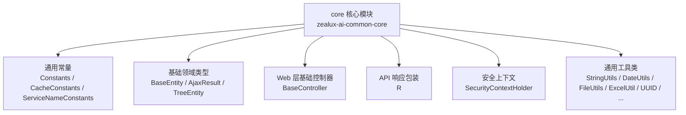
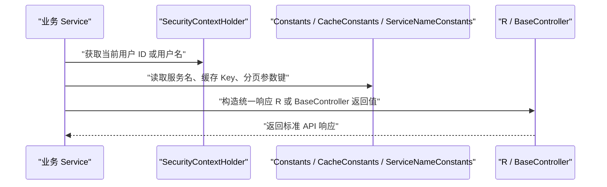
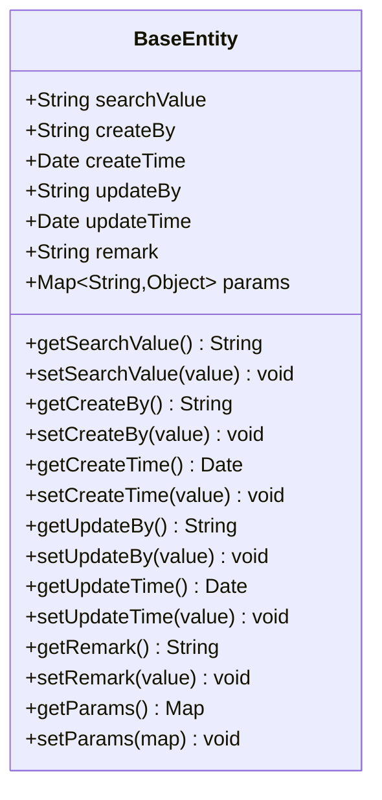
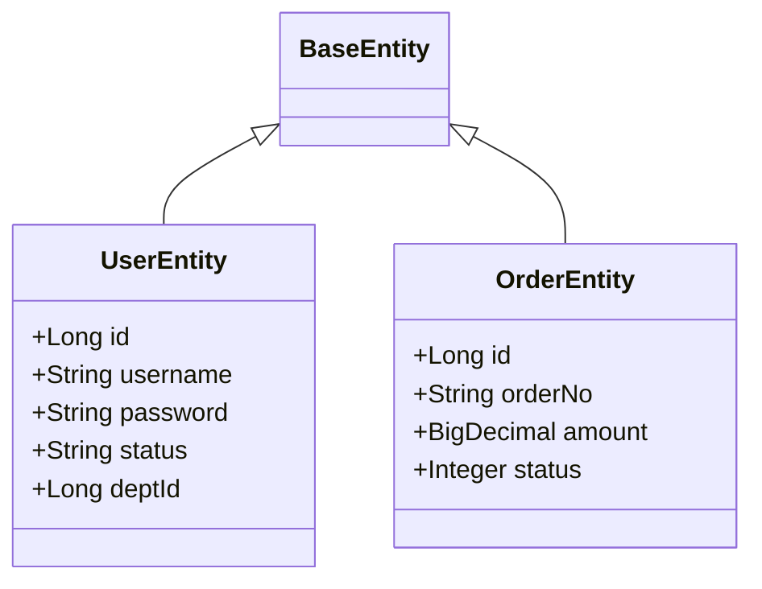
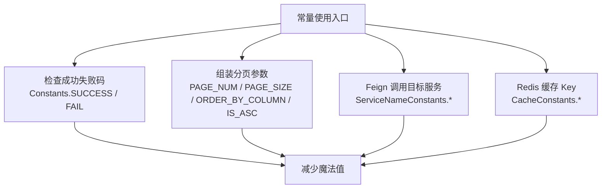
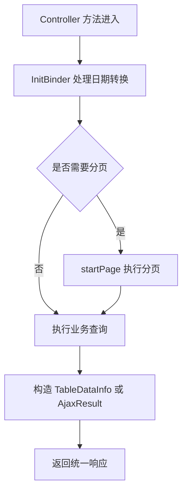
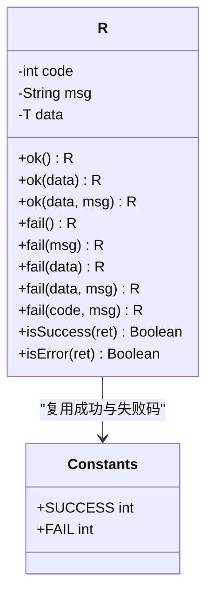
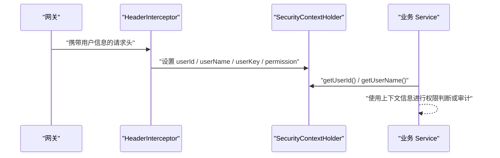

# core 核心模块

<cite>
**本文引用的文件**   
- [zealux-ai-common-core/pom.xml](file://zealux-ai-master/zealux-ai-common/zealux-ai-common-core/pom.xml)
- [BaseEntity.java](file://zealux-ai-master/zealux-ai-common/zealux-ai-common-core/src/main/java/com/zealux/common/core/web/domain/BaseEntity.java)
- [Constants.java](file://zealux-ai-master/zealux-ai-common/zealux-ai-common-core/src/main/java/com/zealux/common/core/constant/Constants.java)
- [CacheConstants.java](file://zealux-ai-master/zealux-ai-common/zealux-ai-common-core/src/main/java/com/zealux/common/core/constant/CacheConstants.java)
- [ServiceNameConstants.java](file://zealux-ai-master/zealux-ai-common/zealux-ai-common-core/src/main/java/com/zealux/common/core/constant/ServiceNameConstants.java)
- [BaseController.java](file://zealux-ai-master/zealux-ai-common/zealux-ai-common-core/src/main/java/com/zealux/common/core/web/controller/BaseController.java)
- [R.java](file://zealux-ai-master/zealux-ai-common/zealux-ai-common-core/src/main/java/com/zealux/common/core/domain/R.java)
- [SecurityContextHolder.java](file://zealux-ai-master/zealux-ai-common/zealux-ai-common-core/src/main/java/com/zealux/common/core/context/SecurityContextHolder.java)
- [StringUtils.java](file://zealux-ai-master/zealux-ai-common/zealux-ai-common-core/src/main/java/com/zealux/common/core/utils/StringUtils.java)
</cite>

## 目录
1. [简介](#简介)
2. [项目结构](#项目结构)
3. [核心组件](#核心组件)
4. [架构总览](#架构总览)
5. [详细组件分析](#详细组件分析)
6. [依赖关系分析](#依赖关系分析)
7. [性能与扩展建议](#性能与扩展建议)
8. [常见问题](#常见问题)
9. [结论](#结论)

## 简介
core 核心模块是 zealux-ai-common 下的基础通用库，主要提供实体基类、通用常量、Web 层基础控制器、通用响应对象、安全上下文工具以及字符串、日期、文件、分页等公共工具。该模块不包含外部中间件的自动装配配置，而是为其他通用子模块和业务模块提供可复用的代码能力。

需要特别说明的是：在源码中未发现名为 `CommonCoreAutoConfiguration` 的自动配置类；当前 core 模块通过 Maven 依赖暴露 API，而非通过 Spring Boot 自动配置完成 Bean 装配。业务模块引入依赖后即可使用这些公共类型。

## 项目结构
zealux-ai-common-core 模块以 Java 包组织，关键分组如下：
- `constant`：通用常量，如字符集、HTTP 协议、成功失败码、分页参数键、缓存 Key、服务名等。
- `web.domain`：Web 领域基础类型，包括 BaseEntity、AjaxResult、TreeEntity、分页结果封装等。
- `web.controller`：Web 层基础控制器 BaseController，统一处理日期绑定、分页和统一返回。
- `domain.R`：统一的 API 响应包装。
- `context.SecurityContextHolder`：基于 TransmittableThreadLocal 的安全上下文，用于跨线程传递用户信息。
- `utils`：通用工具类，涵盖字符串、日期、文件、Excel、UUID、反射、SQL、Servlet、Spring 工具等。
- `annotation`、`exception`、`text`、`enums`、`xss`：注解、异常、文本转换、枚举与 XSS 校验等辅助能力。

**图表来源**
- [zealux-ai-common-core/pom.xml:1-147](file://zealux-ai-master/zealux-ai-common/zealux-ai-common-core/pom.xml#L1-L147)

**章节来源**
- [zealux-ai-common-core/pom.xml:1-147](file://zealux-ai-master/zealux-ai-common/zealux-ai-common-core/pom.xml#L1-L147)

## 核心组件
- BaseEntity：所有持久化实体的基类，提供审计字段与请求参数容器。
- Constants / CacheConstants / ServiceNameConstants：集中定义系统级常量，避免魔法值。
- BaseController：Web 控制器的基类，封装分页、日期转换与统一返回方法。
- R：统一 API 响应体，复用 Constants 中的成功与失败码。
- SecurityContextHolder：线程安全的用户上下文工具，配合网关与拦截器使用。
- StringUtils 等工具类：封装常用字符串、集合、编码、脱敏等操作。

**章节来源**
- [BaseEntity.java:1-122](file://zealux-ai-master/zealux-ai-common/zealux-ai-common-core/src/main/java/com/zealux/common/core/web/domain/BaseEntity.java#L1-L122)
- [Constants.java:1-135](file://zealux-ai-master/zealux-ai-common/zealux-ai-common-core/src/main/java/com/zealux/common/core/constant/Constants.java#L1-L135)
- [CacheConstants.java:1-59](file://zealux-ai-master/zealux-ai-common/zealux-ai-common-core/src/main/java/com/zealux/common/core/constant/CacheConstants.java#L1-L59)
- [ServiceNameConstants.java:1-24](file://zealux-ai-master/zealux-ai-common/zealux-ai-common-core/src/main/java/com/zealux/common/core/constant/ServiceNameConstants.java#L1-L24)
- [BaseController.java:1-142](file://zealux-ai-master/zealux-ai-common/zealux-ai-common-core/src/main/java/com/zealux/common/core/web/controller/BaseController.java#L1-L142)
- [R.java:1-115](file://zealux-ai-master/zealux-ai-common/zealux-ai-common-core/src/main/java/com/zealux/common/core/domain/R.java#L1-L115)
- [SecurityContextHolder.java:1-98](file://zealux-ai-master/zealux-ai-common/zealux-ai-common-core/src/main/java/com/zealux/common/core/context/SecurityContextHolder.java#L1-L98)
- [StringUtils.java:1-200](file://zealux-ai-master/zealux-ai-common/zealux-ai-common-core/src/main/java/com/zealux/common/core/utils/StringUtils.java#L1-L200)

## 架构总览
core 模块作为依赖被其他通用模块与业务模块引用，其职责边界清晰：不启动外部中间件，不注册复杂 Bean；主要暴露常量、基类、工具类和通用数据结构。典型调用链如下：

**图表来源**
- [SecurityContextHolder.java:1-98](file://zealux-ai-master/zealux-ai-common/zealux-ai-common-core/src/main/java/com/zealux/common/core/context/SecurityContextHolder.java#L1-L98)
- [Constants.java:1-135](file://zealux-ai-master/zealux-ai-common/zealux-ai-common-core/src/main/java/com/zealux/common/core/constant/Constants.java#L1-L135)
- [CacheConstants.java:1-59](file://zealux-ai-master/zealux-ai-common/zealux-ai-common-core/src/main/java/com/zealux/common/core/constant/CacheConstants.java#L1-L59)
- [ServiceNameConstants.java:1-24](file://zealux-ai-master/zealux-ai-common/zealux-ai-common-core/src/main/java/com/zealux/common/core/constant/ServiceNameConstants.java#L1-L24)
- [R.java:1-115](file://zealux-ai-master/zealux-ai-common/zealux-ai-common-core/src/main/java/com/zealux/common/core/domain/R.java#L1-L115)
- [BaseController.java:1-142](file://zealux-ai-master/zealux-ai-common/zealux-ai-common-core/src/main/java/com/zealux/common/core/web/controller/BaseController.java#L1-L142)

## 详细组件分析

### BaseEntity 实体基类
BaseEntity 是所有业务实体的推荐基类，包含以下字段：
- searchValue：搜索条件字段，不参与数据库映射，也不参与 JSON 序列化。
- createBy：创建者。
- createTime：创建时间，JSON 输出时采用固定日期格式。
- updateBy：更新者。
- updateTime：更新时间，JSON 输出时采用固定日期格式。
- remark：备注。
- params：请求参数容器，默认懒加载为空 Map，不参与数据库映射。

**图表来源**
- [BaseEntity.java:1-122](file://zealux-ai-master/zealux-ai-common/zealux-ai-common-core/src/main/java/com/zealux/common/core/web/domain/BaseEntity.java#L1-L122)

#### 自动填充机制说明
- BaseEntity 自身没有实现任何自动填充逻辑。字段未使用 MyBatis-Plus 的自动填充注解，也没有可见的 MyBatis 拦截器或 AOP 在此模块内设置这些值。
- 因此，id、createBy、createTime、updateBy、updateTime、remark 等字段的“自动填充”并非由 BaseEntity 直接完成；实际项目中通常由上层 MyBatis-Plus 配置、数据源拦截器或服务层初始化逻辑负责。
- 对于 id：BaseEntity 并未声明 id 字段，因此它不是默认主键基类；业务实体如需 id，应自行添加并使用合适的主键策略。
- 对于审计字段：若需要自动填充，应在业务 Service 或 MyBatis 层面显式设置 createBy/createTime/updateBy/updateTime，而不是假设 BaseEntity 已自动赋值。

**章节来源**
- [BaseEntity.java:1-122](file://zealux-ai-master/zealux-ai-common/zealux-ai-common-core/src/main/java/com/zealux/common/core/web/domain/BaseEntity.java#L1-L122)

#### 实体继承示例
业务实体可以继承 BaseEntity，获得统一的审计字段和请求参数容器。例如：

实际使用时，实体类应：
- 继承 BaseEntity。
- 根据业务需要增加业务字段。
- 如需 id，自行定义 id 字段并配合持久层主键策略。
- 在 Service 层对 createBy、createTime、updateBy、updateTime 进行初始化。

**图表来源**
- [BaseEntity.java:1-122](file://zealux-ai-master/zealux-ai-common/zealux-ai-common-core/src/main/java/com/zealux/common/core/web/domain/BaseEntity.java#L1-L122)

### 常量体系
常量集中在多个类中，按用途划分：

| 分类 | 类名 | 作用 | 典型用途 |
|---|---|---|---|
| 通用常量 | Constants | 字符集、HTTP 协议、成功失败码、登录状态、分页参数键、资源路径、白名单等 | 避免硬编码 HTTP 状态码、URL 前缀、分页参数名 |
| 缓存常量 | CacheConstants | 缓存过期时间、刷新时间、密码错误次数、登录 Token Key、验证码 Key、字典 Key、黑名单 Key 等 | Redis 缓存键命名、认证相关缓存 |
| 服务名常量 | ServiceNameConstants | Feign 调用使用的微服务名称 | 服务间远程调用 |
| 其他常量 | GenConstants、HttpStatus、ScheduleConstants、SecurityConstants、TokenConstants、UserConstants | 代码生成、HTTP 状态、定时任务、安全、令牌、用户等 | 按场景选择对应常量类 |

#### 常用常量示例
- 成功与失败码：Constants.SUCCESS、Constants.FAIL。
- 分页参数：Constants.PAGE_NUM、Constants.PAGE_SIZE、Constants.ORDER_BY_COLUMN、Constants.IS_ASC。
- 服务名：ServiceNameConstants.AUTH_SERVICE、ServiceNameConstants.SYSTEM_SERVICE、ServiceNameConstants.FILE_SERVICE。
- 缓存 Key：CacheConstants.LOGIN_TOKEN_KEY、CacheConstants.CAPTCHA_CODE_KEY、CacheConstants.SYS_CONFIG_KEY、CacheConstants.SYS_DICT_KEY。

**图表来源**
- [Constants.java:1-135](file://zealux-ai-master/zealux-ai-common/zealux-ai-common-core/src/main/java/com/zealux/common/core/constant/Constants.java#L1-L135)
- [CacheConstants.java:1-59](file://zealux-ai-master/zealux-ai-common/zealux-ai-common-core/src/main/java/com/zealux/common/core/constant/CacheConstants.java#L1-L59)
- [ServiceNameConstants.java:1-24](file://zealux-ai-master/zealux-ai-common/zealux-ai-common-core/src/main/java/com/zealux/common/core/constant/ServiceNameConstants.java#L1-L24)

**章节来源**
- [Constants.java:1-135](file://zealux-ai-master/zealux-ai-common/zealux-ai-common-core/src/main/java/com/zealux/common/core/constant/Constants.java#L1-L135)
- [CacheConstants.java:1-59](file://zealux-ai-master/zealux-ai-common/zealux-ai-common-core/src/main/java/com/zealux/common/core/constant/CacheConstants.java#L1-L59)
- [ServiceNameConstants.java:1-24](file://zealux-ai-master/zealux-ai-common/zealux-ai-common-core/src/main/java/com/zealux/common/core/constant/ServiceNameConstants.java#L1-L24)

### Web 层基础能力
BaseController 提供以下能力：
- 将前端传入的日期字符串转换为 Date。
- startPage/clearPage 与 TableDataInfo 结合，支持分页查询。
- success/error/warn/toAjax 等便捷返回方法。
- 日志记录器 logger。

**图表来源**
- [BaseController.java:1-142](file://zealux-ai-master/zealux-ai-common/zealux-ai-common-core/src/main/java/com/zealux/common/core/web/controller/BaseController.java#L1-L142)

**章节来源**
- [BaseController.java:1-142](file://zealux-ai-master/zealux-ai-common/zealux-ai-common-core/src/main/java/com/zealux/common/core/web/controller/BaseController.java#L1-L142)

### 统一响应对象 R
R 是泛型 API 响应包装，内部复用 Constants.SUCCESS 与 Constants.FAIL。常用静态方法包括 ok、ok(data)、fail、fail(msg)、isSuccess、isError。

**图表来源**
- [R.java:1-115](file://zealux-ai-master/zealux-ai-common/zealux-ai-common-core/src/main/java/com/zealux/common/core/domain/R.java#L1-L115)
- [Constants.java:1-135](file://zealux-ai-master/zealux-ai-common/zealux-ai-common-core/src/main/java/com/zealux/common/core/constant/Constants.java#L1-L135)

**章节来源**
- [R.java:1-115](file://zealux-ai-master/zealux-ai-common/zealux-ai-common-core/src/main/java/com/zealux/common/core/domain/R.java#L1-L115)
- [Constants.java:1-135](file://zealux-ai-master/zealux-ai-common/zealux-ai-common-core/src/main/java/com/zealux/common/core/constant/Constants.java#L1-L135)

### 安全上下文 SecurityContextHolder
SecurityContextHolder 基于 TransmittableThreadLocal 存储当前线程的用户上下文，支持 userId、userName、userKey、permission 等字段读写，并提供 remove 清理方法。文档注释强调：必须在网关通过请求头传入，并由 HeaderInterceptor 拦截器设置值后，此处才能获取。

**图表来源**
- [SecurityContextHolder.java:1-98](file://zealux-ai-master/zealux-ai-common/zealux-ai-common-core/src/main/java/com/zealux/common/core/context/SecurityContextHolder.java#L1-L98)

**章节来源**
- [SecurityContextHolder.java:1-98](file://zealux-ai-master/zealux-ai-common/zealux-ai-common-core/src/main/java/com/zealux/common/core/context/SecurityContextHolder.java#L1-L98)

### 工具类与公共能力
StringUtils 继承 Apache Commons Lang3 的 StringUtils，补充空值判断、去空格、隐藏敏感字符等方法，并复用 Constants 中的字符集常量。core 模块还包含日期、文件、Excel、UUID、反射、SQL、Servlet、Spring 工具等大量工具类，供业务模块直接使用。

**章节来源**
- [StringUtils.java:1-200](file://zealux-ai-master/zealux-ai-common/zealux-ai-common-core/src/main/java/com/zealux/common/core/utils/StringUtils.java#L1-L200)

## 依赖关系分析
core 模块的 Maven 依赖体现其定位：它是通用能力提供者，而不是某个具体中间件的服务端。

```mermaid
graph TB
    POM["zealux-ai-common-core/pom.xml"] --> SpringCloud["Spring Cloud OpenFeign / Loadbalancer"]
    POM --> SpringWeb["Spring Web / Context Support"]
    POM --> Ttl["TransmittableThreadLocal"]
    POM --> PageHelper["Pagehelper"]
    POM --> Mybatis["Mybatis / MyBatis-Spring / MyBatis-Plus"]
    POM --> Hutool["Hutool"]
    POM --> Validation["Hibernate Validator"]
    POM --> Jackson["Jackson"]
    POM --> Fastjson["Fastjson2"]
    POM --> Jwt["JWT"]
    POM --> JAXB["JAXB"]
    POM --> CommonsLang["Apache Commons Lang3"]
    POM --> CommonsIo["Commons IO"]
    POM --> Poi["Apache POI"]
    POM --> ServletApi["Jakarta Servlet API"]
```

**图表来源**
- [zealux-ai-common-core/pom.xml:1-147](file://zealux-ai-master/zealux-ai-common/zealux-ai-common-core/pom.xml#L1-L147)

**章节来源**
- [zealux-ai-common-core/pom.xml:1-147](file://zealux-ai-master/zealux-ai-common/zealux-ai-common-core/pom.xml#L1-L147)

## 性能与扩展建议
- 常量优先：尽量使用 Constants、CacheConstants、ServiceNameConstants，避免在业务代码中出现硬编码字符串或数字。
- 审计字段：不要假定 BaseEntity 会自动填充 createBy、createTime、updateBy、updateTime；应在 Service 层或 MyBatis 层明确设置。
- 分页：Controller 层优先使用 BaseController.startPage，避免手写分页 SQL 和总数统计。
- 安全上下文：确保网关和拦截器正确设置用户信息，否则 SecurityContextHolder 取不到值。
- 依赖范围：core 模块本身不装配外部中间件 Bean；如需扩展，应在具体业务模块或专用通用模块中添加配置。

[本节为通用建议，不直接分析具体文件]

## 常见问题

### 是否存在 CommonCoreAutoConfiguration？
- 在 core 模块源码中未找到 CommonCoreAutoConfiguration。
- 该模块通过 Maven 依赖暴露常量、基类、工具类与通用数据结构，而不是通过自动配置类装配 Bean。
- 如果业务需要自动装配行为，应在具体业务模块或专用通用模块中编写对应的自动配置类。

**章节来源**
- [zealux-ai-common-core/pom.xml:1-147](file://zealux-ai-master/zealux-ai-common/zealux-ai-common-core/pom.xml#L1-L147)

### BaseEntity 是否自动填充 id、createBy、createTime、updateBy、updateTime、remark？
- BaseEntity 中没有自动填充逻辑，也没有声明 id 字段。
- 审计字段不会由 BaseEntity 自动设置；业务 Service 应在保存或更新前显式填充 createBy、createTime、updateBy、updateTime。
- remark 属于普通字段，也不会自动填充。
- 如果需要自动填充，应结合 MyBatis-Plus 的自动填充配置或服务层初始化逻辑实现。

**章节来源**
- [BaseEntity.java:1-122](file://zealux-ai-master/zealux-ai-common/zealux-ai-common-core/src/main/java/com/zealux/common/core/web/domain/BaseEntity.java#L1-L122)

### 如何在业务 Service 中使用常量避免魔法值？
- 使用 Constants.SUCCESS / Constants.FAIL 表示成功或失败状态。
- 使用 Constants.PAGE_NUM、Constants.PAGE_SIZE、Constants.ORDER_BY_COLUMN、Constants.IS_ASC 处理分页参数。
- 使用 ServiceNameConstants.* 作为 Feign 调用的服务名。
- 使用 CacheConstants.* 作为 Redis 缓存 Key。

**章节来源**
- [Constants.java:1-135](file://zealux-ai-master/zealux-ai-common/zealux-ai-common-core/src/main/java/com/zealux/common/core/constant/Constants.java#L1-L135)
- [CacheConstants.java:1-59](file://zealux-ai-master/zealux-ai-common/zealux-ai-common-core/src/main/java/com/zealux/common/core/constant/CacheConstants.java#L1-L59)
- [ServiceNameConstants.java:1-24](file://zealux-ai-master/zealux-ai-common/zealux-ai-common-core/src/main/java/com/zealux/common/core/constant/ServiceNameConstants.java#L1-L24)

### 自定义 BaseDTO / BaseVO 时应遵循什么命名约定？
- DTO/VO 不应混入 BaseEntity 的审计字段语义，除非确实代表持久化实体。
- 命名建议：
  - 持久化实体：以 Entity 结尾，如 XxxEntity。
  - 数据传输对象：以 DTO 结尾，如 XxxDTO。
  - 视图对象：以 VO 结尾，如 XxxVO。
- 如果 DTO/VO 需要与 BaseEntity 字段一致以便复用，可在 Service 层做映射，而不是让 DTO/VO 直接继承 BaseEntity。

[本节为约定建议，不直接分析具体文件]

### 常量冲突如何处理？
- 优先确认冲突常量所在的类：Constants、CacheConstants、ServiceNameConstants、GenConstants、HttpStatus、ScheduleConstants、SecurityConstants、TokenConstants、UserConstants。
- 若业务常量与核心常量冲突，应将业务常量放入本业务模块的常量类中，并以业务前缀区分。
- 不要修改 core 模块中的常量值；如有不同环境需求，应在业务模块或配置中心覆盖。

[本节为通用建议，不直接分析具体文件]

### 为什么 SecurityContextHolder 拿不到用户信息？
- 根据 SecurityContextHolder 的注释，必须由网关通过请求头传入，并由 HeaderInterceptor 拦截器设置值。
- 如果缺少网关注入或拦截器设置，这里将无法获取 userId、userName、userKey、permission。
- 排查顺序：网关是否转发用户信息 → 拦截器是否正确写入 SecurityContextHolder → 业务代码是否使用正确的 key 取值。

**章节来源**
- [SecurityContextHolder.java:1-98](file://zealux-ai-master/zealux-ai-common/zealux-ai-common-core/src/main/java/com/zealux/common/core/context/SecurityContextHolder.java#L1-L98)

## 结论
core 核心模块是 zealux-ai-common 的基础层，重点提供 BaseEntity、通用常量、Web 基础控制器、统一响应对象、安全上下文和大量工具类。它不负责外部中间件的自动装配，也不在 BaseEntity 中实现审计字段自动填充；这些能力应由上层配置或业务逻辑实现。业务模块应通过依赖引入 core，并在常量、实体基类、分页、统一响应和安全上下文中复用其公共能力，从而降低重复代码和魔法值。

[本节为总结性内容，不直接分析具体文件]