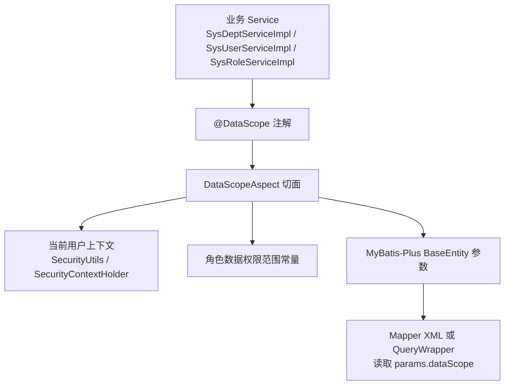
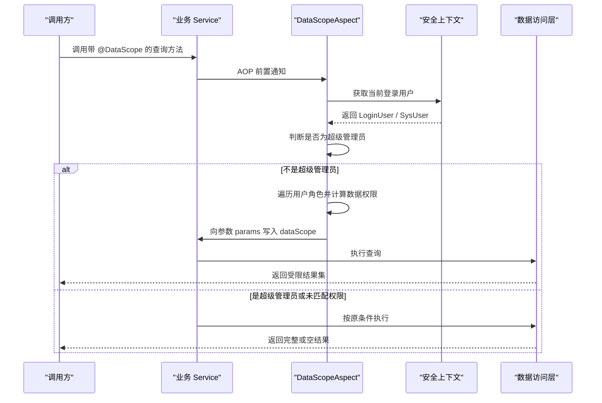
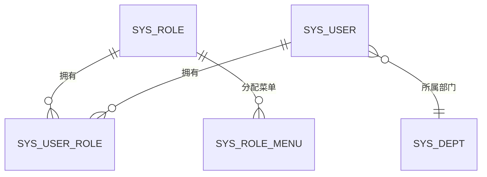
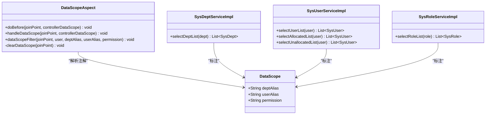

# datascope 数据权限模块

<cite>
**本文引用的文件**   
- [DataScope.java](file://zealux-ai-master/zealux-ai-common/zealux-ai-common-datascope/src/main/java/com/zealux/common/datascope/annotation/DataScope.java)
- [DataScopeAspect.java](file://zealux-ai-master/zealux-ai-common/zealux-ai-common-datascope/src/main/java/com/zealux/common/datascope/aspect/DataScopeAspect.java)
- [SysDeptServiceImpl.java](file://zealux-ai-master/zealux-ai-modules/zealux-ai-system/src/main/java/com/zealux/system/service/impl/SysDeptServiceImpl.java)
- [SysUserServiceImpl.java](file://zealux-ai-master/zealux-ai-modules/zealux-ai-system/src/main/java/com/zealux/system/service/impl/SysUserServiceImpl.java)
- [SysRoleServiceImpl.java](file://zealux-ai-master/zealux-ai-modules/zealux-ai-system/src/main/java/com/zealux/system/service/impl/SysRoleServiceImpl.java)
- [ry_20240629.sql](file://_setup/sql/ry_20240629.sql)
</cite>

## 目录
1. [简介](#简介)
2. [项目结构定位](#项目结构定位)
3. [核心组件总览](#核心组件总览)
4. [注解与切面工作原理](#注解与切面工作原理)
5. [属性与数据权限范围说明](#属性与数据权限范围说明)
6. [Service 使用示例](#service-使用示例)
7. [与部门、用户、角色数据的关系](#与部门用户角色数据的关系)
8. [依赖关系分析](#依赖关系分析)
9. [性能与索引建议](#性能与索引建议)
10. [常见问题排查](#常见问题排查)
11. [结论](#结论)

## 简介
本模块为基于 RuoYi-Cloud 的数据权限过滤能力，属于 `zealux-ai-common` 中的 `zealux-ai-common-datascope` 子模块。它通过一个自定义注解和一个 AOP 切面，在 Service 层查询方法执行前，根据当前登录用户的角色、部门及权限字符，向 MyBatis-Plus 的查询参数中注入一段 SQL WHERE 片段，从而实现行级数据权限控制。

需要特别注意：仓库中定义的 `@DataScope` 注解只有 `deptAlias`、`userAlias` 和 `permission` 三个属性；代码中并未定义 `roleAlias`、`deptChildren`、`userChildren` 等属性。文档后续将严格以实际源码为准，不把这些不存在属性描述为已有能力。

**章节来源**
- [DataScope.java:1-33](file://zealux-ai-master/zealux-ai-common/zealux-ai-common-datascope/src/main/java/com/zealux/common/datascope/annotation/DataScope.java#L1-L33)
- [DataScopeAspect.java:1-184](file://zealux-ai-master/zealux-ai-common/zealux-ai-common-datascope/src/main/java/com/zealux/common/datascope/aspect/DataScopeAspect.java#L1-L184)

## 项目结构定位
该模块位于后端公共库中，对外暴露两个核心 Java 类：

| 路径 | 职责 |
|---|---|
| `com.zealux.common.datascope.annotation.DataScope` | 定义用于标注 Service 方法的注解及其属性 |
| `com.zealux.common.datascope.aspect.DataScopeAspect` | 解析注解、读取当前用户上下文、拼接数据权限 SQL 片段 |

系统模块 `zealux-ai-system` 中的部门、用户、角色服务在其列表查询方法上使用该注解，从而复用同一套数据权限逻辑。

**图表来源**
- [DataScopeAspect.java:39-184](file://zealux-ai-master/zealux-ai-common/zealux-ai-common-datascope/src/main/java/com/zealux/common/datascope/aspect/DataScopeAspect.java#L39-L184)
- [SysDeptServiceImpl.java:44-63](file://zealux-ai-master/zealux-ai-modules/zealux-ai-system/src/main/java/com/zealux/system/service/impl/SysDeptServiceImpl.java#L44-L63)
- [SysUserServiceImpl.java:66-99](file://zealux-ai-master/zealux-ai-modules/zealux-ai-system/src/main/java/com/zealux/system/service/impl/SysUserServiceImpl.java#L66-L99)
- [SysRoleServiceImpl.java:39-47](file://zealux-ai-master/zealux-ai-modules/zealux-ai-system/src/main/java/com/zealux/system/service/impl/SysRoleServiceImpl.java#L39-L47)

**章节来源**
- [DataScope.java:1-33](file://zealux-ai-master/zealux-ai-common/zealux-ai-common-datascope/src/main/java/com/zealux/common/datascope/annotation/DataScope.java#L1-L33)
- [DataScopeAspect.java:1-184](file://zealux-ai-master/zealux-ai-common/zealux-ai-common-datascope/src/main/java/com/zealux/common/datascope/aspect/DataScopeAspect.java#L1-L184)

## 核心组件总览
- **注解处理器（AOP 切面）**：`DataScopeAspect`
  - 在目标方法执行前拦截带有 `@DataScope` 的方法。
  - 从安全上下文中获取当前登录用户。
  - 跳过超级管理员。
  - 根据用户角色的数据权限范围生成 SQL 条件片段。
  - 将条件写入第一个参数的 `params.dataScope`。
- **注解定义**：`DataScope`
  - 仅支持 `deptAlias`、`userAlias`、`permission`。
  - 未支持 `roleAlias`、`deptChildren`、`userChildren`。
- **典型使用方**：
  - 部门服务：`selectDeptList` 使用 `deptAlias = "d"`。
  - 用户服务：`selectUserList`、`selectAllocatedList`、`selectUnallocatedList` 同时使用 `deptAlias = "d"` 与 `userAlias = "u"`。
  - 角色服务：`selectRoleList` 使用 `deptAlias = "d"`。

**章节来源**
- [DataScopeAspect.java:39-184](file://zealux-ai-master/zealux-ai-common/zealux-ai-common-datascope/src/main/java/com/zealux/common/datascope/aspect/DataScopeAspect.java#L39-L184)
- [SysDeptServiceImpl.java:44-63](file://zealux-ai-master/zealux-ai-modules/zealux-ai-system/src/main/java/com/zealux/system/service/impl/SysDeptServiceImpl.java#L44-L63)
- [SysUserServiceImpl.java:66-99](file://zealux-ai-master/zealux-ai-modules/zealux-ai-system/src/main/java/com/zealux/system/service/impl/SysUserServiceImpl.java#L66-L99)
- [SysRoleServiceImpl.java:39-47](file://zealux-ai-master/zealux-ai-modules/zealux-ai-system/src/main/java/com/zealux/system/service/impl/SysRoleServiceImpl.java#L39-L47)

## 注解与切面工作原理
### 执行流程

**图表来源**
- [DataScopeAspect.java:39-184](file://zealux-ai-master/zealux-ai-common/zealux-ai-common-datascope/src/main/java/com/zealux/common/datascope/aspect/DataScopeAspect.java#L39-L184)

### 关键处理逻辑
- 若当前用户为空，则不注入任何限制。
- 若当前用户是超级管理员，则直接跳过数据权限过滤。
- 若用户角色均不包含所需权限字符，则注入一个恒假条件，使查询返回空结果。
- 最终把 SQL 片段放入 `BaseEntity.getParams().put("dataScope", ...)`，供后续 SQL 拼接使用。

**章节来源**
- [DataScopeAspect.java:39-184](file://zealux-ai-master/zealux-ai-common/zealux-ai-common-datascope/src/main/java/com/zealux/common/datascope/aspect/DataScopeAspect.java#L39-L184)

## 属性与数据权限范围说明
### 注解属性
| 属性 | 类型 | 默认值 | 含义 |
|---|---|---|---|
| `deptAlias` | String | 空字符串 | 业务表中代表“所属部门”的表别名 |
| `userAlias` | String | 空字符串 | 业务表中代表“创建人/归属用户”的表别名 |
| `permission` | String | 空字符串 | 权限字符，用于筛选符合要求的角色；为空时回退到安全上下文中的权限集合 |

### 不存在属性的明确说明
- 源码中**没有** `roleAlias` 属性。
- 源码中**没有** `deptChildren` 属性。
- 源码中**没有** `userChildren` 属性。
- 因此不能把这三个名称当作现有注解配置项使用。

### 五种数据权限范围
切面内部定义了五个范围常量：

| 常量名 | 值 | 行为 |
|---|---:|---|
| `DATA_SCOPE_ALL` | `1` | 全部数据权限，清空已拼接的条件 |
| `DATA_SCOPE_CUSTOM` | `2` | 自定义数据权限，通过 `sys_role_dept` 表关联角色可查部门 |
| `DATA_SCOPE_DEPT` | `3` | 本部门数据 |
| `DATA_SCOPE_DEPT_AND_CHILD` | `4` | 本部门及以下部门数据 |
| `DATA_SCOPE_SELF` | `5` | 仅本人数据 |

这些值来自 `SysRole.getDataScope()`，由系统模块中的角色数据提供。

**章节来源**
- [DataScope.java:12-33](file://zealux-ai-master/zealux-ai-common/zealux-ai-common-datascope/src/main/java/com/zealux/common/datascope/annotation/DataScope.java#L12-L33)
- [DataScopeAspect.java:27-172](file://zealux-ai-master/zealux-ai-common/zealux-ai-common-datascope/src/main/java/com/zealux/common/datascope/aspect/DataScopeAspect.java#L27-L172)

## Service 使用示例
### 在 Service 方法上标注 `@DataScope`
以下三类查询方法展示了该注解的典型用法：

| 服务类 | 方法 | 注解配置 | 作用 |
|---|---|---|---|
| `SysDeptServiceImpl` | `selectDeptList` | `deptAlias = "d"` | 对部门列表按角色数据权限过滤 |
| `SysUserServiceImpl` | `selectUserList` | `deptAlias = "d"`, `userAlias = "u"` | 对用户列表按部门和用户归属过滤 |
| `SysRoleServiceImpl` | `selectRoleList` | `deptAlias = "d"` | 对角色列表按部门数据权限过滤 |

### 配合 MyBatis-Plus 的 QueryWrapper 使用
切面写入的是 `BaseEntity` 的 `params.dataScope` 字段。因此，业务层通常有两种方式消费该片段：

1. **XML 方式**：Mapper XML 中使用 `<if test="params.dataScope != null"> AND ${params.dataScope}</if>` 拼接。
2. **QueryWrapper 方式**：通过 `QueryWrapper` 的 `.last()` 或类似机制，或在构造 Wrapper 后追加该片段。

注意：切面不会自动修改 `QueryWrapper` 对象本身，而是向请求参数中注入 SQL 文本片段。若业务代码使用纯 `QueryWrapper` 构建 SQL，必须显式读取并拼接 `params.dataScope`，否则数据权限不会生效。

### 推荐的使用步骤
1. 在 Service 实现类的列表查询方法上加 `@DataScope`。
2. 设置正确的 `deptAlias`；如果业务表有用户归属字段，再设置 `userAlias`。
3. 如需限定某些角色才允许访问，设置 `permission`；否则让切面使用安全上下文中的权限集合。
4. 在数据访问层读取 `params.dataScope` 并拼接到 WHERE 条件末尾。

**章节来源**
- [SysDeptServiceImpl.java:44-63](file://zealux-ai-master/zealux-ai-modules/zealux-ai-system/src/main/java/com/zealux/system/service/impl/SysDeptServiceImpl.java#L44-L63)
- [SysUserServiceImpl.java:66-99](file://zealux-ai-master/zealux-ai-modules/zealux-ai-system/src/main/java/com/zealux/system/service/impl/SysUserServiceImpl.java#L66-L99)
- [SysRoleServiceImpl.java:39-47](file://zealux-ai-master/zealux-ai-modules/zealux-ai-system/src/main/java/com/zealux/system/service/impl/SysRoleServiceImpl.java#L39-L47)
- [DataScopeAspect.java:160-184](file://zealux-ai-master/zealux-ai-common/zealux-ai-common-datascope/src/main/java/com/zealux/common/datascope/aspect/DataScopeAspect.java#L160-L184)

## 与部门、用户、角色数据的关系
### 数据权限如何映射到数据库表
切面在处理不同数据权限范围时，会直接或间接引用以下系统表：

| 场景 | 使用的表或字段 | 说明 |
|---|---|---|
| 自定义数据权限 | `sys_role_dept`、`dept_id`、`role_id` | 根据角色关联部门决定可查部门 |
| 本部门 | 业务表的部门字段 | 匹配当前用户的 `deptId` |
| 本部门及以下 | `sys_dept.dept_id`、`sys_dept.ancestors` | 利用部门祖先链判断子部门 |
| 仅本人 | 业务表的 `user_id` | 需要 `userAlias`，否则退化为不可见 |
| 全部数据 | 无额外条件 | 覆盖之前拼接的条件 |

### 系统表结构要点
本地初始化脚本包含以下相关表：

| 表名 | 关键字段 | 用途 |
|---|---|---|
| `sys_dept` | `dept_id`、`parent_id`、`ancestors` | 部门树与祖先链 |
| `sys_user` | `user_id`、`dept_id` | 用户及其所属部门 |
| `sys_role` | `role_id`、`role_key`、`status`、`data_scope`、`permissions` | 角色、状态、数据权限范围与权限字符 |
| `sys_user_role` | `user_id`、`role_id` | 用户与角色关系 |
| `sys_role_menu` | `role_id`、`menu_id` | 角色菜单权限（与本模块间接相关） |

注意：`sys_role_dept` 在上述 SQL 片段中被切面引用，但本节不扩展其建表语句；应以实际数据库结构为准。

**图表来源**
- [ry_20240629.sql:6-37](file://_setup/sql/ry_20240629.sql#L6-L37)
- [ry_20240629.sql:43-70](file://_setup/sql/ry_20240629.sql#L43-L70)
- [ry_20240629.sql:105-128](file://_setup/sql/ry_20240629.sql#L105-L128)
- [ry_20240629.sql:267-309](file://_setup/sql/ry_20240629.sql#L267-L309)

**章节来源**
- [DataScopeAspect.java:89-158](file://zealux-ai-master/zealux-ai-common/zealux-ai-common-datascope/src/main/java/com/zealux/common/datascope/aspect/DataScopeAspect.java#L89-L158)
- [ry_20240629.sql:6-37](file://_setup/sql/ry_20240629.sql#L6-L37)
- [ry_20240629.sql:43-70](file://_setup/sql/ry_20240629.sql#L43-L70)
- [ry_20240629.sql:105-128](file://_setup/sql/ry_20240629.sql#L105-L128)
- [ry_20240629.sql:267-309](file://_setup/sql/ry_20240629.sql#L267-L309)

## 依赖关系分析
### 注解处理器依赖
`DataScopeAspect` 依赖以下运行时信息：
- Spring AOP：`@Aspect`、`@Before`。
- 当前用户：`SecurityUtils.getLoginUser()`。
- 权限上下文：`SecurityContextHolder.getPermission()`。
- 用户模型：`SysUser`、`SysRole`、`LoginUser`。
- 基础实体：`BaseEntity`，用于写入 `params.dataScope`。
- 工具类：`StringUtils`、`Convert`。

### 业务模块依赖
系统模块的服务实现类通过 `@DataScope` 声明自身的数据权限语义，并把具体 SQL 交给底层 Mapper 执行。

**图表来源**
- [DataScope.java:12-33](file://zealux-ai-master/zealux-ai-common/zealux-ai-common-datascope/src/main/java/com/zealux/common/datascope/annotation/DataScope.java#L12-L33)
- [DataScopeAspect.java:21-184](file://zealux-ai-master/zealux-ai-common/zealux-ai-common-datascope/src/main/java/com/zealux/common/datascope/aspect/DataScopeAspect.java#L21-L184)
- [SysDeptServiceImpl.java:44-63](file://zealux-ai-master/zealux-ai-modules/zealux-ai-system/src/main/java/com/zealux/system/service/impl/SysDeptServiceImpl.java#L44-L63)
- [SysUserServiceImpl.java:66-99](file://zealux-ai-master/zealux-ai-modules/zealux-ai-system/src/main/java/com/zealux/system/service/impl/SysUserServiceImpl.java#L66-L99)
- [SysRoleServiceImpl.java:39-47](file://zealux-ai-master/zealux-ai-modules/zealux-ai-system/src/main/java/com/zealux/system/service/impl/SysRoleServiceImpl.java#L39-L47)

**章节来源**
- [DataScopeAspect.java:1-184](file://zealux-ai-master/zealux-ai-common/zealux-ai-common-datascope/src/main/java/com/zealux/common/datascope/aspect/DataScopeAspect.java#L1-L184)
- [SysDeptServiceImpl.java:44-63](file://zealux-ai-master/zealux-ai-modules/zealux-ai-system/src/main/java/com/zealux/system/service/impl/SysDeptServiceImpl.java#L44-L63)
- [SysUserServiceImpl.java:66-99](file://zealux-ai-master/zealux-ai-modules/zealux-ai-system/src/main/java/com/zealux/system/service/impl/SysUserServiceImpl.java#L66-L99)
- [SysRoleServiceImpl.java:39-47](file://zealux-ai-master/zealux-ai-modules/zealux-ai-system/src/main/java/com/zealux/system/service/impl/SysRoleServiceImpl.java#L39-L47)

## 性能与索引建议
### 大数据量下的主要风险
- 自定义数据权限可能产生 `IN (SELECT dept_id FROM sys_role_dept WHERE role_id IN (...))` 子查询。
- 本部门及以下权限可能涉及 `sys_dept` 上的祖先链扫描。
- 多个角色且多个自定义权限时，条件拼接会更复杂。
- 若业务表数据量大且未对部门或用户字段建立索引，WHERE 条件可能退化为全表扫描。

### 索引优化建议
- 在业务表上为被用作权限过滤的字段建立索引，例如：
  - 部门维度：`dept_id`。
  - 用户维度：`user_id`。
- 确保 `sys_dept` 的 `dept_id`、`parent_id`、`ancestors` 具备合适的索引或主键约束。
- 确保 `sys_role_dept` 的 `role_id`、`dept_id` 有合适索引，避免子查询成为瓶颈。
- 对于高频分页查询，尽量结合业务查询条件一起走索引，不要只依赖 `dataScope` 片段。
- 当部门树很深或子部门非常多时，应评估 `ancestors` 列上的查询成本，必要时考虑缓存常用部门的可见范围。

**章节来源**
- [DataScopeAspect.java:108-158](file://zealux-ai-master/zealux-ai-common/zealux-ai-common-datascope/src/main/java/com/zealux/common/datascope/aspect/DataScopeAspect.java#L108-L158)
- [ry_20240629.sql:6-37](file://_setup/sql/ry_20240629.sql#L6-L37)

## 常见问题排查
### 1. 注解属性拼写错误
**现象**  
使用了 `roleAlias`、`deptChildren`、`userChildren` 等属性，编译失败或注解无法生效。

**原因**  
`@DataScope` 仅定义 `deptAlias`、`userAlias`、`permission`，不存在其他属性。

**处理**  
- 删除不存在的属性。
- 使用 `deptAlias` 指定业务部门字段别名。
- 使用 `userAlias` 指定业务用户字段别名。
- 如需限制角色，使用 `permission`。

**章节来源**
- [DataScope.java:12-33](file://zealux-ai-master/zealux-ai-common/zealux-ai-common-datascope/src/main/java/com/zealux/common/datascope/annotation/DataScope.java#L12-L33)

### 2. SQL 拼接异常或权限未生效
**现象**  
查询结果不符合预期，或者数据权限完全无效。

**可能原因**  
- Mapper XML 或 QueryWrapper 中没有读取 `params.dataScope`。
- 业务表别名与注解中配置的 `deptAlias`、`userAlias` 不一致。
- 当前用户是超级管理员，切面主动跳过数据权限过滤。
- 用户角色都不包含 `permission`，导致注入恒假条件，返回空结果。

**排查步骤**  
1. 确认 Service 方法是否标注了 `@DataScope`。
2. 检查注解中的别名是否与 SQL 中的表别名一致。
3. 检查数据访问层是否拼接了 `params.dataScope`。
4. 查看当前用户角色是否包含对应权限字符。
5. 确认用户是否被判定为超级管理员。

**章节来源**
- [DataScopeAspect.java:61-184](file://zealux-ai-master/zealux-ai-common/zealux-ai-common-datascope/src/main/java/com/zealux/common/datascope/aspect/DataScopeAspect.java#L61-L184)

### 3. 仅本人权限却查不到数据
**现象**  
设置了 `userAlias` 后仍返回空结果，或没有设置 `userAlias` 时所有数据都不可见。

**原因**  
- 当数据权限范围为“仅本人”且未提供 `userAlias` 时，切面会注入一个恒假条件。
- 即使提供了 `userAlias`，若业务表没有正确维护归属用户字段，也可能查不到数据。

**处理**  
- 为“仅本人”权限的场景提供正确的 `userAlias`。
- 校验业务表中归属用户字段是否填写。
- 检查用户角色数据权限范围是否确实是“仅本人”。

**章节来源**
- [DataScopeAspect.java:136-158](file://zealux-ai-master/zealux-ai-common/zealux-ai-common-datascope/src/main/java/com/zealux/common/datascope/aspect/DataScopeAspect.java#L136-L158)

### 4. 大数据量下查询缓慢
**现象**  
部门树较大、用户较多或角色自定义权限较多时，列表查询变慢。

**处理**  
- 为业务表的部门、用户字段加索引。
- 为 `sys_dept` 和 `sys_role_dept` 的关键字段加索引。
- 避免在分页前先加载大量中间数据。
- 对高频可见部门范围做缓存设计，减少重复子查询。

**章节来源**
- [DataScopeAspect.java:108-158](file://zealux-ai-master/zealux-ai-common/zealux-ai-common-datascope/src/main/java/com/zealux/common/datascope/aspect/DataScopeAspect.java#L108-L158)

## 结论
`zealux-ai-common-datascope` 是一个轻量但关键的行级数据权限基础设施。它通过 `@DataScope` 注解和 AOP 切面，把当前用户角色对应的部门、用户、自定义权限范围转化为 SQL WHERE 片段，并由业务数据访问层消费。

使用时必须注意：
- 只使用注解中真实存在的属性：`deptAlias`、`userAlias`、`permission`。
- 不要把 `roleAlias`、`deptChildren`、`userChildren` 当成已有能力。
- 必须在数据访问层读取并拼接 `params.dataScope`，否则权限不会生效。
- 合理配置角色数据权限范围，并确保数据库中对部门、用户、角色关联字段建立必要索引。