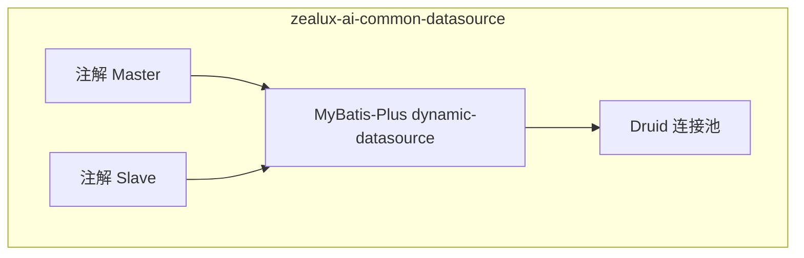
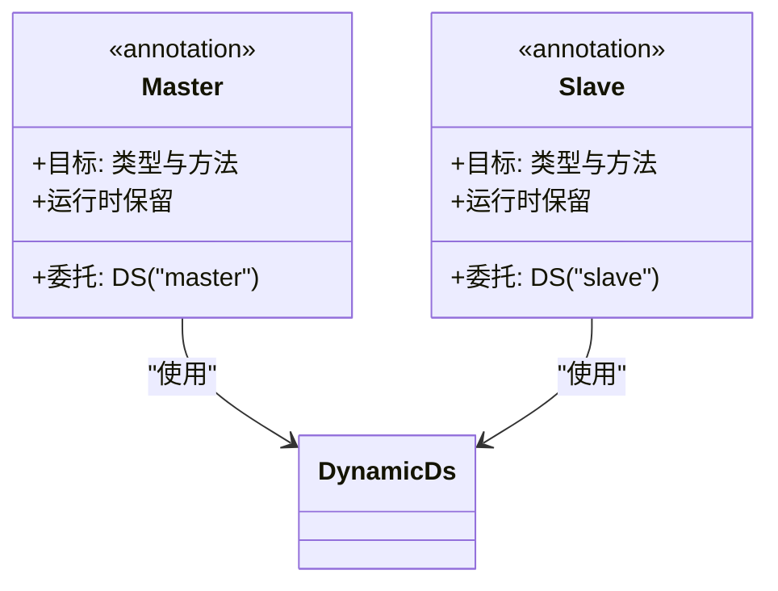
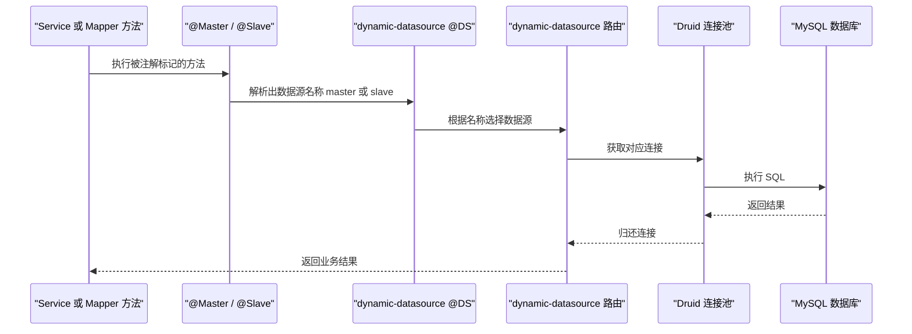
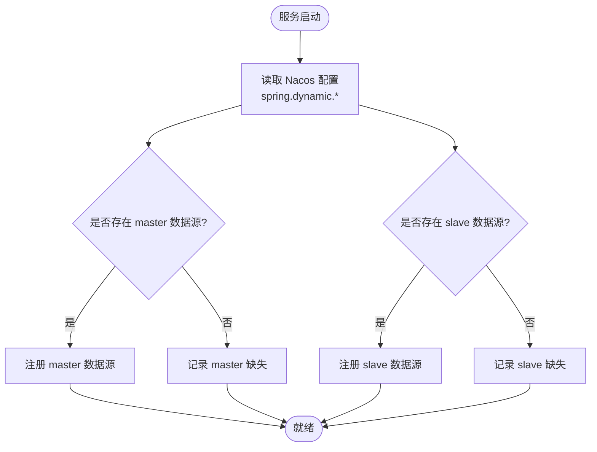
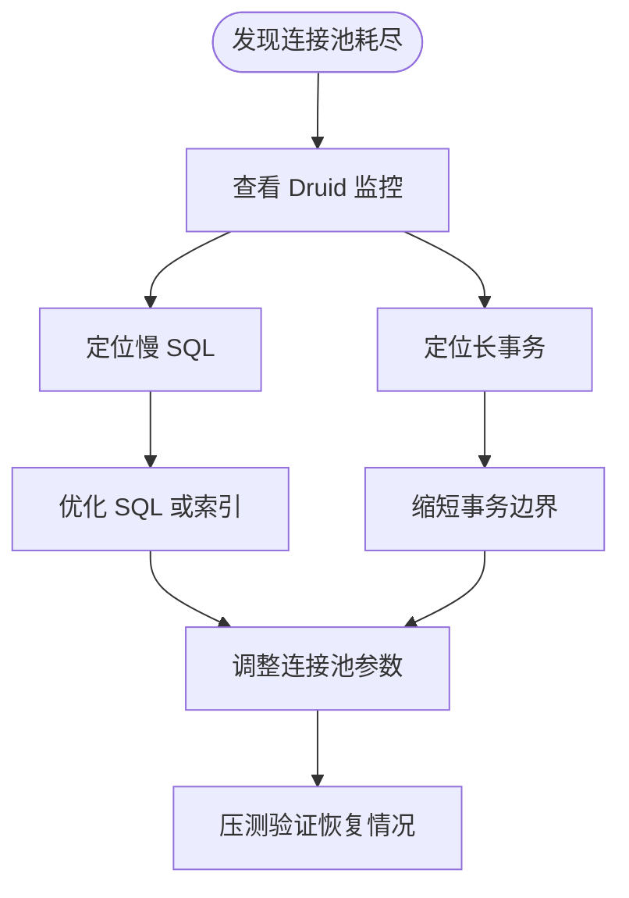

# datasource 数据源模块

<cite>
**本文引用的文件 **
- [Master.java](file://zealux-ai-master/zealux-ai-common/zealux-ai-common-datasource/src/main/java/com/zealux/common/datasource/annotation/Master.java)
- [Slave.java](file://zealux-ai-master/zealux-ai-common/zealux-ai-common-datasource/src/main/java/com/zealux/common/datasource/annotation/Slave.java)
- [pom.xml（datasource 子模块）](file://zealux-ai-master/zealux-ai-common/zealux-ai-common-datasource/pom.xml)
- [pom.xml（根项目）](file://zealux-ai-master/pom.xml)
- [application-dev.yml（Nacos 本地配置副本）](file://_setup/stack/nacos/nacos/data/config-data/DEFAULT_GROUP/application-dev.yml)
- [zealux-ai-system-dev.yml（Nacos 本地配置副本）](file://_setup/stack/nacos/nacos/data/config-data/DEFAULT_GROUP/zealux-ai-system-dev.yml)
</cite>

## 目录
1. [引言](#引言)
2. [模块定位与依赖](#模块定位与依赖)
3. [注解定义：@Master 与 @Slave](#注解定义master-与-slave)
4. [动态数据源切换机制](#动态数据源切换机制)
5. [Nacos 多数据源配置映射](#nacos-多数据源配置映射)
6. [在 Mapper 与 Service 上的使用方式](#在-mapper-与-service-上的使用方式)
7. [默认数据源与强制指定数据源的差异](#默认数据源与强制指定数据源的差异)
8. [常见问题与排查思路](#常见问题与排查思路)
9. [结论](#结论)

## 引言
本模块是 zealux-ai-common 中的 `zealux-ai-common-datasource`，用于为系统提供基于注解的动态数据源切换能力。该模块没有重新实现底层路由逻辑，而是通过引入 Druid 连接池与 MyBatis-Plus 的 dynamic-datasource 组件，并在自身中定义语义更清晰的 `@Master`、`@Slave` 两个注解，对外暴露主库和从库的数据源选择策略。

需要特别说明的是：
- 当前仓库中只实现了注解封装；工作区内未找到由本项目维护的 AOP 切面、数据源上下文类或数据库初始化脚本。
- Nacos 本地配置副本中仅定义了名为 `master` 的主库数据源，未发现名为 `slave` 的从库配置。
- 因此，“读写分离”在本仓库中表现为“通过注解将请求路由到已配置的 named datasource”，并不保证已经部署了真实的从库实例。

## 模块定位与依赖
`zealux-ai-common-datasource` 是一个轻量公共库，其职责是把业务侧关心的“主库/从库”语义，翻译成 dynamic-datasource 能够识别的数据源名称。

| 维度 | 说明 |
|---|---|
| Maven artifactId | `zealux-ai-common-datasource` |
| 所属父模块 | `zealux-ai-common` |
| 核心依赖 | Druid Spring Boot 3 Starter、dynamic-datasource-spring-boot3-starter |
| 版本来源 | `druid.version=1.2.23`、`dynamic-ds.version=4.3.1` |
| 对外暴露 | `com.zealux.common.datasource.annotation.Master`、`Slave` |

**图表来源**
- [pom.xml（datasource 子模块）:1-35](file://zealux-ai-master/zealux-ai-common/zealux-ai-common-datasource/pom.xml#L1-L35)
- [Master.java:1-22](file://zealux-ai-master/zealux-ai-common/zealux-ai-common-datasource/src/main/java/com/zealux/common/datasource/annotation/Master.java#L1-L22)
- [Slave.java:1-22](file://zealux-ai-master/zealux-ai-common/zealux-ai-common-datasource/src/main/java/com/zealux/common/datasource/annotation/Slave.java#L1-L22)

**章节来源**
- [pom.xml（datasource 子模块）:1-35](file://zealux-ai-master/zealux-ai-common/zealux-ai-common-datasource/pom.xml#L1-L35)
- [pom.xml（根项目）:32-33](file://zealux-ai-master/pom.xml#L32-L33)

## 注解定义：@Master 与 @Slave
模块中只有两个注解，且结构高度对称：

| 注解 | 作用目标 | 保留策略 | 内部行为 |
|---|---|---|---|
| `@Master` | 类型与方法 | 运行时保留 | 委托给 dynamic-datasource 的 `@DS("master")` |
| `@Slave` | 类型与方法 | 运行时保留 | 委托给 dynamic-datasource 的 `@DS("slave")` |

这意味着：
- 注解本身不保存额外参数，也不包含自定义逻辑。
- 真正决定使用哪个数据源的是注解上嵌入的字符串 `"master"` 或 `"slave"`。
- 这两个注解只是对业务语义的包装，降低直接写 `"master"`、`"slave"` 带来的可读性问题。

**图表来源**
- [Master.java:1-22](file://zealux-ai-master/zealux-ai-common/zealux-ai-common-datasource/src/main/java/com/zealux/common/datasource/annotation/Master.java#L1-L22)
- [Slave.java:1-22](file://zealux-ai-master/zealux-ai-common/zealux-ai-common-datasource/src/main/java/com/zealux/common/datasource/annotation/Slave.java#L1-L22)

**章节来源**
- [Master.java:1-22](file://zealux-ai-master/zealux-ai-common/zealux-ai-common-datasource/src/main/java/com/zealux/common/datasource/annotation/Master.java#L1-L22)
- [Slave.java:1-22](file://zealux-ai-master/zealux-ai-common/zealux-ai-common-datasource/src/main/java/com/zealux/common/datasource/annotation/Slave.java#L1-L22)

## 动态数据源切换机制
由于本仓库没有暴露自定义的 AOP 切面或 `DynamicDataSourceContextHolder` 等上下文类，当前实现的数据源选择链路可理解为：

关键点如下：
1. 注解的目标是 `TYPE` 与 `METHOD`，所以可以加在类上作为默认策略，也可以加在具体方法上覆盖类级别设置。
2. 当多个注解同时存在时，应以 dynamic-datasource 的规则为准；代码中未给出冲突处理逻辑。
3. 如果方法上没有 `@Master` 或 `@Slave`，则回退到 dynamic-datasource 的默认数据源。
4. 如果某个服务没有启用 dynamic-datasource starter，或者 Nacos 中没有注册对应 dataId 的配置，则无法完成切换。

**图表来源**
- [Master.java:1-22](file://zealux-ai-master/zealux-ai-common/zealux-ai-common-datasource/src/main/java/com/zealux/common/datasource/annotation/Master.java#L1-L22)
- [Slave.java:1-22](file://zealux-ai-master/zealux-ai-common/zealux-ai-common-datasource/src/main/java/com/zealux/common/datasource/annotation/Slave.java#L1-L22)
- [pom.xml（datasource 子模块）:20-35](file://zealux-ai-master/zealux-ai-common/zealux-ai-common-datasource/pom.xml#L20-L35)

**章节来源**
- [Master.java:1-22](file://zealux-ai-master/zealux-ai-common/zealux-ai-common-datasource/src/main/java/com/zealux/common/datasource/annotation/Master.java#L1-L22)
- [Slave.java:1-22](file://zealux-ai-master/zealux-ai-common/zealux-ai-common-datasource/src/main/java/com/zealux/common/datasource/annotation/Slave.java#L1-L22)
- [pom.xml（datasource 子模块）:20-35](file://zealux-ai-master/zealux-ai-common/zealux-ai-common-datasource/pom.xml#L20-L35)

## Nacos 多数据源配置映射
本模块通过 dynamic-datasource 读取以 `spring.dynamic.*` 开头的配置。本地 Nacos 配置副本显示，system 服务的 dev 配置中包含以下关键路径：

| Nacos 配置路径 | 当前值 | 含义 |
|---|---|---|
| `spring.datasource.druid.stat-view-servlet.enabled` | `true` | 开启 Druid 监控面板 |
| `spring.dynamic.druid.initial-size` | `5` | 初始连接数 |
| `spring.dynamic.druid.min-idle` | `5` | 最小空闲连接数 |
| `spring.dynamic.druid.maxActive` | `20` | 最大活动连接数 |
| `spring.dynamic.druid.validationQuery` | `SELECT 1 FROM DUAL` | 连接有效性校验语句 |
| `spring.dynamic.datasource.master.driver-class-name` | MySQL 驱动类 | 主库驱动 |
| `spring.dynamic.datasource.master.url` | `jdbc:mysql://127.0.0.1:3306/zealux-ai-cloud?...` | 主库连接地址 |
| `spring.dynamic.datasource.master.username` | `root` | 主库用户名 |
| `spring.dynamic.datasource.master.password` | `root` | 主库密码 |

注意：
- 本地配置副本中只定义了 `master`，未定义 `slave`。
- 若方法标注 `@Slave`，但 Nacos 中没有 `spring.dynamic.datasource.slave`，运行时可能找不到数据源。
- `application-dev.yml` 中还排除了 Druid 默认的 `DruidDataSourceAutoConfigure`，这通常是为了让 dynamic-datasource 接管连接池初始化。

**图表来源**
- [zealux-ai-system-dev.yml:1-55](file://_setup/stack/nacos/nacos/data/config-data/DEFAULT_GROUP/zealux-ai-system-dev.yml#L1-L55)
- [application-dev.yml:1-5](file://_setup/stack/nacos/nacos/data/config-data/DEFAULT_GROUP/application-dev.yml#L1-L5)

**章节来源**
- [zealux-ai-system-dev.yml:1-55](file://_setup/stack/nacos/nacos/data/config-data/DEFAULT_GROUP/zealux-ai-system-dev.yml#L1-L55)
- [application-dev.yml:1-5](file://_setup/stack/nacos/nacos/data/config-data/DEFAULT_GROUP/application-dev.yml#L1-L5)

## 在 Mapper 与 Service 上的使用方式
### 推荐用法
- 读操作：在查询类 Service 方法上标注 `@Slave`，使请求默认走从库。
- 写操作：在新增、修改、删除方法上标注 `@Master`，确保写入主库。
- 默认策略：如果整个 Service 类都是读操作，可在类上标注 `@Slave`，方法级不再重复标注。
- 混合场景：一个 Service 类同时包含读写方法时，建议只在具体方法上标注，避免类级别默认值干扰。

### 示例形式
以下示例仅展示注解位置与语义，不包含具体业务字段或返回值。

| 场景 | 示例形式 |
|---|---|
| 单个查询方法使用从库 | 在 Service 方法上加 `@Slave` |
| 单个写入方法使用主库 | 在 Service 方法上加 `@Master` |
| 整类默认读从库 | 在 Service 类上加 `@Slave` |
| 覆盖类的默认策略 | 在类上加 `@Slave`，特定写方法再加 `@Master` |
| Mapper 层 | 若 Mapper 方法属于事务或复杂流程，建议把注解放在 Service 方法上，而不是 Mapper 接口 |

### 不推荐的做法
- 同时在同一方法上混用多个数据源相关注解。
- 把写注解放在只读事务方法上。
- 仅在 Mapper 上标注而不在调用链入口标注，导致事务边界判断困难。

**章节来源**
- [Master.java:1-22](file://zealux-ai-master/zealux-ai-common/zealux-ai-common-datasource/src/main/java/com/zealux/common/datasource/annotation/Master.java#L1-L22)
- [Slave.java:1-22](file://zealux-ai-master/zealux-ai-common/zealux-ai-common-datasource/src/main/java/com/zealux/common/datasource/annotation/Slave.java#L1-L22)

## 默认数据源与强制指定数据源的差异
| 对比项 | 默认数据源 | 强制指定数据源 |
|---|---|---|
| 触发方式 | 方法上没有 `@Master` 或 `@Slave` | 方法或类上明确标注 `@Master` / `@Slave` |
| 数据来源 | dynamic-datasource 的默认数据源 | 注解中指定的 `master` 或 `slave` |
| 可控性 | 较低，依赖框架默认行为 | 较高，由业务代码显式声明 |
| 可读性 | 不明确是否读写 | 明确表达“读从库”或“写主库”意图 |
| 风险 | 默认数据源变化会影响所有未标注方法 | 每个方法职责清晰，便于审查 |

在现有 Nacos 配置中，`master` 是唯一可见的 named datasource。若没有额外配置 `slave`，强制指定 `@Slave` 并不能自动实现真正的从库隔离，而只是尝试访问名为 `slave` 的数据源。

**章节来源**
- [Master.java:1-22](file://zealux-ai-master/zealux-ai-common/zealux-ai-common-datasource/src/main/java/com/zealux/common/datasource/annotation/Master.java#L1-L22)
- [Slave.java:1-22](file://zealux-ai-master/zealux-ai-common/zealux-ai-common-datasource/src/main/java/com/zealux/common/datasource/annotation/Slave.java#L1-L22)
- [zealux-ai-system-dev.yml:1-55](file://_setup/stack/nacos/nacos/data/config-data/DEFAULT_GROUP/zealux-ai-system-dev.yml#L1-L55)

## 常见问题与排查思路

### 1. 事务边界内数据源切换失效
**现象：**  
方法上加了 `@Master`，但事务内的查询仍走了默认数据源或从库。

**原因分析：**
- 事务通常在方法进入前创建连接。如果外层方法先开启事务并绑定了一个连接，内层方法的注解可能无法再切换到另一个数据源。
- 本模块没有看到自定义的事务拦截器或事务同步策略，因此应遵循 dynamic-datasource 的一般限制：尽量避免在一个事务中跨数据源切换。

**排查步骤：**
1. 确认事务注解位于哪个方法上。
2. 检查该方法是否调用了其他带不同数据源注解的方法。
3. 将写操作拆分为独立方法，并把事务边界收缩到最短范围。
4. 如果必须跨库，考虑改为分布式事务方案，而不是依赖简单注解切换。

**章节来源**
- [Master.java:1-22](file://zealux-ai-master/zealux-ai-common/zealux-ai-common-datasource/src/main/java/com/zealux/common/datasource/annotation/Master.java#L1-L22)
- [Slave.java:1-22](file://zealux-ai-master/zealux-ai-common/zealux-ai-common-datasource/src/main/java/com/zealux/common/datasource/annotation/Slave.java#L1-L22)

### 2. 只读事务与写注解冲突
**现象：**  
方法标注 `@Transactional(readOnly = true)`，同时又标注 `@Master`，写入时报错或未按预期写入。

**原因分析：**
- 只读事务通常会向数据库发送只读模式提示，某些数据库或中间件会拒绝写操作。
- `@Master` 只负责选择数据源，不负责改变事务的只读属性。

**排查步骤：**
1. 移除写方法的只读事务注解。
2. 将读方法和写方法拆分到不同函数。
3. 如果确实需要同一个函数既读又写，应将事务改为可写，并确保写操作有明确的事务边界。

**章节来源**
- [Master.java:1-22](file://zealux-ai-master/zealux-ai-common/zealux-ai-common-datasource/src/main/java/com/zealux/common/datasource/annotation/Master.java#L1-L22)

### 3. 找不到 slave 数据源
**现象：**  
调用标注 `@Slave` 的方法后报错，提示找不到名为 `slave` 的数据源。

**原因分析：**
- 注解只会告诉 dynamic-datasource 使用 `slave` 这个名称。
- 本地 Nacos 配置副本中只定义了 `master`，没有 `slave`。

**排查步骤：**
1. 检查 Nacos 中对应服务的 dataId 是否包含 `spring.dynamic.datasource.slave`。
2. 确认 slave 数据库连接信息完整：driver、url、username、password。
3. 验证 slave 数据库实例可达，且账号权限正确。
4. 如暂时不需要从库，可先移除 `@Slave`，统一使用 `@Master` 或默认数据源。

**章节来源**
- [Slave.java:1-22](file://zealux-ai-master/zealux-ai-common/zealux-ai-common-datasource/src/main/java/com/zealux/common/datasource/annotation/Slave.java#L1-L22)
- [zealux-ai-system-dev.yml:1-55](file://_setup/stack/nacos/nacos/data/config-data/DEFAULT_GROUP/zealux-ai-system-dev.yml#L1-L55)

### 4. 连接池耗尽
**现象：**  
高并发下出现连接获取超时、线程阻塞或数据库连接数接近上限。

**原因分析：**
- Nacos 配置中 `maxActive=20`，表示每个数据源的最大活动连接数为 20。
- 长事务、慢查询、未关闭的连接或跨数据源事务都会显著消耗连接。
- 若后续增加更多 named datasource，总连接数会成倍增长。

**排查步骤：**
1. 查看 Druid 监控面板中各数据源的活跃连接、等待队列和慢 SQL。
2. 检查是否存在长时间未提交的事务。
3. 排查是否有循环调用、批量任务或定时任务占用大量连接。
4. 适当调整 `initial-size`、`min-idle`、`maxActive`，并结合压测确定合理值。
5. 将慢查询优化或拆分，减少单次事务持有连接的时间。

**图表来源**
- [zealux-ai-system-dev.yml:1-55](file://_setup/stack/nacos/nacos/data/config-data/DEFAULT_GROUP/zealux-ai-system-dev.yml#L1-L55)

**章节来源**
- [zealux-ai-system-dev.yml:1-55](file://_setup/stack/nacos/nacos/data/config-data/DEFAULT_GROUP/zealux-ai-system-dev.yml#L1-L55)

### 5. 注解没有生效
**现象：**  
加了 `@Master` 或 `@Slave`，但 SQL 仍然走默认数据源。

**排查步骤：**
1. 确认目标类或方法已被 Spring 管理。
2. 确认目标包已被扫描到。
3. 确认服务引入了 `dynamic-datasource-spring-boot3-starter`。
4. 确认 Nacos 中 dataId 正确加载，且 `spring.dynamic.*` 配置可用。
5. 检查是否存在外层事务、AOP 或代理导致注解未被解析。

**章节来源**
- [pom.xml（datasource 子模块）:20-35](file://zealux-ai-master/zealux-ai-common/zealux-ai-common-datasource/pom.xml#L20-L35)
- [application-dev.yml:1-5](file://_setup/stack/nacos/nacos/data/config-data/DEFAULT_GROUP/application-dev.yml#L1-L5)

## 结论
`zealux-ai-common-datasource` 的核心价值在于用 `@Master` 和 `@Slave` 两个轻量注解，把“主库/从库”的业务语义映射到 dynamic-datasource 的 `master` 与 `slave` 数据源名称。它本身不包含自定义 AOP 实现，也不维护数据源上下文；真正的路由由 dynamic-datasource 完成，连接池由 Druid 管理。

在当前仓库中，实际可用的 named datasource 只有 `master`。因此：
- 读写分离在架构意图上是明确的，但在本仓库中尚未体现为真实的双库部署。
- 生产接入前应补充 `slave` 数据源配置，并验证 Nacos 配置、数据库连通性和连接池容量。
- 使用时应优先在 Service 方法上标注，控制事务边界，避免在只读事务中进行写操作。
- 对于事务内切换失败、连接池耗尽、找不到 slave 等问题，应按本文排查路径逐项确认。