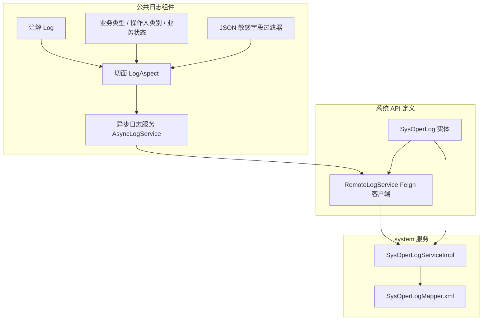
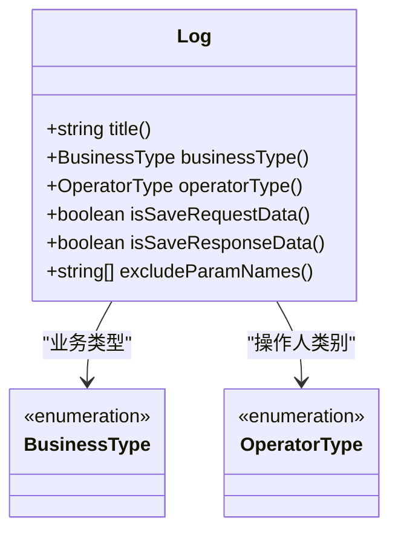
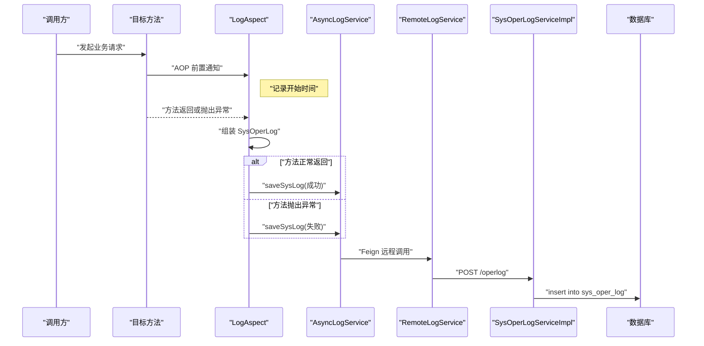
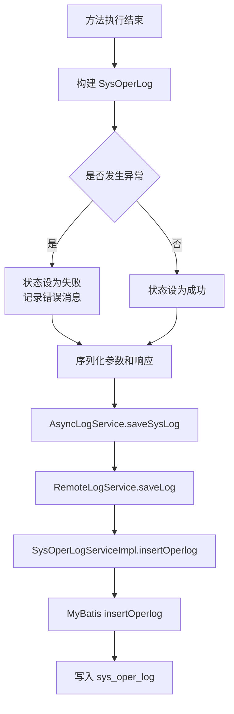
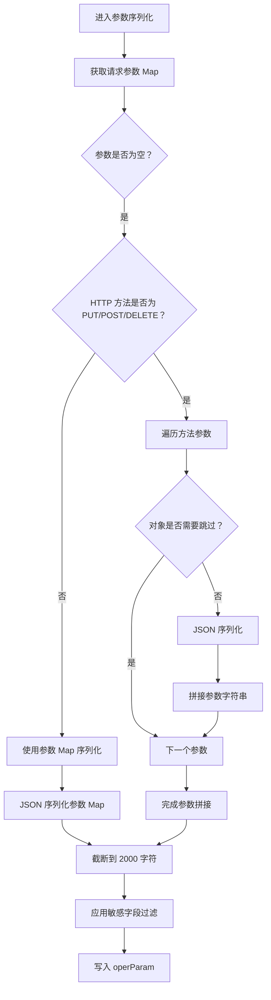
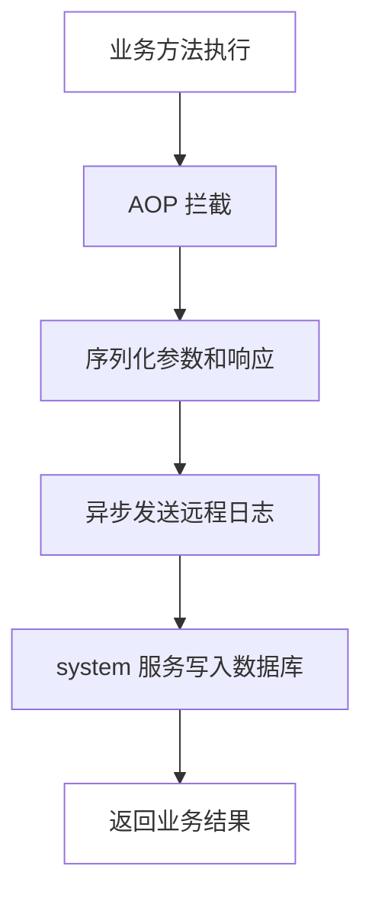

# log 日志模块

<cite>
**本文引用的文件**   
- [Log.java](file://zealux-ai-master/zealux-ai-common/zealux-ai-common-log/src/main/java/com/zealux/common/log/annotation/Log.java)
- [LogAspect.java](file://zealux-ai-master/zealux-ai-common/zealux-ai-common-log/src/main/java/com/zealux/common/log/aspect/LogAspect.java)
- [BusinessType.java](file://zealux-ai-master/zealux-ai-common/zealux-ai-common-log/src/main/java/com/zealux/common/log/enums/BusinessType.java)
- [OperatorType.java](file://zealux-ai-master/zealux-ai-common/zealux-ai-common-log/src/main/java/com/zealux/common/log/enums/OperatorType.java)
- [BusinessStatus.java](file://zealux-ai-master/zealux-ai-common/zealux-ai-common-log/src/main/java/com/zealux/common/log/enums/BusinessStatus.java)
- [PropertyPreExcludeFilter.java](file://zealux-ai-master/zealux-ai-common/zealux-ai-common-log/src/main/java/com/zealux/common/log/filter/PropertyPreExcludeFilter.java)
- [AsyncLogService.java](file://zealux-ai-master/zealux-ai-common/zealux-ai-common-log/src/main/java/com/zealux/common/log/service/AsyncLogService.java)
- [SysOperLog.java](file://zealux-ai-master/zealux-ai-api/zealux-ai-api-system/src/main/java/com/zealux/system/api/domain/SysOperLog.java)
- [RemoteLogService.java](file://zealux-ai-master/zealux-ai-api/zealux-ai-api-system/src/main/java/com/zealux/system/api/RemoteLogService.java)
- [SysOperLogServiceImpl.java](file://zealux-ai-master/zealux-ai-modules/zealux-ai-system/src/main/java/com/zealux/system/service/impl/SysOperLogServiceImpl.java)
- [SysOperLogMapper.xml](file://zealux-ai-master/zealux-ai-modules/zealux-ai-system/src/main/resources/mapper/system/SysOperLogMapper.xml)
</cite>

## 目录
1. [引言](#引言)
2. [模块定位与依赖范围](#模块定位与依赖范围)
3. [注解定义：@Log](#注解定义log)
4. [切面执行流程](#切面执行流程)
5. [异步持久化链路](#异步持久化链路)
6. [参数序列化与敏感字段过滤](#参数序列化与敏感字段过滤)
7. [业务类型与操作人类别](#业务类型与操作人类别)
8. [在 Service 层使用 @Log 的示例说明](#在-service-层使用-log-的示例说明)
9. [触发时机、异常处理与性能影响](#触发时机异常处理与性能影响)
10. [常见问题排查](#常见问题排查)
11. [结论](#结论)

## 引言
本模块是 RuoYi-Cloud 3.6.5 体系中的操作日志能力实现。它基于 Spring AOP，通过自定义注解拦截 Controller 或 Service 方法，收集请求上下文、业务类型、耗时、参数和响应数据，并通过异步方式调用远程日志服务，最终由 system 服务写入 `sys_oper_log` 表。

需要特别说明的是：仓库中定义的注解类名为 `com.zealux.common.log.annotation.Log`，而非用户问题中提到的 `@Operlog`；其属性名也采用 Java 命名风格，如 `title()`、`businessType()`、`operatorType()`、`isSaveRequestData()`、`isSaveResponseData()`、`excludeParamNames()`，而不是 `isSaveRemoteAddr`、`isSaveReqParam`、`isSaveRspParam`。文档将以源码实际名称为准。

**章节来源**
- [Log.java:1-51](file://zealux-ai-master/zealux-ai-common/zealux-ai-common-log/src/main/java/com/zealux/common/log/annotation/Log.java#L1-L51)

## 模块定位与依赖范围
该日志模块位于公共库子模块 `zealux-ai-common-log`，主要包含以下职责：

| 包路径 | 职责 |
|---|---|
| `com.zealux.common.log.annotation` | 定义操作日志注解 |
| `com.zealux.common.log.aspect` | 定义 AOP 切面，负责捕获方法调用、组装日志对象 |
| `com.zealux.common.log.enums` | 定义业务状态、业务类型、操作人类别等枚举 |
| `com.zealux.common.log.filter` | 提供 JSON 序列化时排除敏感字段的过滤器 |
| `com.zealux.common.log.service` | 封装异步保存日志的能力 |

日志落盘并不直接由 common-log 完成，而是通过 Feign 接口 `RemoteLogService` 调用 system 服务，再由 `SysOperLogServiceImpl` 与 MyBatis Mapper 写入数据库。因此，common-log 更准确地说是一个“日志采集 + 异步转发”组件，而不是完整的日志持久化实现。

**图表来源**
- [Log.java:1-51](file://zealux-ai-master/zealux-ai-common/zealux-ai-common-log/src/main/java/com/zealux/common/log/annotation/Log.java#L1-L51)
- [LogAspect.java:1-250](file://zealux-ai-master/zealux-ai-common/zealux-ai-common-log/src/main/java/com/zealux/common/log/aspect/LogAspect.java#L1-L250)
- [BusinessType.java:1-59](file://zealux-ai-master/zealux-ai-common/zealux-ai-common-log/src/main/java/com/zealux/common/log/enums/BusinessType.java#L1-L59)
- [OperatorType.java:1-24](file://zealux-ai-master/zealux-ai-common/zealux-ai-common-log/src/main/java/com/zealux/common/log/enums/OperatorType.java#L1-L24)
- [BusinessStatus.java:1-20](file://zealux-ai-master/zealux-ai-common/zealux-ai-common-log/src/main/java/com/zealux/common/log/enums/BusinessStatus.java#L1-L20)
- [PropertyPreExcludeFilter.java:1-24](file://zealux-ai-master/zealux-ai-common/zealux-ai-common-log/src/main/java/com/zealux/common/log/filter/PropertyPreExcludeFilter.java#L1-L24)
- [AsyncLogService.java:1-29](file://zealux-ai-master/zealux-ai-common/zealux-ai-common-log/src/main/java/com/zealux/common/log/service/AsyncLogService.java#L1-L29)
- [SysOperLog.java:1-255](file://zealux-ai-master/zealux-ai-api/zealux-ai-api-system/src/main/java/com/zealux/system/api/domain/SysOperLog.java#L1-L255)
- [RemoteLogService.java:1-41](file://zealux-ai-master/zealux-ai-api/zealux-ai-api-system/src/main/java/com/zealux/system/api/RemoteLogService.java#L1-L41)
- [SysOperLogServiceImpl.java:1-77](file://zealux-ai-master/zealux-ai-modules/zealux-ai-system/src/main/java/com/zealux/system/service/impl/SysOperLogServiceImpl.java#L1-L77)
- [SysOperLogMapper.xml:1-86](file://zealux-ai-master/zealux-ai-modules/zealux-ai-system/src/main/resources/mapper/system/SysOperLogMapper.xml#L1-L86)

**章节来源**
- [LogAspect.java:1-250](file://zealux-ai-master/zealux-ai-common/zealux-ai-common-log/src/main/java/com/zealux/common/log/aspect/LogAspect.java#L1-L250)
- [AsyncLogService.java:1-29](file://zealux-ai-master/zealux-ai-common/zealux-ai-common-log/src/main/java/com/zealux/common/log/service/AsyncLogService.java#L1-L29)
- [SysOperLogServiceImpl.java:1-77](file://zealux-ai-master/zealux-ai-modules/zealux-ai-system/src/main/java/com/zealux/system/service/impl/SysOperLogServiceImpl.java#L1-L77)
- [SysOperLogMapper.xml:1-86](file://zealux-ai-master/zealux-ai-modules/zealux-ai-system/src/main/resources/mapper/system/SysOperLogMapper.xml#L1-L86)

## 注解定义：@Log
注解类为 `@Log`，目标元素包括 `METHOD` 和 `PARAMETER`，保留策略为 `RUNTIME`，因此可在运行期被 AOP 切面读取。

| 属性名 | 类型 | 默认值 | 含义 |
|---|---|---|---|
| `title` | `String` | `""` | 日志标题，表示本次操作的模块或功能描述 |
| `businessType` | `BusinessType` | `OTHER` | 业务操作类型，对应新增、修改、删除、导出、导入等业务语义 |
| `operatorType` | `OperatorType` | `MANAGE` | 操作人类别，例如后台用户、手机端用户 |
| `isSaveRequestData` | `boolean` | `true` | 是否保存请求参数；关闭后不会拼接 `operParam` |
| `isSaveResponseData` | `boolean` | `true` | 是否保存返回结果；关闭后不会序列化 `jsonResult` |
| `excludeParamNames` | `String[]` | `{}` | 在 JSON 序列化时额外排除的请求参数字段名 |

需要注意：
- 源码中没有 `isSaveRemoteAddr` 属性。IP 地址由切面内部通过 IP 工具获取并设置到 `operIp`，不是注解开关控制的。
- 源码中也没有 `isSaveReqParam`、`isSaveRspParam` 属性，对应的正确属性名是 `isSaveRequestData` 和 `isSaveResponseData`。
- `excludeParamNames` 用于把指定字段从请求参数和对象参数的 JSON 输出中剔除，避免记录密码、令牌等敏感信息。

**图表来源**
- [Log.java:1-51](file://zealux-ai-master/zealux-ai-common/zealux-ai-common-log/src/main/java/com/zealux/common/log/annotation/Log.java#L1-L51)
- [BusinessType.java:1-59](file://zealux-ai-master/zealux-ai-common/zealux-ai-common-log/src/main/java/com/zealux/common/log/enums/BusinessType.java#L1-L59)
- [OperatorType.java:1-24](file://zealux-ai-master/zealux-ai-common/zealux-ai-common-log/src/main/java/com/zealux/common/log/enums/OperatorType.java#L1-L24)

**章节来源**
- [Log.java:1-51](file://zealux-ai-master/zealux-ai-common/zealux-ai-common-log/src/main/java/com/zealux/common/log/annotation/Log.java#L1-L51)

## 切面执行流程
`LogAspect` 是一个 Spring AOP 切面，核心逻辑如下：

1. **进入方法前**：在 `@Before` 中记录当前时间戳，用于计算方法耗时。
2. **方法正常返回**：在 `@AfterReturning` 中组装成功状态的日志对象，并调用异步服务保存。
3. **方法抛出异常**：在 `@AfterThrowing` 中把状态设为失败，截取错误消息，再调用异步服务保存。
4. **异常保护**：`handleLog` 本身用 try-catch 包裹，防止日志记录过程再次抛错影响主业务。
5. **清理线程局部变量**：无论成功还是失败，都会在 finally 中移除耗时线程本地变量。

**图表来源**
- [LogAspect.java:1-250](file://zealux-ai-master/zealux-ai-common/zealux-ai-common-log/src/main/java/com/zealux/common/log/aspect/LogAspect.java#L1-L250)
- [AsyncLogService.java:1-29](file://zealux-ai-master/zealux-ai-common/zealux-ai-common-log/src/main/java/com/zealux/common/log/service/AsyncLogService.java#L1-L29)
- [RemoteLogService.java:1-41](file://zealux-ai-master/zealux-ai-api/zealux-ai-api-system/src/main/java/com/zealux/system/api/RemoteLogService.java#L1-L41)
- [SysOperLogServiceImpl.java:1-77](file://zealux-ai-master/zealux-ai-modules/zealux-ai-system/src/main/java/com/zealux/system/service/impl/SysOperLogServiceImpl.java#L1-L77)

**章节来源**
- [LogAspect.java:1-250](file://zealux-ai-master/zealux-ai-common/zealux-ai-common-log/src/main/java/com/zealux/common/log/aspect/LogAspect.java#L1-L250)

## 异步持久化链路
异步保存的核心入口是 `AsyncLogService.saveSysLog`，该方法标注了 `@Async`，因此不会阻塞调用它的 AOP 切面。它通过注入的 `RemoteLogService` 调用 system 服务的 `/operlog` 接口，并在请求头中携带内部来源标识。

system 服务侧的 `SysOperLogServiceImpl.insertOperlog` 委托给 MyBatis Mapper，最终由 `SysOperLogMapper.xml` 中的 `insertOperlog` SQL 写入 `sys_oper_log` 表。

| 阶段 | 组件 | 行为 |
|---|---|---|
| 日志采集 | `LogAspect` | 构造 `SysOperLog`，填充标题、方法名、URL、IP、状态、耗时、参数、响应 |
| 异步调度 | `AsyncLogService` | 以独立线程执行保存逻辑 |
| 远程调用 | `RemoteLogService` | 通过 Feign 调用 system 服务 |
| 服务实现 | `SysOperLogServiceImpl` | 调用 Mapper 插入记录 |
| 数据映射 | `SysOperLogMapper.xml` | 将对象字段映射到 `sys_oper_log` 列 |

**图表来源**
- [LogAspect.java:1-250](file://zealux-ai-master/zealux-ai-common/zealux-ai-common-log/src/main/java/com/zealux/common/log/aspect/LogAspect.java#L1-L250)
- [AsyncLogService.java:1-29](file://zealux-ai-master/zealux-ai-common/zealux-ai-common-log/src/main/java/com/zealux/common/log/service/AsyncLogService.java#L1-L29)
- [RemoteLogService.java:1-41](file://zealux-ai-master/zealux-ai-api/zealux-ai-api-system/src/main/java/com/zealux/system/api/RemoteLogService.java#L1-L41)
- [SysOperLogServiceImpl.java:1-77](file://zealux-ai-master/zealux-ai-modules/zealux-ai-system/src/main/java/com/zealux/system/service/impl/SysOperLogServiceImpl.java#L1-L77)
- [SysOperLogMapper.xml:1-86](file://zealux-ai-master/zealux-ai-modules/zealux-ai-system/src/main/resources/mapper/system/SysOperLogMapper.xml#L1-L86)

**章节来源**
- [AsyncLogService.java:1-29](file://zealux-ai-master/zealux-ai-common/zealux-ai-common-log/src/main/java/com/zealux/common/log/service/AsyncLogService.java#L1-L29)
- [SysOperLogServiceImpl.java:1-77](file://zealux-ai-master/zealux-ai-modules/zealux-ai-system/src/main/java/com/zealux/system/service/impl/SysOperLogServiceImpl.java#L1-L77)
- [SysOperLogMapper.xml:1-86](file://zealux-ai-master/zealux-ai-modules/zealux-ai-system/src/main/resources/mapper/system/SysOperLogMapper.xml#L1-L86)

## 参数序列化与敏感字段过滤
### 请求参数来源
当请求参数为空且 HTTP 方法是 PUT、POST 或 DELETE 时，切面会遍历方法参数数组，跳过不需要序列化的对象，再把每个参数转成 JSON 字符串拼接。否则，它会从 Servlet 请求中提取参数 Map 进行序列化。

### 响应数据序列化
如果注解开启了 `isSaveResponseData`，并且返回值不为空，则使用 JSON 工具将整个返回对象序列化为字符串，然后截断到固定长度。

### 最大长度限制
为避免单个日志字段过大，代码对多个字符串字段做了截断：
- 请求 URL 最多保留前 255 个字符。
- 请求参数 `operParam` 最多保留前 2000 个字符。
- 返回结果 `jsonResult` 最多保留前 2000 个字符。
- 错误消息 `errorMsg` 最多保留前 2000 个字符。

### 敏感字段过滤
内置排除字段包括常见密码相关字段。开发者还可通过注解的 `excludeParamNames` 追加要排除的字段名。底层使用 `SimplePropertyPreFilter` 的子类 `PropertyPreExcludeFilter` 控制 JSON 序列化时不输出这些字段。

### 需要跳过的对象
切面会跳过以下类型，避免无意义或危险的序列化：
- `MultipartFile` 及其数组、集合、Map 中的文件对象。
- `HttpServletRequest`。
- `HttpServletResponse`。
- `BindingResult`。

**图表来源**
- [LogAspect.java:1-250](file://zealux-ai-master/zealux-ai-common/zealux-ai-common-log/src/main/java/com/zealux/common/log/aspect/LogAspect.java#L1-L250)
- [PropertyPreExcludeFilter.java:1-24](file://zealux-ai-master/zealux-ai-common/zealux-ai-common-log/src/main/java/com/zealux/common/log/filter/PropertyPreExcludeFilter.java#L1-L24)

**章节来源**
- [LogAspect.java:1-250](file://zealux-ai-master/zealux-ai-common/zealux-ai-common-log/src/main/java/com/zealux/common/log/aspect/LogAspect.java#L1-L250)
- [PropertyPreExcludeFilter.java:1-24](file://zealux-ai-master/zealux-ai-common/zealux-ai-common-log/src/main/java/com/zealux/common/log/filter/PropertyPreExcludeFilter.java#L1-L24)

## 业务类型与操作人类别
### 业务类型
`BusinessType` 枚举定义了常见的业务操作分类：

| 枚举值 | 含义 |
|---|---|
| `OTHER` | 其他操作 |
| `INSERT` | 新增 |
| `UPDATE` | 修改 |
| `DELETE` | 删除 |
| `GRANT` | 授权 |
| `EXPORT` | 导出 |
| `IMPORT` | 导入 |
| `FORCE` | 强退 |
| `GENCODE` | 生成代码 |
| `CLEAN` | 清空数据 |

日志表中存储的是枚举的序号，因此扩展业务类型时，只要新增枚举项即可；已有记录的序号语义保持不变。

### 操作人类别
`OperatorType` 枚举用于区分操作来源：

| 枚举值 | 含义 |
|---|---|
| `OTHER` | 其他 |
| `MANAGE` | 后台用户 |
| `MOBILE` | 手机端用户 |

### 业务状态
`BusinessStatus` 只区分成功与失败。切面默认按成功状态记录；若方法抛出异常，则改为失败状态，并把异常消息写入 `errorMsg`。

**章节来源**
- [BusinessType.java:1-59](file://zealux-ai-master/zealux-ai-common/zealux-ai-common-log/src/main/java/com/zealux/common/log/enums/BusinessType.java#L1-L59)
- [OperatorType.java:1-24](file://zealux-ai-master/zealux-ai-common/zealux-ai-common-log/src/main/java/com/zealux/common/log/enums/OperatorType.java#L1-L24)
- [BusinessStatus.java:1-20](file://zealux-ai-master/zealux-ai-common/zealux-ai-common-log/src/main/java/com/zealux/common/log/enums/BusinessStatus.java#L1-L20)

## 在 Service 层使用 @Log 的示例说明
虽然注解目标包含 `PARAMETER`，但切面使用的点切表达式匹配的是方法上的注解，因此最常见、最稳妥的使用位置仍是 Service 或 Controller 方法上。

### 基本用法
在某个 Service 方法上使用 `@Log`，可以填写：
- `title`：例如“用户管理”“订单操作”“系统配置”。
- `businessType`：选择新增、修改、删除、导出、导入等业务类型。
- `operatorType`：一般保持默认后台用户；如果是移动端接口，可改为手机端用户。
- `isSaveRequestData`：建议在高并发或对参数体积敏感的场景关闭，避免序列化大对象。
- `isSaveResponseData`：建议在返回结构很大或包含敏感内容时关闭。
- `excludeParamNames`：传入需要排除的字段名，例如密码、令牌、密钥等。

### businessType 枚举值的定义方式
业务类型应复用现有 `BusinessType` 枚举。如果新增业务语义，应在该枚举中添加新值，不要随意把任意字符串塞进日志标题。这样查询、统计、导出时才能按统一编号分类。

### 请求参数与响应数据的序列化策略
- 默认开启请求参数和响应数据记录。
- 请求参数优先从 Servlet 参数 Map 序列化；对 POST/PUT/DELETE 且参数 Map 为空的情况，回退到方法参数数组。
- 响应数据是对整个返回值做 JSON 序列化，并被截断到固定长度。
- 所有字符串字段都会被截断，防止单条日志过长。
- 敏感字段会被过滤，但仍建议主动使用 `excludeParamNames` 排除业务敏感字段。

### 示例场景（文字说明）
假设有一个用户更新接口：
- 方法上标注 `@Log(title = "用户管理", businessType = UPDATE, operatorType = MANAGE)`。
- 请求体中包含用户名、邮箱、手机号和密码。
- 由于密码属于敏感字段，应将其加入 `excludeParamNames`。
- 如果用户列表返回对象较大，可在不需要审计响应体的场景下关闭 `isSaveResponseData`。

**章节来源**
- [Log.java:1-51](file://zealux-ai-master/zealux-ai-common/zealux-ai-common-log/src/main/java/com/zealux/common/log/annotation/Log.java#L1-L51)
- [LogAspect.java:1-250](file://zealux-ai-master/zealux-ai-common/zealux-ai-common-log/src/main/java/com/zealux/common/log/aspect/LogAspect.java#L1-L250)
- [BusinessType.java:1-59](file://zealux-ai-master/zealux-ai-common/zealux-ai-common-log/src/main/java/com/zealux/common/log/enums/BusinessType.java#L1-L59)
- [OperatorType.java:1-24](file://zealux-ai-master/zealux-ai-common/zealux-ai-common-log/src/main/java/com/zealux/common/log/enums/OperatorType.java#L1-L24)

## 触发时机、异常处理与性能影响
### 触发时机
- 方法进入时记录开始时间。
- 方法正常返回时，切面收集成功状态日志。
- 方法抛出异常时，切面收集失败状态日志。
- 日志对象构建完成后立即提交到异步线程池，主线程不再等待数据库写入。

### 异常捕获行为
切面的 `handleLog` 方法内部有 try-catch，会把日志记录异常作为普通错误日志输出，并打印堆栈。这样做是为了避免日志记录失败污染主业务流程。但是，这也会带来一个副作用：如果日志记录本身出错，调用方可能看不到这个错误，只能查看服务自身日志。

### 性能影响
- AOP 拦截会引入少量反射和上下文获取开销。
- JSON 序列化是主要成本，尤其是大对象、嵌套结构、超大响应体。
- 虽然写库被异步化，但序列化、网络调用、Feign 编解码仍会在异步线程中消耗 CPU 和内存。
- 默认没有看到显式的线程池 Bean 配置；`@Async` 使用的是 Spring 默认的异步执行器。若未自定义线程池，队列和线程数受框架默认策略影响。
- 日志字段最大长度截断能降低单行大小，但不能消除序列化前的对象拷贝和 JSON 构建开销。

[本图为概念流程图，不直接映射具体源码结构，因此不附加图表来源]

**章节来源**
- [LogAspect.java:1-250](file://zealux-ai-master/zealux-ai-common/zealux-ai-common-log/src/main/java/com/zealux/common/log/aspect/LogAspect.java#L1-L250)
- [AsyncLogService.java:1-29](file://zealux-ai-master/zealux-ai-common/zealux-ai-common-log/src/main/java/com/zealux/common/log/service/AsyncLogService.java#L1-L29)

## 常见问题排查
### 日志未落盘
**可能原因：**
1. system 服务不可用：Feign 调用 `RemoteLogService` 的目标服务未启动或注册失败。
2. Nacos 配置缺失：system 服务未正确加载日志相关的配置。
3. 数据库表不存在：`sys_oper_log` 表未建立或未初始化。
4. 异步任务被拒绝：自定义线程池队列满或线程数过小，导致异步任务丢弃。
5. Feign 熔断或降级：`RemoteLogFallbackFactory` 被触发，远程调用失败。

**排查步骤：**
- 确认 system 服务已启动并能接收 `/operlog` 请求。
- 检查 Nacos 中是否存在 system 服务相关配置。
- 检查数据库是否已存在 `sys_oper_log` 表。
- 检查服务日志中是否有 Feign 超时、连接拒绝或降级日志。
- 如果使用了自定义异步线程池，检查队列容量、线程数和拒绝策略。

**章节来源**
- [RemoteLogService.java:1-41](file://zealux-ai-master/zealux-ai-api/zealux-ai-api-system/src/main/java/com/zealux/system/api/RemoteLogService.java#L1-L41)
- [SysOperLogMapper.xml:1-86](file://zealux-ai-master/zealux-ai-modules/zealux-ai-system/src/main/resources/mapper/system/SysOperLogMapper.xml#L1-L86)

### 参数过大导致内存溢出
**可能原因：**
- 启用了 `isSaveRequestData` 或 `isSaveResponseData`，而请求体或响应体非常大。
- 方法参数包含大型集合、嵌套对象或文件上传对象。
- JSON 序列化过程中先构建完整字符串，再截断，峰值内存可能高于最终落盘大小。

**解决方案：**
- 对大对象接口关闭 `isSaveResponseData`。
- 对高吞吐接口关闭 `isSaveRequestData`，或仅记录必要摘要。
- 使用 `excludeParamNames` 排除敏感和大字段。
- 在 Service 层对返回结果做精简，不要把完整大图、大文件或全量明细传给前端后再原样记录。
- 监控异步线程堆内存，确认不是 JSON 序列化导致的 OOM。

**章节来源**
- [LogAspect.java:1-250](file://zealux-ai-master/zealux-ai-common/zealux-ai-common-log/src/main/java/com/zealux/common/log/aspect/LogAspect.java#L1-L250)
- [PropertyPreExcludeFilter.java:1-24](file://zealux-ai-master/zealux-ai-common/zealux-ai-common-log/src/main/java/com/zealux/common/log/filter/PropertyPreExcludeFilter.java#L1-L24)

### 异步线程池配置不当
**现象：**
- 日志偶尔丢失。
- 高峰期日志延迟明显。
- 服务出现线程池拒绝或队列积压。

**解决方案：**
- 显式定义异步线程池 Bean，合理设置核心线程数、最大线程数、队列容量和拒绝策略。
- 根据业务 QPS 调整线程池大小，避免过多线程抢占业务线程资源。
- 观察异步任务执行时间和队列堆积情况，必要时拆分日志写入或使用批量写入。
- 确保异步线程具备正确的安全上下文，使 `SecurityUtils.getUsername()` 能正确获取用户信息。

**章节来源**
- [AsyncLogService.java:1-29](file://zealux-ai-master/zealux-ai-common/zealux-ai-common-log/src/main/java/com/zealux/common/log/service/AsyncLogService.java#L1-L29)
- [LogAspect.java:1-250](file://zealux-ai-master/zealux-ai-common/zealux-ai-common-log/src/main/java/com/zealux/common/log/aspect/LogAspect.java#L1-L250)

### 注解属性名不一致
**现象：**
- 使用 `isSaveRemoteAddr`、`isSaveReqParam`、`isSaveRspParam` 编译或运行时找不到属性。
- 使用 `@Operlog` 无法被切面识别。

**解决方案：**
- 将注解名改为 `@Log`。
- 将 `isSaveReqParam` 改为 `isSaveRequestData`。
- 将 `isSaveRspParam` 改为 `isSaveResponseData`。
- 不需要 `isSaveRemoteAddr`，因为 IP 地址由切面自动获取。

**章节来源**
- [Log.java:1-51](file://zealux-ai-master/zealux-ai-common/zealux-ai-common-log/src/main/java/com/zealux/common/log/annotation/Log.java#L1-L51)
- [LogAspect.java:1-250](file://zealux-ai-master/zealux-ai-common/zealux-ai-common-log/src/main/java/com/zealux/common/log/aspect/LogAspect.java#L1-L250)

## 结论
本日志模块以 `@Log` 注解和 `LogAspect` 切面为核心，实现了操作日志的统一采集、序列化、异常记录和异步持久化。它适合覆盖新增、修改、删除、导出、导入等典型业务操作，但在高吞吐场景中需要谨慎开启请求参数和响应数据记录。

实践中应注意以下几点：
- 使用正确的注解名 `@Log` 和属性名。
- 用 `BusinessType` 表达业务语义，用 `OperatorType` 表达操作来源。
- 对大对象和高频接口关闭不必要的参数或响应记录。
- 明确 `excludeParamNames` 的作用，避免敏感信息落盘。
- 为 `@Async` 配置合适的线程池，并监控异步任务执行情况。
- 确认 system 服务、Feign 调用和 `sys_oper_log` 表可用，以保证日志最终落盘。