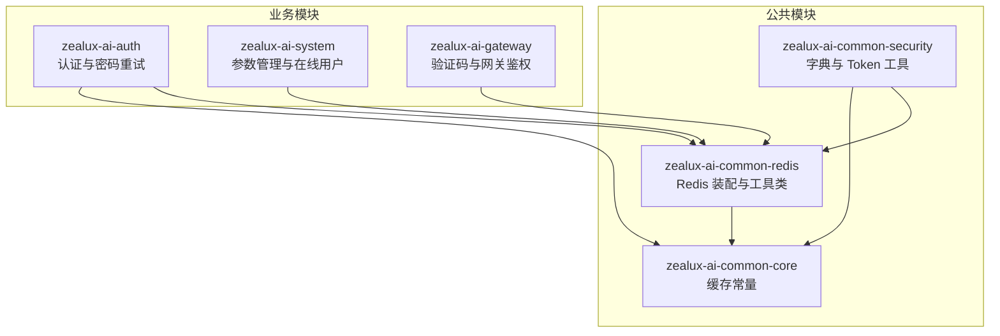
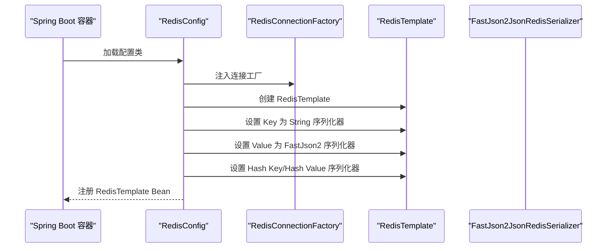
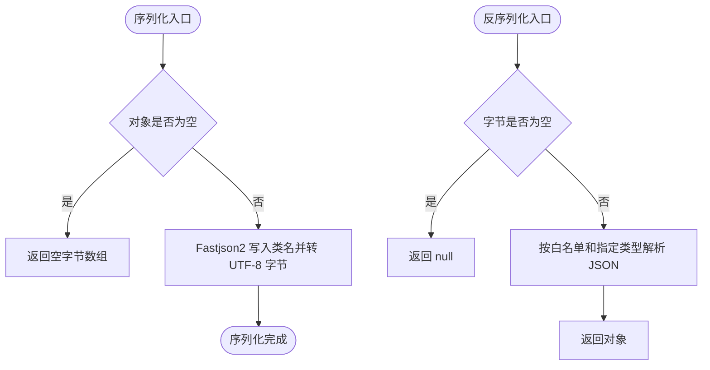
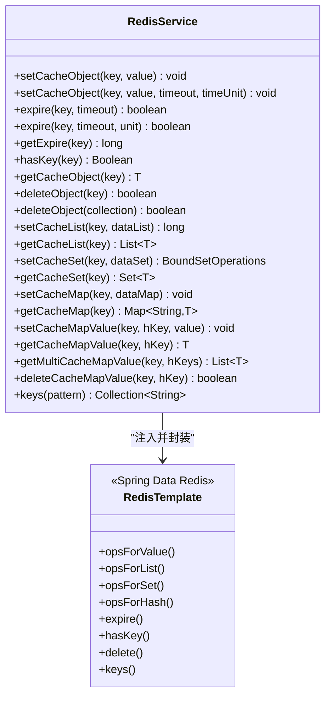
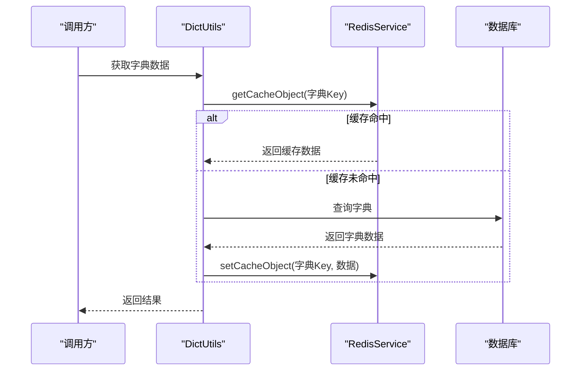
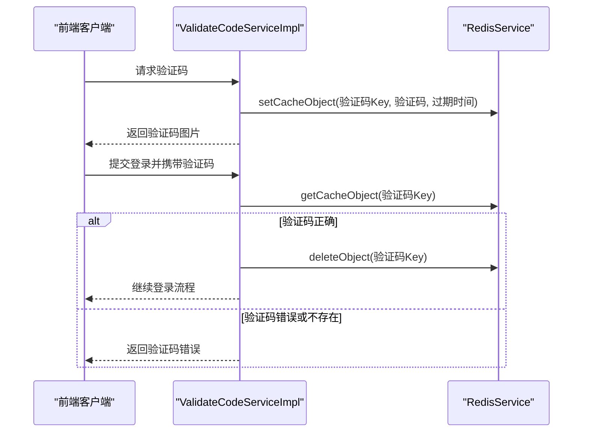
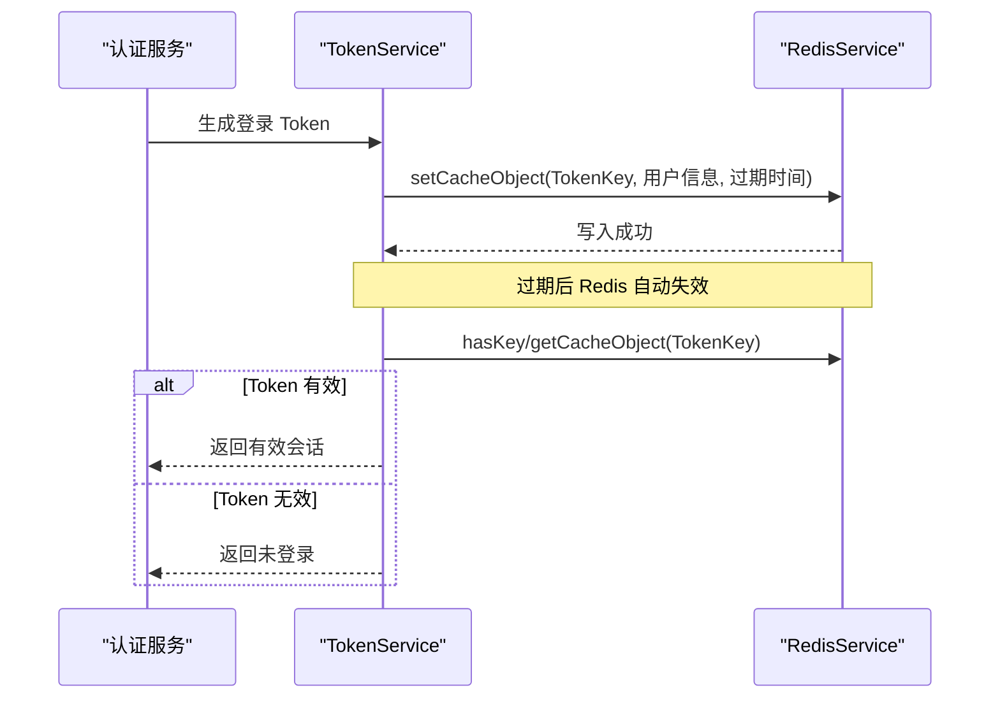
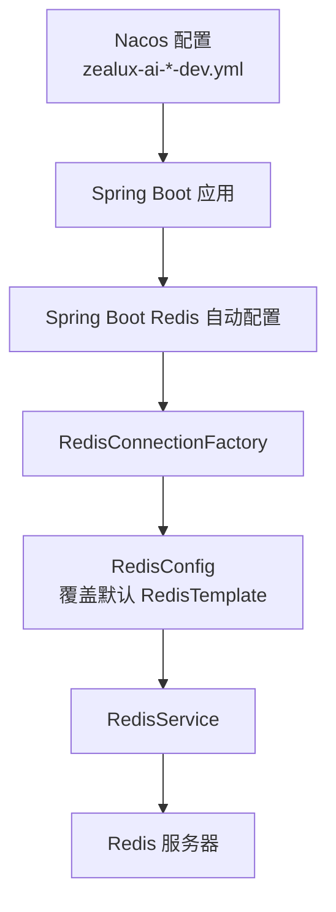
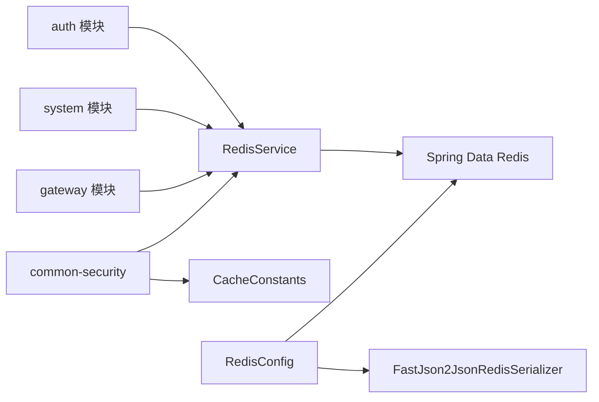

# Redis 缓存模块

<cite>
**本文引用的文件**
- [RedisConfig.java](file://zealux-ai-master/zealux-ai-common/zealux-ai-common-redis/src/main/java/com/zealux/common/redis/configure/RedisConfig.java)
- [FastJson2JsonRedisSerializer.java](file://zealux-ai-master/zealux-ai-common/zealux-ai-common-redis/src/main/java/com/zealux/common/redis/configure/FastJson2JsonRedisSerializer.java)
- [RedisService.java](file://zealux-ai-master/zealux-ai-common/zealux-ai-common-redis/src/main/java/com/zealux/common/redis/service/RedisService.java)
- [CacheConstants.java](file://zealux-ai-master/zealux-ai-common/zealux-ai-common-core/src/main/java/com/zealux/common/core/constant/CacheConstants.java)
- [DictUtils.java](file://zealux-ai-master/zealux-ai-common/zealux-ai-common-security/src/main/java/com/zealux/common/security/utils/DictUtils.java)
- [TokenService.java](file://zealux-ai-master/zealux-ai-common/zealux-ai-common-security/src/main/java/com/zealux/common/security/service/TokenService.java)
- [SysPasswordService.java](file://zealux-ai-master/zealux-ai-auth/src/main/java/com/zealux/auth/service/SysPasswordService.java)
- [ValidateCodeServiceImpl.java](file://zealux-ai-master/zealux-ai-gateway/src/main/java/com/zealux/gateway/service/impl/ValidateCodeServiceImpl.java)
- [SysConfigServiceImpl.java](file://zealux-ai-master/zealux-ai-modules/zealux-ai-system/src/main/java/com/zealux/system/service/impl/SysConfigServiceImpl.java)
- [zealux-ai-system-dev.yml](file://_setup/stack/nacos/nacos/data/config-data/DEFAULT_GROUP/zealux-ai-system-dev.yml)
</cite>

## 目录
1. [引言](#引言)
2. [项目结构定位](#项目结构定位)
3. [核心组件总览](#核心组件总览)
4. [架构与装配流程](#架构与装配流程)
5. [详细组件分析](#详细组件分析)
6. [业务使用示例：字典、验证码与 Token](#业务使用示例字典验证码与-token)
7. [Key 命名规范与 TTL 设置](#key-命名规范与-ttl-设置)
8. [Nacos 配置关系](#nacos-配置关系)
9. [依赖关系分析](#依赖关系分析)
10. [常见问题与优化建议](#常见问题与优化建议)
11. [结论](#结论)

## 引言
本模块是 RuoYi-Cloud 3.6.5 的二次开发仓库中，围绕 Spring Data Redis 提供的通用缓存能力。它没有命名为 `RedisAutoConfiguration`，而是通过自定义配置类在 Spring Boot 原生 Redis 自动配置之前注入 `RedisTemplate`，并统一序列化策略；同时暴露 `RedisService` 作为 Service 层可直接使用的缓存工具类。该文档聚焦以下目标：

- 说明 Redis 装配过程、序列化器与 Key 序列化方式。
- 解释 `RedisService` 提供的 get、set、delete、批量获取等封装方法。
- 给出在 Service 中使用 Redis 缓存字典、验证码、Token 黑名单的调用方式。
- 总结 Key 命名规范和 TTL 设置依据。
- 说明与 Nacos 中 `spring.redis.*` 属性的关系。
- 补充连接失败、序列化不一致、Key 冲突与大 Key 等问题的排查与优化建议。

需要特别说明：代码中并未定义名为 `RedisCache` 的类；实际对外暴露的缓存服务类是 `RedisService`。下文以 `RedisService` 为准进行说明。

## 项目结构定位
Redis 相关实现集中在公共模块 `zealux-ai-common/zealux-ai-common-redis` 中，由多个业务模块和公共安全模块共同复用：

**图表来源**
- [RedisConfig.java:1-44](file://zealux-ai-master/zealux-ai-common/zealux-ai-common-redis/src/main/java/com/zealux/common/redis/configure/RedisConfig.java#L1-L44)
- [RedisService.java:1-268](file://zealux-ai-master/zealux-ai-common/zealux-ai-common-redis/src/main/java/com/zealux/common/redis/service/RedisService.java#L1-L268)
- [CacheConstants.java:1-59](file://zealux-ai-master/zealux-ai-common/zealux-ai-common-core/src/main/java/com/zealux/common/core/constant/CacheConstants.java#L1-L59)

**章节来源**
- [RedisConfig.java:1-44](file://zealux-ai-master/zealux-ai-common/zealux-ai-common-redis/src/main/java/com/zealux/common/redis/configure/RedisConfig.java#L1-L44)
- [RedisService.java:1-268](file://zealux-ai-master/zealux-ai-common/zealux-ai-common-redis/src/main/java/com/zealux/common/redis/service/RedisService.java#L1-L268)
- [CacheConstants.java:1-59](file://zealux-ai-master/zealux-ai-common/zealux-ai-common-core/src/main/java/com/zealux/common/core/constant/CacheConstants.java#L1-L59)

## 核心组件总览
Redis 缓存模块的核心由三个部分组成：

| 组件 | 路径 | 职责 |
|---|---|---|
| `RedisConfig` | `zealux-ai-common-redis/.../configure/RedisConfig.java` | 启用缓存注解，在 Spring Boot Redis 自动配置之前创建 `RedisTemplate`，统一 Key、Hash Key、Value、Hash Value 的序列化方式。 |
| `FastJson2JsonRedisSerializer` | `zealux-ai-common-redis/.../configure/FastJson2JsonRedisSerializer.java` | 基于 Fastjson2 的 JSON 序列化器，写入类名并使用白名单过滤反序列化类型。 |
| `RedisService` | `zealux-ai-common-redis/.../service/RedisService.java` | 对 `RedisTemplate` 的包装，提供 String、List、Set、Map、过期时间、键匹配等常用操作。 |

注意：`RedisConfig` 继承的是 Spring Cache 的 `CachingConfigurerSupport`，并通过 `@EnableCaching` 开启缓存注解能力；但它本身不是 `org.springframework.boot.autoconfigure.data.redis.RedisAutoConfiguration`，而是在其之前装配，因此覆盖默认 `RedisTemplate` 的序列化行为。

**章节来源**
- [RedisConfig.java:1-44](file://zealux-ai-master/zealux-ai-common/zealux-ai-common-redis/src/main/java/com/zealux/common/redis/configure/RedisConfig.java#L1-L44)
- [FastJson2JsonRedisSerializer.java:1-52](file://zealux-ai-master/zealux-ai-common/zealux-ai-common-redis/src/main/java/com/zealux/common/redis/configure/FastJson2JsonRedisSerializer.java#L1-L52)
- [RedisService.java:1-268](file://zealux-ai-master/zealux-ai-common/zealux-ai-common-redis/src/main/java/com/zealux/common/redis/service/RedisService.java#L1-L268)

## 架构与装配流程
Spring Boot 启动时，会先加载本项目的 `RedisConfig`，再加载 Spring Boot 的 Redis 自动配置。`RedisConfig` 从 Spring 容器中注入 `RedisConnectionFactory`，然后构造 `RedisTemplate<Object, Object>`，并设置：

- Key 序列化器：`StringRedisSerializer`，保证 Redis 中的 Key 是可读的字符串。
- Value 序列化器：`FastJson2JsonRedisSerializer`，把对象序列化为带类名的 JSON。
- Hash Key 序列化器：`StringRedisSerializer`。
- Hash Value 序列化器：`FastJson2JsonRedisSerializer`。

**图表来源**
- [RedisConfig.java:18-44](file://zealux-ai-master/zealux-ai-common/zealux-ai-common-redis/src/main/java/com/zealux/common/redis/configure/RedisConfig.java#L18-L44)
- [FastJson2JsonRedisSerializer.java:17-52](file://zealux-ai-master/zealux-ai-common/zealux-ai-common-redis/src/main/java/com/zealux/common/redis/configure/FastJson2JsonRedisSerializer.java#L17-L52)

**章节来源**
- [RedisConfig.java:1-44](file://zealux-ai-master/zealux-ai-common/zealux-ai-common-redis/src/main/java/com/zealux/common/redis/configure/RedisConfig.java#L1-L44)
- [FastJson2JsonRedisSerializer.java:1-52](file://zealux-ai-master/zealux-ai-common/zealux-ai-common-redis/src/main/java/com/zealux/common/redis/configure/FastJson2JsonRedisSerializer.java#L1-L52)

## 详细组件分析

### RedisConfig：RedisTemplate 装配
`RedisConfig` 的关键点如下：

| 配置项 | 值或行为 | 影响 |
|---|---|---|
| `@EnableCaching` | 启用缓存注解 | 允许后续使用 `@Cacheable`、`@CacheEvict`、`@CachePut` 等注解。 |
| `@AutoConfigureBefore(RedisAutoConfiguration.class)` | 在 Spring Boot Redis 自动配置前执行 | 确保自定义 `RedisTemplate` 优先于默认实例。 |
| `RedisTemplate` 的 Key 序列化器 | `StringRedisSerializer` | Redis 中的 Key 是明文字符串，便于调试和运维查看。 |
| `RedisTemplate` 的 Value 序列化器 | `FastJson2JsonRedisSerializer` | 对象转为 JSON，并写入 Java 类名。 |
| Hash Key 序列化器 | `StringRedisSerializer` | Hash 字段名也是字符串。 |
| Hash Value 序列化器 | `FastJson2JsonRedisSerializer` | Hash 字段值按对象 JSON 序列化。 |

该配置类没有暴露独立的 `StringRedisTemplate` Bean，也没有定义统一的 Key 前缀策略 Bean。也就是说，Key 前缀和业务语义是由调用方通过常量或工具类决定的，而不是由 `RedisConfig` 强制注入。

**章节来源**
- [RedisConfig.java:1-44](file://zealux-ai-master/zealux-ai-common/zealux-ai-common-redis/src/main/java/com/zealux/common/redis/configure/RedisConfig.java#L1-L44)

### FastJson2JsonRedisSerializer：对象序列化
这个序列化器的核心逻辑是：

1. 空对象序列化为空字节数组。
2. 非空对象使用 Fastjson2 的 `JSON.toJSONString(t, JSONWriter.Feature.WriteClassName)` 输出 UTF-8 字节。
3. 反序列化时使用 `JSONReader.autoTypeFilter(Constants.JSON_WHITELIST_STR)` 限制可反序列化的类。

这意味着：

- 如果两个不同版本类的包名或类名发生变化，反序列化可能失败。
- 如果写入的对象类型不在白名单内，反序列化会被拒绝。
- 因为写入了类名，同一个 JSON 值在不同业务上下文中也可能被解析成不同 Java 类型。

**图表来源**
- [FastJson2JsonRedisSerializer.java:21-52](file://zealux-ai-master/zealux-ai-common/zealux-ai-common-redis/src/main/java/com/zealux/common/redis/configure/FastJson2JsonRedisSerializer.java#L21-L52)

**章节来源**
- [FastJson2JsonRedisSerializer.java:1-52](file://zealux-ai-master/zealux-ai-common/zealux-ai-common-redis/src/main/java/com/zealux/common/redis/configure/FastJson2JsonRedisSerializer.java#L1-L52)

### RedisService：缓存封装方法
`RedisService` 是对 `RedisTemplate` 的面向业务的方法封装。它直接注入 `redisTemplate`，不直接使用 `StringRedisTemplate`，因此所有 value 都走 Fastjson2 JSON 序列化。

| 方法类别 | 主要方法 | 行为说明 |
|---|---|---|
| 基本对象 | `setCacheObject(key, value)` | 无过期时间地存储对象。 |
| 基本对象 | `setCacheObject(key, value, timeout, timeUnit)` | 设置对象及过期时间。 |
| 过期控制 | `expire(key, timeout)` | 设置秒级过期。 |
| 过期控制 | `expire(key, timeout, unit)` | 支持多种时间单位。 |
| 过期查询 | `getExpire(key)` | 读取剩余过期时间。 |
| 存在性判断 | `hasKey(key)` | 判断 Key 是否存在。 |
| 读取对象 | `getCacheObject(key)` | 反序列化为泛型对象。 |
| 删除 | `deleteObject(key)` | 删除单个 Key。 |
| 批量删除 | `deleteObject(collection)` | 批量删除多个 Key。 |
| List | `setCacheList` / `getCacheList` | 右压入列表并整体读取。 |
| Set | `setCacheSet` / `getCacheSet` | 添加集合元素并读取全部成员。 |
| Map | `setCacheMap` / `getCacheMap` | 批量写入和读取整个 Hash。 |
| Hash 单字段 | `setCacheMapValue` / `getCacheMapValue` | 读写 Hash 中的某个字段。 |
| Hash 多字段 | `getMultiCacheMapValue` | 批量读取 Hash 字段。 |
| Hash 删除 | `deleteCacheMapValue` | 删除 Hash 中某个字段。 |
| Key 匹配 | `keys(pattern)` | 返回匹配的 Key 集合。 |

需要注意：`RedisService` 没有名为 `getAll` 的方法；对应“批量获取”的能力是 `keys(pattern)`，但它返回的是 Key 列表，而不是 Value 列表。如果需要一次性取回多个值，应先用 `keys` 拿到 Key，再循环调用 `getCacheObject`。

**图表来源**
- [RedisService.java:18-268](file://zealux-ai-master/zealux-ai-common/zealux-ai-common-redis/src/main/java/com/zealux/common/redis/service/RedisService.java#L18-L268)

**章节来源**
- [RedisService.java:1-268](file://zealux-ai-master/zealux-ai-common/zealux-ai-common-redis/src/main/java/com/zealux/common/redis/service/RedisService.java#L1-L268)

## 业务使用示例：字典、验证码与 Token
下面以仓库中已实际使用 `RedisService` 的场景为例，说明如何在 Service 层使用 Redis 缓存。

### 字典缓存
字典缓存由公共安全模块的 `DictUtils` 提供，其 Key 前缀来自 `CacheConstants.SYS_DICT_KEY`，值为字典数据列表。典型流程是：

1. 根据字典键生成缓存 Key。
2. 先从 `RedisService.getCacheObject` 读取缓存。
3. 未命中则从数据库或其他来源加载。
4. 通过 `RedisService.setCacheObject` 写入缓存。
5. 字典更新时通过 `RedisService.deleteObject` 删除对应 Key。

**图表来源**
- [DictUtils.java:20-62](file://zealux-ai-master/zealux-ai-common/zealux-ai-common-security/src/main/java/com/zealux/common/security/utils/DictUtils.java#L20-L62)
- [CacheConstants.java:45-48](file://zealux-ai-master/zealux-ai-common/zealux-ai-common-core/src/main/java/com/zealux/common/core/constant/CacheConstants.java#L45-L48)

**章节来源**
- [DictUtils.java:1-62](file://zealux-ai-master/zealux-ai-common/zealux-ai-common-security/src/main/java/com/zealux/common/security/utils/DictUtils.java#L1-L62)
- [CacheConstants.java:45-48](file://zealux-ai-master/zealux-ai-common/zealux-ai-common-core/src/main/java/com/zealux/common/core/constant/CacheConstants.java#L45-L48)

### 验证码缓存
网关中的验证码实现类直接调用 `RedisService` 保存验证码、校验验证码并删除验证码。验证码 Key 前缀来自 `CacheConstants.CAPTCHA_CODE_KEY`，过期时间使用常量中的分钟级过期配置。

**图表来源**
- [ValidateCodeServiceImpl.java:70-112](file://zealux-ai-master/zealux-ai-gateway/src/main/java/com/zealux/gateway/service/impl/ValidateCodeServiceImpl.java#L70-L112)
- [CacheConstants.java:35-38](file://zealux-ai-master/zealux-ai-common/zealux-ai-common-core/src/main/java/com/zealux/common/core/constant/CacheConstants.java#L35-L38)

**章节来源**
- [ValidateCodeServiceImpl.java:1-112](file://zealux-ai-master/zealux-ai-gateway/src/main/java/com/zealux/gateway/service/impl/ValidateCodeServiceImpl.java#L1-L112)
- [CacheConstants.java:35-38](file://zealux-ai-master/zealux-ai-common/zealux-ai-common-core/src/main/java/com/zealux/common/core/constant/CacheConstants.java#L35-L38)

### Token 与黑名单
Token 管理由 `TokenService` 负责，登录成功后将用户信息存入 Redis，Key 前缀来自 `CacheConstants.LOGIN_TOKEN_KEY`。系统还使用 Redis 维护登录 IP 黑名单，Key 来自 `CacheConstants.SYS_LOGIN_BLACKIPLIST`，底层仍依赖参数管理缓存 Key 前缀。

**图表来源**
- [TokenService.java:100-167](file://zealux-ai-master/zealux-ai-common/zealux-ai-common-security/src/main/java/com/zealux/common/security/service/TokenService.java#L100-L167)
- [CacheConstants.java:30-33](file://zealux-ai-master/zealux-ai-common/zealux-ai-common-core/src/main/java/com/zealux/common/core/constant/CacheConstants.java#L30-L33)
- [CacheConstants.java:55-58](file://zealux-ai-master/zealux-ai-common/zealux-ai-common-core/src/main/java/com/zealux/common/core/constant/CacheConstants.java#L55-L58)

**章节来源**
- [TokenService.java:1-167](file://zealux-ai-master/zealux-ai-common/zealux-ai-common-security/src/main/java/com/zealux/common/security/service/TokenService.java#L1-L167)
- [CacheConstants.java:30-58](file://zealux-ai-master/zealux-ai-common/zealux-ai-common-core/src/main/java/com/zealux/common/core/constant/CacheConstants.java#L30-L58)

### 密码重试与登录失败计数
`SysPasswordService` 使用 Redis 记录用户名对应的密码错误次数，并在超过阈值后设置锁定时间。这里体现的是 Redis 在限流与状态保护上的常见用法。

**章节来源**
- [SysPasswordService.java:1-82](file://zealux-ai-master/zealux-ai-auth/src/main/java/com/zealux/auth/service/SysPasswordService.java#L1-L82)
- [CacheConstants.java:20-28](file://zealux-ai-master/zealux-ai-common/zealux-ai-common-core/src/main/java/com/zealux/common/core/constant/CacheConstants.java#L20-L28)

### 参数管理缓存
`SysConfigServiceImpl` 使用 Redis 缓存系统参数，Key 前缀为 `SYS_CONFIG_KEY`。新增、修改、删除参数时都会同步更新或删除对应缓存。

**章节来源**
- [SysConfigServiceImpl.java:1-172](file://zealux-ai-master/zealux-ai-modules/zealux-ai-system/src/main/java/com/zealux/system/service/impl/SysConfigServiceImpl.java#L1-L172)
- [CacheConstants.java:40-43](file://zealux-ai-master/zealux-ai-common/zealux-ai-common-core/src/main/java/com/zealux/common/core/constant/CacheConstants.java#L40-L43)

## Key 命名规范与 TTL 设置

### Key 命名规范
系统中的 Key 并不由 `RedisConfig` 统一加前缀，而是由业务常量组合形成。现有规范可以归纳为：

| 用途 | Key 前缀常量 | 含义 |
|---|---|---|
| Token | `login_tokens:` | 登录后用户的 Token 主键。 |
| 验证码 | `captcha_codes:` | 图形验证码值。 |
| 系统参数 | `sys_config:` | 参数管理配置。 |
| 字典 | `sys_dict:` | 字典数据。 |
| 密码错误次数 | `pwd_err_cnt:` | 防止暴力破解的错误计数。 |
| 登录 IP 黑名单 | `sys_config:sys.login.blackIPList` | 复用参数管理前缀的固定 Key。 |

推荐的新增 Key 规则：

- 使用业务域前缀，例如 `token:`、`captcha:`、`config:`、`dict:`、`rate_limit:`。
- 用冒号分隔层级，例如 `login_tokens:{userId}`。
- 避免在 Key 中包含空格、换行、特殊字符。
- 对热点 Key 加入唯一标识，例如租户 ID、环境标识或版本号，降低多实例或多环境冲突风险。

### TTL 设置
当前代码中有两类 TTL 模式：

1. **显式设置 TTL**：例如验证码通过 `setCacheObject(key, code, Constants.CAPTTCHA_EXPIRATION, TimeUnit.MINUTES)` 设置过期时间。
2. **依赖 Redis 自然过期**：`RedisService.setCacheObject(key, value)` 不传超时参数，Key 不会自动过期，需要业务主动 `deleteObject` 清理。

建议：

- 临时状态（验证码、短信码、登录失败计数）必须设置短 TTL。
- 短期会话（Token）使用分钟级 TTL，并配合刷新机制。
- 长生命周期数据（字典、参数）要么设置较长 TTL，要么明确通过删除操作失效。
- 不要长期保留大对象到 Redis，否则容易形成“大 Key”。

**章节来源**
- [CacheConstants.java:10-58](file://zealux-ai-master/zealux-ai-common/zealux-ai-common-core/src/main/java/com/zealux/common/core/constant/CacheConstants.java#L10-L58)
- [ValidateCodeServiceImpl.java:70-112](file://zealux-ai-master/zealux-ai-gateway/src/main/java/com/zealux/gateway/service/impl/ValidateCodeServiceImpl.java#L70-L112)
- [RedisService.java:34-116](file://zealux-ai-master/zealux-ai-common/zealux-ai-common-redis/src/main/java/com/zealux/common/redis/service/RedisService.java#L34-L116)

## Nacos 配置关系
在本工作区中，Redis 的连接信息位于本地 Nacos 配置副本下，每个服务通常有独立的 dev 配置文件。以 `zealux-ai-system-dev.yml` 为例，其中包含：

| 配置路径 | 示例值 | 说明 |
|---|---|---|
| `spring.redis.host` | `127.0.0.1` | Redis 主机地址。 |
| `spring.redis.port` | `6379` | Redis 端口。 |
| `spring.redis.password` | 空值 | 当前示例未设置密码。 |

其他服务如 `zealux-ai-job-dev.yml`、`zealux-ai-gen-dev.yml`、`zealux-ai-gateway-dev.yml`、`zealux-ai-auth-dev.yml` 中也存在类似的 `spring.redis` 段落，但都属于本地运行环境的 Nacos 配置副本，不应被描述为本仓库源码中的生产配置。

**图表来源**
- [zealux-ai-system-dev.yml:1-6](file://_setup/stack/nacos/nacos/data/config-data/DEFAULT_GROUP/zealux-ai-system-dev.yml#L1-L6)
- [RedisConfig.java:18-44](file://zealux-ai-master/zealux-ai-common/zealux-ai-common-redis/src/main/java/com/zealux/common/redis/configure/RedisConfig.java#L18-L44)
- [RedisService.java:18-33](file://zealux-ai-master/zealux-ai-common/zealux-ai-common-redis/src/main/java/com/zealux/common/redis/service/RedisService.java#L18-L33)

**章节来源**
- [zealux-ai-system-dev.yml:1-6](file://_setup/stack/nacos/nacos/data/config-data/DEFAULT_GROUP/zealux-ai-system-dev.yml#L1-L6)
- [RedisConfig.java:18-44](file://zealux-ai-master/zealux-ai-common/zealux-ai-common-redis/src/main/java/com/zealux/common/redis/configure/RedisConfig.java#L18-L44)

## 依赖关系分析
Redis 模块的依赖方向比较清晰：业务模块依赖公共 Redis 工具类，公共安全模块依赖核心缓存常量，而 Redis 配置依赖 Spring Boot 与 Spring Data Redis。

**图表来源**
- [RedisService.java:18-33](file://zealux-ai-master/zealux-ai-common/zealux-ai-common-redis/src/main/java/com/zealux/common/redis/service/RedisService.java#L18-L33)
- [RedisConfig.java:18-44](file://zealux-ai-master/zealux-ai-common/zealux-ai-common-redis/src/main/java/com/zealux/common/redis/configure/RedisConfig.java#L18-L44)
- [FastJson2JsonRedisSerializer.java:17-52](file://zealux-ai-master/zealux-ai-common/zealux-ai-common-redis/src/main/java/com/zealux/common/redis/configure/FastJson2JsonRedisSerializer.java#L17-L52)
- [CacheConstants.java:10-58](file://zealux-ai-master/zealux-ai-common/zealux-ai-common-core/src/main/java/com/zealux/common/core/constant/CacheConstants.java#L10-L58)

**章节来源**
- [RedisService.java:1-268](file://zealux-ai-master/zealux-ai-common/zealux-ai-common-redis/src/main/java/com/zealux/common/redis/service/RedisService.java#L1-L268)
- [RedisConfig.java:1-44](file://zealux-ai-master/zealux-ai-common/zealux-ai-common-redis/src/main/java/com/zealux/common/redis/configure/RedisConfig.java#L1-L44)
- [FastJson2JsonRedisSerializer.java:1-52](file://zealux-ai-master/zealux-ai-common/zealux-ai-common-redis/src/main/java/com/zealux/common/redis/configure/FastJson2JsonRedisSerializer.java#L1-L52)
- [CacheConstants.java:1-59](file://zealux-ai-master/zealux-ai-common/zealux-ai-common-core/src/main/java/com/zealux/common/core/constant/CacheConstants.java#L1-L59)

## 常见问题与优化建议

### Redis 连接失败
**现象：** 应用启动时报 Redis 连接异常，或运行时调用 `RedisService` 抛连接相关异常。

**排查要点：**

1. 检查 Nacos 中对应服务的 `spring.redis.host`、`spring.redis.port`、`spring.redis.password` 是否与实际 Redis 一致。
2. 确认本地或线上 Redis 服务正在运行。
3. 如果 Redis 设置了密码，确认 Nacos 配置中的 password 不为空且正确。
4. 检查网络连通性与防火墙策略。
5. 如果使用集群或哨兵模式，还需确认连接池、节点地址等额外属性是否正确。

**建议：**

- 不要把真实口令写在文档正文中，凭据应保存在本地凭据记录或受控的配置中心。
- 为不同环境区分 Redis 实例，避免测试环境污染生产缓存。

**章节来源**
- [zealux-ai-system-dev.yml:1-6](file://_setup/stack/nacos/nacos/data/config-data/DEFAULT_GROUP/zealux-ai-system-dev.yml#L1-L6)

### 序列化格式不一致
**现象：** 同一 Key 能读到值，但类型转换异常，或旧数据无法被新代码反序列化。

**原因：**

- Value 使用 `FastJson2JsonRedisSerializer`，会写入 Java 类名。
- 如果类包名、类名、字段顺序或类型发生变化，反序列化可能失败。
- 反序列化受 Fastjson2 的 autoType 白名单限制。

**处理建议：**

- 升级对象模型时，保持向后兼容，避免随意删除字段。
- 对历史 Key 做迁移或清理后再发布新版本。
- 新增业务对象时，确保其类型在 Fastjson2 白名单范围内。
- 如果跨语言访问 Redis，应避免依赖写入类名的 JSON 格式，改用更稳定的数据结构。

**章节来源**
- [FastJson2JsonRedisSerializer.java:21-52](file://zealux-ai-master/zealux-ai-common/zealux-ai-common-redis/src/main/java/com/zealux/common/redis/configure/FastJson2JsonRedisSerializer.java#L21-L52)

### Key 冲突
**现象：** 一个业务读到了另一个业务的缓存数据，或者多实例之间缓存互相干扰。

**原因：**

- `RedisConfig` 没有全局 Key 前缀策略。
- Key 由业务常量拼接，若 Key 设计重复或不够精确，就会发生冲突。
- 多租户或多环境共享同一 Redis 时，缺少环境或租户隔离。

**处理建议：**

- 为每个业务域定义独立前缀，例如 `login_tokens:`、`captcha_codes:`、`sys_dict:`、`sys_config:`。
- 对热点实体 Key 加入租户、环境、版本号。
- 删除不再使用的 Key，避免残留脏数据。
- 使用 `RedisService.keys(pattern)` 前先评估匹配范围，避免全库扫描。

**章节来源**
- [CacheConstants.java:30-58](file://zealux-ai-master/zealux-ai-common/zealux-ai-common-core/src/main/java/com/zealux/common/core/constant/CacheConstants.java#L30-L58)
- [RedisService.java:240-268](file://zealux-ai-master/zealux-ai-common/zealux-ai-common-redis/src/main/java/com/zealux/common/redis/service/RedisService.java#L240-L268)

### 大 Key 导致的性能问题
**现象：** Redis CPU 升高、命令延迟增大、主从同步卡顿、内存碎片增加。

**常见来源：**

- 将整个大对象放入单个 String Key。
- 使用单个 Hash 或 List 存放过多字段或元素。
- 一次性 `keys('*')` 或 `keys('prefix:*')` 匹配出大量 Key。
- 字典、配置、日志等本应落库的数据被整份放入 Redis。

**优化建议：**

- 大对象拆分为多个 Key，例如按分页、按分片或按业务维度拆分。
- 对集合类型设置上限，避免无限增长。
- 使用 `RedisService.expire` 为临时 Key 设置合理 TTL。
- 避免在热路径上频繁调用 `keys`，必要时改用 Redis 扫描或业务侧维护索引。
- 监控 Redis 大 Key，定期清理过期但未删除的 Key。

**章节来源**
- [RedisService.java:130-268](file://zealux-ai-master/zealux-ai-common/zealux-ai-common-redis/src/main/java/com/zealux/common/redis/service/RedisService.java#L130-L268)

### 未设置 TTL 导致 Key 常驻
**现象：** 某些 Key 一直存在，占用内存，即使业务逻辑已经不需要它们。

**原因：**

- 调用 `setCacheObject(key, value)` 时没有传入超时参数。
- 业务只负责写入，不负责删除。

**处理建议：**

- 对所有临时数据强制设置 TTL。
- 对需要手动失效的数据，在业务删除路径中调用 `deleteObject`。
- 定期检查长时间未访问但仍存在的 Key。

**章节来源**
- [RedisService.java:34-116](file://zealux-ai-master/zealux-ai-common/zealux-ai-common-redis/src/main/java/com/zealux/common/redis/service/RedisService.java#L34-L116)
- [SysConfigServiceImpl.java:100-172](file://zealux-ai-master/zealux-ai-modules/zealux-ai-system/src/main/java/com/zealux/system/service/impl/SysConfigServiceImpl.java#L100-L172)

## 结论
本仓库的 Redis 缓存模块建立在 Spring Boot 与 Spring Data Redis 之上，核心贡献在于：

- 通过 `RedisConfig` 在自动配置之前覆盖 `RedisTemplate`，统一 Key 使用字符串序列化、Value 使用 Fastjson2 JSON 序列化。
- 通过 `RedisService` 屏蔽底层 `RedisTemplate` 的差异，为业务提供简洁的 get、set、delete、过期控制、集合与 Map 操作。
- 通过 `CacheConstants` 集中定义 Token、验证码、系统参数、字典、密码错误计数等 Key 前缀。
- 实际业务由认证、网关、系统模块和安全公共模块共同复用，而非由单一 `RedisCache` 类承担。

对于后续扩展，建议在保持现有 Key 前缀风格的基础上，补充全局 Key 前缀策略、统一的 TTL 管理、大 Key 检测与慢命令监控，以降低 Redis 使用过程中的连接、序列化、冲突与性能风险。