# security 安全模块

<cite>
**本文引用的文件**   
- [WebMvcConfig.java](file://zealux-ai-master/zealux-ai-common/zealux-ai-common-security/src/main/java/com/zealux/common/security/config/WebMvcConfig.java)
- [HeaderInterceptor.java](file://zealux-ai-master/zealux-ai-common/zealux-ai-common-security/src/main/java/com/zealux/common/security/interceptor/HeaderInterceptor.java)
- [TokenService.java](file://zealux-ai-master/zealux-ai-common/zealux-ai-common-security/src/main/java/com/zealux/common/security/service/TokenService.java)
- [SecurityUtils.java](file://zealux-ai-master/zealux-ai-common/zealux-ai-common-security/src/main/java/com/zealux/common/security/utils/SecurityUtils.java)
- [AuthUtil.java](file://zealux-ai-master/zealux-ai-common/zealux-ai-common-security/src/main/java/com/zealux/common/security/auth/AuthUtil.java)
- [AuthLogic.java](file://zealux-ai-master/zealux-ai-common/zealux-ai-common-security/src/main/java/com/zealux/common/security/auth/AuthLogic.java)
- [PreAuthorizeAspect.java](file://zealux-ai-master/zealux-ai-common/zealux-ai-common-security/src/main/java/com/zealux/common/security/aspect/PreAuthorizeAspect.java)
- [RequiresLogin.java](file://zealux-ai-master/zealux-ai-common/zealux-ai-common-security/src/main/java/com/zealux/common/security/annotation/RequiresLogin.java)
- [RequiresRoles.java](file://zealux-ai-master/zealux-ai-common/zealux-ai-common-security/src/main/java/com/zealux/common/security/annotation/RequiresRoles.java)
- [RequiresPermissions.java](file://zealux-ai-master/zealux-ai-common/zealux-ai-common-security/src/main/java/com/zealux/common/security/annotation/RequiresPermissions.java)
- [FeignRequestInterceptor.java](file://zealux-ai-master/zealux-ai-common/zealux-ai-common-security/src/main/java/com/zealux/common/security/feign/FeignRequestInterceptor.java)
- [GlobalExceptionHandler.java](file://zealux-ai-master/zealux-ai-common/zealux-ai-common-security/src/main/java/com/zealux/common/security/handler/GlobalExceptionHandler.java)
- [EnableCustomConfig.java](file://zealux-ai-master/zealux-ai-common/zealux-ai-common-security/src/main/java/com/zealux/common/security/annotation/EnableCustomConfig.java)
- [AuthFilter.java](file://zealux-ai-master/zealux-ai-gateway/src/main/java/com/zealux/gateway/filter/AuthFilter.java)
- [IgnoreWhiteProperties.java](file://zealux-ai-master/zealux-ai-gateway/src/main/java/com/zealux/gateway/config/properties/IgnoreWhiteProperties.java)
</cite>

## 目录

1. [引言](#引言)
2. [模块定位与依赖边界](#模块定位与依赖边界)
3. [整体架构](#整体架构)
4. [请求进入与安全处理流程](#请求进入与安全处理流程)
5. [核心组件分析](#核心组件分析)
6. [在业务 Controller 中获取当前用户、角色与权限](#在业务-controller-中获取当前用户角色与权限)
7. [白名单路径配置](#白名单路径配置)
8. [多服务间 Token 传递机制](#多服务间-token-传递机制)
9. [Redis 依赖说明](#redis-依赖说明)
10. [常见问题排查](#常见问题排查)
11. [总结](#总结)

## 引言

security 安全模块是 zealux-ai 后端微服务的统一鉴权基础。它不是独立的前端页面或业务模块，而是由 `zealux-ai-common-security` 提供的公共能力，被系统服务、网关以及其他业务服务共同依赖。

该模块实现的是“网关做入口校验、业务服务做身份上下文与权限校验”的两段式鉴权：

| 层级 | 主要职责 | 关键实现 |
|---|---|---|
| 网关层 | 解析请求头中的 Token，校验是否过期、是否仍在线，并把用户信息写入下游请求头 | `AuthFilter` |
| 业务服务层 | 把请求头中的身份信息写入线程上下文，提供 Token 缓存刷新、注解式角色与权限校验 | `HeaderInterceptor`、`TokenService`、`AuthLogic`、`PreAuthorizeAspect` |

需要特别注意：代码中不存在名为 `SecurityAutoConfiguration` 的类；也不存在名为 `JwtAuthenticationTokenTokenFilter` 的过滤器。该模块通过 `WebMvcConfig` 注册 `HeaderInterceptor`，并通过 AOP 注解完成权限校验，而不是通过 Spring Security 的 `SecurityAutoConfiguration` + JWT Filter 模式。

**章节来源**
- [WebMvcConfig.java:1-33](file://zealux-ai-master/zealux-ai-common/zealux-ai-common-security/src/main/java/com/zealux/common/security/config/WebMvcConfig.java#L1-L33)
- [HeaderInterceptor.java:1-54](file://zealux-ai-master/zealux-ai-common/zealux-ai-common-security/src/main/java/com/zealux/common/security/interceptor/HeaderInterceptor.java#L1-L54)
- [PreAuthorizeAspect.java:1-89](file://zealux-ai-master/zealux-ai-common/zealux-ai-common-security/src/main/java/com/zealux/common/security/aspect/PreAuthorizeAspect.java#L1-L89)

## 模块定位与依赖边界

### 包结构概览

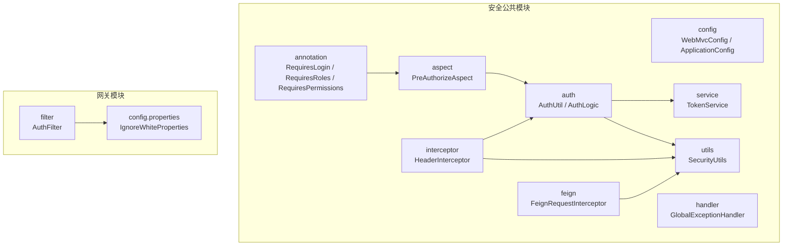

**图表来源**
- [WebMvcConfig.java:1-33](file://zealux-ai-master/zealux-ai-common/zealux-ai-common-security/src/main/java/com/zealux/common/security/config/WebMvcConfig.java#L1-L33)
- [HeaderInterceptor.java:1-54](file://zealux-ai-master/zealux-ai-common/zealux-ai-common-security/src/main/java/com/zealux/common/security/interceptor/HeaderInterceptor.java#L1-L54)
- [TokenService.java:1-174](file://zealux-ai-master/zealux-ai-common/zealux-ai-common-security/src/main/java/com/zealux/common/security/service/TokenService.java#L1-L174)
- [SecurityUtils.java:1-117](file://zealux-ai-master/zealux-ai-common/zealux-ai-common-security/src/main/java/com/zealux/common/security/utils/SecurityUtils.java#L1-L117)
- [AuthUtil.java:1-167](file://zealux-ai-master/zealux-ai-common/zealux-ai-common-security/src/main/java/com/zealux/common/security/auth/AuthUtil.java#L1-L167)
- [AuthLogic.java:1-373](file://zealux-ai-master/zealux-ai-common/zealux-ai-common-security/src/main/java/com/zealux/common/security/auth/AuthLogic.java#L1-L373)
- [PreAuthorizeAspect.java:1-89](file://zealux-ai-master/zealux-ai-common/zealux-ai-common-security/src/main/java/com/zealux/common/security/aspect/PreAuthorizeAspect.java#L1-L89)
- [FeignRequestInterceptor.java:1-54](file://zealux-ai-master/zealux-ai-common/zealux-ai-common-security/src/main/java/com/zealux/common/security/feign/FeignRequestInterceptor.java#L1-L54)
- [GlobalExceptionHandler.java:1-166](file://zealux-ai-master/zealux-ai-common/zealux-ai-common-security/src/main/java/com/zealux/common/security/handler/GlobalExceptionHandler.java#L1-L166)
- [AuthFilter.java:1-135](file://zealux-ai-master/zealux-ai-gateway/src/main/java/com/zealux/gateway/filter/AuthFilter.java#L1-L135)
- [IgnoreWhiteProperties.java:1-33](file://zealux-ai-master/zealux-ai-gateway/src/main/java/com/zealux/gateway/config/properties/IgnoreWhiteProperties.java#L1-L33)

### 模块职责边界

| 组件 | 职责 | 不负责 |
|---|---|---|
| `AuthFilter` | 网关级鉴权：判断 URL 是否在白名单、校验 Token 是否存在且未过期、校验 Redis 中登录状态、向下游注入用户头 | 不实现细粒度角色与权限校验 |
| `HeaderInterceptor` | 业务服务级拦截：从请求头读取用户信息并写入 `SecurityContextHolder`，必要时刷新会话有效期 | 不负责生成或签发 Token |
| `TokenService` | Token 创建、从 Redis 查询登录用户、删除登录用户、刷新 Token 有效期 | 不直接解析 JWT 的业务字段 |
| `AuthLogic` / `AuthUtil` | 登录态检查、角色与权限校验逻辑 | 不直接访问数据库表 |
| `PreAuthorizeAspect` | 对 `@RequiresLogin`、`@RequiresRoles`、`@RequiresPermissions` 进行 AOP 拦截 | 不做网关路由匹配 |
| `FeignRequestInterceptor` | Feign 调用时透传认证相关请求头 | 不修改下游业务参数 |
| `GlobalExceptionHandler` | 将权限异常转换为统一响应 | 不捕获所有业务错误之外的系统异常以外的异常 |

**章节来源**
- [AuthFilter.java:1-135](file://zealux-ai-master/zealux-ai-gateway/src/main/java/com/zealux/gateway/filter/AuthFilter.java#L1-L135)
- [HeaderInterceptor.java:1-54](file://zealux-ai-master/zealux-ai-common/zealux-ai-common-security/src/main/java/com/zealux/common/security/interceptor/HeaderInterceptor.java#L1-L54)
- [TokenService.java:1-174](file://zealux-ai-master/zealux-ai-common/zealux-ai-common-security/src/main/java/com/zealux/common/security/service/TokenService.java#L1-L174)
- [AuthLogic.java:1-373](file://zealux-ai-master/zealux-ai-common/zealux-ai-common-security/src/main/java/com/zealux/common/security/auth/AuthLogic.java#L1-L373)
- [PreAuthorizeAspect.java:1-89](file://zealux-ai-master/zealux-ai-common/zealux-ai-common-security/src/main/java/com/zealux/common/security/aspect/PreAuthorizeAspect.java#L1-L89)
- [FeignRequestInterceptor.java:1-54](file://zealux-ai-master/zealux-ai-common/zealux-ai-common-security/src/main/java/com/zealux/common/security/feign/FeignRequestInterceptor.java#L1-L54)
- [GlobalExceptionHandler.java:1-166](file://zealux-ai-master/zealux-ai-common/zealux-ai-common-security/src/main/java/com/zealux/common/security/handler/GlobalExceptionHandler.java#L1-L166)

## 整体架构

本模块采用“网关前置校验 + 业务服务上下文注入 + 注解式权限控制”的分层设计。

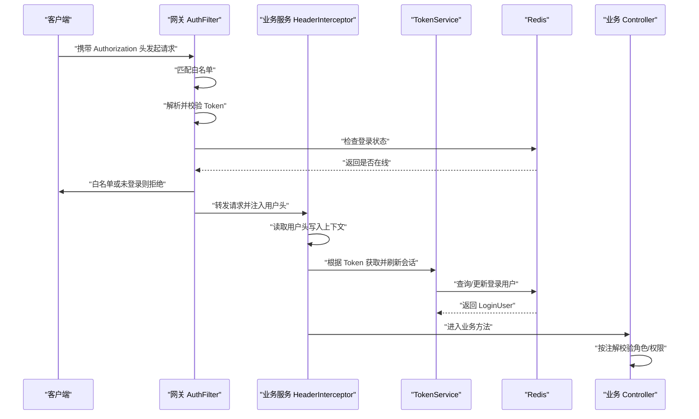

**图表来源**
- [AuthFilter.java:29-110](file://zealux-ai-master/zealux-ai-gateway/src/main/java/com/zealux/gateway/filter/AuthFilter.java#L29-L110)
- [HeaderInterceptor.java:21-47](file://zealux-ai-master/zealux-ai-common/zealux-ai-common-security/src/main/java/com/zealux/common/security/interceptor/HeaderInterceptor.java#L21-L47)
- [TokenService.java:72-174](file://zealux-ai-master/zealux-ai-common/zealux-ai-common-security/src/main/java/com/zealux/common/security/service/TokenService.java#L72-L174)

## 请求进入与安全处理流程

### 网关层：AuthFilter

`AuthFilter` 是全局过滤器，优先级为 `-200`，在请求到达具体微服务之前执行。其流程如下：

1. 获取请求路径。
2. 使用 `IgnoreWhiteProperties.whites` 判断是否为白名单路径。
3. 如果不在白名单，则从请求头提取 `Authorization`。
4. 如果 Token 为空，返回未授权响应。
5. 使用 `JwtUtils.parseToken` 解析 Token。
6. 如果解析失败，返回“令牌已过期或验证不正确”。
7. 从 Token 中取出 `userkey`，并在 Redis 中检查对应登录键是否存在。
8. 如果 Redis 中没有登录信息，返回“登录状态已过期”。
9. 从 Token 中提取用户 ID 和用户名。
10. 将 `userKey`、`userId`、`username` 编码后添加到下游请求头。
11. 移除内部来源标记头，继续转发请求。

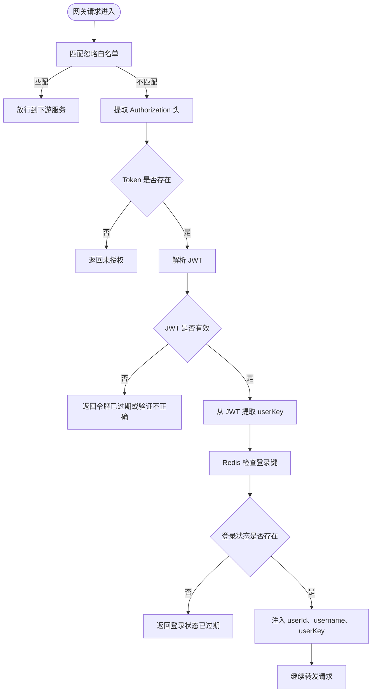

**图表来源**
- [AuthFilter.java:29-110](file://zealux-ai-master/zealux-ai-gateway/src/main/java/com/zealux/gateway/filter/AuthFilter.java#L29-L110)
- [IgnoreWhiteProperties.java:15-33](file://zealux-ai-master/zealux-ai-gateway/src/main/java/com/zealux/gateway/config/properties/IgnoreWhiteProperties.java#L15-L33)

### 业务服务层：HeaderInterceptor

`HeaderInterceptor` 是 Spring MVC 拦截器，注册在 `WebMvcConfig` 中，对所有控制器请求生效，但排除 `/login`、`/logout`、`/refresh`。

它的核心职责是：

1. 仅对控制器处理器生效，非 `HandlerMethod` 直接放行。
2. 从原始请求头读取用户 ID、用户名、userKey，并写入 `SecurityContextHolder`。
3. 从 `Authorization` 头读取 Token。
4. 如果有 Token，则调用 `AuthUtil.getLoginUser(token)` 从 Redis 加载登录用户。
5. 如果找到登录用户，调用 `verifyLoginUserExpire` 刷新会话有效期。
6. 将 `LoginUser` 放入 `SecurityContextHolder`，供后续业务代码使用。
7. 请求完成后清理 `SecurityContextHolder`，避免线程复用污染。

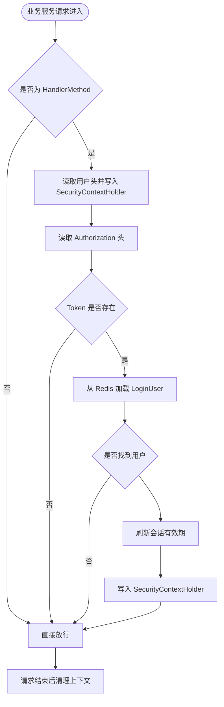

**图表来源**
- [WebMvcConfig.java:17-33](file://zealux-ai-master/zealux-ai-common/zealux-ai-common-security/src/main/java/com/zealux/common/security/config/WebMvcConfig.java#L17-L33)
- [HeaderInterceptor.java:21-53](file://zealux-ai-master/zealux-ai-common/zealux-ai-common-security/src/main/java/com/zealux/common/security/interceptor/HeaderInterceptor.java#L21-L53)

**章节来源**
- [AuthFilter.java:1-135](file://zealux-ai-master/zealux-ai-gateway/src/main/java/com/zealux/gateway/filter/AuthFilter.java#L1-L135)
- [WebMvcConfig.java:1-33](file://zealux-ai-master/zealux-ai-common/zealux-ai-common-security/src/main/java/com/zealux/common/security/config/WebMvcConfig.java#L1-L33)
- [HeaderInterceptor.java:1-54](file://zealux-ai-master/zealux-ai-common/zealux-ai-common-security/src/main/java/com/zealux/common/security/interceptor/HeaderInterceptor.java#L1-L54)

## 核心组件分析

### TokenService：Token 生命周期与会话管理

`TokenService` 是该模块中与 Redis 交互最核心的组件，负责：

| 方法 | 行为 |
|---|---|
| `createToken` | 生成 UUID 作为 token，构建包含用户标识的 claims，调用 `JwtUtils.createToken` 签发 Token，并把 `access_token` 与过期时间返回给前端 |
| `getLoginUser` | 从请求或 Token 中提取 `userKey`，再从 Redis 查询 `LoginUser` |
| `setLoginUser` | 调用 `refreshToken` 刷新登录会话 |
| `delLoginUser` | 根据 Token 对应的 Redis key 删除登录信息 |
| `verifyToken` | 当剩余有效期小于阈值时刷新会话 |
| `refreshToken` | 计算登录时间与过期时间，并将 `LoginUser` 写入 Redis |

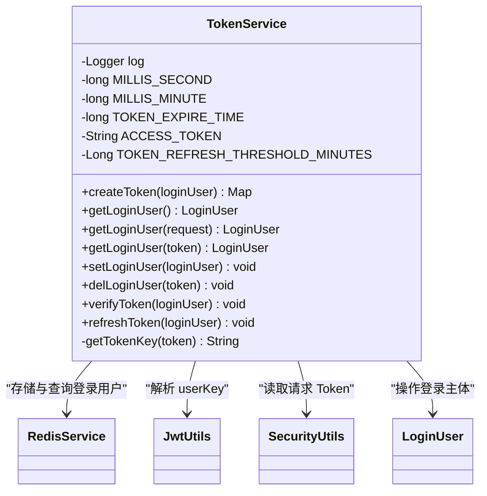

**图表来源**
- [TokenService.java:23-174](file://zealux-ai-master/zealux-ai-common/zealux-ai-common-security/src/main/java/com/zealux/common/security/service/TokenService.java#L23-L174)

**章节来源**
- [TokenService.java:1-174](file://zealux-ai-master/zealux-ai-common/zealux-ai-common-security/src/main/java/com/zealux/common/security/service/TokenService.java#L1-L174)

### SecurityUtils：当前用户与 Token 工具

`SecurityUtils` 是对 `SecurityContextHolder` 的轻量封装，提供以下常用能力：

- 获取当前用户 ID
- 获取当前用户名
- 获取当前 userKey
- 获取当前 `LoginUser`
- 从当前请求头读取并裁剪 Token 前缀
- 判断管理员
- 密码加密与比对

其中，`getToken(HttpServletRequest request)` 从 `Authorization` 头读取 Token，并使用 `TokenConstants.PREFIX` 裁剪前缀。这是业务服务识别前端传入 Token 的统一入口。

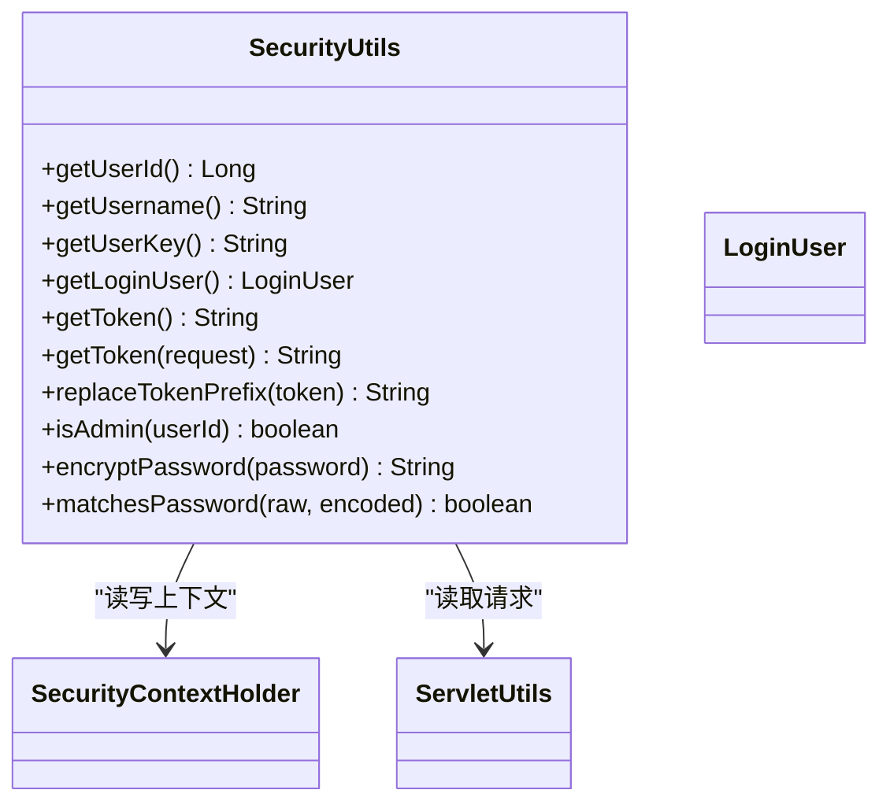

**图表来源**
- [SecurityUtils.java:17-117](file://zealux-ai-master/zealux-ai-common/zealux-ai-common-security/src/main/java/com/zealux/common/security/utils/SecurityUtils.java#L17-L117)

**章节来源**
- [SecurityUtils.java:1-117](file://zealux-ai-master/zealux-ai-common/zealux-ai-common-security/src/main/java/com/zealux/common/security/utils/SecurityUtils.java#L1-L117)

### AuthLogic 与 AuthUtil：权限校验核心

`AuthUtil` 是一个静态门面，所有鉴权方法最终委托给 `AuthLogic`。`AuthLogic` 承担实际逻辑：

| 能力 | 实现方式 |
|---|---|
| 注销会话 | 删除 Redis 中的登录用户 |
| 检查登录 | 从当前请求获取 Token，再从上下文中取 `LoginUser` |
| 检查权限 | 从 `LoginUser.getPermissions()` 中匹配权限码 |
| 检查角色 | 从 `LoginUser.getRoles()` 中匹配角色标识 |
| AND 校验 | 所有条件都必须满足 |
| OR 校验 | 任一条件满足即可 |
| 通配权限 | `*:*:*` 表示全部权限 |
| 超级角色 | `admin` 表示超级角色 |

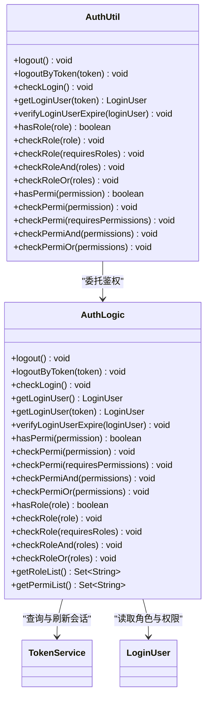

**图表来源**
- [AuthUtil.java:15-167](file://zealux-ai-master/zealux-ai-common/zealux-ai-common-security/src/main/java/com/zealux/common/security/auth/AuthUtil.java#L15-L167)
- [AuthLogic.java:25-373](file://zealux-ai-master/zealux-ai-common/zealux-ai-common-security/src/main/java/com/zealux/common/security/auth/AuthLogic.java#L25-L373)

**章节来源**
- [AuthUtil.java:1-167](file://zealux-ai-master/zealux-ai-common/zealux-ai-common-security/src/main/java/com/zealux/common/security/auth/AuthUtil.java#L1-L167)
- [AuthLogic.java:1-373](file://zealux-ai-master/zealux-ai-common/zealux-ai-common-security/src/main/java/com/zealux/common/security/auth/AuthLogic.java#L1-L373)

### PreAuthorizeAspect：注解式权限校验

`PreAuthorizeAspect` 基于 Spring AOP，切面点覆盖三个注解：

- `@RequiresLogin`：要求已登录
- `@RequiresRoles`：要求具备指定角色
- `@RequiresPermissions`：要求具备指定权限

注解支持 `Logical.AND` 与 `Logical.OR`，默认 `AND`。AOP 会在目标方法执行前检查注解，再调用 `AuthUtil` 执行校验，最后执行原方法。

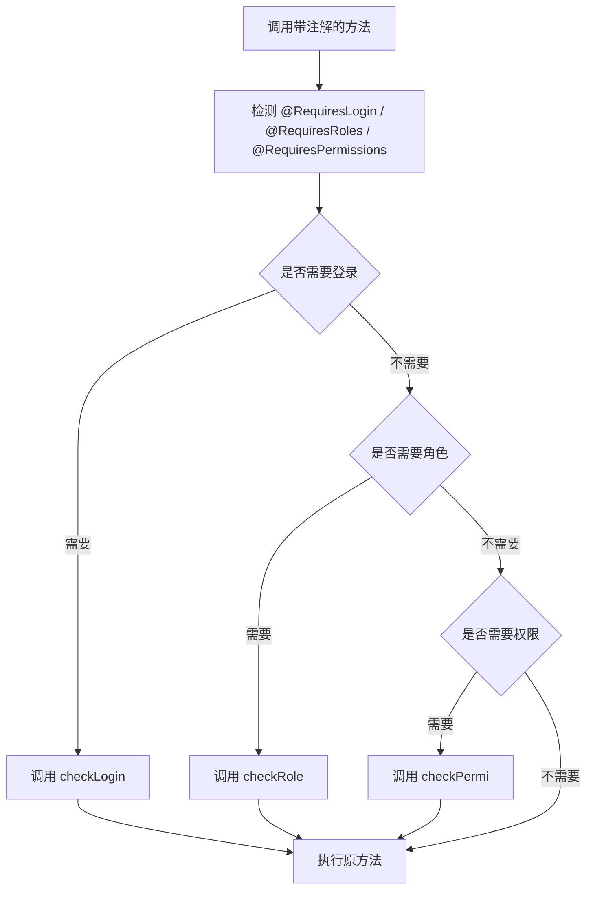

**图表来源**
- [PreAuthorizeAspect.java:28-89](file://zealux-ai-master/zealux-ai-common/zealux-ai-common-security/src/main/java/com/zealux/common/security/aspect/PreAuthorizeAspect.java#L28-L89)

**章节来源**
- [PreAuthorizeAspect.java:1-89](file://zealux-ai-master/zealux-ai-common/zealux-ai-common-security/src/main/java/com/zealux/common/security/aspect/PreAuthorizeAspect.java#L1-L89)
- [RequiresLogin.java:1-18](file://zealux-ai-master/zealux-ai-common/zealux-ai-common-security/src/main/java/com/zealux/common/security/annotation/RequiresLogin.java#L1-L18)
- [RequiresRoles.java:1-26](file://zealux-ai-master/zealux-ai-common/zealux-ai-common-security/src/main/java/com/zealux/common/security/annotation/RequiresRoles.java#L1-L26)
- [RequiresPermissions.java:1-27](file://zealux-ai-master/zealux-ai-common/zealux-ai-common-security/src/main/java/com/zealux/common/security/annotation/RequiresPermissions.java#L1-L27)

## 在业务 Controller 中获取当前用户、角色与权限

### 获取当前用户

推荐使用 `SecurityUtils.getLoginUser()`，它从 `SecurityContextHolder` 中取出已解析的 `LoginUser`。该对象通常包含用户实体、角色集合、权限集合、Token、IP 等上下文信息。

也可以使用 `SecurityUtils.getUserId()` 与 `SecurityUtils.getUsername()` 获取最小必要信息。

如果需要显式检查当前用户是否管理员，可使用 `SecurityUtils.isAdmin(userId)`。

### 获取当前角色

通过 `AuthUtil.hasRole(role)` 可判断当前用户是否拥有某个角色标识。

通过 `AuthUtil.checkRole(role)` 可在不满足时抛出角色权限异常。

`AuthLogic` 内部会从 `LoginUser.getRoles()` 读取角色列表，因此角色的数据来源于登录成功后填充进 Redis 的 `LoginUser`。

### 获取当前权限

通过 `AuthUtil.hasPermi(permission)` 可判断当前用户是否拥有某个权限码。

通过 `AuthUtil.checkPermi(permission)` 可在不满足时抛出权限异常。

权限匹配支持通配符，例如 `*:*:*` 表示全部权限。

### 注解式校验

| 注解 | 用途 | 不满足时的行为 |
|---|---|---|
| `@RequiresLogin` | 要求接口必须登录 | 抛出未登录异常 |
| `@RequiresRoles(value = {"role1","role2"}, logical = Logical.AND)` | 要求同时拥有多个角色 | 抛出角色异常 |
| `@RequiresRoles(value = {"role1","role2"}, logical = Logical.OR)` | 要求至少拥有一个角色 | 抛出角色异常 |
| `@RequiresPermissions(value = {"sys:user:list"}, logical = Logical.AND)` | 要求同时拥有多个权限 | 抛出权限异常 |
| `@RequiresPermissions(value = {"sys:user:add","sys:user:delete"}, logical = Logical.OR)` | 要求至少拥有一个权限 | 抛出权限异常 |

### 自定义白名单路径的配置示例

业务服务侧的 `WebMvcConfig` 中已有固定白名单：

| 路径 | 含义 |
|---|---|
| `/login` | 登录 |
| `/logout` | 登出 |
| `/refresh` | 刷新 |

如果需要在业务服务中新增不经过 `HeaderInterceptor` 的路径，应在 `WebMvcConfig.excludeUrls` 中添加对应路径模式。

网关侧的白名单则由 `security.ignore.whites` 配置项控制，通过 `IgnoreWhiteProperties` 注入 `AuthFilter`。

**章节来源**
- [SecurityUtils.java:17-117](file://zealux-ai-master/zealux-ai-common/zealux-ai-common-security/src/main/java/com/zealux/common/security/utils/SecurityUtils.java#L17-L117)
- [AuthUtil.java:33-167](file://zealux-ai-master/zealux-ai-common/zealux-ai-common-security/src/main/java/com/zealux/common/security/auth/AuthUtil.java#L33-L167)
- [AuthLogic.java:121-373](file://zealux-ai-master/zealux-ai-common/zealux-ai-common-security/src/main/java/com/zealux/common/security/auth/AuthLogic.java#L121-L373)
- [PreAuthorizeAspect.java:28-89](file://zealux-ai-master/zealux-ai-common/zealux-ai-common-security/src/main/java/com/zealux/common/security/aspect/PreAuthorizeAspect.java#L28-L89)
- [WebMvcConfig.java:17-33](file://zealux-ai-master/zealux-ai-common/zealux-ai-common-security/src/main/java/com/zealux/common/security/config/WebMvcConfig.java#L17-L33)
- [IgnoreWhiteProperties.java:15-33](file://zealux-ai-master/zealux-ai-gateway/src/main/java/com/zealux/gateway/config/properties/IgnoreWhiteProperties.java#L15-L33)

## 白名单路径配置

### 业务服务白名单

业务服务白名单定义在 `WebMvcConfig.excludeUrls` 中，用于跳过 `HeaderInterceptor` 的用户头填充与会话刷新。

当前值为：

| 路径 |
|---|
| `/login` |
| `/logout` |
| `/refresh` |

注意：这个白名单只影响业务服务层的 `HeaderInterceptor`，不代表网关层也会放行这些路径。

### 网关白名单

网关白名单由 `IgnoreWhiteProperties` 提供，属性前缀为 `security.ignore`，字段为 `whites`。`AuthFilter` 在过滤时使用 `StringUtils.matches(url, ignoreWhite.getWhites())` 判断是否跳过鉴权。

因此，网关白名单应通过 Nacos 或配置中心设置 `security.ignore.whites`，添加需要跳过网关鉴权的路径。

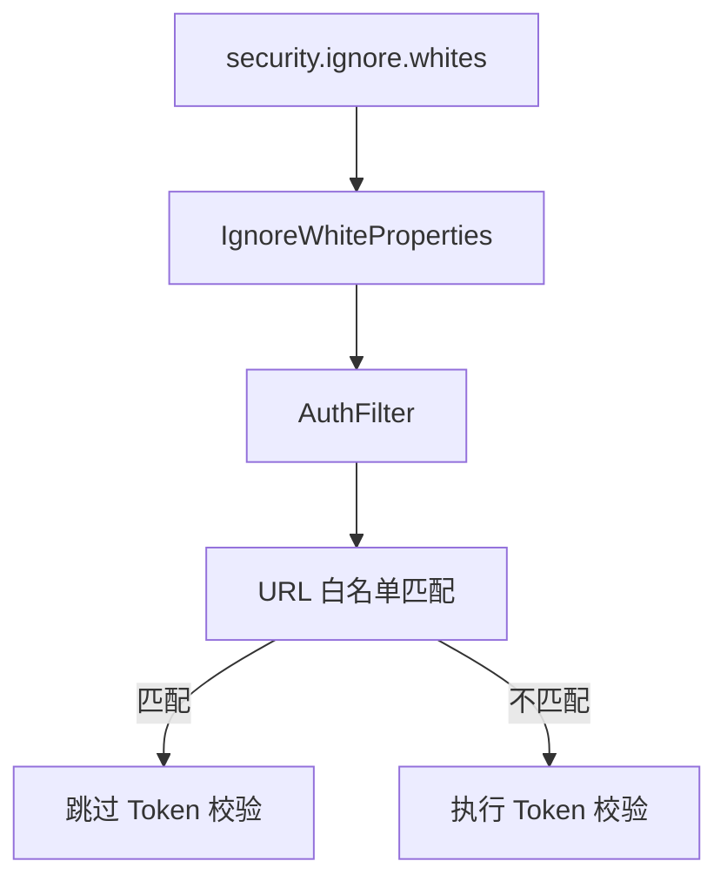

**图表来源**
- [IgnoreWhiteProperties.java:15-33](file://zealux-ai-master/zealux-ai-gateway/src/main/java/com/zealux/gateway/config/properties/IgnoreWhiteProperties.java#L15-L33)
- [AuthFilter.java:45-60](file://zealux-ai-master/zealux-ai-gateway/src/main/java/com/zealux/gateway/filter/AuthFilter.java#L45-L60)

**章节来源**
- [WebMvcConfig.java:17-33](file://zealux-ai-master/zealux-ai-common/zealux-ai-common-security/src/main/java/com/zealux/common/security/config/WebMvcConfig.java#L17-L33)
- [IgnoreWhiteProperties.java:1-33](file://zealux-ai-master/zealux-ai-gateway/src/main/java/com/zealux/gateway/config/properties/IgnoreWhiteProperties.java#L1-L33)
- [AuthFilter.java:45-60](file://zealux-ai-master/zealux-ai-gateway/src/main/java/com/zealux/gateway/filter/AuthFilter.java#L45-L60)

## 多服务间 Token 传递机制

### 网关到业务服务

网关 `AuthFilter` 会向下游请求注入以下头部：

| 请求头 | 含义 |
|---|---|
| `Authorization` | 前端传来的 Token（经网关保留） |
| `userKey` | 从 JWT 中提取的 userKey |
| `userId` | 从 JWT 中提取的用户 ID |
| `username` | 从 JWT 中提取的用户名 |

业务服务 `HeaderInterceptor` 先从这些头部读取用户信息写入 `SecurityContextHolder`，再从 `Authorization` 头解析 Token 并刷新 Redis 中的会话。

### 业务服务之间的 Feign 调用

`FeignRequestInterceptor` 在 Feign 发起调用时，会从当前线程绑定的 `HttpServletRequest` 中读取原始请求头，并复制以下字段到 Feign 请求模板：

- `DETAILS_USER_ID`
- `USER_KEY`
- `DETAILS_USERNAME`
- `AUTHORIZATION_HEADER`

同时追加 `X-Forwarded-For` 客户端 IP。

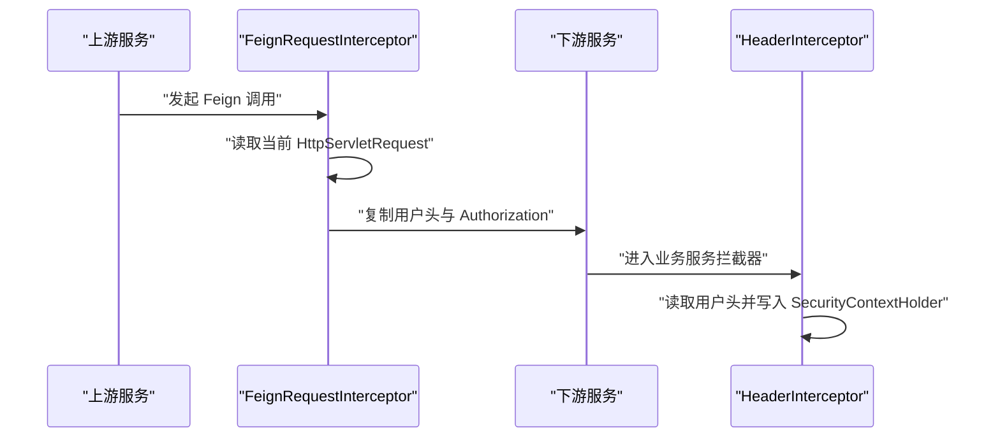

**图表来源**
- [FeignRequestInterceptor.java:22-54](file://zealux-ai-master/zealux-ai-common/zealux-ai-common-security/src/main/java/com/zealux/common/security/feign/FeignRequestInterceptor.java#L22-L54)
- [HeaderInterceptor.java:21-47](file://zealux-ai-master/zealux-ai-common/zealux-ai-common-security/src/main/java/com/zealux/common/security/interceptor/HeaderInterceptor.java#L21-L47)

**章节来源**
- [AuthFilter.java:80-110](file://zealux-ai-master/zealux-ai-gateway/src/main/java/com/zealux/gateway/filter/AuthFilter.java#L80-L110)
- [FeignRequestInterceptor.java:1-54](file://zealux-ai-master/zealux-ai-common/zealux-ai-common-security/src/main/java/com/zealux/common/security/feign/FeignRequestInterceptor.java#L1-L54)
- [HeaderInterceptor.java:1-54](file://zealux-ai-master/zealux-ai-common/zealux-ai-common-security/src/main/java/com/zealux/common/security/interceptor/HeaderInterceptor.java#L1-L54)

## Redis 依赖说明

该安全模块依赖 Redis 的原因主要有两点：

1. **登录会话存储**：`TokenService.refreshToken` 将 `LoginUser` 以 `CacheConstants.LOGIN_TOKEN_KEY + token` 为 key 存入 Redis，并设置分钟级过期时间。
2. **网关登录状态校验**：`AuthFilter` 使用 `JwtUtils.getUserKey(claims)` 得到 `userkey`，再通过 `RedisService.hasKey(getTokenKey(userkey))` 判断用户是否仍处于在线状态。

此外，`TokenService.delLoginUser` 也通过 Redis 删除登录用户，配合 `AuthLogic.logoutByToken` 实现主动注销。

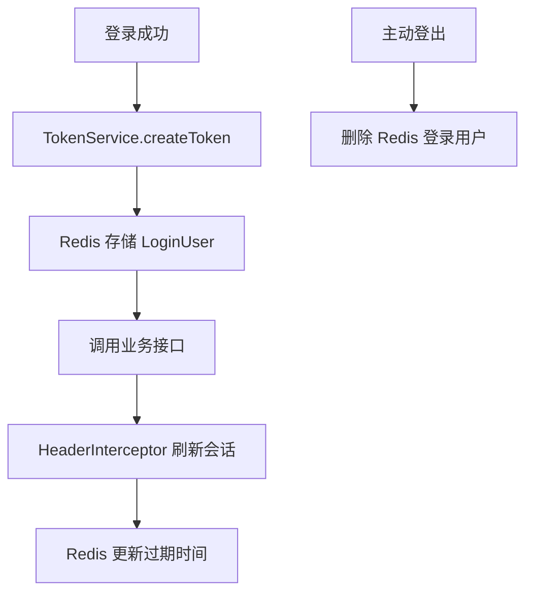

**图表来源**
- [TokenService.java:45-174](file://zealux-ai-master/zealux-ai-common/zealux-ai-common-security/src/main/java/com/zealux/common/security/service/TokenService.java#L45-L174)
- [AuthFilter.java:61-96](file://zealux-ai-master/zealux-ai-gateway/src/main/java/com/zealux/gateway/filter/AuthFilter.java#L61-L96)
- [AuthLogic.java:45-69](file://zealux-ai-master/zealux-ai-common/zealux-ai-common-security/src/main/java/com/zealux/common/security/auth/AuthLogic.java#L45-L69)

**章节来源**
- [TokenService.java:1-174](file://zealux-ai-master/zealux-ai-common/zealux-ai-common-security/src/main/java/com/zealux/common/security/service/TokenService.java#L1-L174)
- [AuthFilter.java:45-96](file://zealux-ai-master/zealux-ai-gateway/src/main/java/com/zealux/gateway/filter/AuthFilter.java#L45-L96)
- [AuthLogic.java:45-69](file://zealux-ai-master/zealux-ai-common/zealux-ai-common-security/src/main/java/com/zealux/common/security/auth/AuthLogic.java#L45-L69)

## 常见问题排查

### Token 过期

**现象**

- 网关返回“令牌已过期或验证不正确”
- 业务服务无法获取 `LoginUser`
- 接口报未登录或无效 Token

**可能原因**

1. 前端 Token 确实已过期。
2. 网关解析 JWT 失败。
3. Redis 中登录用户已被删除或过期。
4. 网关与业务服务使用的 JWT 密钥不一致。
5. 多服务间没有正确传递 `Authorization` 头。

**排查步骤**

1. 确认前端请求头是否携带 `Authorization`。
2. 检查网关日志中是否出现“令牌已过期或验证不正确”。
3. 检查 Redis 中是否存在 `token` 对应的登录键。
4. 检查业务服务是否仍能通过 `SecurityUtils.getLoginUser()` 拿到用户。
5. 如果是 Feign 调用，检查 `FeignRequestInterceptor` 是否复制了认证头。

**相关代码位置**

- [AuthFilter.java:61-96](file://zealux-ai-master/zealux-ai-gateway/src/main/java/com/zealux/gateway/filter/AuthFilter.java#L61-L96)
- [TokenService.java:88-118](file://zealux-ai-master/zealux-ai-common/zealux-ai-common-security/src/main/java/com/zealux/common/security/service/TokenService.java#L88-L118)
- [HeaderInterceptor.java:21-47](file://zealux-ai-master/zealux-ai-common/zealux-ai-common-security/src/main/java/com/zealux/common/security/interceptor/HeaderInterceptor.java#L21-L47)

### 跨域导致的鉴权失败

**现象**

浏览器控制台出现跨域错误，或预检请求丢失 `Authorization` 头，导致服务端鉴权失败。

**原因分析**

当前 `WebMvcConfig` 中只注册了 `HeaderInterceptor`，并没有暴露全局 CORS 配置。`HeaderInterceptor` 只在 `preHandle` 阶段工作，不会自动处理跨域预检请求的响应头。

**建议**

- 在业务服务中增加统一的跨域配置，允许前端域名、方法与请求头。
- 确保跨域预检请求能够返回必要的响应头。
- 确保真实请求能携带 `Authorization` 头。
- 如果跨域发生在网关层，需检查网关本身的跨域策略，不要误以为业务服务已经处理了跨域。

**相关代码位置**

- [WebMvcConfig.java:17-33](file://zealux-ai-master/zealux-ai-common/zealux-ai-common-security/src/main/java/com/zealux/common/security/config/WebMvcConfig.java#L17-L33)
- [HeaderInterceptor.java:21-53](file://zealux-ai-master/zealux-ai-common/zealux-ai-common-security/src/main/java/com/zealux/common/security/interceptor/HeaderInterceptor.java#L21-L53)

### 多服务间 Token 传递问题

**现象**

单服务正常，微服务之间 Feign 调用时报未登录或权限不足。

**可能原因**

1. 上游服务没有启用 `EnableCustomConfig`，导致 `FeignRequestInterceptor` 未被加载。
2. 上游服务中当前线程没有绑定 `HttpServletRequest`，导致无法读取原始请求头。
3. 下游服务没有正确读取用户头。
4. 网关与下游服务对 `Authorization` 头的处理不一致。

**排查步骤**

1. 确认上游服务启用了 `EnableCustomConfig`。
2. 检查 `FeignRequestInterceptor` 是否复制了 `Authorization`、`userId`、`username`、`userKey`。
3. 检查下游服务 `HeaderInterceptor` 是否能读取到这些头。
4. 检查下游服务能否通过 `SecurityUtils.getLoginUser()` 获取用户。

**相关代码位置**

- [EnableCustomConfig.java:17-31](file://zealux-ai-master/zealux-ai-common/zealux-ai-common-security/src/main/java/com/zealux/common/security/annotation/EnableCustomConfig.java#L17-L31)
- [FeignRequestInterceptor.java:22-54](file://zealux-ai-master/zealux-ai-common/zealux-ai-common-security/src/main/java/com/zealux/common/security/feign/FeignRequestInterceptor.java#L22-L54)
- [HeaderInterceptor.java:21-47](file://zealux-ai-master/zealux-ai-common/zealux-ai-common-security/src/main/java/com/zealux/common/security/interceptor/HeaderInterceptor.java#L21-L47)

### 权限校验失败

**现象**

返回“没有访问权限，请联系管理员授权”，或角色校验失败。

**可能原因**

1. 当前用户没有对应权限码或角色标识。
2. 权限码写法与系统配置的权限不一致。
3. 使用了错误的 `logical` 值。
4. 登录用户未正确刷新到 Redis。
5. 前端 Token 过期或无效。

**排查步骤**

1. 确认接口是否标注了 `@RequiresPermissions` 或 `@RequiresRoles`。
2. 确认当前 `LoginUser` 中的权限集合与角色集合是否正确。
3. 检查 Redis 中登录用户是否仍然在线。
4. 查看 `GlobalExceptionHandler` 是否输出权限码校验失败的日志。

**相关代码位置**

- [PreAuthorizeAspect.java:48-89](file://zealux-ai-master/zealux-ai-common/zealux-ai-common-security/src/main/java/com/zealux/common/security/aspect/PreAuthorizeAspect.java#L48-L89)
- [AuthLogic.java:121-373](file://zealux-ai-master/zealux-ai-common/zealux-ai-common-security/src/main/java/com/zealux/common/security/auth/AuthLogic.java#L121-L373)
- [GlobalExceptionHandler.java:28-57](file://zealux-ai-master/zealux-ai-common/zealux-ai-common-security/src/main/java/com/zealux/common/security/handler/GlobalExceptionHandler.java#L28-L57)

**章节来源**
- [AuthFilter.java:61-96](file://zealux-ai-master/zealux-ai-gateway/src/main/java/com/zealux/gateway/filter/AuthFilter.java#L61-L96)
- [WebMvcConfig.java:17-33](file://zealux-ai-master/zealux-ai-common/zealux-ai-common-security/src/main/java/com/zealux/common/security/config/WebMvcConfig.java#L17-L33)
- [EnableCustomConfig.java:17-31](file://zealux-ai-master/zealux-ai-common/zealux-ai-common-security/src/main/java/com/zealux/common/security/annotation/EnableCustomConfig.java#L17-L31)
- [FeignRequestInterceptor.java:22-54](file://zealux-ai-master/zealux-ai-common/zealux-ai-common-security/src/main/java/com/zealux/common/security/feign/FeignRequestInterceptor.java#L22-L54)
- [HeaderInterceptor.java:21-53](file://zealux-ai-master/zealux-ai-common/zealux-ai-common-security/src/main/java/com/zealux/common/security/interceptor/HeaderInterceptor.java#L21-L53)
- [PreAuthorizeAspect.java:48-89](file://zealux-ai-master/zealux-ai-common/zealux-ai-common-security/src/main/java/com/zealux/common/security/aspect/PreAuthorizeAspect.java#L48-L89)
- [AuthLogic.java:121-373](file://zealux-ai-master/zealux-ai-common/zealux-ai-common-security/src/main/java/com/zealux/common/security/auth/AuthLogic.java#L121-L373)
- [GlobalExceptionHandler.java:28-57](file://zealux-ai-master/zealux-ai-common/zealux-ai-common-security/src/main/java/com/zealux/common/security/handler/GlobalExceptionHandler.java#L28-L57)

## 总结

security 安全模块的核心结论如下：

1. 该模块没有 `SecurityAutoConfiguration`，也没有 `JwtAuthenticationTokenTokenFilter`。鉴权入口是网关的 `AuthFilter` 和业务服务的 `HeaderInterceptor`。
2. 网关负责粗粒度鉴权：白名单判断、Token 解析、Redis 登录状态检查、用户头注入。
3. 业务服务负责细粒度鉴权：从请求头加载用户上下文、刷新会话、通过注解校验角色与权限。
4. 当前用户、角色、权限主要通过 `SecurityUtils` 与 `AuthUtil` 获取；权限与角色来自 `LoginUser`。
5. 白名单分为两层：业务服务由 `WebMvcConfig.excludeUrls` 控制，网关由 `security.ignore.whites` 控制。
6. 多服务间通过 `Authorization` 与用户相关请求头传递身份，Feign 调用由 `FeignRequestInterceptor` 负责透传。
7. 该模块强依赖 Redis：Token 签发后的登录会话存储在 Redis 中，网关与业务服务都依赖 Redis 中的登录状态。
8. 常见故障集中在 Token 过期、跨域未配置、Feign 未透传认证头、Redis 登录会话失效四个方面。