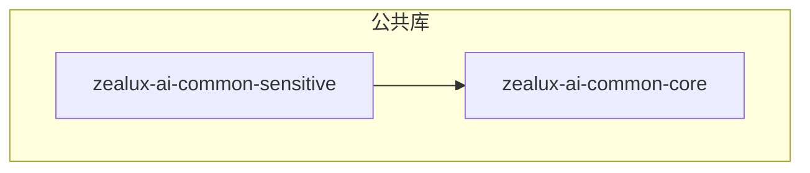
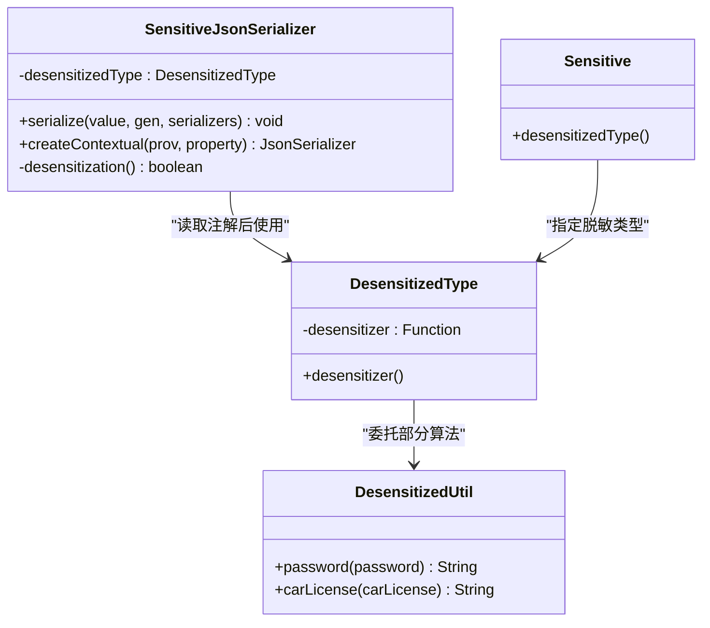
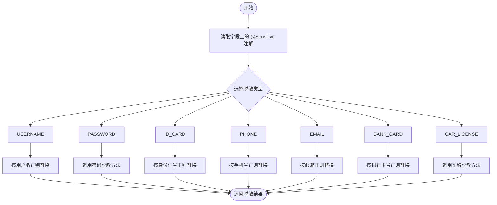
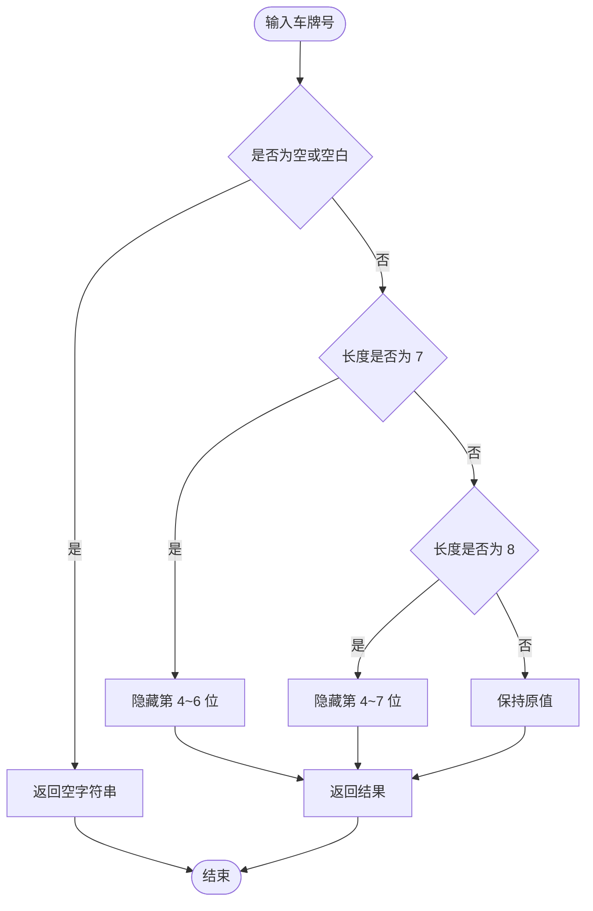
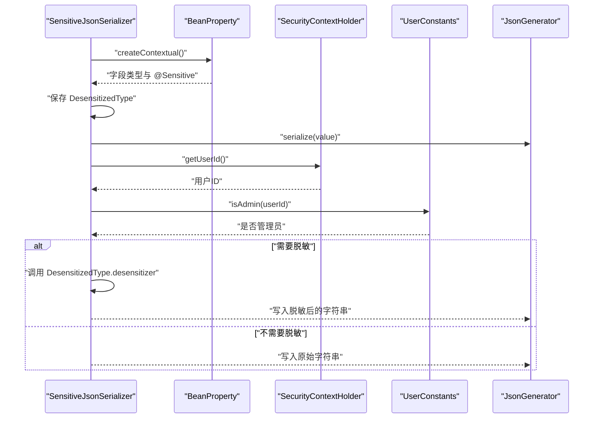
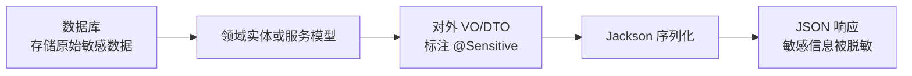

# sensitive 数据脱敏模块

<cite>
**本文引用的文件**   
- [pom.xml](file://zealux-ai-master/zealux-ai-common/ruoyi-common-sensitive/pom.xml)
- [Sensitive.java](file://zealux-ai-master/zealux-ai-common/ruoyi-common-sensitive/src/main/java/com/ruoyi/common/sensitive/annotation/Sensitive.java)
- [DesensitizedType.java](file://zealux-ai-master/zealux-ai-common/ruoyi-common-sensitive/src/main/java/com/ruoyi/common/sensitive/enums/DesensitizedType.java)
- [DesensitizedUtil.java](file://zealux-ai-master/zealux-ai-common/ruoyi-common-sensitive/src/main/java/com/ruoyi/common/sensitive/utils/DesensitizedUtil.java)
- [SensitiveJsonSerializer.java](file://zealux-ai-master/zealux-ai-common/ruoyi-common-sensitive/src/main/java/com/ruoyi/common/sensitive/config/SensitiveJsonSerializer.java)
</cite>

## 目录
1. [引言](#引言)
2. [模块定位与依赖](#模块定位与依赖)
3. [核心组件总览](#核心组件总览)
4. [@Sensitive 注解](#sensitive-注解)
5. [脱敏类型枚举](#脱敏类型枚举)
6. [脱敏工具类算法](#脱敏工具类算法)
7. [Jackson 序列化集成机制](#jackson-序列化集成机制)
8. [在 VO/DTO 字段上的使用方式](#在-vodto-字段上的使用方式)
9. [适用边界：对外返回接口](#适用边界对外返回接口)
10. [常见问题与排查](#常见问题与排查)
11. [最佳实践](#最佳实践)
12. [结论](#结论)

## 引言
本模块是 RuoYi-Cloud 二次开发项目中的敏感数据脱敏能力，位于 `zealux-ai-common/ruoyi-common-sensitive`。它通过 Jackson 序列化阶段自动对标记为敏感的字符串字段进行脱敏，从而避免在对外 JSON 响应中直接暴露手机号、邮箱、身份证号、银行卡号等敏感信息。

需要明确：该模块面向的是“序列化输出层”，而不是数据库写入层。因此它适合用于对外返回接口；不建议把业务入库前的原始敏感数据先脱敏再落库。

## 模块定位与依赖
该模块是一个独立的 Maven 子模块，artifactId 为 `zealux-ai-common-sensitive`，父模块为 `zealux-ai-common`，版本与整体一致。它仅依赖 `zealux-ai-common-core`，没有引入额外的 Web 或序列化框架扩展；其 Jackson 行为通过自定义 `JsonSerializer` 实现。



**图表来源**
- [pom.xml:1-27](file://zealux-ai-master/zealux-ai-common/ruoyi-common-sensitive/pom.xml#L1-L27)

**章节来源**
- [pom.xml:1-27](file://zealux-ai-master/zealux-ai-common/ruoyi-common-sensitive/pom.xml#L1-L27)

## 核心组件总览
模块由四个核心 Java 文件组成，职责清晰、耦合较低：

| 组件 | 包路径 | 职责 |
|---|---|---|
| `@Sensitive` 注解 | `com.zealux.common.sensitive.annotation` | 标注在字段上，声明该字段使用哪种脱敏规则 |
| `DesensitizedType` 枚举 | `com.zealux.common.sensitive.enums` | 定义支持的脱敏类型及其对应的脱敏函数 |
| `DesensitizedUtil` 工具类 | `com.zealux.common.sensitive.utils` | 提供密码、车牌等复用型脱敏逻辑 |
| `SensitiveJsonSerializer` 序列化器 | `com.zealux.common.sensitive.config` | 在 Jackson 序列化时读取注解并执行脱敏 |



**图表来源**
- [Sensitive.java:1-24](file://zealux-ai-master/zealux-ai-common/ruoyi-common-sensitive/src/main/java/com/ruoyi/common/sensitive/annotation/Sensitive.java#L1-L24)
- [DesensitizedType.java:1-59](file://zealux-ai-master/zealux-ai-common/ruoyi-common-sensitive/src/main/java/com/ruoyi/common/sensitive/enums/DesensitizedType.java#L1-L59)
- [DesensitizedUtil.java:1-51](file://zealux-ai-master/zealux-ai-common/ruoyi-common-sensitive/src/main/java/com/ruoyi/common/sensitive/utils/DesensitizedUtil.java#L1-L51)
- [SensitiveJsonSerializer.java:1-67](file://zealux-ai-master/zealux-ai-common/ruoyi-common-sensitive/src/main/java/com/ruoyi/common/sensitive/config/SensitiveJsonSerializer.java#L1-L67)

## @Sensitive 注解
`@Sensitive` 是一个运行时可见的字段级注解，同时具备两个关键元注解：

| 元注解 | 作用 |
|---|---|
| `@Retention(RUNTIME)` | 允许序列化期反射读取 |
| `@Target(FIELD)` | 只能标注在字段上 |
| `@JacksonAnnotationsInside` | 组合其他 Jackson 注解 |
| `@JsonSerialize(using = SensitiveJsonSerializer.class)` | 将该字段的序列化交给自定义序列化器 |

注解只有一个属性：

| 属性名 | 类型 | 含义 |
|---|---|---|
| `desensitizedType` | `DesensitizedType` | 指定该字段使用的脱敏类型 |

这意味着开发者只需在 VO/DTO 字段上加注解，而不需要在 Controller 或 Service 里手动调用脱敏方法。

**章节来源**
- [Sensitive.java:1-24](file://zealux-ai-master/zealux-ai-common/ruoyi-common-sensitive/src/main/java/com/ruoyi/common/sensitive/annotation/Sensitive.java#L1-L24)

## 脱敏类型枚举
`DesensitizedType` 定义了当前仓库实现的脱敏类型。每种类型都绑定一个 `Function<String, String>`，输入是原始字符串，输出是脱敏后的字符串。

| 枚举值 | 适用场景 | 脱敏策略 |
|---|---|---|
| `USERNAME` | 姓名 | 保留首尾字符，中间替换为星号 |
| `PASSWORD` | 密码 | 全部字符替换为星号，长度与原值相同 |
| `ID_CARD` | 身份证号 | 中间 10 位用星号替换，保留前 4 位和后 3/4 位 |
| `PHONE` | 手机号 | 中间 4 位用星号替换，保留前 3 位和后 4 位 |
| `EMAIL` | 邮箱 | 保留第一个字母和 `@` 及之后内容，中间用星号替换 |
| `BANK_CARD` | 银行卡号 | 保留最后 3 位，其余位置用星号填充并按分组格式化 |
| `CAR_LICENSE` | 车牌号 | 普通车牌隐藏第 4~6 位，新能源车牌隐藏第 4~7 位 |

注意：这些正则表达式是对“已经看起来像目标格式”的字符串做局部替换，不是完整的格式校验器。例如，`PHONE` 的正则会匹配任意包含连续 11 个数字的字符串，并不保证一定是真实手机号。



**图表来源**
- [DesensitizedType.java:1-59](file://zealux-ai-master/zealux-ai-common/ruoyi-common-sensitive/src/main/java/com/ruoyi/common/sensitive/enums/DesensitizedType.java#L1-L59)

**章节来源**
- [DesensitizedType.java:1-59](file://zealux-ai-master/zealux-ai-common/ruoyi-common-sensitive/src/main/java/com/ruoyi/common/sensitive/enums/DesensitizedType.java#L1-L59)

## 脱敏工具类算法
`DesensitizedUtil` 提供了两类可复用的脱敏逻辑：

### 密码脱敏
- 空值或空白字符串返回空字符串。
- 非空字符串返回与原长度相同的星号串。

时间复杂度为 O(n)，空间复杂度取决于语言底层字符串不可变特性产生的副本。

### 车牌脱敏
- 空值或空白字符串返回空字符串。
- 长度为 7 的普通车牌：隐藏第 4~6 位。
- 长度为 8 的新能源车牌：隐藏第 4~7 位。
- 其他长度不做处理，原样返回。

该逻辑依赖 `StringUtils.hide` 完成实际替换，本身只做长度分支判断。



**图表来源**
- [DesensitizedUtil.java:1-51](file://zealux-ai-master/zealux-ai-common/ruoyi-common-sensitive/src/main/java/com/ruoyi/common/sensitive/utils/DesensitizedUtil.java#L1-L51)

**章节来源**
- [DesensitizedUtil.java:1-51](file://zealux-ai-master/zealux-ai-common/ruoyi-common-sensitive/src/main/java/com/ruoyi/common/sensitive/utils/DesensitizedUtil.java#L1-L51)

## Jackson 序列化集成机制
`SensitiveJsonSerializer` 继承自 Jackson 的 `JsonSerializer<String>`，并实现 `ContextualSerializer`。它的工作流程如下：

1. **创建上下文**：`createContextual` 检查字段是否带有 `@Sensitive`，并且字段类型是 `String`。
2. **提取脱敏类型**：如果满足条件，保存注解中的 `DesensitizedType`，并返回自身作为该字段的序列化器。
3. **执行序列化**：`serialize` 根据是否需要脱敏决定是否调用脱敏函数。
4. **管理员豁免**：内部通过 `SecurityContextHolder.getUserId()` 获取当前用户 ID，并结合 `UserConstants.isAdmin` 判断管理员是否跳过脱敏。
5. **异常兜底**：如果获取用户信息失败，默认执行脱敏。



**图表来源**
- [SensitiveJsonSerializer.java:1-67](file://zealux-ai-master/zealux-ai-common/ruoyi-common-sensitive/src/main/java/com/ruoyi/common/sensitive/config/SensitiveJsonSerializer.java#L1-L67)

需要注意的关键点：

| 行为 | 说明 |
|---|---|
| 仅对 `String` 类型生效 | `createContextual` 显式检查 `property.getType().getRawClass()` 是否为 `String` |
| 嵌套对象不会自动递归脱敏 | 嵌套对象的字段如果没有自己的 `@Sensitive`，不会被该序列化器处理 |
| 管理员可能不脱敏 | 管理员判定逻辑来自 `UserConstants.isAdmin`，具体判定规则属于 core 模块 |
| 空值处理 | 脱敏函数通常应自行处理空值；例如 `DesensitizedUtil.password` 和 `carLicense` 已做空值判断 |

**章节来源**
- [SensitiveJsonSerializer.java:1-67](file://zealux-ai-master/zealux-ai-common/ruoyi-common-sensitive/src/main/java/com/ruoyi/common/sensitive/config/SensitiveJsonSerializer.java#L1-L67)

## 在 VO/DTO 字段上的使用方式
推荐在面向外部接口的 VO/DTO 上使用 `@Sensitive`，而不是在实体类或持久化模型上直接使用。典型用法包括：

| 字段 | 建议类型 | 建议注解 |
|---|---|---|
| 手机号 | `String` | `@Sensitive(desensitizedType = PHONE)` |
| 邮箱 | `String` | `@Sensitive(desensitizedType = EMAIL)` |
| 身份证号 | `String` | `@Sensitive(desensitizedType = ID_CARD)` |
| 银行卡号 | `String` | `@Sensitive(desensitizedType = BANK_CARD)` |
| 姓名 | `String` | `@Sensitive(desensitizedType = USERNAME)` |
| 密码 | `String` | `@Sensitive(desensitizedType = PASSWORD)` |
| 车牌号 | `String` | `@Sensitive(desensitizedType = CAR_LICENSE)` |

使用示例的结构示意如下（不包含真实敏感数据）：

```json
{
  "phone": "@Sensitive(desensitizedType = PHONE)",
  "email": "@Sensitive(desensitizedType = EMAIL)",
  "idCard": "@Sensitive(desensitizedType = ID_CARD)",
  "bankCard": "@Sensitive(desensitizedType = BANK_CARD)",
  "name": "@Sensitive(desensitizedType = USERNAME)",
  "password": "@Sensitive(desensitizedType = PASSWORD)",
  "licensePlate": "@Sensitive(desensitizedType = CAR_LICENSE)"
}
```

关键点：

- 字段必须是 `String` 类型，否则 `SensitiveJsonSerializer` 不会接管序列化。
- 如果同一对象既有原始字段又有脱敏展示字段，建议使用独立 VO，不要混用。
- 列表、Map、嵌套对象中的敏感字段仍需单独标注 `@Sensitive`。

**章节来源**
- [Sensitive.java:1-24](file://zealux-ai-master/zealux-ai-common/ruoyi-common-sensitive/src/main/java/com/ruoyi/common/sensitive/annotation/Sensitive.java#L1-L24)
- [SensitiveJsonSerializer.java:1-67](file://zealux-ai-master/zealux-ai-common/ruoyi-common-sensitive/src/main/java/com/ruoyi/common/sensitive/config/SensitiveJsonSerializer.java#L1-L67)

## 适用边界：对外返回接口
该模块的设计目标是控制 JSON 输出内容，而不是改变持久化数据。因此：

- **推荐使用场景**：用户信息查询、客户详情、订单详情等对外返回的 API。
- **不推荐使用场景**：写入数据库前的数据清洗。
- **原因**：
  - 脱敏发生在序列化阶段，而数据库写入发生在持久化阶段。
  - 如果入库前就脱敏，后续需要查看原始数据的业务将丢失信息。
  - 如果只在序列化阶段脱敏，则内部服务可以继续使用完整数据，对外接口只输出脱敏值。

建议的数据流：



[此图为概念流程图，不映射到具体源码文件]

## 常见问题与排查

### 问题一：脱敏结果仍含敏感信息
可能原因：

1. 字段类型不是 `String`。
   - 序列化器只对 `String` 类型生效。
2. 忘记加 `@Sensitive` 注解。
3. 使用了嵌套对象，但嵌套对象内部字段没有标注 `@Sensitive`。
4. 当前请求来自管理员用户，且系统配置允许管理员不脱敏。
5. 返回的不是通过 Jackson 序列化的 JSON，而是直接拼接字符串或其他序列化方式。

排查步骤：

- 确认 VO 字段类型为 `String`。
- 确认字段上有 `@Sensitive`。
- 确认返回体是由 Spring MVC / Jackson 序列化的对象。
- 检查当前用户是否为管理员，以及 `UserConstants.isAdmin` 的行为。
- 打印序列化前的 VO 对象，确认原始值存在；再打印响应体，确认脱敏是否生效。

**章节来源**
- [SensitiveJsonSerializer.java:1-67](file://zealux-ai-master/zealux-ai-common/ruoyi-common-sensitive/src/main/java/com/ruoyi/common/sensitive/config/SensitiveJsonSerializer.java#L1-L67)

### 问题二：正则匹配不准确
可能原因：

- 输入不是标准格式，例如手机号中间有空格、连字符、国家码。
- 身份证号位数不正确，或包含空格、分隔符。
- 银行卡号包含空格、短横线，或长度不符合预期。
- 邮箱地址中包含用户名前缀以外的特殊字符，导致正则只匹配到部分内容。
- 车牌号长度不是 7 或 8。

建议：

- 在业务层先标准化输入，例如去除空格、统一大小写。
- 如果格式差异较大，不要依赖单一正则，可在 `DesensitizedType` 中增加新的脱敏函数，或使用自定义序列化器。
- 对于强格式字段，先在 Service 层做格式校验，再交给脱敏模块处理。
- 测试用例要覆盖空值、空白字符串、过短字符串、超长字符串、带分隔符字符串。

**章节来源**
- [DesensitizedType.java:1-59](file://zealux-ai-master/zealux-ai-common/ruoyi-common-sensitive/src/main/java/com/ruoyi/common/sensitive/enums/DesensitizedType.java#L1-L59)
- [DesensitizedUtil.java:1-51](file://zealux-ai-master/zealux-ai-common/ruoyi-common-sensitive/src/main/java/com/ruoyi/common/sensitive/utils/DesensitizedUtil.java#L1-L51)

### 问题三：JSON 嵌套对象未生效
原因：

- 该序列化器只对标注了 `@Sensitive` 的 `String` 字段生效。
- 嵌套对象中的字段如果没有注解，Jackson 会使用默认序列化器，不会自动发现外层注解。

解决方案：

- 在嵌套 VO 的敏感字段上也加上 `@Sensitive`。
- 如果嵌套层级较深，考虑拆分 VO，让每个对外对象只暴露必要字段。
- 对复杂结构，可以在更高层封装转换方法，或在自定义序列化器中扩展递归逻辑。

**章节来源**
- [SensitiveJsonSerializer.java:1-67](file://zealux-ai-master/zealux-ai-common/ruoyi-common-sensitive/src/main/java/com/ruoyi/common/sensitive/config/SensitiveJsonSerializer.java#L1-L67)

### 问题四：管理员看到明文
这是当前实现有意为之的行为：当 `SecurityContextHolder` 能获取到管理员用户 ID 时，序列化过程可能跳过脱敏。

排查建议：

- 确认登录身份是否正确。
- 检查 `UserConstants.isAdmin` 的实现是否符合预期。
- 如果安全策略要求即使是管理员也脱敏，应在核心模块调整管理员判断逻辑，而不是绕过序列化器。

**章节来源**
- [SensitiveJsonSerializer.java:1-67](file://zealux-ai-master/zealux-ai-common/ruoyi-common-sensitive/src/main/java/com/ruoyi/common/sensitive/config/SensitiveJsonSerializer.java#L1-L67)

## 最佳实践
1. **VO 与实体分离**：实体类保留原始数据，对外接口使用独立 VO，并在敏感字段上加 `@Sensitive`。
2. **只脱敏输出，不脱敏入库**：入库保留明文，必要时结合加密、访问控制、审计日志保护数据。
3. **字段类型统一为 String**：手机号、身份证号、银行卡号等尽量以字符串形式参与序列化。
4. **预处理输入格式**：在脱敏前先去除空格、分隔符，提高正则匹配准确性。
5. **为常见敏感字段建立统一 VO**：减少重复注解，降低遗漏风险。
6. **为脱敏逻辑编写单元测试**：覆盖空值、空白值、标准格式、异常格式、管理员与非管理员场景。
7. **谨慎扩展管理员豁免**：管理员不脱敏可能是调试便利，但生产环境需评估安全风险。
8. **避免在日志中直接输出原始敏感字段**：即使序列化层脱敏，也不代表所有日志路径都已脱敏。

## 结论
`sensitive` 数据脱敏模块通过 `@Sensitive` 注解与 Jackson 自定义序列化器，在 JSON 输出阶段对手机号、邮箱、身份证号、银行卡号、姓名、密码、车牌等敏感信息进行可控脱敏。它适合用于对外返回接口，但不替代数据库安全策略。使用时应关注字段类型、嵌套对象、管理员豁免、正则格式匹配等问题，并通过 VO 分层、输入标准化和测试用例保障脱敏效果。