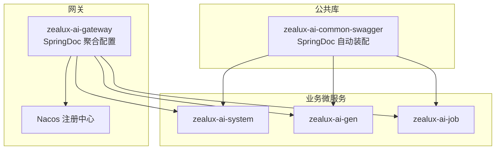
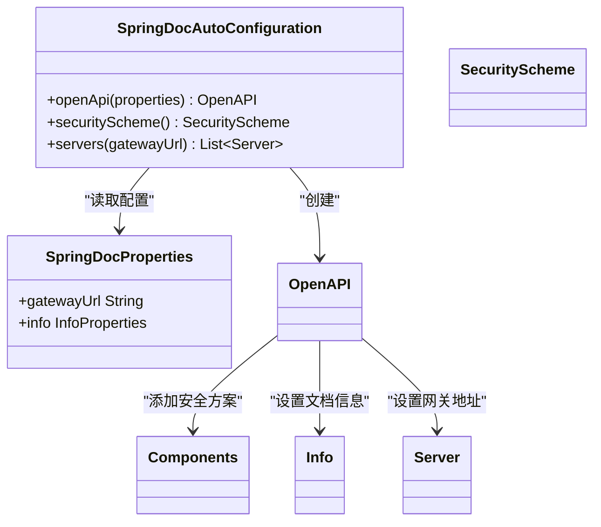
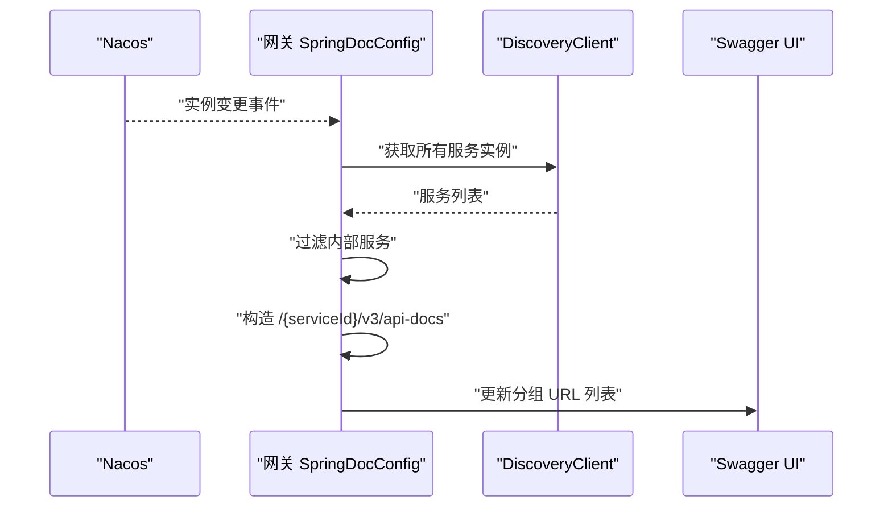
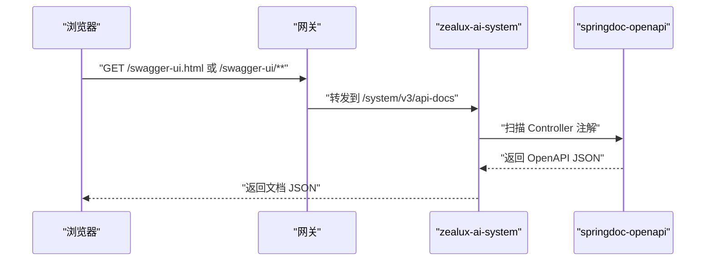
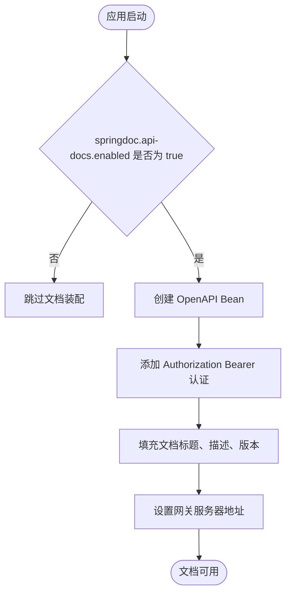
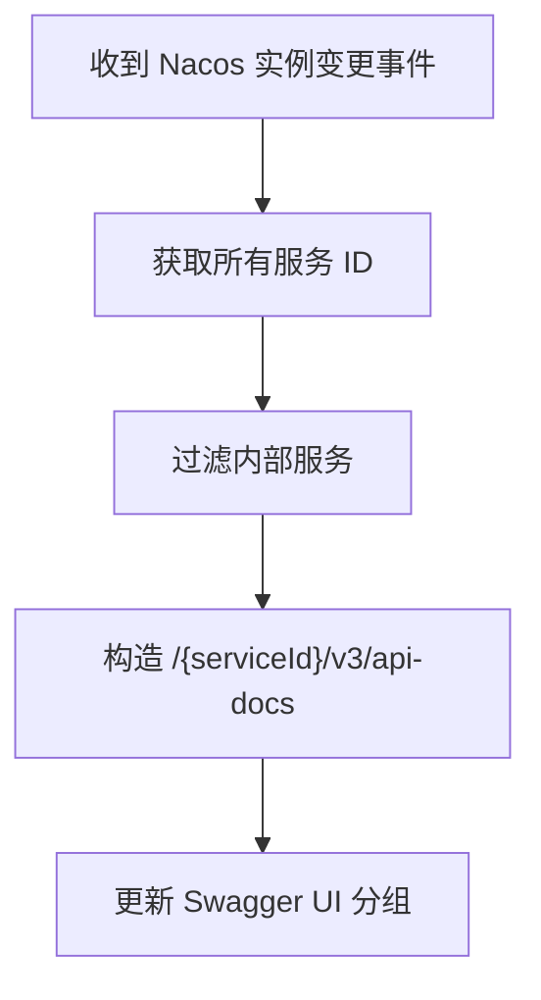
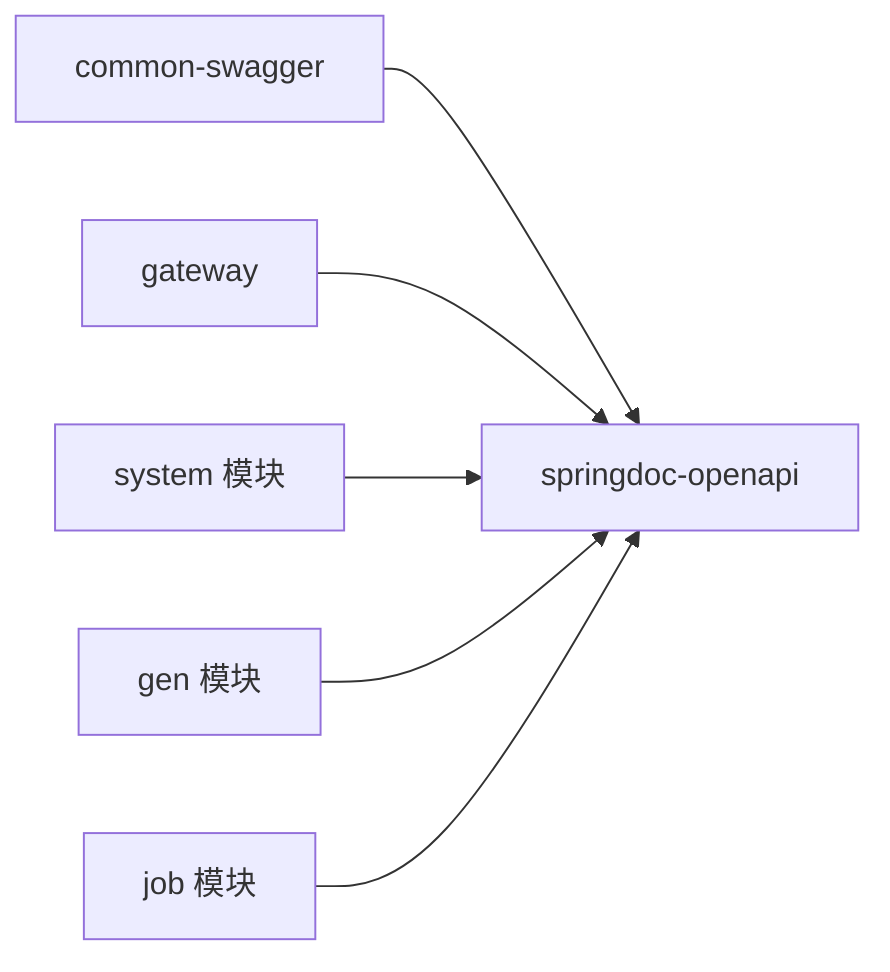
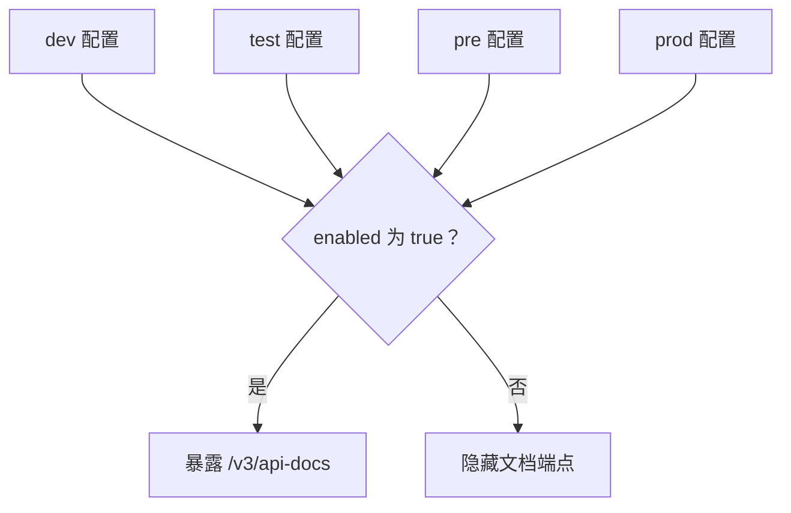

# swagger API 文档模块

<cite>
**本文引用的文件**   
- [SpringDocAutoConfiguration.java](file://zealux-ai-master/zealux-ai-common/zealux-ai-common-swagger/src/main/java/com/zealux/common/swagger/config/SpringDocAutoConfiguration.java)
- [SpringDocProperties.java](file://zealux-ai-master/zealux-ai-common/zealux-ai-common-swagger/src/main/java/com/zealux/common/swagger/config/properties/SpringDocProperties.java)
- [SpringDocConfig.java](file://zealux-ai-master/zealux-ai-gateway/src/main/java/com/zealux/gateway/config/SpringDocConfig.java)
- [pom.xml（公共 Swagger 模块）](file://zealux-ai-master/zealux-ai-common/zealux-ai-common-swagger/pom.xml)
- [pom.xml（网关模块）](file://zealux-ai-master/zealux-ai-gateway/pom.xml)
- [pom.xml（系统模块）](file://zealux-ai-master/zealux-ai-modules/zealux-ai-system/pom.xml)
- [pom.xml（代码生成模块）](file://zealux-ai-master/zealux-ai-modules/zealux-ai-gen/pom.xml)
- [pom.xml（定时任务模块）](file://zealux-ai-master/zealux-ai-modules/zealux-ai-job/pom.xml)
- [Nacos 配置：zealux-ai-system-dev.yml](file://_setup/stack/nacos/nacos/data/config-data/DEFAULT_GROUP/zealux-ai-system-dev.yml)
- [Nacos 配置：zealux-ai-gateway-dev.yml](file://_setup/stack/nacos/nacos/data/config-data/DEFAULT_GROUP/zealux-ai-gateway-dev.yml)
</cite>

## 目录
1. [简介](#简介)
2. [项目结构](#项目结构)
3. [核心组件](#核心组件)
4. [架构总览](#架构总览)
5. [详细组件分析](#详细组件分析)
6. [依赖关系分析](#依赖关系分析)
7. [性能与行为特性](#性能与行为特性)
8. [接口文档注解规范](#接口文档注解规范)
9. [Nacos 配置控制](#nacos-配置控制)
10. [常见问题排查](#常见问题排查)
11. [结论](#结论)

## 简介
本模块基于 springdoc-openapi 实现 RuoYi-Cloud 3.6.5 的 OpenAPI 文档能力。它不是自研框架，而是对开源 RuoYi-Cloud 中 swagger 相关能力的继承与扩展：根工程 artifactId 为 zealux-ai、版本为 3.6.5；公共库子目录仍保留 ruoyi-common-sensitive 等原命名，后端服务启动类也沿用 RuoYi*Application 风格。

当前仓库中并未发现业务 Controller 直接使用 @Operation、@Parameter、@ApiResponses 等 SpringDoc 注解；因此这些注解在本项目中属于“建议用法”，而非已有实现。本文会说明如何正确使用它们，并严格区分“已实现”和“方案”。

## 项目结构
Swagger 相关代码主要分布在两个位置：

| 层次 | 位置 | 职责 |
|---|---|---|
| 公共配置层 | `zealux-ai-common/zealux-ai-common-swagger` | 定义 SpringDoc 自动装配、OpenAPI 元数据、认证头与服务器地址 |
| 网关聚合层 | `zealux-ai-gateway` | 订阅 Nacos 服务实例，动态注册各微服务的 `/v3/api-docs` 分组 |
| 业务模块层 | `zealux-ai-modules/*` | 通过 Maven 依赖引入 springdoc-openapi，从而暴露 OpenAPI JSON |



**图表来源**
- [SpringDocAutoConfiguration.java:1-66](file://zealux-ai-master/zealux-ai-common/zealux-ai-common-swagger/src/main/java/com/zealux/common/swagger/config/SpringDocAutoConfiguration.java#L1-L66)
- [SpringDocConfig.java:1-93](file://zealux-ai-master/zealux-ai-gateway/src/main/java/com/zealux/gateway/config/SpringDocConfig.java#L1-L93)

**章节来源**
- [SpringDocAutoConfiguration.java:1-66](file://zealux-ai-master/zealux-ai-common/zealux-ai-common-swagger/src/main/java/com/zealux/common/swagger/config/SpringDocAutoConfiguration.java#L1-L66)
- [SpringDocConfig.java:1-93](file://zealux-ai-master/zealux-ai-gateway/src/main/java/com/zealux/gateway/config/SpringDocConfig.java#L1-L93)

## 核心组件
### SpringDocAutoConfiguration
这是整个 Swagger 文档的入口自动装配类，关键行为如下：

1. **启用时机**  
   - 使用 `@AutoConfiguration(before = SpringDocConfiguration.class)`，在 springdoc 默认配置之前加载。  
   - 使用 `@ConditionalOnProperty(name = "springdoc.api-docs.enabled", havingValue = "true", matchIfMissing = true)`，默认开启。

2. **注册 OpenAPI 元数据**  
   - 创建 `OpenAPI` Bean，注入标题、描述、联系人、许可证、版本等信息。  
   - 设置全局安全要求，默认要求名为 `apikey` 的安全方案。

3. **注册认证头**  
   - 添加名为 `apikey` 的 `SecurityScheme`。  
   - 类型为 `APIKEY`，位置为请求头 `Authorization`，scheme 为 `Bearer`。  
   - 这意味着文档中的“授权”按钮应填写 Bearer Token，而不是普通 Cookie。

4. **设置文档服务器地址**  
   - 从 `springdoc.gatewayUrl` 读取网关地址，作为 OpenAPI 的 Server URL。  
   - 这会影响在线测试时请求的目标地址。



**图表来源**
- [SpringDocAutoConfiguration.java:1-66](file://zealux-ai-master/zealux-ai-common/zealux-ai-common-swagger/src/main/java/com/zealux/common/swagger/config/SpringDocAutoConfiguration.java#L1-L66)
- [SpringDocProperties.java:1-135](file://zealux-ai-master/zealux-ai-common/zealux-ai-common-swagger/src/main/java/com/zealux/common/swagger/config/properties/SpringDocProperties.java#L1-L135)

**章节来源**
- [SpringDocAutoConfiguration.java:1-66](file://zealux-ai-master/zealux-ai-common/zealux-ai-common-swagger/src/main/java/com/zealux/common/swagger/config/SpringDocAutoConfiguration.java#L1-L66)
- [SpringDocProperties.java:1-135](file://zealux-ai-master/zealux-ai-common/zealux-ai-common-swagger/src/main/java/com/zealux/common/swagger/config/properties/SpringDocProperties.java#L1-L135)

### SpringDocProperties
该配置类把 `springdoc.*` 映射到 Java 对象：

| 配置项 | 类型 | 作用 |
|---|---|---|
| `springdoc.gatewayUrl` | String | 文档中的服务器地址，通常指向网关 |
| `springdoc.info.title` | String | 文档标题 |
| `springdoc.info.description` | String | 文档描述 |
| `springdoc.info.contact.name` | String | 联系人名称 |
| `springdoc.info.contact.url` | String | 联系人链接 |
| `springdoc.info.version` | String | 文档版本 |
| `springdoc.api-docs.enabled` | Boolean | 控制是否启用 `/v3/api-docs` 端点 |

注意：该类只定义了 `gatewayUrl` 和 `info` 字段；如果未来需要按模块控制开关，应在此类中添加对应属性，而不是直接假设已有字段。

**章节来源**
- [SpringDocProperties.java:1-135](file://zealux-ai-master/zealux-ai-common/zealux-ai-common-swagger/src/main/java/com/zealux/common/swagger/config/properties/SpringDocProperties.java#L1-L135)

### 网关中的 SpringDocConfig
网关不承载业务接口，但负责聚合多个微服务的文档。其核心逻辑是：

1. 当 `springdoc.api-docs.enabled` 为真或未设置时启用。
2. 在初始化后注册 Nacos 实例变更订阅器。
3. 监听 `InstancesChangeEvent`，遍历所有已注册服务。
4. 排除网关自身及若干内部服务：`zealux-ai-gateway`、`zealux-ai-auth`、`zealux-ai-file`、`zealux-ai-monitor`。
5. 将每个服务实例转换为一个 Swagger 分组，URL 形如 `/{serviceId}/v3/api-docs`。
6. 把这些分组写入 `swaggerUiConfigProperties.urls`，供前端 UI 选择。



**图表来源**
- [SpringDocConfig.java:1-93](file://zealux-ai-master/zealux-ai-gateway/src/main/java/com/zealux/gateway/config/SpringDocConfig.java#L1-L93)

**章节来源**
- [SpringDocConfig.java:1-93](file://zealux-ai-master/zealux-ai-gateway/src/main/java/com/zealux/gateway/config/SpringDocConfig.java#L1-L93)

## 架构总览
下图展示一次典型访问流程：用户打开网关上的 Swagger UI，选择某个业务服务分组，然后由该业务服务暴露 `/v3/api-docs`。



**图表来源**
- [SpringDocAutoConfiguration.java:1-66](file://zealux-ai-master/zealux-ai-common/zealux-ai-common-swagger/src/main/java/com/zealux/common/swagger/config/SpringDocAutoConfiguration.java#L1-L66)
- [SpringDocConfig.java:1-93](file://zealux-ai-master/zealux-ai-gateway/src/main/java/com/zealux/gateway/config/SpringDocConfig.java#L1-L93)

## 详细组件分析

### SpringDocAutoConfiguration 的工作机制
该类承担以下职责：

| 功能 | 实现方式 | 影响 |
|---|---|---|
| 启用条件 | `@ConditionalOnProperty("springdoc.api-docs.enabled=true")` | 关闭该属性后，不会创建 OpenAPI Bean |
| 全局安全方案 | 注册名为 `apikey` 的 API Key 安全方案 | 文档中出现“授权”按钮 |
| 认证头 | Authorization，Bearer | 测试时需填入 `Bearer <token>` |
| 文档信息 | 从 `springdoc.info.*` 读取 | 显示标题、描述、联系人、版本 |
| 服务器地址 | 从 `springdoc.gatewayUrl` 读取 | 在线测试请求目标 |

需要特别注意：虽然类名在搜索中被命名为 `SpringDocAutoConfiguration`，但题目要求的 `SwaggerAutoConfiguration` 在当前仓库源码中并不存在。当前实现以 `SpringDocAutoConfiguration` 为准。



**图表来源**
- [SpringDocAutoConfiguration.java:1-66](file://zealux-ai-master/zealux-ai-common/zealux-ai-common-swagger/src/main/java/com/zealux/common/swagger/config/SpringDocAutoConfiguration.java#L1-L66)

**章节来源**
- [SpringDocAutoConfiguration.java:1-66](file://zealux-ai-master/zealux-ai-common/zealux-ai-common-swagger/src/main/java/com/zealux/common/swagger/config/SpringDocAutoConfiguration.java#L1-L66)

### 网关聚合文档分组
网关根据 Nacos 的服务发现结果，动态构建 Swagger 分组。关键点：

- 排除列表包括：`zealux-ai-gateway`、`zealux-ai-auth`、`zealux-ai-file`、`zealux-ai-monitor`。
- 分组 URL 格式为 `/{serviceId}/v3/api-docs`。
- 分组集合最终写入 `swaggerUiConfigProperties.urls`。



**图表来源**
- [SpringDocConfig.java:1-93](file://zealux-ai-master/zealux-ai-gateway/src/main/java/com/zealux/gateway/config/SpringDocConfig.java#L1-L93)

**章节来源**
- [SpringDocConfig.java:1-93](file://zealux-ai-master/zealux-ai-gateway/src/main/java/com/zealux/gateway/config/SpringDocConfig.java#L1-L93)

## 依赖关系分析
目前可确认 springdoc-openapi 依赖存在于以下 Maven 模块：

| 模块 | 依赖情况 | 说明 |
|---|---|---|
| `zealux-ai-common/zealux-ai-common-swagger` | 包含 springdoc-openapi 相关依赖 | 提供公共 OpenAPI 配置 |
| `zealux-ai-gateway` | 包含 springdoc-openapi 相关依赖 | 聚合多服务文档 |
| `zealux-ai-modules/zealux-ai-system` | 包含 springdoc-openapi 相关依赖 | 暴露系统接口文档 |
| `zealux-ai-modules/zealux-ai-gen` | 包含 springdoc-openapi 相关依赖 | 暴露代码生成接口文档 |
| `zealux-ai-modules/zealux-ai-job` | 包含 springdoc-openapi 相关依赖 | 暴露定时任务接口文档 |



**图表来源**
- [pom.xml（公共 Swagger 模块）](file://zealux-ai-master/zealux-ai-common/zealux-ai-common-swagger/pom.xml)
- [pom.xml（网关模块）](file://zealux-ai-master/zealux-ai-gateway/pom.xml)
- [pom.xml（系统模块）](file://zealux-ai-master/zealux-ai-modules/zealux-ai-system/pom.xml)
- [pom.xml（代码生成模块）](file://zealux-ai-master/zealux-ai-modules/zealux-ai-gen/pom.xml)
- [pom.xml（定时任务模块）](file://zealux-ai-master/zealux-ai-modules/zealux-ai-job/pom.xml)

**章节来源**
- [pom.xml（公共 Swagger 模块）](file://zealux-ai-master/zealux-ai-common/zealux-ai-common-swagger/pom.xml)
- [pom.xml（网关模块）](file://zealux-ai-master/zealux-ai-gateway/pom.xml)
- [pom.xml（系统模块）](file://zealux-ai-master/zealux-ai-modules/zealux-ai-system/pom.xml)
- [pom.xml（代码生成模块）](file://zealux-ai-master/zealux-ai-modules/zealux-ai-gen/pom.xml)
- [pom.xml（定时任务模块）](file://zealux-ai-master/zealux-ai-modules/zealux-ai-job/pom.xml)

## 性能与行为特性
- 默认启用：`springdoc.api-docs.enabled` 未配置时视为 `true`。
- 文档扫描开销：springdoc 会在启动阶段扫描控制器、方法、参数、返回值等注解。接口数量较多时会增加启动时间。
- 网关聚合开销：每次 Nacos 实例变化都会重新计算 Swagger 分组。
- 安全风险：若生产环境未关闭该开关，可能泄露接口结构、参数、部分响应模型。

[本节为通用行为说明，不涉及具体文件分析]

## 接口文档注解规范
### 已在仓库中观察到的状态
- 未发现任何业务 Controller 使用 @Operation、@Parameter、@ApiResponses。
- 未发现 Controller 上使用 @Hidden、@Tag(hidden = ...) 等隐藏注解。
- 未发现全局 OpenAPI 自定义器用于统一过滤敏感接口。
- 未发现针对开发环境的条件化文档配置。

因此，以下示例属于**建议写法**，用于指导后续新增或改造接口时使用。

### 推荐注解用法
| 注解 | 用途 | 建议 |
|---|---|---|
| `@Operation` | 描述接口方法与摘要 | 每个 Controller 方法都应补充 |
| `@Parameter` | 描述路径变量、查询参数、请求体字段 | 避免让文档字段名代替可读说明 |
| `@ApiResponses` / `@ApiResponse` | 描述成功与失败响应 | 至少声明常见错误码 |
| `@Tag` | 对 Controller 分组 | 便于 Swagger UI 分组展示 |
| `@Hidden` 或 `@Tag(hidden = true)` | 隐藏内部接口 | 仅对非对外接口使用 |

### 示例：Controller 上添加文档注解
以下为建议结构，不包含实际代码内容：

- 在 Controller 类上使用 `@Tag(name = "用户管理")` 表示接口分组。
- 在查询方法上使用 `@Operation(summary = "分页查询用户")`。
- 在分页参数上使用 `@Parameter(description = "页码")`、`@Parameter(description = "每页条数")`。
- 在删除或修改方法上使用 `@ApiResponses` 列出成功与权限不足等情况。
- 对内部调试接口加上 `@Hidden`，使其不出现在文档中。

### 示例：Token 如何带入测试
由于全局安全方案定义为：

- 名称：`apikey`
- 位置：请求头
- Header 名称：`Authorization`
- Scheme：`Bearer`

因此在 Swagger UI 中点击“授权”后，应填入完整的 Bearer Token，例如：

```text
Bearer 你的令牌值
```

不要把原始 token 粘贴到公开仓库或聊天记录中。本地凭据应放在独立的凭据记录或密钥管理系统中。

**章节来源**
- [SpringDocAutoConfiguration.java:1-66](file://zealux-ai-master/zealux-ai-common/zealux-ai-common-swagger/src/main/java/com/zealux/common/swagger/config/SpringDocAutoConfiguration.java#L1-L66)

## Nacos 配置控制
### 系统模块配置
本地 Nacos 中 `zealux-ai-system-dev.yml` 包含：

| 配置项 | 当前值 | 含义 |
|---|---|---|
| `springdoc.gatewayUrl` | `http://localhost:8080/` | 文档服务器地址 |
| `springdoc.api-docs.enabled` | `true` | 开启 `/v3/api-docs` |
| `springdoc.info.title` | 系统模块接口文档 | 文档标题 |
| `springdoc.info.description` | 系统模块接口描述 | 文档描述 |
| `springdoc.info.contact.name` | RuoYi | 联系人名称 |
| `springdoc.info.contact.url` | https://ruoyi.vip | 联系人链接 |

### 网关模块配置
`zealux-ai-gateway-dev.yml` 中与文档相关的关键点是：

- 路由前缀：`/auth/**`、`/system/**`、`/code/**`、`/schedule/**`、`/file/**`。
- 白名单中包含 `/v3/api-docs/**`、`/swagger-ui/**`、`/swagger-resources/**`，允许网关放行文档访问。
- 不存在 `/leads/**` 路由，也不存在 CRM 相关路由。

### 如何控制是否暴露文档
| 环境 | 建议配置 | 说明 |
|---|---|---|
| 开发环境 | `springdoc.api-docs.enabled: true` | 正常暴露文档 |
| 测试环境 | `springdoc.api-docs.enabled: true` | 配合鉴权白名单使用 |
| 预发环境 | `springdoc.api-docs.enabled: false` | 建议关闭 |
| 生产环境 | `springdoc.api-docs.enabled: false` | 必须关闭 |

如果希望更细粒度控制，可在 `SpringDocProperties` 中新增布尔字段，并在 `SpringDocAutoConfiguration` 中增加额外条件。



**图表来源**
- [Nacos 配置：zealux-ai-system-dev.yml](file://_setup/stack/nacos/nacos/data/config-data/DEFAULT_GROUP/zealux-ai-system-dev.yml)
- [Nacos 配置：zealux-ai-gateway-dev.yml](file://_setup/stack/nacos/nacos/data/config-data/DEFAULT_GROUP/zealux-ai-gateway-dev.yml)

**章节来源**
- [Nacos 配置：zealux-ai-system-dev.yml](file://_setup/stack/nacos/nacos/data/config-data/DEFAULT_GROUP/zealux-ai-system-dev.yml)
- [Nacos 配置：zealux-ai-gateway-dev.yml](file://_setup/stack/nacos/nacos/data/config-data/DEFAULT_GROUP/zealux-ai-gateway-dev.yml)

## 常见问题排查

### 问题一：文档不显示
**可能原因**
1. `springdoc.api-docs.enabled` 被设置为 `false`。
2. 业务模块未引入 springdoc-openapi 依赖。
3. Nacos 中没有正确注册服务，网关无法发现实例。
4. 网关路由没有放行 `/v3/api-docs/**`。
5. 文档服务器地址 `springdoc.gatewayUrl` 与实际网关地址不一致。

**排查步骤**
1. 检查 Nacos 中 `springdoc.api-docs.enabled` 是否为 `true`。
2. 检查业务模块 pom.xml 是否包含 springdoc-openapi 依赖。
3. 访问 `http://网关地址/{服务ID}/v3/api-docs`，看是否能返回 JSON。
4. 检查网关是否放行 `/v3/api-docs/**`。
5. 修正 `springdoc.gatewayUrl`，使其指向真实网关地址。

**章节来源**
- [SpringDocAutoConfiguration.java:1-66](file://zealux-ai-master/zealux-ai-common/zealux-ai-common-swagger/src/main/java/com/zealux/common/swagger/config/SpringDocAutoConfiguration.java#L1-L66)
- [SpringDocConfig.java:1-93](file://zealux-ai-master/zealux-ai-gateway/src/main/java/com/zealux/gateway/config/SpringDocConfig.java#L1-L93)
- [Nacos 配置：zealux-ai-gateway-dev.yml](file://_setup/stack/nacos/nacos/data/config-data/DEFAULT_GROUP/zealux-ai-gateway-dev.yml)

### 问题二：接口重复
**可能原因**
1. 同一 Controller 同时被多个包扫描到。
2. 多个模块重复声明相同接口。
3. 网关聚合时出现同名 serviceId。
4. 使用了错误的包路径导致同一个类被多次注册。

**修复建议**
1. 确保每个 Controller 只位于一个包路径下。
2. 检查 Maven 依赖是否重复引入不同版本的 springdoc-openapi。
3. 检查 Nacos 服务注册是否出现同名服务。
4. 如需隐藏重复内部接口，可使用 `@Hidden` 或 `@Tag(hidden = true)`。

[本节为通用排查建议，未直接分析具体文件]

### 问题三：Token 无法带入测试
**可能原因**
1. 全局安全方案使用 `Authorization` 头，但测试时传入了其他 header。
2. 没有点击 Swagger UI 的“授权”按钮。
3. 传入的 token 缺少 `Bearer ` 前缀。
4. 后端安全过滤器拒绝 token，与文档无关。

**修复建议**
1. 在 Swagger UI 中点击“授权”。
2. 输入 `Bearer <token>`，其中 `<token>` 替换为本地凭据记录中的令牌占位值。
3. 确认 `springdoc.gatewayUrl` 指向正确的网关地址。
4. 如果 Token 校验失败，优先排查后端认证逻辑，而不是只改文档。

**章节来源**
- [SpringDocAutoConfiguration.java:1-66](file://zealux-ai-master/zealux-ai-common/zealux-ai-common-swagger/src/main/java/com/zealux/common/swagger/config/SpringDocAutoConfiguration.java#L1-L66)

### 问题四：生产环境误开放文档的安全风险
**风险**
- 外部人员可能看到接口路径、参数、请求体结构、响应模型。
- 结合其他漏洞，攻击面可能被扩大。
- 文档可能间接暴露数据库字段、内部服务调用约定。

**修复方法**
1. 在生产 Nacos 配置中将 `springdoc.api-docs.enabled` 设为 `false`。
2. 在网关层不再放行 `/v3/api-docs/**`。
3. 不要依赖“隐藏 Controller”作为唯一防护手段。
4. 若确实需要生产调试文档，应通过独立网段、强身份认证和审计日志保护。

**章节来源**
- [Nacos 配置：zealux-ai-system-dev.yml](file://_setup/stack/nacos/nacos/data/config-data/DEFAULT_GROUP/zealux-ai-system-dev.yml)
- [Nacos 配置：zealux-ai-gateway-dev.yml](file://_setup/stack/nacos/nacos/data/config-data/DEFAULT_GROUP/zealux-ai-gateway-dev.yml)

### 问题五：敏感接口未过滤
**现状**
- 当前 `SpringDocAutoConfiguration` 没有实现全局接口过滤规则。
- 也没有 `OperationCustomizer` 或 `GlobalOpenApiCustomizer` 的统一过滤逻辑。
- 因此不能声称系统已经具备“敏感接口自动过滤”的能力。

**建议方案**
1. 在 `SpringDocProperties` 中新增敏感接口配置，例如黑名单路径或正则。
2. 在自动装配类中读取该配置，并通过 SpringDoc 提供的 Operation 自定义机制过滤。
3. 对于明确内部使用的接口，优先使用 `@Hidden`。
4. 对仅开发环境开放的接口，使用 Spring Profile 或 Nacos 配置开关控制。

[本节为方案建议，未对应现有实现]

## 结论
本项目的 Swagger 文档能力建立在 springdoc-openapi 之上，并由公共库 `zealux-ai-common-swagger` 提供统一的 OpenAPI 配置，由网关 `zealux-ai-gateway` 动态聚合各微服务的 `/v3/api-docs`。当前实现的关键要点是：

- 默认启用文档端点。
- 全局安全方案使用 `Authorization: Bearer`。
- 文档服务器地址来自 `springdoc.gatewayUrl`。
- 网关根据 Nacos 实例动态注册文档分组。
- 业务模块尚未使用 @Operation、@Parameter、@ApiResponses 等注解，这些属于建议规范。
- 敏感接口过滤、开发环境隔离、分组标签等能力当前未完全实现，需通过新增配置与注解逐步完善。
- 生产环境必须显式关闭 `springdoc.api-docs.enabled`，避免文档泄露。