# 通用模块(common)设计

<cite>
**本文引用的文件**   
- [zealux-ai-common/pom.xml](file://zealux-ai-master/zealux-ai-common/pom.xml)
- [core/AutoConfiguration.imports](file://zealux-ai-master/zealux-ai-common/zealux-ai-common-core/src/main/resources/META-INF/spring/org.springframework.boot.autoconfigure.AutoConfiguration.imports)
- [core/SpringUtils.java](file://zealux-ai-master/zealux-ai-common/zealux-ai-common-core/src/main/java/com/zealux/common/core/utils/SpringUtils.java)
- [security/AutoConfiguration.imports](file://zealux-ai-master/zealux-ai-common/zealux-ai-common-security/src/main/resources/META-INF/spring/org.springframework.boot.autoconfigure.AutoConfiguration.imports)
- [log/AutoConfiguration.imports](file://zealux-ai-master/zealux-ai-common/zealux-ai-common-log/src/main/resources/META-INF/spring/org.springframework.boot.autoconfigure.AutoConfiguration.imports)
- [log/LogAspect.java](file://zealux-ai-master/zealux-ai-common/zealux-ai-common-log/src/main/java/com/zealux/common/log/aspect/LogAspect.java)
- [log/AsyncLogService.java](file://zealux-ai-master/zealux-ai-common/zealux-ai-common-log/src/main/java/com/zealux/common/log/service/AsyncLogService.java)
- [log/Log.java](file://zealux-ai-master/zealux-ai-common/zealux-ai-common-log/src/main/java/com/zealux/common/log/annotation/Log.java)
- [redis/AutoConfiguration.imports](file://zealux-ai-master/zealux-ai-common/zealux-ai-common-redis/src/main/resources/META-INF/spring/org.springframework.boot.autoconfigure.AutoConfiguration.imports)
- [redis/RedisConfig.java](file://zealux-ai-master/zealux-ai-common/zealux-ai-common-redis/src/main/java/com/zealux/common/redis/configure/RedisConfig.java)
- [redis/RedisService.java](file://zealux-ai-master/zealux-ai-common/zealux-ai-common-redis/src/main/java/com/zealux/common/redis/service/RedisService.java)
- [swagger/AutoConfiguration.imports](file://zealux-ai-master/zealux-ai-common/zealux-ai-common-swagger/src/main/resources/META-INF/spring/org.springframework.boot.autoconfigure.AutoConfiguration.imports)
- [swagger/SpringDocAutoConfiguration.java](file://zealux-ai-master/zealux-ai-common/zealux-ai-common-swagger/src/main/java/com/zealux/common/swagger/config/SpringDocAutoConfiguration.java)
- [datasource/Master.java](file://zealux-ai-master/zealux-ai-common/zealux-ai-common-datasource/src/main/java/com/zealux/common/datasource/annotation/Master.java)
- [datasource/Slave.java](file://zealux-ai-master/zealux-ai-common/zealux-ai-common-datasource/src/main/java/com/zealux/common/datasource/annotation/Slave.java)
- [datascope/DataScope.java](file://zealux-ai-master/zealux-ai-common/zealux-ai-common-datascope/src/main/java/com/zealux/common/datascope/annotation/DataScope.java)
- [datascope/DataScopeAspect.java](file://zealux-ai-master/zealux-ai-common/zealux-ai-common-datascope/src/main/java/com/zealux/common/datascope/aspect/DataScopeAspect.java)
- [ruoyi-common-sensitive/Sensitive.java](file://zealux-ai-master/zealux-ai-common/ruoyi-common-sensitive/src/main/java/com/ruoyi/common/sensitive/annotation/Sensitive.java)
- [ruoyi-common-sensitive/SensitiveJsonSerializer.java](file://zealux-ai-master/zealux-ai-common/ruoyi-common-sensitive/src/main/java/com/ruoyi/common/sensitive/config/SensitiveJsonSerializer.java)
- [ruoyi-common-sensitive/DesensitizedType.java](file://zealux-ai-master/zealux-ai-common/ruoyi-common-sensitive/src/main/java/com/ruoyi/common/sensitive/enums/DesensitizedType.java)
- [ai/AutoConfiguration.imports](file://zealux-ai-master/zealux-ai-common/zealux-ai-common-ai/src/main/resources/META-INF/spring/org.springframework.boot.autoconfigure.AutoConfiguration.imports)
- [ai/ChatClientConfig.java](file://zealux-ai-master/zealux-ai-common/zealux-ai-common-ai/src/main/java/com/zealux/common/ai/config/ChatClientConfig.java)
- [ai/RedisVectorConfig.java](file://zealux-ai-master/zealux-ai-common/zealux-ai-common-ai/src/main/java/com/zealux/common/ai/config/RedisVectorConfig.java)
</cite>

## 目录

1. [引言](#引言)
2. [项目结构](#项目结构)
3. [自动装配机制与 Starter 使用方式](#自动装配机制与-starter-使用方式)
4. [核心组件总览](#核心组件总览)
5. [详细组件分析](#详细组件分析)
6. [依赖关系分析](#依赖关系分析)
7. [典型用法示例](#典型用法示例)
8. [性能与可维护性考虑](#性能与可维护性考虑)
9. [故障排查指南](#故障排查指南)
10. [结论](#结论)

## 引言

zealux-ai-common 是 zealux-ai 多模块工程中的公共能力层。它不直接暴露业务接口，而是通过 Spring Boot 的自动装配机制，把常量、工具类、安全过滤、操作日志、Redis 封装、API 文档、数据权限、读写数据源注解和数据脱敏等横切能力注入到业务模块中。

需要特别强调：本仓库中该父模块只声明了 9 个 Maven 子模块，但其中 `zealux-ai-common-seata` 没有 Java 源码；另外，敏感信息处理模块虽然存在于代码库中，却未被父 pom 列入构建列表。因此，“9 个非空子模块”应理解为：**父 pom 中显式声明的 9 个模块**（core、security、log、redis、swagger、datasource、datascope、seata、ai），再加上 **未参与构建但未删除的 ruoyi-common-sensitive**。

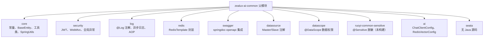

**图示来源**   
- [zealux-ai-common/pom.xml:12-23](file://zealux-ai-master/zealux-ai-common/pom.xml#L12-L23)

**章节来源**   
- [zealux-ai-common/pom.xml:1-31](file://zealux-ai-master/zealux-ai-common/pom.xml#L1-L31)

## 项目结构

zealux-ai-common 采用“按横切能力拆分”的结构，每个子模块只承担单一职责，并通过 Spring Boot 3 推荐的 `META-INF/spring/org.springframework.boot.autoconfigure.AutoConfiguration.imports` 文件注册自动配置类。

| 模块 | 主要职责 | 是否由父 pom 构建 | 是否启用自动装配 |
|---|---|---:|---:|
| core | 常量、上下文、异常、工具类、SpringUtils | 是 | 是 |
| security | WebMvc、TokenService、权限 AOP、全局异常 | 是 | 是 |
| log | @Log 注解、操作日志 AOP、异步日志服务 | 是 | 是 |
| redis | RedisTemplate 配置与 RedisService 封装 | 是 | 是 |
| swagger | springdoc-openapi 自动配置 | 是 | 是 |
| datasource | Master、Slave 数据源标注注解 | 否 | 否（仅定义注解） |
| datascope | @DataScope 注解与数据权限 AOP | 是 | 是 |
| ruoyi-common-sensitive | @Sensitive、脱敏类型、JSON 序列化器 | 否 | 否（未列在父 pom modules） |
| ai | ChatClientConfig、RedisVectorConfig 等 AI 通用配置 | 是 | 是 |
| seata | 分布式事务依赖占位 | 是 | 否（无 Java 文件） |

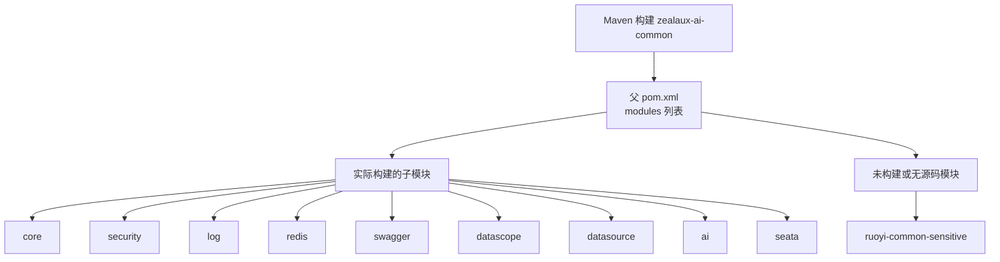

**图示来源**   
- [zealux-ai-common/pom.xml:12-23](file://zealux-ai-master/zealux-ai-common/pom.xml#L12-L23)

**章节来源**   
- [zealux-ai-common/pom.xml:1-31](file://zealux-ai-master/zealux-ai-common/pom.xml#L1-L31)

## 自动装配机制与 Starter 使用方式

这些模块不是传统意义上的独立 Starter，而是基于 Spring Boot 3 的自动装配机制：每个模块在 `src/main/resources/META-INF/spring/org.springframework.boot.autoconfigure.AutoConfiguration.imports` 中列出要注册的类名。当业务模块引入对应依赖后，Spring Boot 启动时会加载这些类并注册为 Bean。

| 模块 | AutoConfiguration.imports 内容 | 装配行为 |
|---|---|---|
| core | `SpringUtils` | 将 SpringUtils 作为组件加入容器 |
| security | WebMvcConfig、TokenService、PreAuthorizeAspect、InnerAuthAspect、GlobalExceptionHandler | 装配 Web MVC 配置、令牌服务、权限切面与全局异常处理器 |
| log | AsyncLogService、LogAspect | 装配异步日志服务和操作日志切面 |
| redis | RedisConfig、RedisService | 装配 RedisTemplate 配置与 RedisService |
| swagger | SpringDocAutoConfiguration | 条件装配 springdoc-openapi |
| datascope | DataScopeAspect | 装配数据权限切面 |
| ai | ChatClientConfig | 装配 ChatClientConfig；RedisVectorConfig 存在但不在 imports 中 |
| datasource | 无 | 仅提供注解，不提供自动装配类 |
| ruoyi-common-sensitive | 无 | 仅提供注解和序列化器，不参与自动装配 |

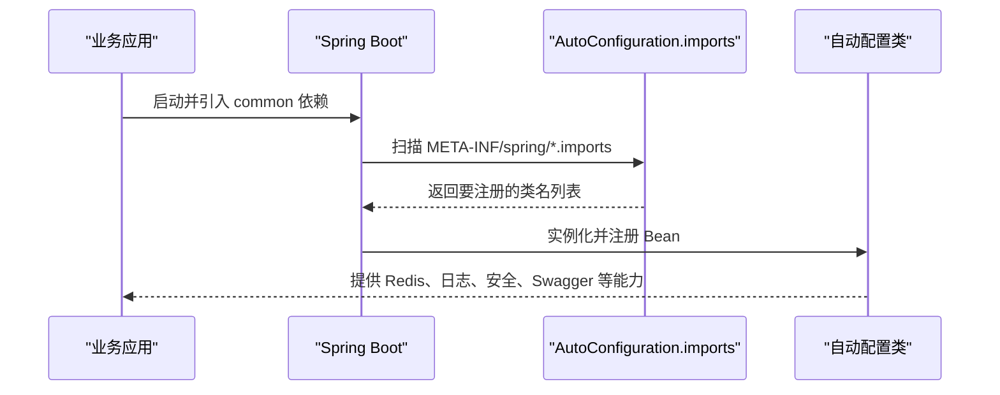

**图示来源**   
- [core/AutoConfiguration.imports:1](file://zealux-ai-master/zealux-ai-common/zealux-ai-common-core/src/main/resources/META-INF/spring/org.springframework.boot.autoconfigure.AutoConfiguration.imports#L1)
- [security/AutoConfiguration.imports:1-5](file://zealux-ai-master/zealux-ai-common/zealux-ai-common-security/src/main/resources/META-INF/spring/org.springframework.boot.autoconfigure.AutoConfiguration.imports#L1-L5)
- [log/AutoConfiguration.imports:1-2](file://zealux-ai-master/zealux-ai-common/zealux-ai-common-log/src/main/resources/META-INF/spring/org.springframework.boot.autoconfigure.AutoConfiguration.imports#L1-L2)
- [redis/AutoConfiguration.imports:1-2](file://zealux-ai-master/zealux-ai-common/zealux-ai-common-redis/src/main/resources/META-INF/spring/org.springframework.boot.autoconfigure.AutoConfiguration.imports#L1-L2)
- [swagger/AutoConfiguration.imports:1](file://zealux-ai-master/zealux-ai-common/zealux-ai-common-swagger/src/main/resources/META-INF/spring/org.springframework.boot.autoconfigure.AutoConfiguration.imports#L1)
- [datascope/AutoConfiguration.imports:1](file://zealux-ai-master/zealux-ai-common/zealux-ai-common-datascope/src/main/resources/META-INF/spring/org.springframework.boot.autoconfigure.AutoConfiguration.imports#L1)
- [ai/AutoConfiguration.imports:1](file://zealux-ai-master/zealux-ai-common/zealux-ai-common-ai/src/main/resources/META-INF/spring/org.springframework.boot.autoconfigure.AutoConfiguration.imports#L1)

**章节来源**   
- [core/AutoConfiguration.imports:1](file://zealux-ai-master/zealux-ai-common/zealux-ai-common-core/src/main/resources/META-INF/spring/org.springframework.boot.autoconfigure.AutoConfiguration.imports#L1)
- [security/AutoConfiguration.imports:1-5](file://zealux-ai-master/zealux-ai-common/zealux-ai-common-security/src/main/resources/META-INF/spring/org.springframework.boot.autoconfigure.AutoConfiguration.imports#L1-L5)
- [log/AutoConfiguration.imports:1-2](file://zealux-ai-master/zealux-ai-common/zealux-ai-common-log/src/main/resources/META-INF/spring/org.springframework.boot.autoconfigure.AutoConfiguration.imports#L1-L2)
- [redis/AutoConfiguration.imports:1-2](file://zealux-ai-master/zealux-ai-common/zealux-ai-common-redis/src/main/resources/META-INF/spring/org.springframework.boot.autoconfigure.AutoConfiguration.imports#L1-L2)
- [swagger/AutoConfiguration.imports:1](file://zealux-ai-master/zealux-ai-common/zealux-ai-common-swagger/src/main/resources/META-INF/spring/org.springframework.boot.autoconfigure.AutoConfiguration.imports#L1)
- [datascope/AutoConfiguration.imports:1](file://zealux-ai-master/zealux-ai-common/zealux-ai-common-datascope/src/main/resources/META-INF/spring/org.springframework.boot.autoconfigure.AutoConfiguration.imports#L1)
- [ai/AutoConfiguration.imports:1](file://zealux-ai-master/zealux-ai-common/zealux-ai-common-ai/src/main/resources/META-INF/spring/org.springframework.boot.autoconfigure.AutoConfiguration.imports#L1)

## 核心组件总览

### core 模块

core 是最底层的通用模块，提供常量、上下文、异常体系、文本处理、工具类和 SpringUtils。它通过 AutoConfiguration.imports 注册 `SpringUtils`，让业务模块可以获取 Spring 容器中的 Bean。

- `SpringUtils` 是一个 `@Component`，用于在静态上下文中访问 Spring Bean。
- 其他子包如 constant、context、exception、text、utils、web、xss、domain、enums、annotation 共同构成基础能力。

**章节来源**   
- [core/AutoConfiguration.imports:1](file://zealux-ai-master/zealux-ai-common/zealux-ai-common-core/src/main/resources/META-INF/spring/org.springframework.boot.autoconfigure.AutoConfiguration.imports#L1)
- [core/SpringUtils.java:1,15](file://zealux-ai-master/zealux-ai-common/zealux-ai-common-core/src/main/java/com/zealux/common/core/utils/SpringUtils.java#L1-L15)

### security 模块

security 模块负责系统级安全能力，包括 Web MVC 配置、令牌服务、前置权限校验切面、内部调用认证切面和全局异常处理。

- 自动装配类包含 `WebMvcConfig`、`TokenService`、`PreAuthorizeAspect`、`InnerAuthAspect`、`GlobalExceptionHandler`。
- 它通常被 auth、system 等业务模块间接依赖，而不是所有业务模块都必须直接使用。

**章节来源**   
- [security/AutoConfiguration.imports:1-5](file://zealux-ai-master/zealux-ai-common/zealux-ai-common-security/src/main/resources/META-INF/spring/org.springframework.boot.autoconfigure.AutoConfiguration.imports#L1-L5)

### log 模块

log 模块通过注解+AOP+异步服务的方式记录用户操作日志。

- 注解：`@Log`，作用域为参数和方法。
- 切面：`LogAspect`，拦截带 `@Log` 的方法。
- 异步服务：`AsyncLogService`，将日志写入任务队列或异步处理。
- 枚举：`BusinessType`、`OperatorType`、`BusinessStatus` 描述日志分类和操作状态。

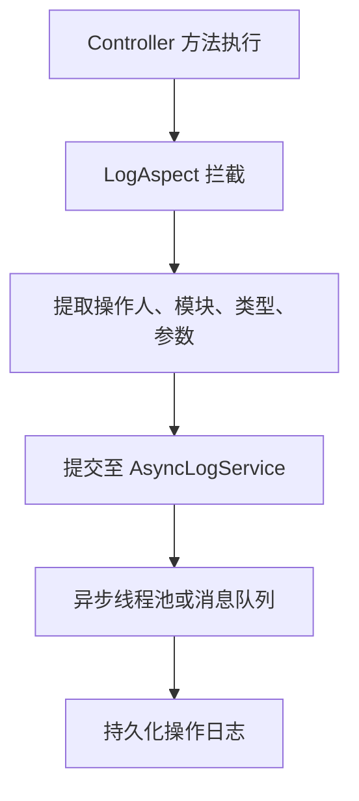

**图示来源**   
- [log/Log.java:17-20](file://zealux-ai-master/zealux-ai-common/zealux-ai-common-log/src/main/java/com/zealux/common/log/annotation/Log.java#L17-L20)
- [log/LogAspect.java:39-41](file://zealux-ai-master/zealux-ai-common/zealux-ai-common-log/src/main/java/com/zealux/common/log/aspect/LogAspect.java#L39-L41)
- [log/AsyncLogService.java:15-16](file://zealux-ai-master/zealux-ai-common/zealux-ai-common-log/src/main/java/com/zealux/common/log/service/AsyncLogService.java#L15-L16)

**章节来源**   
- [log/AutoConfiguration.imports:1-2](file://zealux-ai-master/zealux-ai-common/zealux-ai-common-log/src/main/resources/META-INF/spring/org.springframework.boot.autoconfigure.AutoConfiguration.imports#L1-L2)
- [log/Log.java:17-20](file://zealux-ai-master/zealux-ai-common/zealux-ai-common-log/src/main/java/com/zealux/common/log/annotation/Log.java#L17-L20)
- [log/LogAspect.java:39-41](file://zealux-ai-master/zealux-ai-common/zealux-ai-common-log/src/main/java/com/zealux/common/log/aspect/LogAspect.java#L39-L41)
- [log/AsyncLogService.java:15-16](file://zealux-ai-master/zealux-ai-common/zealux-ai-common-log/src/main/java/com/zealux/common/log/service/AsyncLogService.java#L15-L16)

### redis 模块

redis 模块封装了 Spring Data Redis 的使用方式，避免业务代码直接操作 RedisTemplate。

- `RedisConfig` 继承 `CachingConfigurerSupport`，自定义 `RedisTemplate` 序列化器。
- `RedisService` 封装常用键值、集合、哈希、过期等操作。
- 还包含 `FastJson2JsonRedisSerializer`，用于 JSON 序列化。

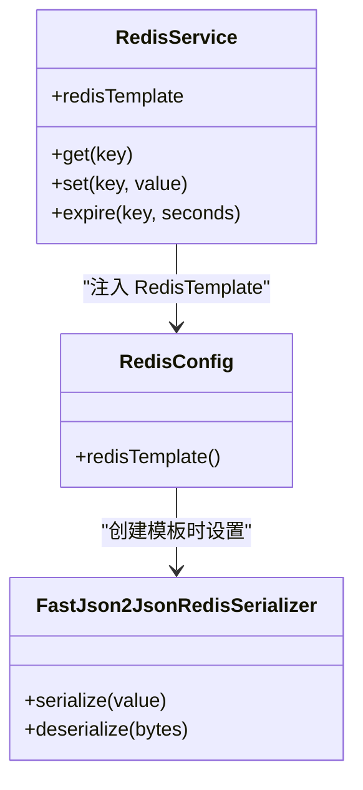

**图示来源**   
- [redis/RedisConfig.java:18-28](file://zealux-ai-master/zealux-ai-common/zealux-ai-common-redis/src/main/java/com/zealux/common/redis/configure/RedisConfig.java#L18-L28)
- [redis/RedisService.java:23-26](file://zealux-ai-master/zealux-ai-common/zealux-ai-common-redis/src/main/java/com/zealux/common/redis/service/RedisService.java#L23-L26)

**章节来源**   
- [redis/AutoConfiguration.imports:1-2](file://zealux-ai-master/zealux-ai-common/zealux-ai-common-redis/src/main/resources/META-INF/spring/org.springframework.boot.autoconfigure.AutoConfiguration.imports#L1-L2)
- [redis/RedisConfig.java:18-28](file://zealux-ai-master/zealux-ai-common/zealux-ai-common-redis/src/main/java/com/zealux/common/redis/configure/RedisConfig.java#L18-L28)
- [redis/RedisService.java:23-26](file://zealux-ai-master/zealux-ai-common/zealux-ai-common-redis/src/main/java/com/zealux/common/redis/service/RedisService.java#L23-L26)

### swagger 模块

swagger 模块对 springdoc-openapi 进行自动配置，默认通过 `springdoc.api-docs.enabled=true` 控制是否启用。

- `SpringDocAutoConfiguration` 使用 `@ConditionalOnProperty` 控制装配。
- `SpringDocProperties` 提供以 `springdoc` 为前缀的配置属性。
- 自动装配入口是 `SpringDocAutoConfiguration`。

**章节来源**   
- [swagger/AutoConfiguration.imports:1](file://zealux-ai-master/zealux-ai-common/zealux-ai-common-swagger/src/main/resources/META-INF/spring/org.springframework.boot.autoconfigure.AutoConfiguration.imports#L1)
- [swagger/SpringDocAutoConfiguration.java:26-27](file://zealux-ai-master/zealux-ai-common/zealux-ai-common-swagger/src/main/java/com/zealux/common/swagger/config/SpringDocAutoConfiguration.java#L26-L27)

### datasource 模块

datasource 模块目前只定义了两个注解：`Master` 和 `Slave`。它本身没有自动装配类，也没有实现读写分离逻辑。这意味着该模块在当前仓库中更像是一个“契约定义”，真正的数据源路由实现应位于其他模块或外部项目中。

- `Master` 标注主库。
- `Slave` 标注从库。

**章节来源**   
- [datasource/Master.java:19](file://zealux-ai-master/zealux-ai-common/zealux-ai-common-datasource/src/main/java/com/zealux/common/datasource/annotation/Master.java#L19)
- [datasource/Slave.java:19](file://zealux-ai-master/zealux-ai-common/zealux-ai-common-datasource/src/main/java/com/zealux/common/datasource/annotation/Slave.java#L19)

### datascope 模块

datascope 模块实现基于角色和用户的数据权限控制。

- `@DataScope` 是 Controller 层注解，用于指定数据权限范围。
- `DataScopeAspect` 是 AOP 切面，在方法执行前解析当前用户、角色和权限，并将数据范围注入上下文。
- 它读取当前用户的角色权限，支持自定义权限字符串匹配。

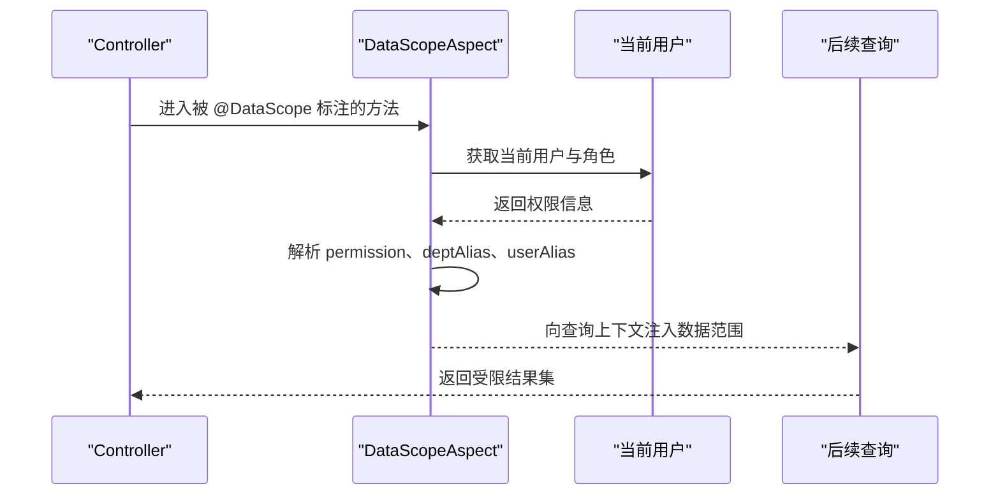

**图示来源**   
- [datascope/DataScope.java:17](file://zealux-ai-master/zealux-ai-common/zealux-ai-common-datascope/src/main/java/com/zealux/common/datascope/annotation/DataScope.java#L17)
- [datascope/DataScopeAspect.java:59-77](file://zealux-ai-master/zealux-ai-common/zealux-ai-common-datascope/src/main/java/com/zealux/common/datascope/aspect/DataScopeAspect.java#L59-L77)

**章节来源**   
- [datascope/AutoConfiguration.imports:1](file://zealux-ai-master/zealux-ai-common/zealux-ai-common-datascope/src/main/resources/META-INF/spring/org.springframework.boot.autoconfigure.AutoConfiguration.imports#L1)
- [datascope/DataScope.java:17](file://zealux-ai-master/zealux-ai-common/zealux-ai-common-datascope/src/main/java/com/zealux/common/datascope/annotation/DataScope.java#L17)
- [datascope/DataScopeAspect.java:59-77](file://zealux-ai-master/zealux-ai-common/zealux-ai-common-datascope/src/main/java/com/zealux/common/datascope/aspect/DataScopeAspect.java#L59-L77)

### ruoyi-common-sensitive 模块

该模块提供字段级敏感信息脱敏能力，但没有被父 pom 的 modules 列表包含，因此不会随 zealux-ai-common 一起构建。

- `@Sensitive`：标注实体字段，指定脱敏类型。
- `DesensitizedType`：定义手机号、邮箱、身份证、银行卡等脱敏策略。
- `SensitiveJsonSerializer`：通过 Jackson 的 `ContextualSerializer` 在 JSON 序列化时执行脱敏。

注意：该类引用的是 `com.zealux.common.sensitive.*` 包路径，而实际源码位于 `com.ruoyi.common.sensitive.*`，这是一个包名不一致的问题。若直接编译，可能产生包导入错误。

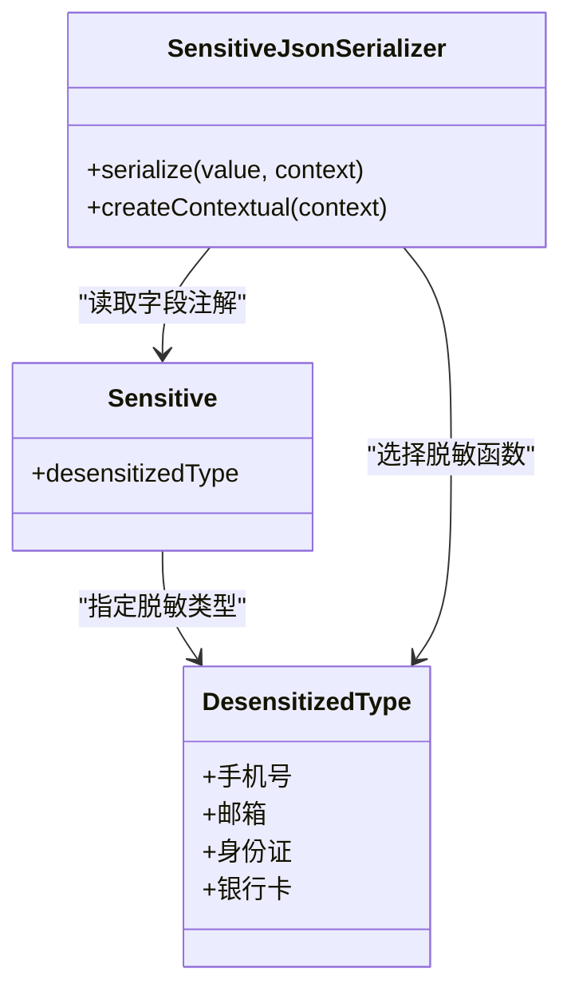

**图示来源**   
- [ruoyi-common-sensitive/Sensitive.java:18-23](file://zealux-ai-master/zealux-ai-common/ruoyi-common-sensitive/src/main/java/com/ruoyi/common/sensitive/annotation/Sensitive.java#L18-L23)
- [ruoyi-common-sensitive/SensitiveJsonSerializer.java:21-42](file://zealux-ai-master/zealux-ai-common/ruoyi-common-sensitive/src/main/java/com/ruoyi/common/sensitive/config/SensitiveJsonSerializer.java#L21-L42)
- [ruoyi-common-sensitive/DesensitizedType.java:11,50](file://zealux-ai-master/zealux-ai-common/ruoyi-common-sensitive/src/main/java/com/ruoyi/common/sensitive/enums/DesensitizedType.java#L11-L50)

**章节来源**   
- [ruoyi-common-sensitive/Sensitive.java:18-23](file://zealux-ai-master/zealux-ai-common/ruoyi-common-sensitive/src/main/java/com/ruoyi/common/sensitive/annotation/Sensitive.java#L18-L23)
- [ruoyi-common-sensitive/SensitiveJsonSerializer.java:21-42](file://zealux-ai-master/zealux-ai-common/ruoyi-common-sensitive/src/main/java/com/ruoyi/common/sensitive/config/SensitiveJsonSerializer.java#L21-L42)
- [ruoyi-common-sensitive/DesensitizedType.java:11,50](file://zealux-ai-master/zealux-ai-common/ruoyi-common-sensitive/src/main/java/com/ruoyi/common/sensitive/enums/DesensitizedType.java#L11-L50)

### ai 模块

ai 模块提供 AI 相关通用配置，重点包括聊天客户端配置和 Redis 向量存储配置。

- `ChatClientConfig`：装配聊天客户端相关 Bean。
- `RedisVectorConfig`：装配 Redis 向量能力相关 Bean。
- AutoConfiguration.imports 只注册了 `ChatClientConfig`；`RedisVectorConfig` 虽存在且为 `@Configuration`，但未被自动装配入口列出。

**章节来源**   
- [ai/AutoConfiguration.imports:1](file://zealux-ai-master/zealux-ai-common/zealux-ai-common-ai/src/main/resources/META-INF/spring/org.springframework.boot.autoconfigure.AutoConfiguration.imports#L1)
- [ai/ChatClientConfig.java:7-8](file://zealux-ai-master/zealux-ai-common/zealux-ai-common-ai/src/main/java/com/zealux/common/ai/config/ChatClientConfig.java#L7-L8)
- [ai/RedisVectorConfig.java:17,23](file://zealux-ai-master/zealux-ai-common/zealux-ai-common-ai/src/main/java/com/zealux/common/ai/config/RedisVectorConfig.java#L17-L23)

### seata 目录

zealux-ai-common-seata 目录下没有 Java 源码，只有 target 产物和 pom.xml。它属于分布式事务能力的占位模块，当前不包含任何可执行的 Java 实现，因此不应为其单独生成页面。

**章节来源**   
- [zealux-ai-common/pom.xml:12-23](file://zealux-ai-master/zealux-ai-common/pom.xml#L12-L23)

## 依赖关系分析

common 各模块之间存在明确的依赖方向：越靠近 core 的模块越基础，越靠近业务侧的模块越容易组合使用。

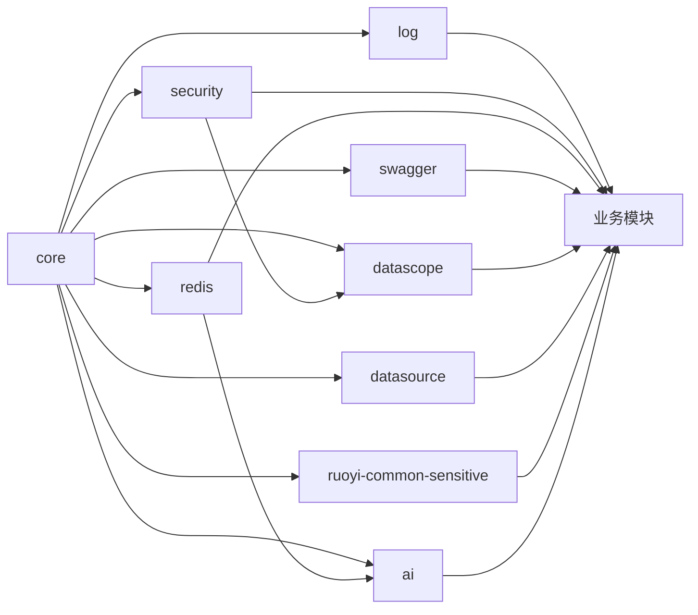

- core 是所有模块的基础。
- security、log、redis、swagger、datascope、datasource、sensitive、ai 都依赖 core。
- datascope 在运行时依赖 security 提供的当前用户和权限上下文。
- ai 依赖 redis 提供的向量存储能力。
- datasource 只提供注解，不反向依赖其他 common 模块。

**图示来源**   
- [core/AutoConfiguration.imports:1](file://zealux-ai-master/zealux-ai-common/zealux-ai-common-core/src/main/resources/META-INF/spring/org.springframework.boot.autoconfigure.AutoConfiguration.imports#L1)
- [security/AutoConfiguration.imports:1-5](file://zealux-ai-master/zealux-ai-common/zealux-ai-common-security/src/main/resources/META-INF/spring/org.springframework.boot.autoconfigure.AutoConfiguration.imports#L1-L5)
- [datascope/DataScopeAspect.java:76-77](file://zealux-ai-master/zealux-ai-common/zealux-ai-common-datascope/src/main/java/com/zealux/common/datascope/aspect/DataScopeAspect.java#L76-L77)
- [ai/RedisVectorConfig.java:17,23](file://zealux-ai-master/zealux-ai-common/zealux-ai-common-ai/src/main/java/com/zealux/common/ai/config/RedisVectorConfig.java#L17-L23)

**章节来源**   
- [core/AutoConfiguration.imports:1](file://zealux-ai-master/zealux-ai-common/zealux-ai-common-core/src/main/resources/META-INF/spring/org.springframework.boot.autoconfigure.AutoConfiguration.imports#L1)
- [security/AutoConfiguration.imports:1-5](file://zealux-ai-master/zealux-ai-common/zealux-ai-common-security/src/main/resources/META-INF/spring/org.springframework.boot.autoconfigure.AutoConfiguration.imports#L1-L5)
- [datascope/DataScopeAspect.java:76-77](file://zealux-ai-master/zealux-ai-common/zealux-ai-common-datascope/src/main/java/com/zealux/common/datascope/aspect/DataScopeAspect.java#L76-L77)
- [ai/RedisVectorConfig.java:17,23](file://zealux-ai-master/zealux-ai-common/zealux-ai-common-ai/src/main/java/com/zealux/common/ai/config/RedisVectorConfig.java#L17-L23)

## 典型用法示例

以下示例说明业务模块如何依赖和使用这些通用模块。为避免泄露真实凭据，所有账号、口令、token、API Key 均用占位形式表示。

### 启用 Redis 缓存

1. 在业务模块 pom 中引入 `zealux-ai-common-redis`。
2. 配置 Redis 连接信息（例如 host、port、password）。
3. 在业务 Service 中注入 `RedisService` 或直接注入 `RedisTemplate`。
4. 调用 `RedisService` 的 get/set/expire 等方法操作缓存。

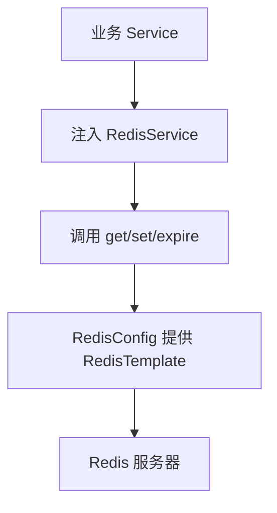

**图示来源**   
- [redis/RedisService.java:23-26](file://zealux-ai-master/zealux-ai-common/zealux-ai-common-redis/src/main/java/com/zealux/common/redis/service/RedisService.java#L23-L26)
- [redis/RedisConfig.java:22-28](file://zealux-ai-master/zealux-ai-common/zealux-ai-common-redis/src/main/java/com/zealux/common/redis/configure/RedisConfig.java#L22-L28)

### 添加 @Operlog 类型的操作日志

注意：代码中实际注解名为 `@Log`，而非 `@Operlog`。业务模块应使用 `@Log` 标记需要记录的操作方法。

1. 在 Controller 或 Service 方法上添加 `@Log`。
2. 填写模块名称、业务类型、操作类型等属性。
3. Spring Boot 启动后，`LogAspect` 会自动拦截该方法。
4. `AsyncLogService` 异步处理日志写入。

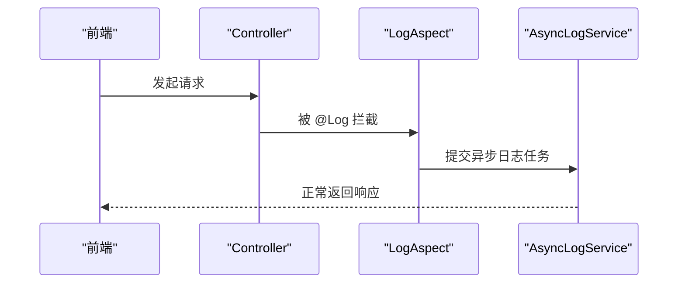

**图示来源**   
- [log/Log.java:17-20](file://zealux-ai-master/zealux-ai-common/zealux-ai-common-log/src/main/java/com/zealux/common/log/annotation/Log.java#L17-L20)
- [log/LogAspect.java:39-41](file://zealux-ai-master/zealux-ai-common/zealux-ai-common-log/src/main/java/com/zealux/common/log/aspect/LogAspect.java#L39-L41)
- [log/AsyncLogService.java:15-16](file://zealux-ai-master/zealux-ai-common/zealux-ai-common-log/src/main/java/com/zealux/common/log/service/AsyncLogService.java#L15-L16)

### 声明读写数据源

datasource 模块只提供 `@Master` 和 `@Slave` 注解，不实现路由逻辑。典型用法是：

1. 在 Mapper 或 Service 方法上使用 `@Master` 标注写操作。
2. 在查询方法上使用 `@Slave` 标注读操作。
3. 由业务模块或外部框架根据这两个注解动态切换数据源。

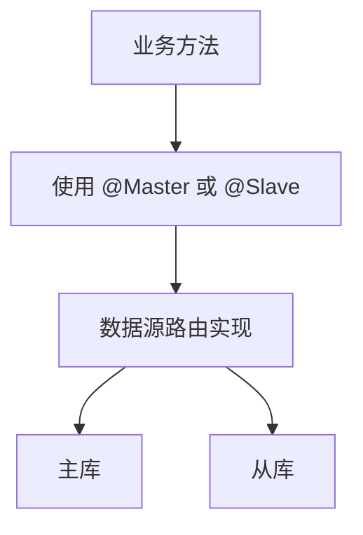

**图示来源**   
- [datasource/Master.java:19](file://zealux-ai-master/zealux-ai-common/zealux-ai-common-datasource/src/main/java/com/zealux/common/datasource/annotation/Master.java#L19)
- [datasource/Slave.java:19](file://zealux-ai-master/zealux-ai-common/zealux-ai-common-datasource/src/main/java/com/zealux/common/datasource/annotation/Slave.java#L19)

### 对敏感字段脱敏

1. 在实体类字段上加 `@Sensitive(desensitizedType = 某枚举)`。
2. 确保 Jackson 能够序列化该实体。
3. 返回给前端时，敏感字段会按 `DesensitizedType` 的规则脱敏。

注意事项：
- 该模块未被父 pom 构建。
- 注解和序列化器引用的是 `com.zealux.common.sensitive`，但源码包路径是 `com.ruoyi.common.sensitive`，需要修正包路径后再使用。

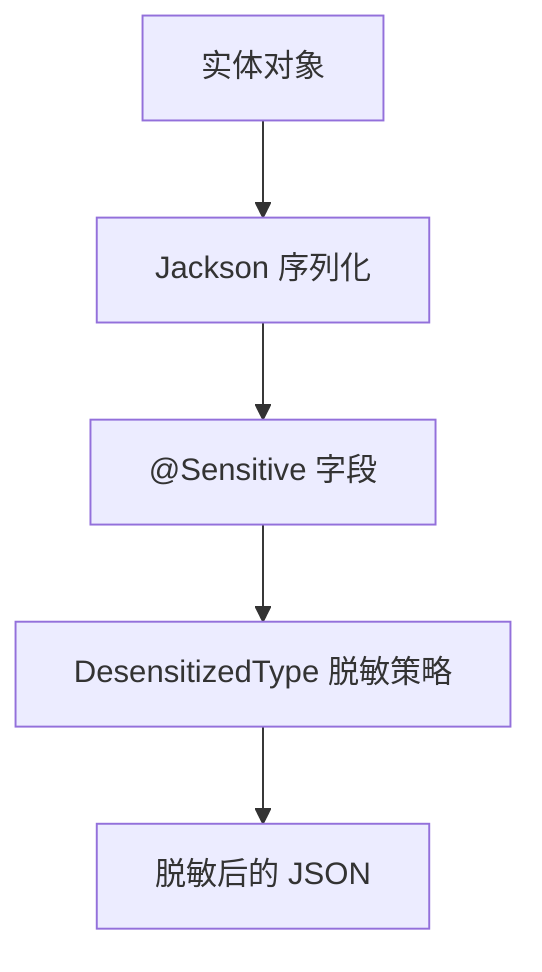

**图示来源**   
- [ruoyi-common-sensitive/Sensitive.java:18-23](file://zealux-ai-master/zealux-ai-common/ruoyi-common-sensitive/src/main/java/com/ruoyi/common/sensitive/annotation/Sensitive.java#L18-L23)
- [ruoyi-common-sensitive/SensitiveJsonSerializer.java:21-42](file://zealux-ai-master/zealux-ai-common/ruoyi-common-sensitive/src/main/java/com/ruoyi/common/sensitive/config/SensitiveJsonSerializer.java#L21-L42)
- [ruoyi-common-sensitive/DesensitizedType.java:11,50](file://zealux-ai-master/zealux-ai-common/ruoyi-common-sensitive/src/main/java/com/ruoyi/common/sensitive/enums/DesensitizedType.java#L11-L50)

### 在 Controller 上开启 Swagger 分组

1. 引入 `zealux-ai-common-swagger`。
2. 确保配置项 `springdoc.api-docs.enabled=true`。
3. 在 Controller 或 API 类上使用 springdoc 的标准注解（如 `@Tag`、`@Operation`）标注接口。
4. 启动后可访问 springdoc 生成的文档页面。

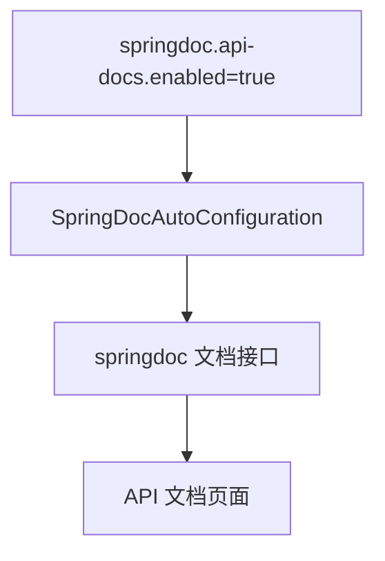

**图示来源**   
- [swagger/SpringDocAutoConfiguration.java:26-27](file://zealux-ai-master/zealux-ai-common/zealux-ai-common-swagger/src/main/java/com/zealux/common/swagger/config/SpringDocAutoConfiguration.java#L26-L27)
- [swagger/AutoConfiguration.imports:1](file://zealux-ai-master/zealux-ai-common/zealux-ai-common-swagger/src/main/resources/META-INF/spring/org.springframework.boot.autoconfigure.AutoConfiguration.imports#L1)

## 性能与可维护性考虑

### 异步日志降低主流程延迟

log 模块将日志写入交给 `AsyncLogService`，避免同步 I/O 阻塞 Controller 响应。对于高并发场景，应关注异步线程池大小、队列容量和日志落盘失败的重试策略。

### Redis 序列化一致性

redis 模块通过 `RedisConfig` 自定义 `RedisTemplate` 的序列化器。业务模块应保证序列化的对象与序列化器兼容，否则可能出现反序列化失败。

### 数据权限切面增加方法调用链

datascope 模块在每个带 `@DataScope` 的方法前增加一次权限解析。如果权限数据来自远程服务或复杂数据库查询，应避免在高频接口上滥用该注解。

### 自动装配过多可能影响启动速度

security、log、redis、swagger、datascope、ai 等模块都会注册多个 Bean。若业务模块不需要全部能力，应考虑按需引入依赖，而不是把所有 common 模块都打入最终 jar。

## 故障排查指南

| 现象 | 可能原因 | 排查步骤 |
|---|---|---|
| 引入 redis 模块后 RedisTemplate 无法注入 | Redis 配置缺失或连接失败 | 检查 Redis host、port、密码；确认 RedisConfig 已装配 |
| 加了 @Log 但没记录日志 | LogAspect 未生效或异步队列堆积 | 确认 log 模块依赖已引入；查看异步日志服务是否正常消费 |
| @Sensitive 字段没有脱敏 | 模块未构建或 Jackson 序列化未触发 | 检查父 pom 是否包含该模块；确认字段确实被 JSON 序列化；核对包路径 |
| @DataScope 不生效 | 当前用户或权限上下文为空 | 确认 security 模块已装配；检查登录流程和 TokenService |
| Swagger 文档不可用 | springdoc 被禁用 | 检查 `springdoc.api-docs.enabled` 配置 |
| ChatClientConfig 生效但 RedisVectorConfig 不生效 | RedisVectorConfig 未在 AutoConfiguration.imports 中注册 | 检查 ai 模块的 imports 文件 |
| 启动时报包导入错误 | sensitive 模块包路径不一致 | 将 `com.zealux.common.sensitive` 改为 `com.ruoyi.common.sensitive` 或统一包名 |

**章节来源**   
- [redis/RedisConfig.java:22-28](file://zealux-ai-master/zealux-ai-common/zealux-ai-common-redis/src/main/java/com/zealux/common/redis/configure/RedisConfig.java#L22-L28)
- [log/LogAspect.java:39-41](file://zealux-ai-master/zealux-ai-common/zealux-ai-common-log/src/main/java/com/zealux/common/log/aspect/LogAspect.java#L39-L41)
- [datascope/DataScopeAspect.java:59-77](file://zealux-ai-master/zealux-ai-common/zealux-ai-common-datascope/src/main/java/com/zealux/common/datascope/aspect/DataScopeAspect.java#L59-L77)
- [swagger/SpringDocAutoConfiguration.java:26-27](file://zealux-ai-master/zealux-ai-common/zealux-ai-common-swagger/src/main/java/com/zealux/common/swagger/config/SpringDocAutoConfiguration.java#L26-L27)
- [ai/AutoConfiguration.imports:1](file://zealux-ai-master/zealux-ai-common/zealux-ai-common-ai/src/main/resources/META-INF/spring/org.springframework.boot.autoconfigure.AutoConfiguration.imports#L1)
- [ruoyi-common-sensitive/SensitiveJsonSerializer.java:13-14](file://zealux-ai-master/zealux-ai-common/ruoyi-common-sensitive/src/main/java/com/ruoyi/common/sensitive/config/SensitiveJsonSerializer.java#L13-L14)

## 结论

zealux-ai-common 的本质是一个以 Spring Boot 自动装配为核心的公共能力聚合层。它的价值不在于提供一个完整业务系统，而在于把跨模块复用的横切能力拆成可独立引入的 Maven 子模块。

在实际使用中，应重点关注以下边界：

1. core 是所有模块的基础，适合引入几乎所有后端服务。
2. security、log、redis、swagger、datascope、ai 通过 AutoConfiguration.imports 自动装配。
3. datasource 只提供注解，不提供路由实现。
4. ruoyi-common-sensitive 有源码但未参与构建，且包路径存在不一致问题。
5. seata 目录没有 Java 实现，不应视为已实现的分布式事务功能。
6. 业务模块应按需引入依赖，避免把所有 common 模块都打包进最终产物。