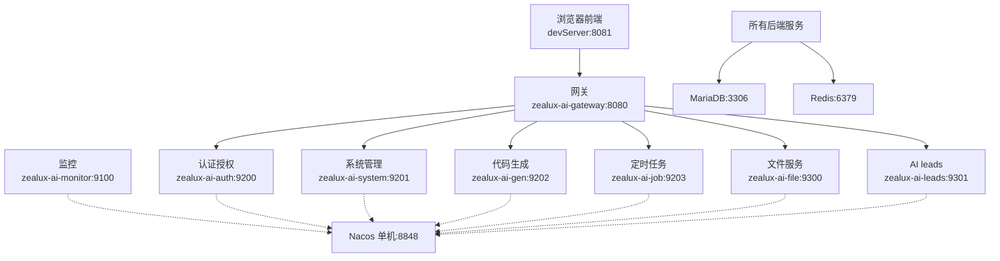
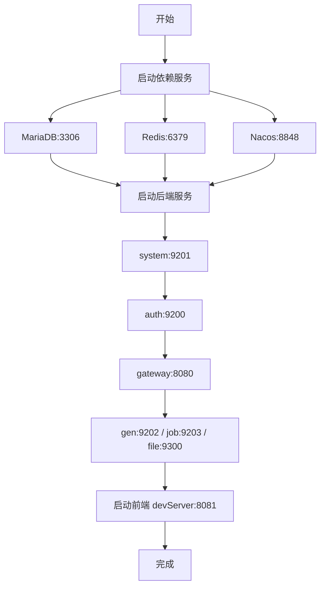
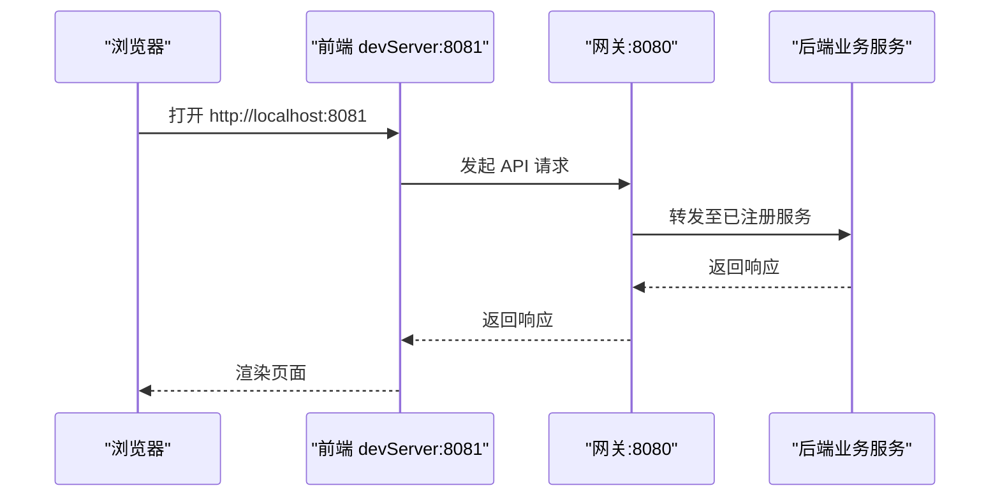
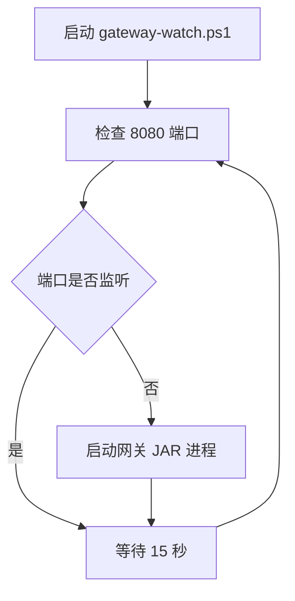

# 开发环境部署

<cite>
**本文引用的文件**   
- [start-all.ps1](file://_setup/start-all.ps1)
- [gateway-watch.ps1](file://_setup/gateway-watch.ps1)
- [bootstrap.yml（网关）](file://zealux-ai-master/zealux-ai-gateway/src/main/resources/bootstrap.yml)
- [bootstrap.yml（认证）](file://zealux-ai-master/zealux-ai-auth/src/main/resources/bootstrap.yml)
- [bootstrap.yml（系统）](file://zealux-ai-master/zealux-ai-modules/zealux-ai-system/src/main/resources/bootstrap.yml)
- [bootstrap.yml（代码生成）](file://zealux-ai-master/zealux-ai-modules/zealux-ai-gen/src/main/resources/bootstrap.yml)
- [bootstrap.yml（定时任务）](file://zealux-ai-master/zealux-ai-modules/zealux-ai-job/src/main/resources/bootstrap.yml)
- [bootstrap.yml（文件服务）](file://zealux-ai-master/zealux-ai-modules/zealux-ai-file/src/main/resources/bootstrap.yml)
- [bootstrap.yml（AI leads）](file://zealux-ai-master/zealux-ai-modules/zealux-ai-leads/src/main/resources/bootstrap.yml)
- [bootstrap.yml（监控）](file://zealux-ai-master/zealux-ai-visual/zealux-ai-monitor/src/main/resources/bootstrap.yml)
- [application-dev.yml（Nacos 本地配置快照）](file://_setup/stack/nacos/nacos/data/config-data/DEFAULT_GROUP/application-dev.yml)
- [package.json（前端主包）](file://zealux-ai-ui-master/package.json)
</cite>

## 目录
1. [引言](#引言)
2. [项目结构](#项目结构)
3. [运行环境与依赖](#运行环境与依赖)
4. [端口规划](#端口规划)
5. [首次启动顺序](#首次启动顺序)
6. [后端服务配置要求](#后端服务配置要求)
7. [前端安装与启动](#前端安装与启动)
8. [脚本说明](#脚本说明)
9. [常见问题排查](#常见问题排查)
10. [生产部署注意事项](#生产部署注意事项)

## 引言
本指南面向在 Windows 本机搭建 RuoYi-Cloud 二次开发环境的开发者。当前仓库是开源 RuoYi-Cloud 的重命名二次开发，根 Maven 模块 artifactId 为 zealux-ai、版本为 3.6.5；多数 Java 启动类仍保留原 RuoYi*Application.java 命名，前端 package.json 名称仍为 ruoyi@3.6.5。工作区 `_setup` 目录下包含 JDK17、Maven 3.9.9、MariaDB 11.4.4、Redis 和 Nacos 单机版的本地二进制、数据目录与调试脚本，用于在本机一次性拉起全部依赖和本端后端服务。

需要特别区分两份前端源码：独立仓库 `zealux-ai-ui-master` 是真正的前端源码；`zealux-ai-master/zealux-ai-ui` 是其逐字节重复拷贝，不参与根 pom.xml 构建，也不应作为第二个前端模块。

## 项目结构
本仓库采用微服务多模块 Maven 工程，核心关系如下：

**图表来源**
- [bootstrap.yml（网关）:1-44](file://zealux-ai-master/zealux-ai-gateway/src/main/resources/bootstrap.yml#L1-L44)
- [bootstrap.yml（认证）:1-25](file://zealux-ai-master/zealux-ai-auth/src/main/resources/bootstrap.yml#L1-L25)
- [bootstrap.yml（系统）:1-25](file://zealux-ai-master/zealux-ai-modules/zealux-ai-system/src/main/resources/bootstrap.yml#L1-L25)
- [bootstrap.yml（代码生成）:1-25](file://zealux-ai-master/zealux-ai-modules/zealux-ai-gen/src/main/resources/bootstrap.yml#L1-L25)
- [bootstrap.yml（定时任务）:1-25](file://zealux-ai-master/zealux-ai-modules/zealux-ai-job/src/main/resources/bootstrap.yml#L1-L25)
- [bootstrap.yml（文件服务）:1-25](file://zealux-ai-master/zealux-ai-modules/zealux-ai-file/src/main/resources/bootstrap.yml#L1-L25)
- [bootstrap.yml（AI leads）:1-27](file://zealux-ai-master/zealux-ai-modules/zealux-ai-leads/src/main/resources/bootstrap.yml#L1-L27)
- [bootstrap.yml（监控）:1-25](file://zealux-ai-master/zealux-ai-visual/zealux-ai-monitor/src/main/resources/bootstrap.yml#L1-L25)

**章节来源**
- [start-all.ps1:1-71](file://_setup/start-all.ps1#L1-L71)

## 运行环境与依赖
| 组件 | 版本 | 位置或用途 |
|---|---:|---|
| JDK | 17 | `_setup/stack/jdk17/jdk-17.0.21+9/bin/java.exe`，由启动脚本直接调用 |
| Maven | 3.9.9 | `_setup/stack/maven/apache-maven-3.9.9/`，用于编译后端模块 |
| MariaDB | 11.4.4 | `_setup/stack/mariadb/mariadb-11.4.4-winx64/`，默认监听 3306 |
| Redis | 未显式标注版本号 | `_setup/stack/redis/redis-server.exe`，默认监听 6379 |
| Nacos | 单机模式 | `_setup/stack/nacos/nacos/`，默认监听 8848 |
| Node.js / npm | 满足 `>=8.9` / `>=3.0.0` | 通过 `zealux-ai-ui-master/package.json` 的 engines 声明约束 |
| pnpm | 存在缓存 | `_setup/pnpm-store/v3/files/`，可复用已缓存包 |

这些二进制和数据目录位于工作区根下的 `_setup`，属于本地调试辅助产物，不应被当作仓库源码的一部分提交到生产环境。

**章节来源**
- [start-all.ps1:1-71](file://_setup/start-all.ps1#L1-L71)
- [package.json:1-90](file://zealux-ai-ui-master/package.json#L1-L90)

## 端口规划
| 服务 | 端口 | 说明 |
|---|---:|---|
| 网关 | 8080 | `zealux-ai-gateway`，统一入口 |
| 认证授权 | 9200 | `zealux-ai-auth` |
| 系统管理 | 9201 | `zealux-ai-system` |
| 代码生成 | 9202 | `zealux-ai-gen` |
| 定时任务 | 9203 | `zealux-ai-job` |
| 文件服务 | 9300 | `zealux-ai-file` |
| AI leads | 9301 | `zealux-ai-leads` |
| 监控 | 9100 | `zealux-ai-monitor` |
| Nacos | 8848 | 注册中心与配置中心 |
| MariaDB | 3306 | 数据库 |
| Redis | 6379 | 缓存与会话存储 |
| 前端 devServer | 8081 | `zealux-ai-ui-master` 默认开发端口 |

各后端服务的 `server.port` 定义如下：

| 服务 | bootstrap.yml 中的端口 |
|---|---|
| 网关 | 8080 |
| 认证 | 9200 |
| 系统 | 9201 |
| 代码生成 | 9202 |
| 定时任务 | 9203 |
| 文件服务 | 9300 |
| AI leads | 9301 |
| 监控 | 9100 |

**章节来源**
- [bootstrap.yml（网关）:2-4](file://zealux-ai-master/zealux-ai-gateway/src/main/resources/bootstrap.yml#L2-L4)
- [bootstrap.yml（认证）:2-4](file://zealux-ai-master/zealux-ai-auth/src/main/resources/bootstrap.yml#L2-L4)
- [bootstrap.yml（系统）:2-4](file://zealux-ai-master/zealux-ai-modules/zealux-ai-system/src/main/resources/bootstrap.yml#L2-L4)
- [bootstrap.yml（代码生成）:2-4](file://zealux-ai-master/zealux-ai-modules/zealux-ai-gen/src/main/resources/bootstrap.yml#L2-L4)
- [bootstrap.yml（定时任务）:2-4](file://zealux-ai-master/zealux-ai-modules/zealux-ai-job/src/main/resources/bootstrap.yml#L2-L4)
- [bootstrap.yml（文件服务）:2-4](file://zealux-ai-master/zealux-ai-modules/zealux-ai-file/src/main/resources/bootstrap.yml#L2-L4)
- [bootstrap.yml（AI leads）:2-4](file://zealux-ai-master/zealux-ai-modules/zealux-ai-leads/src/main/resources/bootstrap.yml#L2-L4)
- [bootstrap.yml（监控）:2-4](file://zealux-ai-master/zealux-ai-visual/zealux-ai-monitor/src/main/resources/bootstrap.yml#L2-L4)

## 首次启动顺序
推荐按以下顺序启动：

1. **启动依赖服务**：MariaDB、Redis、Nacos。
   - MariaDB 使用 3306 端口。
   - Redis 使用 6379 端口。
   - Nacos 以单机模式 `-Dnacos.standalone=true` 启动，监听 8848。
2. **启动后端服务**：先启动系统服务，再启动认证服务，最后启动网关与其他业务服务。
3. **启动前端 devServer**：进入 `zealux-ai-ui-master` 并执行前端开发命令。

**图表来源**
- [start-all.ps1:1-71](file://_setup/start-all.ps1#L1-L71)

**章节来源**
- [start-all.ps1:1-71](file://_setup/start-all.ps1#L1-L71)

## 后端服务配置要求
所有后端服务都通过 `bootstrap.yml` 指定应用名、活跃环境、Nacos 发现地址与配置中心地址，并加载共享配置 `application-${spring.profiles.active}.yml`。因此，每个服务必须确保下列字段正确：

| 配置项 | 含义 | 必填说明 |
|---|---|---|
| `spring.application.name` | 服务名，决定 Nacos 中服务注册名与部分配置 dataId | 每个服务不同，例如 `zealux-ai-gateway`、`zealux-ai-auth`、`zealux-ai-system` 等 |
| `spring.profiles.active` | 激活的环境，脚本和配置均使用 `dev` | 本地开发一般为 `dev` |
| `spring.cloud.nacos.discovery.server-addr` | Nacos 服务注册地址 | 单机版通常为 `127.0.0.1:8848` |
| `spring.cloud.nacos.config.server-addr` | Nacos 配置中心地址 | 单机版通常为 `127.0.0.1:8848` |
| `spring.cloud.nacos.config.file-extension` | 配置文件扩展名 | 当前为 `yml` |
| `spring.cloud.nacos.config.shared-configs` | 共享配置列表 | 当前指向 `application-${spring.profiles.active}.yml` |
| `dataId` | Nacos 中具体配置文件标识 | 常见值为 `zealux-ai-gateway-dev.yml`、`zealux-ai-auth-dev.yml`、`zealux-ai-system-dev.yml`、`zealux-ai-gen-dev.yml`、`zealux-ai-job-dev.yml`、`zealux-ai-file-dev.yml`、`zealux-ai-leads-dev.yml`、`zealux-ai-monitor-dev.yml` |
| 数据库 URL | `spring.datasource.url` 或动态数据源对应的连接串 | 指向本机 MariaDB，例如 JDBC URL 占位符 |
| 数据库用户名 | `spring.datasource.username` | 示例占位符 |
| 数据库口令 | `spring.datasource.password` | 示例占位符 |
| Redis host | `spring.redis.host` | 单机版通常为 `127.0.0.1` |
| Redis port | `spring.redis.port` | 默认 `6379` |
| MinIO endpoint | MinIO 对象存储访问地址 | 示例占位符 |
| MinIO accessKey | MinIO 访问密钥 | 示例占位符 |
| MinIO secretKey | MinIO 秘密密钥 | 示例占位符 |
| MinIO bucketName | MinIO 存储桶名称 | 示例占位符 |

### 各服务关键 bootstrap.yml 字段
| 服务 | `spring.application.name` | `server.port` | Nacos discovery/server-addr |
|---|---|---:|---|
| 网关 | `zealux-ai-gateway` | 8080 | `127.0.0.1:8848` |
| 认证 | `zealux-ai-auth` | 9200 | `127.0.0.1:8848` |
| 系统 | `zealux-ai-system` | 9201 | `127.0.0.1:8848` |
| 代码生成 | `zealux-ai-gen` | 9202 | `127.0.0.1:8848` |
| 定时任务 | `zealux-ai-job` | 9203 | `127.0.0.1:8848` |
| 文件服务 | `zealux-ai-file` | 9300 | `127.0.0.1:8848` |
| AI leads | `zealux-ai-leads` | 9301 | `127.0.0.1:8848` |
| 监控 | `zealux-ai-monitor` | 9100 | `127.0.0.1:8848` |

### Nacos 配置清单
由于各服务启用 Nacos 配置中心，并在 `shared-configs` 中引用 `application-${spring.profiles.active}.yml`，因此 Nacos 中至少需要存在对应 dataId 的配置。仓库工作区的本地 Nacos 快照中存在 `application-dev.yml`，同时存在 `zealux-ai-gen-dev.yml` 与 `zealux-ai-job-dev.yml` 的注释行；其余 dataId（如 `zealux-ai-gateway-dev.yml`、`zealux-ai-auth-dev.yml`、`zealux-ai-system-dev.yml`、`zealux-ai-file-dev.yml`、`zealux-ai-leads-dev.yml`、`zealux-ai-monitor-dev.yml`）应根据实际运行时错误确认是否已在 Nacos 控制台创建。

| dataId | 用途 | 是否必须在 Nacos 中存在 |
|---|---|---|
| `application-dev.yml` | 共享开发环境配置 | 是 |
| `zealux-ai-gateway-dev.yml` | 网关专用配置 | 若该 dataId 被引用则必须存在 |
| `zealux-ai-auth-dev.yml` | 认证专用配置 | 若该 dataId 被引用则必须存在 |
| `zealux-ai-system-dev.yml` | 系统管理专用配置 | 若该 dataId 被引用则必须存在 |
| `zealux-ai-gen-dev.yml` | 代码生成专用配置 | 是（本地快照存在） |
| `zealux-ai-job-dev.yml` | 定时任务专用配置 | 是（本地快照存在） |
| `zealux-ai-file-dev.yml` | 文件服务专用配置 | 若该 dataId 被引用则必须存在 |
| `zealux-ai-leads-dev.yml` | AI leads 专用配置 | 若该 dataId 被引用则必须存在 |
| `zealux-ai-monitor-dev.yml` | 监控专用配置 | 若该 dataId 被引用则必须存在 |

### 数据库、Redis、MinIO 配置建议
- 数据库相关字段应在对应 dataId 或共享配置中填写 MariaDB 连接信息，包括 JDBC URL、用户名、口令。
- Redis 相关字段应填写 `127.0.0.1:6379` 或本机实际地址。
- MinIO 相关字段应填写对象存储 endpoint、accessKey、secretKey 与 bucketName。
- 不要在文档正文中粘贴真实账号、口令、token 或 api-key；示例一律使用占位形式。

**章节来源**
- [bootstrap.yml（网关）:1-44](file://zealux-ai-master/zealux-ai-gateway/src/main/resources/bootstrap.yml#L1-L44)
- [bootstrap.yml（认证）:1-25](file://zealux-ai-master/zealux-ai-auth/src/main/resources/bootstrap.yml#L1-L25)
- [bootstrap.yml（系统）:1-25](file://zealux-ai-master/zealux-ai-modules/zealux-ai-system/src/main/resources/bootstrap.yml#L1-L25)
- [bootstrap.yml（代码生成）:1-25](file://zealux-ai-master/zealux-ai-modules/zealux-ai-gen/src/main/resources/bootstrap.yml#L1-L25)
- [bootstrap.yml（定时任务）:1-25](file://zealux-ai-master/zealux-ai-modules/zealux-ai-job/src/main/resources/bootstrap.yml#L1-L25)
- [bootstrap.yml（文件服务）:1-25](file://zealux-ai-master/zealux-ai-modules/zealux-ai-file/src/main/resources/bootstrap.yml#L1-L25)
- [bootstrap.yml（AI leads）:1-27](file://zealux-ai-master/zealux-ai-modules/zealux-ai-leads/src/main/resources/bootstrap.yml#L1-L27)
- [bootstrap.yml（监控）:1-25](file://zealux-ai-master/zealux-ai-visual/zealux-ai-monitor/src/main/resources/bootstrap.yml#L1-L25)
- [application-dev.yml（Nacos 本地配置快照）:1-35](file://_setup/stack/nacos/nacos/data/config-data/DEFAULT_GROUP/application-dev.yml#L1-L35)

## 前端安装与启动
前端源码以 `zealux-ai-ui-master` 为准。该目录的 `package.json` 将开发命令定义为 `vue-cli-service serve`，依赖 Vue 2、Element UI、Axios、ECharts 等前端库。

### 安装步骤
1. 进入 `zealux-ai-ui-master`。
2. 安装依赖。如果已有 pnpm 缓存，可使用 pnpm；否则也可使用 npm。
3. 若安装失败，优先检查 Node.js 版本是否满足 engines 声明中的要求。

### 启动 devServer
1. 在 `zealux-ai-ui-master` 中执行前端开发命令。
2. 默认监听 8081 端口。
3. 浏览器访问 `http://localhost:8081`，再由前端请求网关 8080。

**图表来源**
- [package.json:1-90](file://zealux-ai-ui-master/package.json#L1-L90)
- [bootstrap.yml（网关）:1-44](file://zealux-ai-master/zealux-ai-gateway/src/main/resources/bootstrap.yml#L1-L44)

**章节来源**
- [package.json:1-90](file://zealux-ai-ui-master/package.json#L1-L90)

## 脚本说明
### start-all.ps1
`_setup/start-all.ps1` 是 Windows 下批量启动本地开发环境的 PowerShell 脚本，主要行为如下：

- 创建日志目录 `_setup/logs`。
- 如果 3306 端口未监听，自动启动 MariaDB。
- 如果 6379 端口未监听，自动启动 Redis。
- 如果 8848 端口未监听，自动以单机模式启动 Nacos，并等待其端口可用后拉取一个共享配置。
- 按固定顺序启动后端服务：system → auth → gateway → gen → job → file。
- 如果 8081 端口未监听，启动 `zealux-ai-ui-master` 的前端 devServer。
- 启动完成后进入无限循环，每 60 秒检查一次。

该脚本明确体现“system 必须先于 auth，gateway 必须在 auth 之后”的服务依赖关系。

### gateway-watch.ps1
`_setup/gateway-watch.ps1` 是网关进程守护脚本：只要 8080 端口不再监听，就重新启动 `zealux-ai-gateway.jar`，并将输出重定向到 `_setup/logs/gateway.out.log` 与 `_setup/logs/gateway.err.log`。它适合在修改网关路由或 Sentinel 配置后观察网关重启过程。

**图表来源**
- [gateway-watch.ps1:1-15](file://_setup/gateway-watch.ps1#L1-L15)

**章节来源**
- [start-all.ps1:1-71](file://_setup/start-all.ps1#L1-L71)
- [gateway-watch.ps1:1-15](file://_setup/gateway-watch.ps1#L1-L15)

## 常见问题排查
| 现象 | 可能原因 | 处理建议 |
|---|---|---|
| 启动脚本无法启动 MariaDB | 3306 端口已被占用，或 `_setup/stack/mariadb` 路径不存在 | 检查端口占用；确认脚本中的 JDK、MariaDB 路径与本机一致 |
| 启动脚本无法启动 Redis | 6379 端口已被占用 | 停止占用 6379 的进程 |
| Nacos 启动后 8848 端口不可用 | JDK 路径或 Nacos 路径不正确，或内存参数不足 | 检查 `JAVA_HOME`、`nacos.home` 及 JVM 参数 |
| 后端服务启动时报 Nacos 连接失败 | Nacos 未启动或 `nacos.discovery.server-addr`、`nacos.config.server-addr` 配置错误 | 确认 Nacos 监听 8848，且各服务 bootstrap.yml 中地址为 `127.0.0.1:8848` |
| 服务启动时报找不到 Nacos dataId | Nacos 中缺少 `application-dev.yml` 或对应 `zealux-ai-*-dev.yml` | 在 Nacos 控制台创建缺失的 dataId |
| 数据库连接失败 | JDBC URL、用户名或口令错误 | 检查 Nacos 中对应 dataId 的数据库配置 |
| Redis 连接失败 | Redis 未启动或端口不是 6379 | 手动启动 `_setup/stack/redis/redis-server.exe` |
| MinIO 上传失败 | endpoint、accessKey、secretKey、bucketName 配置错误 | 核对 MinIO 配置，不要泄露真实凭据 |
| 网关启动成功但前端无法访问 | 网关未注册系统服务、路由错误或系统服务尚未启动 | 先启动 system，再启动 auth，最后启动 gateway |
| 前端 devServer 无法启动 | Node.js 版本不满足要求或依赖安装失败 | 升级 Node.js，重新安装依赖 |
| 修改网关配置后未生效 | 未触发网关重启 | 使用 `gateway-watch.ps1` 或在 Nacos 推送配置后重启网关 |

## 生产部署注意事项
- `_setup/start-all.ps1` 与 `_setup/gateway-watch.ps1` 仅用于本地调试，不应直接作为生产部署方案。
- 脚本中硬编码了本机绝对路径，例如 JDK、MariaDB、Redis、Nacos、JAR 包和日志目录；生产环境应使用容器、进程管理器或云原生部署方式。
- 生产环境不应把本地 Nacos 落盘副本、`_setup/stack` 下的临时文件当作正式配置。
- 数据库初始化脚本 `_setup/sql/ry_20240629.sql`、`quartz.sql`、`ry_config_20240902.sql` 是 RuoYi-Cloud 与 Nacos 的第三方初始化脚本，不能描述成本系统的数据库设计。
- 前端只应以 `zealux-ai-ui-master` 为准；`zealux-ai-master/zealux-ai-ui` 是重复拷贝，不参与构建。
- 本仓库未包含 CRM 表结构；任何 CRM 相关能力都不应描述为已实现功能。
- 敏感配置（数据库口令、MinIO 密钥、Nacos 凭证等）不得写入源码仓库；应通过 Nacos 配置中心或环境变量注入。