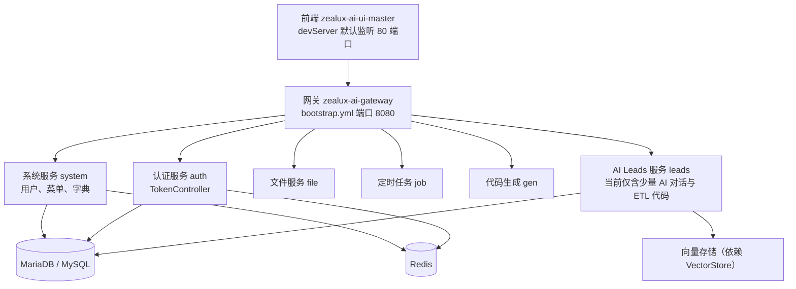
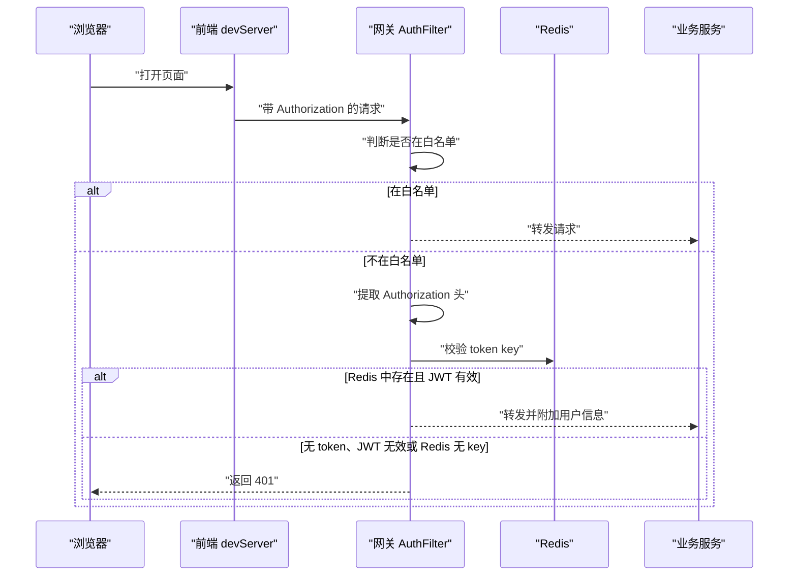

# 故障排查清单

<cite>
**本文引用的文件**   
- [zealux-ai-gateway/src/main/resources/bootstrap.yml](file://zealux-ai-master/zealux-ai-gateway/src/main/resources/bootstrap.yml)
- [AuthFilter.java](file://zealux-ai-master/zealux-ai-gateway/src/main/java/com/zealux/gateway/filter/AuthFilter.java)
- [IgnoreWhiteProperties.java](file://zealux-ai-master/zealux-ai-gateway/src/main/java/com/zealux/gateway/config/properties/IgnoreWhiteProperties.java)
- [TokenController.java](file://zealux-ai-master/zealux-ai-auth/src/main/java/com/zealux/auth/controller/TokenController.java)
- [TokenService.java](file://zealux-ai-master/zealux-ai-common/zealux-ai-common-security/src/main/java/com/zealux/common/security/service/TokenService.java)
- [AuthUtil.java](file://zealux-ai-master/zealux-ai-common/zealux-ai-common-security/src/main/java/com/zealux/common/security/auth/AuthUtil.java)
- [CacheConstants.java](file://zealux-ai-master/zealux-ai-common/zealux-ai-common-core/src/main/java/com/zealux/common/core/constant/CacheConstants.java)
- [AiMessageMapper.java](file://zealux-ai-master/zealux-ai-modules/zealux-ai-leads/src/main/java/com/zealux/leads/mapper/AiMessageMapper.java)
- [AiMessage.java](file://zealux-ai-master/zealux-ai-modules/zealux-ai-leads/src/main/java/com/zealux/leads/domain/AiMessage.java)
- [AiSession.java](file://zealux-ai-master/zealux-ai-modules/zealux-ai-leads/src/main/java/com/zealux/leads/domain/AiSession.java)
- [ETLController.java](file://zealux-ai-master/zealux-ai-modules/zealux-ai-leads/src/main/java/com/zealux/leads/controller/ETLController.java)
- [vue.config.js](file://zealux-ai-ui-master/vue.config.js)
- [request.js](file://zealux-ai-ui-master/src/utils/request.js)
- [auth.js](file://zealux-ai-ui-master/src/utils/auth.js)
- [user.js](file://zealux-ai-ui-master/src/store/modules/user.js)
- [permission.js](file://zealux-ai-ui-master/src/permission.js)
</cite>

## 目录
1. [引言](#引言)
2. [项目结构定位](#项目结构定位)
3. [通用排查原则](#通用排查原则)
4. [Nacos 连接失败导致配置或注册中心不可用](#nacos-连接失败导致配置或注册中心不可用)
5. [Redis 无响应导致验证码、Token、字典缓存失效](#redis-无响应导致验证码token字典缓存失效)
6. [MySQL/MariaDB 连接池耗尽或表不存在](#mysqlmariadb-连接池耗尽或表不存在)
7. [网关返回 401/403](#网关返回-401403)
8. [业务服务启动成功但无法被网关路由](#业务服务启动成功但无法被网关路由)
9. [前端 devServer 无法代理后端接口或跨域报错](#前端-devserver-无法代理后端接口或跨域报错)
10. [Zealux-AI Leads 服务端口 9301 无法运行](#zealux-ai-leads-服务端口-9301-无法运行)
11. [Redis 缺少 RediSearch 导致向量检索不可用](#redis-缺少-redisearch-导致向量检索不可用)
12. [服务启动 OOM 或 CPU 飙升](#服务启动-oom-或-cpu-飙升)
13. [快速核对表](#快速核对表)
14. [结论](#结论)

## 引言
本清单面向开发与运维，按“现象→可能原因→定位步骤→解决方案”组织。系统基于开源 RuoYi-Cloud 3.6.5 重命名二次开发：根 POM 的 artifactId 为 zealux-ai、版本为 3.6.5；部分启动类仍沿用 RuoYi*Application 命名，公共库中仍存在 ruoyi-common-sensitive 等历史目录名。文档只描述仓库中可核验的实现与配置，不将未落地的 CRM 设计或草稿当作已实现能力。

## 项目结构定位
排查时应先确认问题发生在哪个层次：

**图示来源**   
- [bootstrap.yml:1-44](file://zealux-ai-master/zealux-ai-gateway/src/main/resources/bootstrap.yml#L1-L44)
- [TokenController.java:1-78](file://zealux-ai-master/zealux-ai-auth/src/main/java/com/zealux/auth/controller/TokenController.java#L1-L78)
- [Request.js:1-152](file://zealux-ai-ui-master/src/utils/request.js#L1-L152)
- [Vue.config.js:1-131](file://zealux-ai-ui-master/vue.config.js#L1-L131)

**章节来源**   
- [bootstrap.yml:1-44](file://zealux-ai-master/zealux-ai-gateway/src/main/resources/bootstrap.yml#L1-L44)
- [Vue.config.js:1-131](file://zealux-ai-ui-master/vue.config.js#L1-L131)

## 通用排查原则
- 区分“代码中存在的问题”和“本地环境未就绪”。前者表现为配置正确但逻辑错误；后者表现为依赖组件未启动、端口冲突、数据库或 Redis 未初始化。
- 不要在生产日志或文档中粘贴真实账号、口令、token、api-key。示例统一使用占位形式「账号与口令见本地凭据记录」。
- 优先判断请求是否到达网关：前端 devServer、网关、业务服务、数据库、Redis、Nacos 是五层依赖链。
- 排查 Nacos 配置时只写服务名与 dataId，不要引用 _setup 下的本地重建件；_setup 属于工作区临时产物，不是仓库内容。
- 排查网关路由时只能引用 zealux-ai-gateway/src/main/resources 及 gateway 模块源码。

## Nacos 连接失败导致配置或注册中心不可用

**现象**
- 网关或服务启动时报 Nacos 连接异常。
- 服务能启动但无法拉取共享配置 application-dev.yml。
- 其他服务无法通过注册中心发现该服务。

**可能原因**
1. Nacos 服务器未启动或端口 8848 不可访问。
2. bootstrap.yml 中 nacos.discovery.server-addr 或 nacos.config.server-addr 指向了错误的地址。
3. Nacos 上缺少对应服务的配置 dataId，例如 zealux-ai-gateway-dev.yml。
4. 网络策略或防火墙阻断了本机到 127.0.0.1:8848 的连接。

**定位步骤**
1. 检查网关 bootstrap.yml 中的 Nacos 地址：
   - 路径：`zealux-ai-master/zealux-ai-gateway/src/main/resources/bootstrap.yml`
   - 关键项：`spring.cloud.nacos.discovery.server-addr`、`spring.cloud.nacos.config.server-addr`，当前默认值为 `127.0.0.1:8848`。
2. 在本地验证 Nacos 是否可用：
   - 访问 Nacos 控制台地址 `http://127.0.0.1:8848/nacos`。
   - 检查是否存在 `DEFAULT_GROUP` 下对应服务的 dev 配置。
3. 查看网关和服务启动日志，搜索关键字：
   - `nacos`
   - `connect to server failed`
   - `config service not available`
   - `discovery service not available`
4. 检查 Nacos 控制台的服务列表，确认服务是否注册成功。

**解决方案**
- 启动本地 Nacos，并确保 8848 端口未被占用。
- 若使用远程 Nacos，修改 bootstrap.yml 中的 server-addr 并校验网络连通性。
- 在 Nacos 控制台发布对应服务的配置文件，dataId 通常为 `服务名-dev.yml`。
- 如果只需要本地调试且不依赖远端配置，应明确生产与本地环境的差异，避免把 _setup 下的临时配置误认为仓库配置。

**章节来源**   
- [bootstrap.yml:1-44](file://zealux-ai-master/zealux-ai-gateway/src/main/resources/bootstrap.yml#L1-L44)

## Redis 无响应导致验证码、Token、字典缓存失效

**现象**
- 登录时验证码无效。
- 登录后立即返回 401，提示令牌过期或登录状态已过期。
- 字典数据为空或每次刷新都重新加载。
- Token 刷新、退出登录、会话查询失败。

**可能原因**
1. Redis 服务未启动或连接地址错误。
2. Redis 密码、端口、数据库索引与配置不一致。
3. Redis 内存不足或被清空。
4. Redis 缺少 RediSearch 扩展（影响向量检索）。
5. 应用侧对 Redis 异常处理不够健壮，连接失败直接抛错。

**定位步骤**
1. 检查 Redis 进程和端口：
   - 常用端口为 6379，根据本地部署情况确认。
   - 使用 Redis 客户端尝试连接，验证用户名、密码、host、port、database。
2. 检查各服务使用的 Redis 配置，确认是否与本地一致。
3. 在网关和服务日志中搜索关键字：
   - `redis`
   - `connection refused`
   - `timeout`
   - `cannot get connection`
4. 针对 Token 问题，重点检查以下调用链：
   - 登录成功后 `TokenController.login` 调用 `TokenService.createToken`。
   - `TokenService.refreshToken` 将 LoginUser 写入 Redis。
   - 网关 `AuthFilter` 从 Redis 校验 token key。
   - 相关常量由 `CacheConstants.LOGIN_TOKEN_KEY` 和 `EXPIRATION` 控制。
5. 针对向量检索，检查 Redis 是否启用 RediSearch 模块。

**解决方案**
- 启动 Redis 并确认连接参数正确。
- 清理或重置 Redis 后重新登录，确保 token key 被正常写入。
- 若向量检索依赖 Redis 作为向量存储后端，需安装支持 RediSearch 的 Redis 版本或更换为 Spring AI 支持的向量存储实现。
- 不要把真实 Redis 密码粘贴到文档或 PR 中，应使用环境变量或受控的配置中心。

**章节来源**   
- [TokenController.java:1-78](file://zealux-ai-master/zealux-ai-auth/src/main/java/com/zealux/auth/controller/TokenController.java#L1-L78)
- [TokenService.java:1-174](file://zealux-ai-master/zealux-ai-common/zealux-ai-common-security/src/main/java/com/zealux/common/security/service/TokenService.java#L1-L174)
- [AuthFilter.java:1-135](file://zealux-ai-master/zealux-ai-gateway/src/main/java/com/zealux/gateway/filter/AuthFilter.java#L1-L135)
- [CacheConstants.java](file://zealux-ai-master/zealux-ai-common/zealux-ai-common-core/src/main/java/com/zealux/common/core/constant/CacheConstants.java)

## MySQL/MariaDB 连接池耗尽或表不存在

**现象**
- 服务启动时报数据库连接失败。
- 请求间歇性超时，日志出现连接池耗尽。
- 某些模块报 SQL 表不存在。
- 系统功能部分可用，但涉及用户、菜单、字典、操作日志的功能失败。

**可能原因**
1. MariaDB/MySQL 未启动或连接参数错误。
2. 连接池大小过小，高并发下连接耗尽。
3. 数据库初始化脚本未执行或执行的是第三方脚本而非本系统设计。
4. 多数据源或读写分离配置指向了错误库。
5. 某模块新增实体但未建表或未更新 Mapper。

**定位步骤**
1. 确认数据库服务是否可用：
   - 使用本地数据库客户端连接 MariaDB/MySQL。
   - 核对 host、port、username、password、schema。
2. 检查数据库连接池配置，通常位于服务或公共数据源模块中。
3. 检查实际数据库中的表：
   - 本地库实测包含 sys_*、qrtz_*、gen_*、ai_message 等表。
   - 数据库中不存在任何 crm_ 前缀的表，CRM 建表方案并未落地。
4. 检查 ai_message 表：
   - AiMessage 实体存在，AiMessageMapper 也存在于 leads 模块。
   - AiSession 只有实体类，没有对应的表、Mapper 或接口；ai_message 表是本地手工创建，仓库内未发现其建表语句。
5. 在日志中搜索关键字：
   - `datasource`
   - `ConnectionPool`
   - `Cannot acquire connection`
   - `Table doesn't exist`
   - `Unknown table`

**解决方案**
- 启动 MariaDB/MySQL，确认端口可达。
- 根据实际部署初始化数据库，不要将本地 _setup/sql 下的 ry_20240629.sql、quartz.sql、ry_config_20240902.sql 描述成本系统的表结构设计；这些是 RuoYi-Cloud 与 Nacos 的第三方初始化脚本。
- 若确实需要 AI Leads 的会话表，应新增建表语句、Mapper 与持久化接口，并在迁移脚本中管理。
- 调整连接池参数：增大最大连接数、合理设置空闲超时，避免长事务或慢查询拖垮连接池。
- 排查慢查询，尤其是字典、菜单、用户权限等高频查询。

**章节来源**   
- [AiMessageMapper.java:1-10](file://zealux-ai-master/zealux-ai-modules/zealux-ai-leads/src/main/java/com/zealux/leads/mapper/AiMessageMapper.java#L1-L10)
- [AiMessage.java:1-23](file://zealux-ai-master/zealux-ai-modules/zealux-ai-leads/src/main/java/com/zealux/leads/domain/AiMessage.java#L1-L23)
- [AiSession.java:1-22](file://zealux-ai-master/zealux-ai-modules/zealux-ai-leads/src/main/java/com/zealux/leads/domain/AiSession.java#L1-L22)

## 网关返回 401/403

**现象**
- 浏览器直接访问业务接口返回 401。
- 登录后立即返回 401，提示令牌不能为空、令牌已过期、登录状态已过期或令牌验证失败。
- 某些接口返回 403，表示权限不足。
- 前端页面跳转到登录页，或弹出“登录状态已过期”。

**可能原因**
1. 前端未携带 Authorization 头，或 token 前缀不匹配。
2. 网关 `AuthFilter` 未从请求头读取到 token。
3. JWT 已过期或 Redis 中的 token key 不存在。
4. Nacos 中白名单配置缺失，导致本该放行的路径也被鉴权拦截。
5. 业务接口需要角色或权限注解，但当前用户未分配对应权限。

**定位步骤**
1. 在浏览器开发者工具中检查请求头：
   - 是否携带 `Authorization: Bearer <token>`。
   - token 值是否与登录接口返回的 access_token 一致。
2. 检查前端 token 存储：
   - 前端默认 Cookie Key 为 `Admin-Token`，由 `src/utils/auth.js` 定义。
   - 登录成功后 `src/store/modules/user.js` 会保存 access_token 和 expires_in。
   - `src/utils/request.js` 会在请求拦截器中附加 Authorization 头。
3. 检查网关 `AuthFilter` 的行为：
   - 如果 URL 不在白名单中，则必须携带有效 token。
   - 解析 JWT 后，还会去 Redis 检查 token key 是否存在。
4. 检查 Nacos 中网关白名单配置：
   - 白名单由 `IgnoreWhiteProperties` 注入，`AuthFilter` 使用 `ignoreWhite.getWhites()` 进行匹配。
   - 如果某个接口不需要鉴权，应在 Nacos 配置中添加对应模式。
5. 检查业务接口是否使用了角色或权限注解：
   - `AuthUtil` 暴露了 hasRole、checkRole、hasPermi、checkPermi 等方法。
   - 若接口要求特定角色或权限码，需在数据库或权限系统中完成分配。

**解决方案**
- 确保前端登录成功并正确保存 token。
- 确保请求经过网关时携带 Authorization 头，且前缀与 `TokenConstants.PREFIX` 一致。
- 若 Redis 中 token 丢失，请重新登录。
- 在 Nacos 中补充网关白名单配置，使登录、验证码、公开接口不被拦截。
- 对于 403，检查用户角色和权限是否与接口注解要求匹配。

**图示来源**   
- [AuthFilter.java:1-135](file://zealux-ai-master/zealux-ai-gateway/src/main/java/com/zealux/gateway/filter/AuthFilter.java#L1-L135)
- [TokenService.java:1-174](file://zealux-ai-master/zealux-ai-common/zealux-ai-common-security/src/main/java/com/zealux/common/security/service/TokenService.java#L1-L174)
- [Request.js:1-152](file://zealux-ai-ui-master/src/utils/request.js#L1-L152)
- [Auth.js:1-29](file://zealux-ai-ui-master/src/utils/auth.js#L1-L29)

**章节来源**   
- [AuthFilter.java:1-135](file://zealux-ai-master/zealux-ai-gateway/src/main/java/com/zealux/gateway/filter/AuthFilter.java#L1-L135)
- [IgnoreWhiteProperties.java](file://zealux-ai-master/zealux-ai-gateway/src/main/java/com/zealux/gateway/config/properties/IgnoreWhiteProperties.java)
- [AuthUtil.java:1-167](file://zealux-ai-master/zealux-ai-common/zealux-ai-common-security/src/main/java/com/zealux/common/security/auth/AuthUtil.java#L1-L167)
- [Request.js:1-152](file://zealux-ai-ui-master/src/utils/request.js#L1-L152)
- [Auth.js:1-29](file://zealux-ai-ui-master/src/utils/auth.js#L1-L29)
- [User.js:1-122](file://zealux-ai-ui-master/src/store/modules/user.js#L1-L122)

## 业务服务启动成功但无法被网关路由

**现象**
- 服务日志显示启动成功。
- 直接访问服务内部端口可能成功。
- 通过网关访问相同接口返回 404 或 401。
- 网关日志中没有转发到该服务的记录。

**可能原因**
1. 网关只配置了 5 条前缀路由：`/auth/**`、`/system/**`、`/code/**`、`/schedule/**`、`/file/**`。
2. 该服务没有 `/leads/**` 或其他自定义前缀的路由。
3. 服务名与服务实例未在 Nacos 注册成功。
4. 业务 Controller 没有暴露对应路径，或路径与网关路由前缀不匹配。
5. 请求被网关白名单规则或鉴权拦截。

**定位步骤**
1. 确认网关当前路由前缀，检查是否包含目标接口的路径前缀。
2. 在 Nacos 控制台查看服务注册列表，确认服务名是否正确。
3. 检查业务服务 Controller 的实际路径。
4. 检查请求是否命中网关白名单，或者是否需要 token。
5. 查看网关日志，确认请求是否被转发。

**解决方案**
- 如果接口属于系统管理，应放在 `/system/**` 下。
- 如果需要新增网关路由，应在网关配置中增加对应 dataId 的路由规则。
- 确保服务在 Nacos 注册成功，且健康检查通过。
- 不要在现有 5 条路由之外假设已有 `/leads/**` 路由。

**章节来源**   
- [bootstrap.yml:1-44](file://zealux-ai-master/zealux-ai-gateway/src/main/resources/bootstrap.yml#L1-L44)

## 前端 devServer 无法代理后端接口或跨域报错

**现象**
- 前端页面加载成功，但 API 请求失败。
- 浏览器控制台出现 Network Error、超时、跨域错误或后端连接异常。
- 某些接口能访问，某些接口不能访问。
- 本地直接访问后端接口成功，但前端代理失败。

**可能原因**
1. 前端 devServer 默认端口为 80，后端网关默认端口为 8080。
2. `VUE_APP_BASE_API` 环境变量与实际网关路径不一致。
3. `vue.config.js` 的 proxy target 指向的地址不可达。
4. 请求没有携带 token，被网关拦截。
5. 生产部署时静态资源路径与后端路径不一致。

**定位步骤**
1. 检查 `vue.config.js`：
   - devServer 默认 port 来自 `process.env.port` 或 `npm_config_port`，默认回退到 80。
   - proxy target 固定为 `http://127.0.0.1:8080`。
   - pathRewrite 会把 `VUE_APP_BASE_API` 前缀替换为空。
2. 检查前端 axios 基础地址：
   - `request.js` 使用 `process.env.VUE_APP_BASE_API` 作为 baseURL。
3. 检查浏览器开发者工具的 Network 面板：
   - 实际请求 URL 是什么。
   - 是否被代理到 8080。
   - 是否携带 Authorization 头。
4. 检查 Nginx 或生产部署配置（如有）：
   - 生产环境 publicPath 为 `/`。
   - 静态资源位于 dist/static。

**解决方案**
- 开发环境确保网关在 8080 端口运行。
- 如需修改前端端口，设置 `port` 环境变量。
- 如需修改代理目标，修改 `vue.config.js` 中的 proxy target。
- 确保 `VUE_APP_BASE_API` 与后端网关暴露路径一致。
- 不要为了绕过跨域而关闭所有安全限制；应先确认是代理地址、端口还是 token 问题。

**章节来源**   
- [Vue.config.js:1-131](file://zealux-ai-ui-master/vue.config.js#L1-L131)
- [Request.js:1-152](file://zealux-ai-ui-master/src/utils/request.js#L1-L152)

## Zealux-AI Leads 服务端口 9301 无法运行

**现象**
- 启动 leads 模块后无法访问 9301 端口。
- 服务启动后立即退出或报依赖缺失。
- 即使启动成功，也没有前端页面或菜单入口。
- 调用 AI 对话、文档 ETL 或向量检索接口失败。

**可能原因**
1. 该模块只有 13 个 Java 文件，能力限于 AI 对话、文档 ETL 与向量检索。
2. 没有前端页面和菜单入口。
3. Nacos 中没有 `zealux-ai-leads-dev.yml` 配置。
4. 网关没有 `/leads/**` 路由。
5. 本地 Redis 缺少 RediSearch 模块，向量检索不可用。
6. 该服务当前不具备完整可运行条件。

**定位步骤**
1. 确认 leads 模块实际代码范围：
   - Controller：AiMessageController、ETLController、LeadsETLController。
   - Domain：AiMessage、AiSession。
   - Mapper：AiMessageMapper。
   - Memory：AiMessageChatMemory。
   - Service：AiMessageService、DocumentService、IAiMessageService。
2. 检查 Nacos 是否存在 leads 服务配置。
3. 检查网关是否配置了 `/leads/**` 路由。
4. 检查 Redis 是否安装了 RediSearch。
5. 查看服务启动日志，关注 Spring AI、VectorStore、Redis 相关异常。

**解决方案**
- 明确当前 leads 模块是一个未完成的可运行服务，不能把它当作完整产品模块。
- 若要启用它，需要补齐：
  - Nacos 配置 `zealux-ai-leads-dev.yml`。
  - 网关路由 `/leads/**`。
  - 数据库表和持久化接口（AiSession 尚无表与 Mapper）。
  - Redis 向量存储后端或改用 Spring AI 支持的其它向量存储。
  - 前端页面与菜单入口（如确有需要）。
- 在未补齐之前，不应对外暴露 9301 端口，也不应将其接入正式网关。

**章节来源**   
- [AiMessageMapper.java:1-10](file://zealux-ai-master/zealux-ai-modules/zealux-ai-leads/src/main/java/com/zealux/leads/mapper/AiMessageMapper.java#L1-L10)
- [AiMessage.java:1-23](file://zealux-ai-master/zealux-ai-modules/zealux-ai-leads/src/main/java/com/zealux/leads/domain/AiMessage.java#L1-L23)
- [AiSession.java:1-22](file://zealux-ai-master/zealux-ai-modules/zealux-ai-leads/src/main/java/com/zealux/leads/domain/AiSession.java#L1-L22)
- [ETLController.java](file://zealux-ai-master/zealux-ai-modules/zealux-ai-leads/src/main/java/com/zealux/leads/controller/ETLController.java)

## Redis 缺少 RediSearch 导致向量检索不可用

**现象**
- ETL 导入文档后，向量检索或语义问答失败。
- 调用 vectorStore.add 或 similaritySearch 时报错。
- 日志中出现与 Redis 向量索引、RediSearch、Spring AI VectorStore 相关的异常。

**可能原因**
1. Redis 未启用 RediSearch 模块。
2. Redis 版本不支持 Spring AI 使用的向量存储实现。
3. VectorStore Bean 未正确配置。
4. ETL 接口期望底层向量存储支持相似性检索，但当前 Redis 只提供普通 KV 能力。

**定位步骤**
1. 检查 Redis 是否加载 RediSearch 扩展。
2. 检查 leads 模块中 ETLController 对 VectorStore 的使用：
   - add 文档。
   - similaritySearch 查询。
   - QuestionAnswerAdvisor 集成向量检索。
3. 查看 Spring AI 相关依赖和配置，确认 VectorStore 实现类型。
4. 在日志中搜索关键字：
   - `vectorstore`
   - `redisearch`
   - `index`
   - `similarity search`

**解决方案**
- 使用支持 RediSearch 的 Redis 版本，或在 Redis 中启用 RediSearch 模块。
- 若当前 Redis 无法满足需求，可考虑切换到 Spring AI 支持的其它向量存储后端。
- 不要仅通过重启服务掩盖向量索引缺失问题。
- 在部署文档中明确向量存储依赖，而不是只写“安装 Redis”。

**章节来源**   
- [ETLController.java](file://zealux-ai-master/zealux-ai-modules/zealux-ai-leads/src/main/java/com/zealux/leads/controller/ETLController.java)

## 服务启动 OOM 或 CPU 飙升

**现象**
- 服务启动过程中内存持续增长并触发 OOM。
- 服务正常运行后 CPU 长期接近 100%。
- GC 日志频繁 Full GC。
- 向量检索或 ETL 导入大文档时明显卡顿。

**可能原因**
1. JVM 堆内存配置过小。
2. 一次性加载大量文档进入内存或向量存储。
3. 慢查询或全表扫描导致数据库连接和 CPU 压力上升。
4. Redis 中缓存对象过大或缓存未设置过期时间。
5. 日志级别过高，输出大量无用信息。
6. 线程池或异步任务配置不当。

**定位步骤**
1. 检查 JVM 启动参数，确认 `-Xms`、`-Xmx`、`-XX:+UseG1GC` 等参数。
2. 观察 OOM 时的堆栈，确认是哪个对象持续增长。
3. 分析 CPU 热点：
   - 使用 JDK 自带工具或 APM 工具抓取线程快照。
   - 重点关注向量检索、ETL、数据库查询、JSON 序列化。
4. 检查 Redis 缓存键数量和对象大小。
5. 检查数据库慢查询和连接池状态。
6. 降低日志级别，避免在生产环境输出全量调试日志。

**解决方案**
- 根据业务规模调优 JVM 堆大小和 GC 参数。
- 分批处理大文档，避免一次性加载整个文档集合。
- 优化 SQL 和索引，减少全表扫描。
- 给 Redis 缓存设置合理的过期时间和容量上限。
- 对向量检索和 ETL 接口增加限流、分页和进度反馈。
- 将运行日志、监控指标纳入集中采集，但不要直接在排查文档中粘贴真实日志内容。

## 快速核对表

| 现象 | 优先检查项 | 关键路径或关键字 |
|---|---|---|
| Nacos 不可用 | Nacos 是否启动、bootstrap.yml 中 server-addr | `nacos`、`config service not available` |
| Redis 不可用 | Redis 端口、密码、连接 | `redis`、`connection refused` |
| Token 失效 | Authorization 头、Redis token key、JWT 过期 | `令牌不能为空`、`登录状态已过期` |
| 401/403 | 白名单、JWT、Redis、角色权限 | `unauthorizedResponse`、`AuthUtil` |
| 网关 404 | 路由前缀、服务注册、Controller 路径 | `/auth/**`、`/system/**`、`/code/**`、`/schedule/**`、`/file/**` |
| 前端代理失败 | vue.config.js、VUE_APP_BASE_API、8080 端口 | `proxy`、`target`、`pathRewrite` |
| Leads 不可用 | Nacos 配置、网关路由、RediSearch、VectorStore | `zealux-ai-leads-dev.yml`、`/leads/**`、`vectorstore` |
| 数据库连接失败 | MariaDB/MySQL、连接池、表结构 | `datasource`、`ConnectionPool`、`Table doesn't exist` |

## 结论
本系统的故障排查应按“前端→网关→服务→Nacos→Redis→数据库”逐层隔离。大多数 401 问题最终落在 Authorization 头、JWT 或 Redis token key 上；大多数路由问题落在网关 5 条前缀路由和 Nacos 配置上；大多数 Leads 相关问题落在“代码尚未完整、环境依赖未就绪”上。排查时应严格区分仓库中已有的实现与本地临时产物，避免把 _setup、logs、未执行的 CRM 草稿当成系统能力。