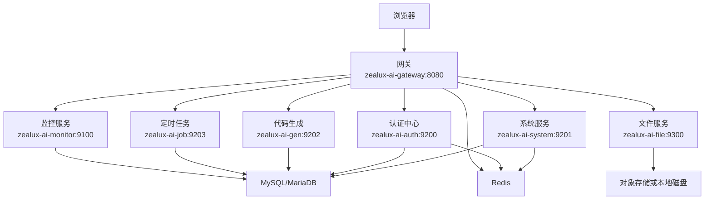
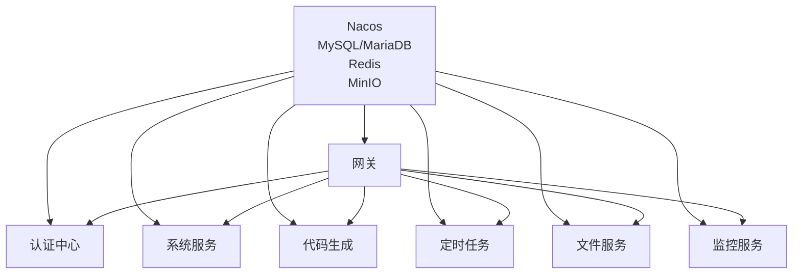
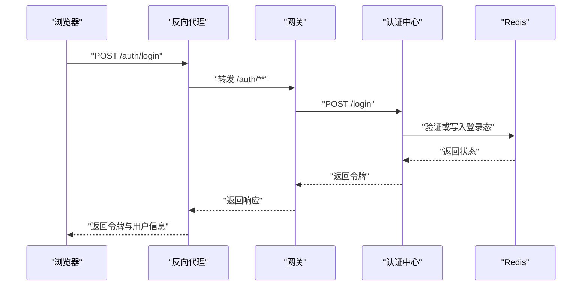
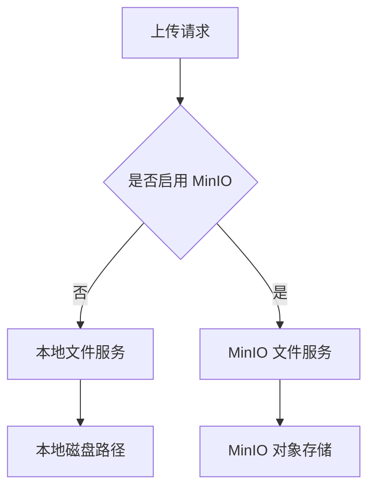

# 生产环境部署

<cite>
**本文引用的文件**   
- [zealux-ai-master/pom.xml](file://zealux-ai-master/pom.xml)
- [zealux-ai-master/README.md](file://zealux-ai-master/README.md)
- [zealux-ai-ui-master/package.json](file://zealux-ai-ui-master/package.json)
- [RuoYiGatewayApplication.java](file://zealux-ai-master/zealux-ai-gateway/src/main/java/com/zealux/gateway/RuoYiGatewayApplication.java)
- [RuoYiAuthApplication.java](file://zealux-ai-master/zealux-ai-auth/src/main/java/com/zealux/auth/RuoYiAuthApplication.java)
- [RuoYiSystemApplication.java](file://zealux-ai-master/zealux-ai-modules/zealux-ai-system/src/main/java/com/zealux/system/RuoYiSystemApplication.java)
- [RuoYiGenApplication.java](file://zealux-ai-master/zealux-ai-modules/zealux-ai-gen/src/main/java/com/zealux/gen/RuoYiGenApplication.java)
- [RuoYiJobApplication.java](file://zealux-ai-master/zealux-ai-modules/zealux-ai-job/src/main/java/com/zealux/job/RuoYiJobApplication.java)
- [RuoYiFileApplication.java](file://zealux-ai-master/zealux-ai-modules/zealux-ai-file/src/main/java/com/zealux/file/RuoYiFileApplication.java)
- [RuoYiMonitorApplication.java](file://zealux-ai-master/zealux-ai-visual/zealux-ai-monitor/src/main/java/com/zealux/modules/monitor/RuoYiMonitorApplication.java)
- [gateway bootstrap.yml](file://zealux-ai-master/zealux-ai-gateway/src/main/resources/bootstrap.yml)
- [auth bootstrap.yml](file://zealux-ai-master/zealux-ai-auth/src/main/resources/bootstrap.yml)
- [system bootstrap.yml](file://zealux-ai-master/zealux-ai-modules/zealux-ai-system/src/main/resources/bootstrap.yml)
- [gen bootstrap.yml](file://zealux-ai-master/zealux-ai-modules/zealux-ai-gen/src/main/resources/bootstrap.yml)
- [job bootstrap.yml](file://zealux-ai-master/zealux-ai-modules/zealux-ai-job/src/main/resources/bootstrap.yml)
- [file bootstrap.yml](file://zealux-ai-master/zealux-ai-modules/zealux-ai-file/src/main/resources/bootstrap.yml)
- [monitor bootstrap.yml](file://zealux-ai-master/zealux-ai-visual/zealux-ai-monitor/src/main/resources/bootstrap.yml)
- [GatewayConfig.java](file://zealux-ai-master/zealux-ai-gateway/src/main/java/com/zealux/gateway/config/GatewayConfig.java)
- [RouterFunctionConfiguration.java](file://zealux-ai-master/zealux-ai-gateway/src/main/java/com/zealux/gateway/config/RouterFunctionConfiguration.java)
- [AuthFilter.java](file://zealux-ai-master/zealux-ai-gateway/src/main/java/com/zealux/gateway/filter/AuthFilter.java)
- [TokenController.java](file://zealux-ai-master/zealux-ai-auth/src/main/java/com/zealux/auth/controller/TokenController.java)
- [MinioConfig.java](file://zealux-ai-master/zealux-ai-modules/zealux-ai-file/src/main/java/com/zealux/file/config/MinioConfig.java)
- [LocalSysFileServiceImpl.java](file://zealux-ai-master/zealux-ai-modules/zealux-ai-file/src/main/java/com/zealux/file/service/LocalSysFileServiceImpl.java)
- [MinioSysFileServiceImpl.java](file://zealux-ai-master/zealux-ai-modules/zealux-ai-file/src/main/java/com/zealux/file/service/MinioSysFileServiceImpl.java)
- [logback.xml（系统模块）](file://zealux-ai-master/zealux-ai-modules/zealux-ai-system/src/main/resources/logback.xml)
- [logback.xml（认证模块）](file://zealux-ai-master/zealux-ai-auth/src/main/resources/logback.xml)
- [zealux-ai-common-datasource pom.xml](file://zealux-ai-master/zealux-ai-common/zealux-ai-common-datasource/pom.xml)
- [zealux-ai-common-redis pom.xml](file://zealux-ai-master/zealux-ai-common/zealux-ai-common-redis/pom.xml)
</cite>

## 目录
1. [简介](#简介)
2. [项目结构](#项目结构)
3. [构建与产物](#构建与产物)
4. [运行环境与外部依赖](#运行环境与外部依赖)
5. [服务启动顺序与依赖关系](#服务启动顺序与依赖关系)
6. [配置管理](#配置管理)
7. [反向代理与网关路由](#反向代理与网关路由)
8. [健康检查与可观测性](#健康检查与可观测性)
9. [容器化与编排](#容器化与编排)
10. [容量规划与性能参数](#容量规划与性能参数)
11. [发布、灰度与回滚](#发布灰度与回滚)
12. [故障排查](#故障排查)
13. [结论](#结论)

## 简介
本部署指南面向生产环境，目标是把当前基于 Spring Cloud Alibaba 的微服务架构稳定地构建、部署和运行。该系统是开源 RuoYi-Cloud 的重命名二次开发：根 `pom.xml` 的 `artifactId=zealux-ai`、版本 `3.6.5`；前端 `package.json` 名称仍为 `ruoyi@3.6.5`；七个后端服务的启动类仍保留 `RuoYi*Application.java` 的原始命名；公共库子目录 `zealux-ai-common/ruoyi-common-sensitive` 也沿用了原目录名。因此，本文在描述架构时明确承认这一继承关系，不将其包装成自研框架。

系统采用前后端分离：后端使用 Spring Boot 3.3.5、Spring Cloud 2023.0.3、Spring Cloud Alibaba 2023.0.1.2；注册中心与配置中心为 Nacos；缓存使用 Redis；数据库通过 Druid 与动态数据源访问；文件存储支持本地磁盘与 MinIO；监控通过 Spring Boot Admin 风格的 monitor 模块提供；流量控制集成 Sentinel。

**章节来源**
- [zealux-ai-master/pom.xml:1-200](file://zealux-ai-master/pom.xml#L1-L200)
- [zealux-ai-master/README.md:1-60](file://zealux-ai-master/README.md#L1-L60)

## 项目结构
后端采用多模块 Maven 工程，核心模块包括：

| 模块 | 默认端口 | 职责 |
|---|---:|---|
| `zealux-ai-gateway` | 8080 | 网关、全局鉴权、验证码直连路由、Sentinel 网关限流入口 |
| `zealux-ai-auth` | 9200 | 登录、注册、刷新令牌、注销 |
| `zealux-ai-system` | 9201 | 用户、角色、菜单、部门、字典、参数等系统管理接口 |
| `zealux-ai-gen` | 9202 | 代码生成器，基于 Velocity 模板生成 Java、SQL、Vue 等代码 |
| `zealux-ai-job` | 9203 | 定时任务管理，基于 Quartz |
| `zealux-ai-file` | 9300 | 文件上传，支持本地磁盘或 MinIO |
| `zealux-ai-monitor` | 9100 | 可视化监控应用 |

前端有两份逐字节相同的源码拷贝：独立仓库 `zealux-ai-ui-master`，以及嵌在后端里的 `zealux-ai-master/zealux-ai-ui`。部署时应以 `zealux-ai-ui-master` 为准，不要为重复拷贝单独生成镜像或页面。

**图表来源**
- [gateway bootstrap.yml:1-44](file://zealux-ai-master/zealux-ai-gateway/src/main/resources/bootstrap.yml#L1-L44)
- [auth bootstrap.yml:1-25](file://zealux-ai-master/zealux-ai-auth/src/main/resources/bootstrap.yml#L1-L25)
- [system bootstrap.yml:1-25](file://zealux-ai-master/zealux-ai-modules/zealux-ai-system/src/main/resources/bootstrap.yml#L1-L25)
- [gen bootstrap.yml:1-25](file://zealux-ai-master/zealux-ai-modules/zealux-ai-gen/src/main/resources/bootstrap.yml#L1-L25)
- [job bootstrap.yml:1-25](file://zealux-ai-master/zealux-ai-modules/zealux-ai-job/src/main/resources/bootstrap.yml#L1-L25)
- [file bootstrap.yml:1-25](file://zealux-ai-master/zealux-ai-modules/zealux-ai-file/src/main/resources/bootstrap.yml#L1-L25)
- [monitor bootstrap.yml:1-25](file://zealux-ai-master/zealux-ai-visual/zealux-ai-monitor/src/main/resources/bootstrap.yml#L1-L25)

**章节来源**
- [zealux-ai-master/README.md:1-60](file://zealux-ai-master/README.md#L1-L60)
- [zealux-ai-ui-master/package.json:1-90](file://zealux-ai-ui-master/package.json#L1-L90)

## 构建与产物
### 后端构建
后端使用 JDK 17 与 Maven 构建。根 `pom.xml` 定义了统一版本：Spring Boot 3.3.5、Spring Cloud 2023.0.3、Spring Cloud Alibaba 2023.0.1.2、MyBatis-Plus 3.5.10、Druid 1.2.23、Fastjson2 2.0.53、MinIO 8.2.2 等。

推荐在生产构建机执行以下流程：

1. 安装 JDK 17、Maven 3.9+。
2. 拉取源码到工作区。
3. 执行非测试打包命令，跳过测试以减少构建分支差异：
   - Unix/Linux/macOS：`mvn clean package -DskipTests -pl '!zealux-ai-leads' -am`
   - Windows PowerShell：`mvn clean package -DskipTests -pl "!zealux-ai-leads" -am`
4. 构建成功后，每个模块 `target` 目录下会生成对应 Spring Boot 可执行 jar。
5. 将需要的服务 jar 推入制品库，并打上 Git commit 与构建时间标签。

注意：
- `zealux-ai-leads` 当前只有少量 Java 文件，缺少前端页面、菜单、Nacos 配置与网关路由，且本地 Redis 缺 RediSearch 模块，不应作为生产可运行服务纳入常规构建清单。
- 若仅需最小生产集，可显式排除 `zealux-ai-leads`，避免其参与依赖解析。

### 前端构建
前端基于 Vue CLI，`package.json` 中定义脚本：

| 脚本 | 含义 |
|---|---|
| `dev` | 本地开发服务 |
| `build:prod` | 构建生产静态资源 |
| `build:stage` | 构建预发布静态资源 |
| `preview` | 预览构建结果 |
| `lint` | ESLint 检查 |

生产构建建议：

1. 安装 Node.js 版本满足引擎要求，推荐使用长期支持版本。
2. 进入 `zealux-ai-ui-master` 目录。
3. 安装依赖：`pnpm install --frozen-lockfile` 或 `npm ci`。
4. 执行生产构建：`pnpm run build:prod`。
5. 产物位于 `dist` 目录，包含 `index.html`、静态资源与主题文件。
6. 将 `dist` 作为 Nginx 或 Kubernetes Ingress 的静态站点根目录。

前端构建产物不包含后端配置，只负责提供 HTML/CSS/JS 静态资源；后端地址、网关前缀、第三方域名等应由运行时配置或反向代理决定。

**章节来源**
- [zealux-ai-master/pom.xml:1-200](file://zealux-ai-master/pom.xml#L1-L200)
- [zealux-ai-ui-master/package.json:1-90](file://zealux-ai-ui-master/package.json#L1-L90)

## 运行环境与外部依赖
### 必需外部组件
| 组件 | 用途 | 生产建议 |
|---|---|---|
| Nacos | 服务注册发现与配置中心 | 至少三节点高可用集群；持久化 MySQL |
| MySQL/MariaDB | 业务与系统表 | 主从或托管数据库，启用 binlog、慢查询日志 |
| Redis | 登录态、验证码、缓存 | 主从或集群模式；禁用危险命令，设置密码与 ACL |
| MinIO 或对象存储 | 文件对象存储 | 多节点纠删码或复制；独立挂载卷 |
| Nginx 或云 Ingress | 反向代理、HTTPS、静态资源 | 转发 `/gateway/**`、`/auth/**`、`/system/**`、`/code/**`、`/schedule/**`、`/file/**` |

### 可选外部组件
| 组件 | 用途 | 说明 |
|---|---|---|
| Sentinel Dashboard | 网关与服务限流控制台 | 网关 bootstrap 中已声明 Sentinel 配置 |
| Spring Boot Admin / monitor | 监控服务 | 由 `zealux-ai-monitor` 提供 |
| Seata | 分布式事务 | 仓库存在 `zealux-ai-common-seata` 模块，但当前模块清单未体现广泛启用，应结合压测确认 |

### 数据库初始化
本地环境由 `_setup/sql` 下的 `ry_20240629.sql`、`quartz.sql`、`ry_config_20240902.sql` 初始化，但这些是 RuoYi-Cloud 与 Nacos 的第三方初始化脚本，不是本项目的数据库设计文档。本地实测数据库中不存在任何 `crm_` 前缀的表，也未发现 CRM 建表方案落库。因此不得把 CRM 模块、CRM 表结构或 CRM 业务接口描述成系统已具备的能力。

**章节来源**
- [zealux-ai-master/README.md:1-60](file://zealux-ai-master/README.md#L1-L60)
- [zealux-ai-master/zealux-ai-common/zealux-ai-common-datasource/pom.xml:1-35](file://zealux-ai-master/zealux-ai-common/zealux-ai-common-datasource/pom.xml#L1-L35)
- [zealux-ai-master/zealux-ai-common/zealux-ai-common-redis/pom.xml:1-33](file://zealux-ai-master/zealux-ai-common/zealux-ai-common-redis/pom.xml#L1-L33)

## 服务启动顺序与依赖关系
微服务依赖 Nacos 完成注册与配置加载。典型启动顺序如下：

1. **启动基础设施**：Nacos、MySQL/MariaDB、Redis、MinIO。
2. **启动网关**：`zealux-ai-gateway` 暴露统一入口。
3. **启动认证中心**：`zealux-ai-auth` 提供登录与令牌能力。
4. **启动系统服务**：`zealux-ai-system` 提供用户、角色、菜单等基础能力。
5. **启动辅助服务**：`zealux-ai-gen`、`zealux-ai-job`、`zealux-ai-file`、`zealux-ai-monitor`。
6. **启动反向代理**：Nginx 或 Ingress 指向网关。

**图表来源**
- [gateway bootstrap.yml:1-44](file://zealux-ai-master/zealux-ai-gateway/src/main/resources/bootstrap.yml#L1-L44)
- [auth bootstrap.yml:1-25](file://zealux-ai-master/zealux-ai-auth/src/main/resources/bootstrap.yml#L1-L25)
- [system bootstrap.yml:1-25](file://zealux-ai-master/zealux-ai-modules/zealux-ai-system/src/main/resources/bootstrap.yml#L1-L25)
- [gen bootstrap.yml:1-25](file://zealux-ai-master/zealux-ai-modules/zealux-ai-gen/src/main/resources/bootstrap.yml#L1-L25)
- [job bootstrap.yml:1-25](file://zealux-ai-master/zealux-ai-modules/zealux-ai-job/src/main/resources/bootstrap.yml#L1-L25)
- [file bootstrap.yml:1-25](file://zealux-ai-master/zealux-ai-modules/zealux-ai-file/src/main/resources/bootstrap.yml#L1-L25)
- [monitor bootstrap.yml:1-25](file://zealux-ai-master/zealux-ai-visual/zealux-ai-monitor/src/main/resources/bootstrap.yml#L1-L25)

**章节来源**
- [RuoYiGatewayApplication.java](file://zealux-ai-master/zealux-ai-gateway/src/main/java/com/zealux/gateway/RuoYiGatewayApplication.java)
- [RuoYiAuthApplication.java](file://zealux-ai-master/zealux-ai-auth/src/main/java/com/zealux/auth/RuoYiAuthApplication.java)
- [RuoYiSystemApplication.java](file://zealux-ai-master/zealux-ai-modules/zealux-ai-system/src/main/java/com/zealux/system/RuoYiSystemApplication.java)
- [RuoYiGenApplication.java](file://zealux-ai-master/zealux-ai-modules/zealux-ai-gen/src/main/java/com/zealux/gen/RuoYiGenApplication.java)
- [RuoYiJobApplication.java](file://zealux-ai-master/zealux-ai-modules/zealux-ai-job/src/main/java/com/zealux/job/RuoYiJobApplication.java)
- [RuoYiFileApplication.java](file://zealux-ai-master/zealux-ai-modules/zealux-ai-file/src/main/java/com/zealux/file/RuoYiFileApplication.java)
- [RuoYiMonitorApplication.java](file://zealux-ai-master/zealux-ai-visual/zealux-ai-monitor/src/main/java/com/zealux/modules/monitor/RuoYiMonitorApplication.java)

## 配置管理
所有服务的 `bootstrap.yml` 都通过 Spring Cloud Bootstrap 加载 Nacos 配置：

- 应用名称来自 `spring.application.name`。
- 环境通过 `spring.profiles.active` 切换。
- Nacos 注册与配置地址在 `spring.cloud.nacos.discovery.server-addr` 与 `spring.cloud.nacos.config.server-addr`。
- 共享配置使用 `shared-configs`，形式为 `application-${spring.profiles.active}.yml`。

生产中的正确做法：

1. 在 Nacos 中为每个服务创建 dataId，例如：
   - `zealux-ai-gateway-dev.yml`
   - `zealux-ai-auth-dev.yml`
   - `zealux-ai-system-dev.yml`
   - `zealux-ai-gen-dev.yml`
   - `zealux-ai-job-dev.yml`
   - `zealux-ai-file-dev.yml`
   - `zealux-ai-monitor-dev.yml`
2. 将数据库连接、Redis 地址、MinIO 凭证、JWT 密钥、短信/邮件 API key 等敏感值写入 Nacos dataId。
3. 不要把真实账号、口令、token、api-key 的值写入仓库。示例中统一写占位形式，如「数据库用户名与口令见本地凭据记录」。
4. 生产 profile 建议使用 `prod`，并把 `active: prod` 放入 Nacos shared 配置或通过环境变量注入，而不是修改源码中的 `bootstrap.yml`。
5. 对 Nacos 本身做访问控制：开启鉴权、强口令、TLS、IP 白名单。

当前仓库中的 `bootstrap.yml` 仍指向 `127.0.0.1:8848`，这是本地开发配置。生产部署时必须通过 Nacos dataId 覆盖这些值。

**章节来源**
- [gateway bootstrap.yml:1-44](file://zealux-ai-master/zealux-ai-gateway/src/main/resources/bootstrap.yml#L1-L44)
- [auth bootstrap.yml:1-25](file://zealux-ai-master/zealux-ai-auth/src/main/resources/bootstrap.yml#L1-L25)
- [system bootstrap.yml:1-25](file://zealux-ai-master/zealux-ai-modules/zealux-ai-system/src/main/resources/bootstrap.yml#L1-L25)
- [gen bootstrap.yml:1-25](file://zealux-ai-master/zealux-ai-modules/zealux-ai-gen/src/main/resources/bootstrap.yml#L1-L25)
- [job bootstrap.yml:1-25](file://zealux-ai-master/zealux-ai-modules/zealux-ai-job/src/main/resources/bootstrap.yml#L1-L25)
- [file bootstrap.yml:1-25](file://zealux-ai-master/zealux-ai-modules/zealux-ai-file/src/main/resources/bootstrap.yml#L1-L25)
- [monitor bootstrap.yml:1-25](file://zealux-ai-master/zealux-ai-visual/zealux-ai-monitor/src/main/resources/bootstrap.yml#L1-L25)

## 反向代理与网关路由
### 网关暴露的路由
当前网关配置中存在两类路由相关逻辑：

1. **全局鉴权过滤器**：`AuthFilter` 对所有请求进行 JWT 校验，并根据白名单放行。
2. **直连路由**：`RouterFunctionConfiguration` 暴露了 GET `/code`，用于验证码。
3. **Sentinel 网关异常处理**：`GatewayConfig` 注册了 `SentinelFallbackHandler`。

根据实际代码，网关并非通过 Spring Cloud Gateway 的 YAML 路由集中声明所有后端路径，而是通过全局过滤器和直连路由配合 Nacos 服务发现完成转发。仓库中未发现集中式 YAML 路由表，也没有 `/leads/**` 或 CRM 路由。

### Nginx 转发规则建议
Nginx 应作为对外入口，将已知前缀转发到网关：

| 客户端路径 | 上游目标 | 说明 |
|---|---|---|
| `/gateway/**` | `http://localhost:8080/` | 网关内部路由前缀 |
| `/auth/**` | `http://localhost:8080/auth/` | 认证接口 |
| `/system/**` | `http://localhost:8080/system/` | 系统管理接口 |
| `/code/**` | `http://localhost:8080/code/` | 验证码直连路由 |
| `/schedule/**` | `http://localhost:8080/schedule/` | 定时任务相关接口 |
| `/file/**` | `http://localhost:8080/file/` | 文件上传下载接口 |
| `/` | 静态资源目录 | 前端 `dist` 目录 |

Ingress 规则应与上述 Nginx 映射保持一致，并通过 TLS 终止、超时、重试、熔断策略统一管理。

### 登录鉴权流程

**图表来源**
- [TokenController.java:1-78](file://zealux-ai-master/zealux-ai-auth/src/main/java/com/zealux/auth/controller/TokenController.java#L1-L78)
- [AuthFilter.java:1-135](file://zealux-ai-master/zealux-ai-gateway/src/main/java/com/zealux/gateway/filter/AuthFilter.java#L1-L135)
- [RouterFunctionConfiguration.java:1-31](file://zealux-ai-master/zealux-ai-gateway/src/main/java/com/zealux/gateway/config/RouterFunctionConfiguration.java#L1-L31)

**章节来源**
- [GatewayConfig.java:1-23](file://zealux-ai-master/zealux-ai-gateway/src/main/java/com/zealux/gateway/config/GatewayConfig.java#L1-L23)
- [RouterFunctionConfiguration.java:1-31](file://zealux-ai-master/zealux-ai-gateway/src/main/java/com/zealux/gateway/config/RouterFunctionConfiguration.java#L1-L31)
- [AuthFilter.java:1-135](file://zealux-ai-master/zealux-ai-gateway/src/main/java/com/zealux/gateway/filter/AuthFilter.java#L1-L135)

## 健康检查与可观测性
### 健康检查端点
当前各服务 `bootstrap.yml` 中未显式暴露 Spring Boot Actuator 的健康检查端点。生产部署时应：

1. 为每个服务引入 Actuator 依赖。
2. 暴露 `/actuator/health` 与 `/actuator/info`。
3. 仅暴露必要指标，避免泄露敏感信息。
4. 在 Nginx 层屏蔽或限制访问 `/actuator/**`。
5. 在 Kubernetes 中使用 HTTP 探针调用 `/actuator/health`，TCP 探针作为兜底。

如果无法直接暴露 Actuator，至少应实现一个轻量级 `/health` 控制器，返回服务是否成功连接 Nacos、Redis、数据库或 MinIO。

### 日志轮转
各服务使用 Logback，按天轮转 info 与 error 日志，历史保留 60 天：

- 系统模块日志路径：`logs/zealux-ai-system`
- 认证模块日志路径：`logs/zealux-ai-auth`
- 其他模块遵循相同模式，但日志路径需以各自 `logback.xml` 为准。

生产建议：

- 将 `log.path` 挂载到独立持久卷或外置日志收集系统。
- 容器内输出到 stdout/stderr，由 Sidecar 或 DaemonSet 收集。
- 调整日志级别：生产默认 `info`，异常场景临时提升到 `debug`。
- 对慢 SQL、鉴权失败、文件上传失败等关键路径单独采集错误日志。

**章节来源**
- [logback.xml（系统模块）:1-74](file://zealux-ai-master/zealux-ai-modules/zealux-ai-system/src/main/resources/logback.xml#L1-L74)
- [logback.xml（认证模块）:1-74](file://zealux-ai-master/zealux-ai-auth/src/main/resources/logback.xml#L1-L74)

## 容器化与编排
### Docker 镜像建议
后端推荐多阶段构建：

1. 第一阶段：JDK 17 + Maven，执行 `mvn clean package -DskipTests`。
2. 第二阶段：精简 JRE 镜像，复制目标 jar。
3. 通过 `ENTRYPOINT` 传入 JVM 参数与启动命令。
4. 镜像标签使用 Git commit SHA，禁止使用 `latest`。

前端推荐：

1. 构建阶段：Node + pnpm/npm，执行 `pnpm run build:prod`。
2. 运行阶段：Nginx 镜像，挂载 `dist` 目录。
3. 通过环境变量注入 API 前缀与静态资源版本。

### Kubernetes Pod 模型
每个微服务一个 Deployment 和一个 Service：

| 组件 | 副本数 | 探针 |
|---|---:|---|
| Nacos | 3 | 就绪/存活探针 |
| MySQL/MariaDB | 主 1 + 从 N | 主从状态探针 |
| Redis | 主从或集群 | 主从同步探针 |
| MinIO | 多节点 | 桶可用性探针 |
| 网关 | ≥2 | HTTP `/actuator/health` |
| 认证中心 | ≥2 | HTTP `/actuator/health` |
| 系统服务 | ≥2 | HTTP `/actuator/health` |
| 代码生成 | ≥1 | HTTP `/actuator/health` |
| 定时任务 | ≥1 | HTTP `/actuator/health` |
| 文件服务 | ≥2 | HTTP `/actuator/health` |
| 监控服务 | ≥1 | HTTP `/actuator/health` |

Pod 资源配置建议：

- 每个 Pod 设置 requests 与 limits。
- 使用 HorizontalPodAutoscaler 按 CPU、内存或自定义指标扩缩容。
- 使用 PodDisruptionBudget 保证最低副本数。
- 使用 ReadinessProbe 防止新实例过早接收流量。
- 使用 LivenessProbe 检测进程卡死。

### Nacos 高可用
- 至少三个节点，避免脑裂。
- 持久化元数据到 MySQL。
- 使用独立域名与负载均衡。
- 关闭开发模式，开启鉴权。
- 为不同环境划分 Nacos namespace 或 groupId。

### Redis 高可用
- 主从复制：主写从读，提升读取吞吐。
- 集群模式：分片扩容，适合大规模缓存。
- 持久化：AOF + RDB，根据数据重要性调整。
- 淘汰策略：`allkeys-lru` 或业务自定义 TTL。
- 安全：绑定内网 IP，启用密码与 ACL。

### MinIO 多节点
- 使用纠删码模式部署多节点。
- 每个节点独立磁盘。
- 配置独立域名与 HTTPS。
- 通过 MinIO Client 或对象存储 SDK 校验桶权限。
- 文件服务通过 `minio.*` 配置接入。

**章节来源**
- [MinioConfig.java:1-82](file://zealux-ai-master/zealux-ai-modules/zealux-ai-file/src/main/java/com/zealux/file/config/MinioConfig.java#L1-L82)

## 容量规划与性能参数
下列数值为参考起点，不是最终生产值。实际大小必须经过压测、基准测试与容量评审后确定。

### JVM 参数
| 参数类别 | 参考值 | 说明 |
|---|---|---|
| 堆内存 `-Xms` / `-Xmx` | 2G ~ 4G | 初始堆等于最大堆，减少动态扩容抖动 |
| 元空间 `-XX:MetaspaceSize` / `-XX:MaxMetaspaceSize` | 256MB ~ 512MB | 微服务类数量相对固定 |
| GC 选择 | G1GC | Spring Boot 3 默认，适合中等堆 |
| 堆外内存 | 留足操作系统缓冲 | 避免 OOM Killer 触发 |
| 日志与线程栈 | 每线程 1MB | 线程池越大，峰值内存越高 |

### 数据库连接池
系统使用 Druid 与动态数据源。参考值：

| 指标 | 参考值 |
|---|---|
| 最大连接数 | 单服务 20 ~ 50 |
| 最小空闲连接 | 5 ~ 10 |
| 连接超时 | 5 ~ 10 秒 |
| 获取连接超时 | 3 ~ 5 秒 |
| 慢 SQL 阈值 | 500ms ~ 2000ms |
| 总连接数 | 不超过数据库 max_connections 的 60%~80% |

### 线程池
- 网关使用 Reactor 非阻塞模型，不建议手动扩大线程池。
- 业务服务异步任务应使用独立线程池，限制队列长度与拒绝策略。
- 定时任务与文件上传等 IO 密集型任务应隔离线程池，避免阻塞普通请求。

### 磁盘与内存
| 组件 | 参考容量 | 增长因素 |
|---|---:|---|
| 应用磁盘 | 20GB ~ 50GB | 日志、临时文件、本地文件存储 |
| 数据库磁盘 | 按数据量 × 3 ~ 5 倍 | 增量、binlog、快照、备份 |
| Redis 内存 | 按热点键 × 1.5 倍 | 大对象、过期延迟清理 |
| MinIO 磁盘 | 按文件大小 × 纠删系数 | 文件增长、删除延迟回收 |
| 日志盘 | 按日日志 × 保留天数 | 错误日志突增 |

### 连接池与线程复杂度
- 数据库连接池复杂度近似 O(并发连接数)，连接数过大可能导致锁竞争与上下文切换开销上升。
- Redis 连接池复杂度近似 O(活跃请求数)，连接泄漏会导致连接耗尽。
- 线程池复杂度近似 O(队列长度 + 线程数)，队列过长会放大内存占用与延迟。

**章节来源**
- [zealux-ai-master/pom.xml:1-200](file://zealux-ai-master/pom.xml#L1-L200)
- [zealux-ai-common-datasource pom.xml:1-35](file://zealux-ai-master/zealux-ai-common/zealux-ai-common-datasource/pom.xml#L1-L35)

## 发布、灰度与回滚
### 滚动升级
- 先升级无状态服务：网关、系统、文件、监控。
- 再升级有状态依赖较少的服务：认证、代码生成。
- 最后升级定时任务，避免旧版本与新版本调度冲突。
- 每次只升级一个副本，等待就绪后再替换下一个。
- 升级期间观察错误率、延迟、CPU、内存、数据库连接数、Redis 命中率。

### 灰度发布
- 使用 Ingress 权重或 Kuma/Traefik 等流量切分机制，将 1%~5% 流量导入新版本。
- 对灰度流量添加额外 Header 或 Cookie，便于链路追踪。
- 灰度期只开放功能开关允许的小范围用户。
- 灰度通过后逐步扩大到 10%、50%、100%。

### 回滚策略
- 保留上一个版本的镜像标签与配置快照。
- 一旦错误率或延迟超过阈值，立即将流量切回上一版本。
- 数据库变更应向前兼容：新增字段可为空，新增表不应被旧版本访问。
- 回滚后清理灰度 Pod，但不立即删除旧镜像，保留至少一个发布周期。

### 停机维护窗口
- 全量停机维护仅在必要时进行，例如不可向前兼容的数据库结构变更。
- 提前公告、关闭写入口、迁移数据、验证数据一致性、重启服务。
- 维护完成后执行冒烟测试与核心业务流程回归。
- 对文件服务，停机前确保无上传写入，或切换到只读模式。

**章节来源**
- [RuoYiGatewayApplication.java](file://zealux-ai-master/zealux-ai-gateway/src/main/java/com/zealux/gateway/RuoYiGatewayApplication.java)
- [RuoYiAuthApplication.java](file://zealux-ai-master/zealux-ai-auth/src/main/java/com/zealux/auth/RuoYiAuthApplication.java)
- [RuoYiSystemApplication.java](file://zealux-ai-master/zealux-ai-modules/zealux-ai-system/src/main/java/com/zealux/system/RuoYiSystemApplication.java)
- [RuoYiFileApplication.java](file://zealux-ai-master/zealux-ai-modules/zealux-ai-file/src/main/java/com/zealux/file/RuoYiFileApplication.java)
- [RuoYiJobApplication.java](file://zealux-ai-master/zealux-ai-modules/zealux-ai-job/src/main/java/com/zealux/job/RuoYiJobApplication.java)

## 故障排查
### 常见启动问题
| 现象 | 可能原因 | 排查方向 |
|---|---|---|
| 服务无法注册到 Nacos | Nacos 地址错误或未启动 | 检查 Nacos dataId 中的 discovery 地址 |
| 配置未生效 | profile 不一致或 dataId 缺失 | 核对 `application-prod.yml` 是否存在 |
| 登录失败 | Redis 不可用或 JWT 密钥不一致 | 查看认证模块日志与 Redis 连通性 |
| 文件上传失败 | MinIO 凭证错误或桶不存在 | 检查 `minio.*` 配置 |
| 本地文件访问 404 | 反向代理未映射文件域名或路径 | 检查 Nginx 静态资源与文件前缀 |
| 网关返回鉴权失败 | 白名单未放行或 token 过期 | 检查 `AuthFilter` 白名单与 Redis 登录态 |

### 文件存储选择
`zealux-ai-file` 提供两种实现：

- `LocalSysFileServiceImpl`：本地磁盘存储，默认优先级更高。
- `MinioSysFileServiceImpl`：MinIO 对象存储。

生产建议优先使用 MinIO，避免多副本 Pod 之间本地文件不一致。本地模式适合单机调试，不适合多副本生产。

**图表来源**
- [LocalSysFileServiceImpl.java:1-50](file://zealux-ai-master/zealux-ai-modules/zealux-ai-file/src/main/java/com/zealux/file/service/LocalSysFileServiceImpl.java#L1-L50)
- [MinioSysFileServiceImpl.java:1-60](file://zealux-ai-master/zealux-ai-modules/zealux-ai-file/src/main/java/com/zealux/file/service/MinioSysFileServiceImpl.java#L1-L60)
- [MinioConfig.java:1-82](file://zealux-ai-master/zealux-ai-modules/zealux-ai-file/src/main/java/com/zealux/file/config/MinioConfig.java#L1-L82)

### 日志定位
- 查看对应模块 `logs/zealux-ai-*` 下的 info 与 error 日志。
- 关注鉴权失败、数据库连接失败、Redis 连接失败、MinIO 上传失败。
- 对于生产问题，先缩小范围：网关 → 认证 → 业务服务 → 数据库/缓存/对象存储。
- 不要在生产日志中打印完整 token、数据库口令或用户明文口令。

**章节来源**
- [AuthFilter.java:1-135](file://zealux-ai-master/zealux-ai-gateway/src/main/java/com/zealux/gateway/filter/AuthFilter.java#L1-L135)
- [LocalSysFileServiceImpl.java:1-50](file://zealux-ai-master/zealux-ai-modules/zealux-ai-file/src/main/java/com/zealux/file/service/LocalSysFileServiceImpl.java#L1-L50)
- [MinioSysFileServiceImpl.java:1-60](file://zealux-ai-master/zealux-ai-modules/zealux-ai-file/src/main/java/com/zealux/file/service/MinioSysFileServiceImpl.java#L1-L60)
- [logback.xml（系统模块）:1-74](file://zealux-ai-master/zealux-ai-modules/zealux-ai-system/src/main/resources/logback.xml#L1-L74)
- [logback.xml（认证模块）:1-74](file://zealux-ai-master/zealux-ai-auth/src/main/resources/logback.xml#L1-L74)

## 结论
该系统的生产部署应以可重复构建为核心：后端使用 JDK 17 与 Maven 构建 jar，前端使用 pnpm 或 npm 构建 `dist` 静态资源。Nacos 作为唯一可信配置来源，所有敏感配置通过 dataId 注入；Redis、MySQL/MariaDB、MinIO 均应采用高可用架构；网关通过反向代理统一暴露 `/gateway/**`、`/auth/**`、`/system/**`、`/code/**`、`/schedule/**`、`/file/**` 路由。每个微服务一个容器或 Pod，配合健康检查、滚动升级、灰度发布与回滚策略，才能在生产环境中保持稳定运行。所有容量与性能参数必须以压测结果为准，本文提供的数值仅是起点而非承诺。