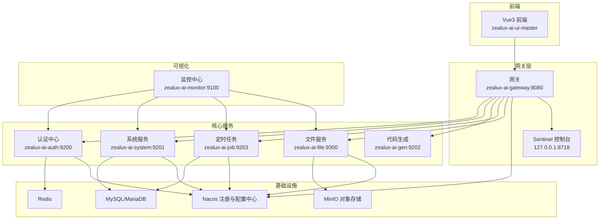
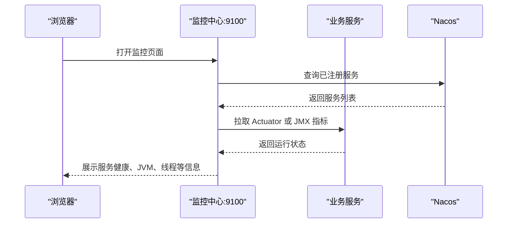
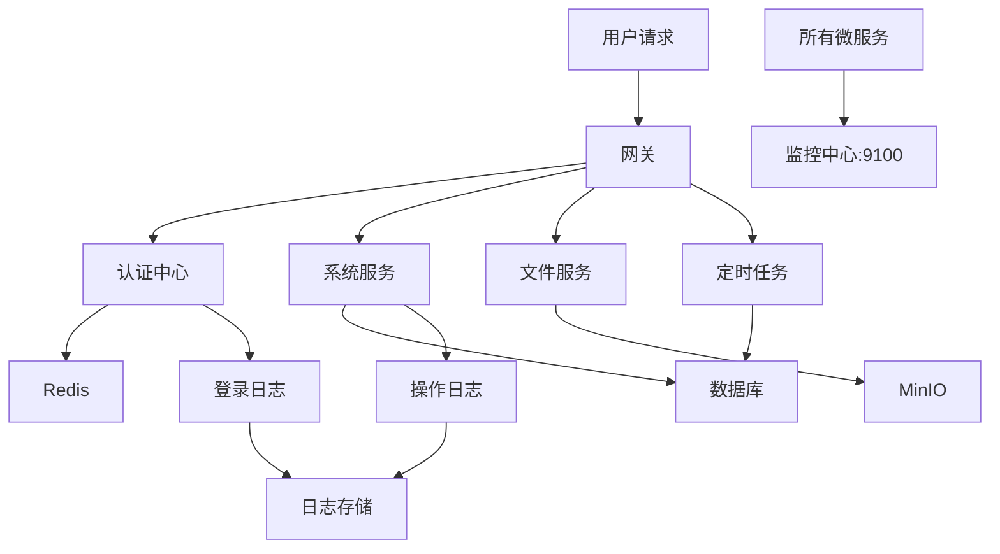
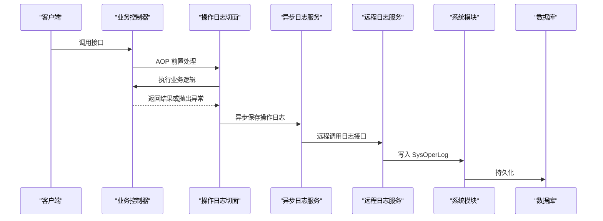
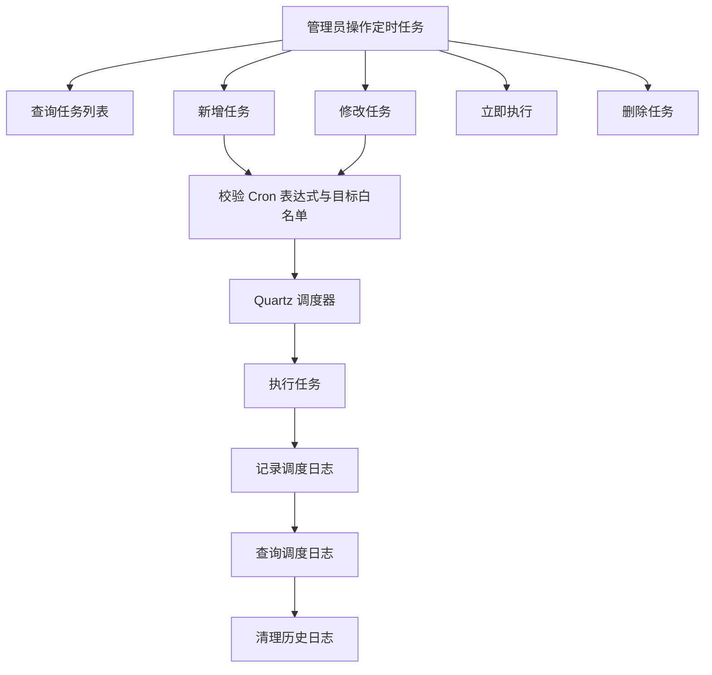
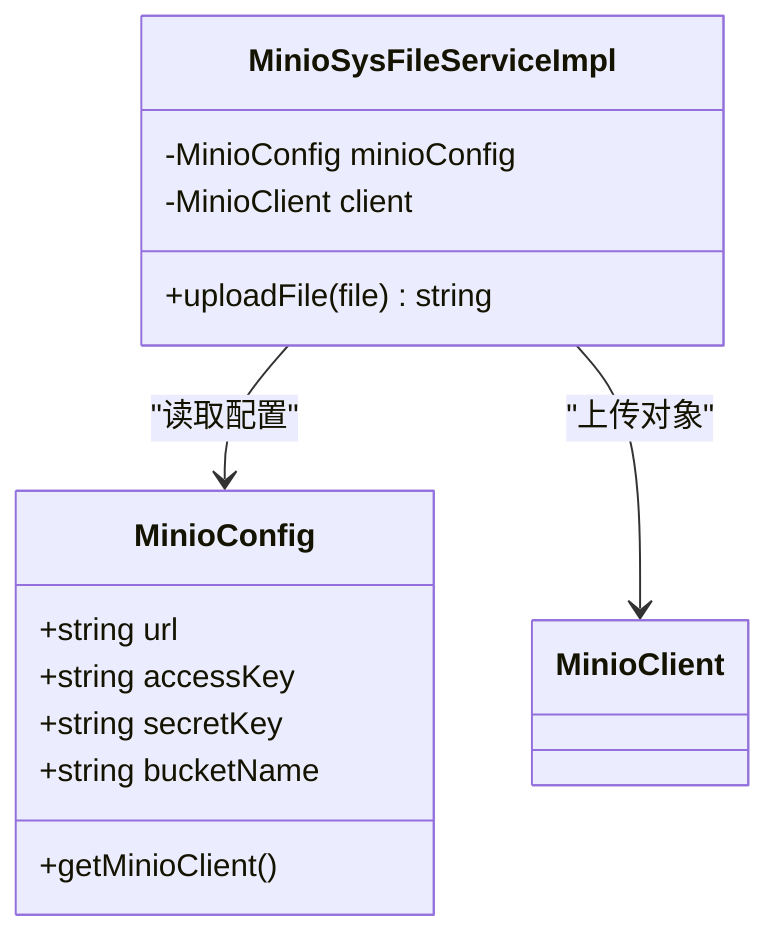
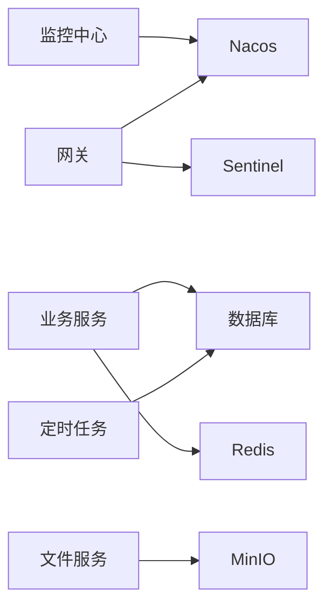
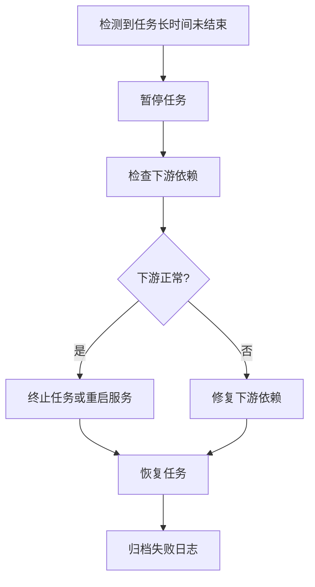

# 监控与日常运维

<cite>
**本文引用的文件**   
- [zealux-ai-master/README.md](file://zealux-ai-master/README.md)
- [zealux-ai-master/pom.xml](file://zealux-ai-master/pom.xml)
- [RuoYiMonitorApplication.java](file://zealux-ai-master/zealux-ai-visual/zealux-ai-monitor/src/main/java/com/zealux/modules/monitor/RuoYiMonitorApplication.java)
- [bootstrap.yml（监控中心）](file://zealux-ai-master/zealux-ai-visual/zealux-ai-monitor/src/main/resources/bootstrap.yml)
- [bootstrap.yml（网关）](file://zealux-ai-master/zealux-ai-gateway/src/main/resources/bootstrap.yml)
- [logback.xml（认证模块）](file://zealux-ai-master/zealux-ai-auth/src/main/resources/logback.xml)
- [logback.xml（系统模块）](file://zealux-ai-master/zealux-ai-modules/zealux-ai-system/src/main/resources/logback.xml)
- [logback.xml（定时任务模块）](file://zealux-ai-master/zealux-ai-modules/zealux-ai-job/src/main/resources/logback.xml)
- [logback.xml（网关）](file://zealux-ai-master/zealux-ai-gateway/src/main/resources/logback.xml)
- [logback.xml（文件服务）](file://zealux-ai-master/zealux-ai-modules/zealux-ai-file/src/main/resources/logback.xml)
- [LogAspect.java](file://zealux-ai-master/zealux-ai-common/zealux-ai-common-log/src/main/java/com/zealux/common/log/aspect/LogAspect.java)
- [AsyncLogService.java](file://zealux-ai-master/zealux-ai-common/zealux-ai-common-log/src/main/java/com/zealux/common/log/service/AsyncLogService.java)
- [SysJobController.java](file://zealux-ai-master/zealux-ai-modules/zealux-ai-job/src/main/java/com/zealux/job/controller/SysJobController.java)
- [SysJobLogController.java](file://zealux-ai-master/zealux-ai-modules/zealux-ai-job/src/main/java/com/zealux/job/controller/SysJobLogController.java)
- [ScheduleUtils.java](file://zealux-ai-master/zealux-ai-modules/zealux-ai-job/src/main/java/com/zealux/job/util/ScheduleUtils.java)
- [SysJobLog.java](file://zealux-ai-master/zealux-ai-modules/zealux-ai-job/src/main/java/com/zealux/job/domain/SysJobLog.java)
- [MinioConfig.java](file://zealux-ai-master/zealux-ai-modules/zealux-ai-file/src/main/java/com/zealux/file/config/MinioConfig.java)
- [MinioSysFileServiceImpl.java](file://zealux-ai-master/zealux-ai-modules/zealux-ai-file/src/main/java/com/zealux/file/service/MinioSysFileServiceImpl.java)
</cite>

## 目录

1. [引言](#引言)
2. [项目结构](#项目结构)
3. [核心监控组件](#核心监控组件)
4. [架构总览](#架构总览)
5. [详细组件分析](#详细组件分析)
6. [依赖关系分析](#依赖关系分析)
7. [性能调优清单](#性能调优清单)
8. [容量评估模型](#容量评估模型)
9. [告警阈值建议](#告警阈值建议)
10. [日志、审计与合规](#日志审计与合规)
11. [定时任务巡检](#定时任务巡检)
12. [备份与恢复](#备份与恢复)
13. [外部可观测性集成](#外部可观测性集成)
14. [故障排查指南](#故障排查指南)
15. [结论](#结论)

## 引言

本系统是基于开源 RuoYi-Cloud 3.6.5 的重命名二次开发，根 Maven 工程的 `artifactId=zealux-ai`、版本为 `3.6.5`。后端采用 Spring Boot 3.3.5、Spring Cloud 2023.0.3 与 Spring Cloud Alibaba，注册中心与配置中心使用 Nacos，权限认证使用 Redis，流量控制使用 Sentinel，分布式事务使用 Seata。前端基于 Vue3、Element Plus 和 Vite，对应 RuoYi-Vue3 体系。

需要特别说明的是：虽然根工程名称是 `zealux-ai`，但多数启动类仍保留 `RuoYi*Application.java` 的形式，公共库子目录也保留了原 `ruoyi-common-*` 的命名风格；只有业务模块 `zealux-ai-leads` 使用了 `Zealux*` 命名。因此，在描述架构时应明确：本仓库是 RuoYi-Cloud 的衍生实现，而不是从零自研框架。

从运维角度，当前代码中已具备的关键能力包括：

| 类别 | 现有能力 | 说明 |
|---|---|---|
| 可视化监控 | 内置 Spring Boot Admin 监控中心 | 端口 `9100`，用于查看已注册的微服务状态 |
| 操作日志 | AOP 切面 + 异步远程写入 | 记录接口调用、耗时、参数、结果与异常 |
| 登录日志 | 认证模块与系统模块共同维护 | 记录登录成功、失败与异常 |
| 定时任务 | Quartz 调度 + 在线管理 | 支持任务增删改查、状态切换、立即执行与日志清理 |
| 文件存储 | MinIO 对象存储客户端 | 上传文件并返回访问地址 |
| 网关限流 | Sentinel 控制台 + Nacos 规则持久化 | 网关启用 Sentinel 仪表盘连接与规则数据源 |
| 数据库连接池 | Druid 1.2.23 | 由根 POM 引入，具体连接池配置需结合部署配置验证 |
| 缓存 | Redis | 作为认证缓存、会话与通用缓存使用 |

此外，根据实际仓库扫描结果，系统中不存在 `crm_` 前缀的数据库表，也没有 CRM 路由或菜单入口；`zealux-ai-leads` 当前不具备完整运行条件。这些边界必须写进运维手册，避免把未实现功能当成已有能力。

**章节来源**
- [zealux-ai-master/README.md:1-60](file://zealux-ai-master/README.md#L1-L60)
- [zealux-ai-master/pom.xml:1-60](file://zealux-ai-master/pom.xml#L1-L60)

## 项目结构

从监控与运维视角，本项目后端采用典型的微服务分层：



**图表来源**
- [bootstrap.yml（监控中心）:1-25](file://zealux-ai-master/zealux-ai-visual/zealux-ai-monitor/src/main/resources/bootstrap.yml#L1-L25)
- [bootstrap.yml（网关）:1-44](file://zealux-ai-master/zealux-ai-gateway/src/main/resources/bootstrap.yml#L1-L44)
- [zealux-ai-master/README.md:15-45](file://zealux-ai-master/README.md#L15-L45)

仓库中存在两份前端源码拷贝：独立仓库 `zealux-ai-ui-master` 与嵌入后端的 `zealux-ai-master/zealux-ai-ui`。两者被确认逐字节相同，且后者不在根 POM 的模块列表中，不参与构建。因此，文档统一以 `zealux-ai-ui-master` 为准，不把重复拷贝当作第二个前端模块。

**章节来源**
- [zealux-ai-master/README.md:15-45](file://zealux-ai-master/README.md#L15-L45)

## 核心监控组件

### 内置可视化监控模块

监控中心是一个独立的 Spring Boot 应用，其启动类为 `RuoYiMonitorApplication`，并使用 `@EnableAdminServer` 启用 Spring Boot Admin Server。配置文件将 Tomcat 端口设置为 `9100`，服务名注册为 `zealux-ai-monitor`，并通过 Nacos 进行服务发现与配置加载。

运维人员日常查看服务状态的主要路径是：

| 项目 | 值 |
|---|---|
| 监控服务名 | `zealux-ai-monitor` |
| 默认端口 | `9100` |
| 注册中心 | Nacos |
| 主要用途 | 查看已注册服务的 JVM、内存、线程、环境、日志等基础信息 |



**图表来源**
- [RuoYiMonitorApplication.java:1-30](file://zealux-ai-master/zealux-ai-visual/zealux-ai-monitor/src/main/java/com/zealux/modules/monitor/RuoYiMonitorApplication.java#L1-L30)
- [bootstrap.yml（监控中心）:1-25](file://zealux-ai-master/zealux-ai-visual/zealux-ai-monitor/src/main/resources/bootstrap.yml#L1-L25)

**章节来源**
- [RuoYiMonitorApplication.java:1-30](file://zealux-ai-master/zealux-ai-visual/zealux-ai-monitor/src/main/java/com/zealux/modules/monitor/RuoYiMonitorApplication.java#L1-L30)
- [bootstrap.yml（监控中心）:1-25](file://zealux-ai-master/zealux-ai-visual/zealux-ai-monitor/src/main/resources/bootstrap.yml#L1-L25)

### 网关与 Sentinel

网关默认监听 `8080`，通过 Nacos 完成服务发现与配置加载。同时，网关启用了 Sentinel，并配置了 Sentinel 控制台地址 `127.0.0.1:8718`，以及基于 Nacos 的规则持久化数据源，dataId 为 `sentinel-zealux-ai-gateway`，rule-type 为 `gw-flow`。

这意味着网关限流规则应优先通过 Sentinel 控制台或 Nacos 配置管理，而不是直接修改本地 bootstrap 文件。

**章节来源**
- [bootstrap.yml（网关）:1-44](file://zealux-ai-master/zealux-ai-gateway/src/main/resources/bootstrap.yml#L1-L44)

## 架构总览

从可观测性角度，系统存在三类可观测数据：

| 数据类型 | 采集位置 | 默认处理方式 | 建议扩展 |
|---|---|---|---|
| JVM 与应用运行时 | 各微服务进程 | Spring Boot Admin 监控中心 | Prometheus + Micrometer、APM |
| 接口与操作日志 | AOP 切面 → 异步远程写入 | 系统模块数据库 | ELK / Loki |
| 定时任务日志 | Quartz 调度器 | 数据库 `sys_job_log` | 定时导出与归档 |



**图表来源**
- [bootstrap.yml（网关）:1-44](file://zealux-ai-master/zealux-ai-gateway/src/main/resources/bootstrap.yml#L1-L44)
- [bootstrap.yml（监控中心）:1-25](file://zealux-ai-master/zealux-ai-visual/zealux-ai-monitor/src/main/resources/bootstrap.yml#L1-L25)
- [LogAspect.java:1-200](file://zealux-ai-master/zealux-ai-common/zealux-ai-common-log/src/main/java/com/zealux/common/log/aspect/LogAspect.java#L1-L200)

**章节来源**
- [bootstrap.yml（网关）:1-44](file://zealux-ai-master/zealux-ai-gateway/src/main/resources/bootstrap.yml#L1-L44)
- [bootstrap.yml（监控中心）:1-25](file://zealux-ai-master/zealux-ai-visual/zealux-ai-monitor/src/main/resources/bootstrap.yml#L1-L25)

## 详细组件分析

### 操作日志采集链路

操作日志由 AOP 切面拦截 Controller 方法，收集请求 IP、URL、用户名、方法签名、HTTP 方法、业务类型、标题、参数、响应、耗时与异常信息，然后通过 `AsyncLogService.saveSysLog` 异步调用远程日志服务，最终落盘到系统模块的数据表中。



**图表来源**
- [LogAspect.java:1-200](file://zealux-ai-master/zealux-ai-common/zealux-ai-common-log/src/main/java/com/zealux/common/log/aspect/LogAspect.java#L1-L200)
- [AsyncLogService.java:1-29](file://zealux-ai-master/zealux-ai-common/zealux-ai-common-log/src/main/java/com/zealux/common/log/service/AsyncLogService.java#L1-L29)

需要注意：

- 切面会排除密码等敏感字段，但仍可能记录其他业务参数。
- 请求参数和响应体最大截取长度约为 2000 字符。
- 异步写入失败时，切面会记录本地异常日志，但不会中断主流程。
- 操作日志是业务审计的重要来源，不应随意关闭。

**章节来源**
- [LogAspect.java:1-200](file://zealux-ai-master/zealux-ai-common/zealux-ai-common-log/src/main/java/com/zealux/common/log/aspect/LogAspect.java#L1-L200)
- [AsyncLogService.java:1-29](file://zealux-ai-master/zealux-ai-common/zealux-ai-common-log/src/main/java/com/zealux/common/log/service/AsyncLogService.java#L1-L29)

### 定时任务调度与日志

定时任务模块暴露 `/job` 和 `/job/log` 两个主要控制器。`SysJobController` 提供任务列表、详情、新增、修改、状态变更、立即执行与删除；`SysJobLogController` 提供调度日志列表、详情、导出、批量删除与清空。



**图表来源**
- [SysJobController.java:1-186](file://zealux-ai-master/zealux-ai-modules/zealux-ai-job/src/main/java/com/zealux/job/controller/SysJobController.java#L1-L186)
- [SysJobLogController.java:1-91](file://zealux-ai-master/zealux-ai-modules/zealux-ai-job/src/main/java/com/zealux/job/controller/SysJobLogController.java#L1-L91)
- [ScheduleUtils.java:1-141](file://zealux-ai-master/zealux-ai-modules/zealux-ai-job/src/main/java/com/zealux/job/util/ScheduleUtils.java#L1-L141)

调度工具类会根据任务的并发设置选择是否允许并发执行；如果任务不允许并发，则使用禁止并发执行的 Quartz 处理器。创建任务时会处理过期策略、缺失触发策略，并对任务是否过期进行检查。

任务目标字符串还会经过白名单检查，防止非法包名或非预期调用。

**章节来源**
- [SysJobController.java:1-186](file://zealux-ai-master/zealux-ai-modules/zealux-ai-job/src/main/java/com/zealux/job/controller/SysJobController.java#L1-L186)
- [SysJobLogController.java:1-91](file://zealux-ai-master/zealux-ai-modules/zealux-ai-job/src/main/java/com/zealux/job/controller/SysJobLogController.java#L1-L91)
- [ScheduleUtils.java:1-141](file://zealux-ai-master/zealux-ai-modules/zealux-ai-job/src/main/java/com/zealux/job/util/ScheduleUtils.java#L1-L141)
- [SysJobLog.java:1-155](file://zealux-ai-master/zealux-ai-modules/zealux-ai-job/src/main/java/com/zealux/job/domain/SysJobLog.java#L1-L155)

### 文件服务与 MinIO

文件服务通过 `MinioConfig` 读取 `minio.*` 配置项，包括服务地址、访问密钥、秘密密钥和桶名称，并创建 `MinioClient` Bean。上传逻辑将文件流写入指定桶，然后返回拼接后的访问地址。



**图表来源**
- [MinioConfig.java:1-82](file://zealux-ai-master/zealux-ai-modules/zealux-ai-file/src/main/java/com/zealux/file/config/MinioConfig.java#L1-L82)
- [MinioSysFileServiceImpl.java:1-60](file://zealux-ai-master/zealux-ai-modules/zealux-ai-file/src/main/java/com/zealux/file/service/MinioSysFileServiceImpl.java#L1-L60)

**章节来源**
- [MinioConfig.java:1-82](file://zealux-ai-master/zealux-ai-modules/zealux-ai-file/src/main/java/com/zealux/file/config/MinioConfig.java#L1-L82)
- [MinioSysFileServiceImpl.java:1-60](file://zealux-ai-master/zealux-ai-modules/zealux-ai-file/src/main/java/com/zealux/file/service/MinioSysFileServiceImpl.java#L1-L60)

## 依赖关系分析

### 监控与可观测性依赖

| 组件 | 作用 | 关键实现位置 |
|---|---|---|
| Spring Boot Admin Server | 可视化监控服务 | `RuoYiMonitorApplication` |
| Nacos | 服务注册与配置中心 | 各模块 `bootstrap.yml` |
| Sentinel | 网关流量控制 | 网关 `bootstrap.yml` |
| Quartz | 定时任务调度 | `zealux-ai-job` 模块 |
| Druid | 数据库连接池 | 根 POM 版本声明 |
| Redis | 认证缓存与通用缓存 | 系统初始化说明 |
| MinIO | 对象存储 | 文件服务模块 |
| MySQL/MariaDB | 业务与调度数据存储 | 定时任务与系统模块 |



**图表来源**
- [pom.xml:20-60](file://zealux-ai-master/pom.xml#L20-L60)
- [bootstrap.yml（网关）:20-44](file://zealux-ai-master/zealux-ai-gateway/src/main/resources/bootstrap.yml#L20-L44)
- [bootstrap.yml（监控中心）:10-25](file://zealux-ai-master/zealux-ai-visual/zealux-ai-monitor/src/main/resources/bootstrap.yml#L10-L25)

**章节来源**
- [pom.xml:20-60](file://zealux-ai-master/pom.xml#L20-L60)
- [bootstrap.yml（网关）:20-44](file://zealux-ai-master/zealux-ai-gateway/src/main/resources/bootstrap.yml#L20-L44)

## 性能调优清单

以下清单按“现状确认 → 风险点 → 建议动作”组织，便于运维逐项核对。

### JVM 堆与非堆参数

| 检查项 | 现状 | 建议 |
|---|---|---|
| Java 版本 | JDK 17 | 保持与生产一致，避免混用 |
| 堆大小 | 未在源码固定 | 根据服务内存上限设定 `-Xms` 与 `-Xmx`，避免频繁 GC |
| 非堆内存 | 未在源码固定 | 关注 Metaspace 与 Code Cache，避免元空间膨胀 |
| 堆转储 | 未看到默认开启 | 生产建议开启 OOM 自动 dump，便于事后分析 |
| GC 日志 | 未看到默认配置 | 建议开启 G1 GC 日志，配合外部分析工具 |

### GC 策略

| 场景 | 建议 |
|---|---|
| 低延迟 API 服务 | 优先使用 G1 GC，合理划分堆大小 |
| 大对象或高吞吐批处理 | 关注 Young/Old 区比例，避免 Full GC |
| 定时任务服务 | 单独评估 CPU 占用，避免与线上服务争抢 |

### Druid 连接池

根 POM 引入了 Druid 1.2.23，但未在当前搜索到的源码中发现显式连接池配置。运维应重点检查部署配置中的：

| 参数 | 建议关注点 |
|---|---|
| 初始连接数 | 不宜过大，避免启动阶段压垮数据库 |
| 最大连接数 | 应小于数据库最大连接数 |
| 最小空闲连接 | 避免频繁创建销毁连接 |
| 最大等待时间 | 防止连接耗尽导致请求堆积 |
| 慢 SQL 统计 | 开启后可定位性能瓶颈 |
| 防火墙检测 | 避免脏连接导致连接失效 |

### 线程池队列与拒绝策略

定时任务调度由 Quartz 管理，源码中可见 Quartz 线程池相关配置处于注释状态，表示当前并未直接使用这些自定义配置。运维应检查：

- Quartz 实际使用的线程池大小。
- 是否存在阻塞型任务长时间占用线程。
- 是否有任务未设置合理的超时或取消机制。
- 对长耗时任务应改用异步消息或分片处理，而不是无限延长线程持有时间。

### Redis 过期键淘汰

Redis 作为认证缓存与通用缓存使用时，应确认：

| 检查项 | 建议 |
|---|---|
| 淘汰策略 | 生产建议使用 `allkeys-lru` 或业务可控策略 |
| 内存上限 | 设置 `maxmemory`，避免 Redis 占满主机内存 |
| 持久化 | 根据是否需要热备决定 RDB/AOF |
| 热点键 | 关注大键与高频键，避免放大下游压力 |

### MinIO 分片大小

当前文件上传实现使用流式上传，未显式设置分片大小。对于小文件可直接上传；对于大文件建议：

- 启用服务端分片上传。
- 根据网络带宽与对象大小调整分片大小。
- 限制单次上传文件大小。
- 在网关或文件服务层增加超时与重试上限。

### 前端静态资源缓存与 CDN

前端构建产物应启用强缓存策略：

| 资源类型 | 建议 |
|---|---|
| HTML | 短缓存或无缓存 |
| JS/CSS | 带哈希文件名，长期缓存 |
| 图片与字体 | 长期缓存 |
| CDN | 静态资源走 CDN，动态请求走网关 |
| 回源策略 | CDN 回源配置应与 Nginx 或容器网关一致 |

**章节来源**
- [pom.xml:20-60](file://zealux-ai-master/pom.xml#L20-L60)
- [ScheduleUtils.java:1-141](file://zealux-ai-master/zealux-ai-modules/zealux-ai-job/src/main/java/com/zealux/job/util/ScheduleUtils.java#L1-L141)
- [MinioSysFileServiceImpl.java:1-60](file://zealux-ai-master/zealux-ai-modules/zealux-ai-file/src/main/java/com/zealux/file/service/MinioSysFileServiceImpl.java#L1-L60)

## 容量评估模型

### 数据库容量模型

定时任务日志实体包含日志序号、任务名称、任务组名、调用目标、日志信息、执行状态、异常信息、开始时间与停止时间。这类表容易随时间增长，应建立容量估算公式：

```
日增量 ≈ 每日任务执行次数 × 单条日志平均字节数
周增量 ≈ 日增量 × 7
月增量 ≈ 日增量 × 30
```

运维应定期统计：

| 指标 | 计算方式 | 用途 |
|---|---|---|
| 日均日志量 | 当日新增行数 | 判断业务波动 |
| 失败率 | 失败日志数 ÷ 总日志数 | 发现任务异常 |
| 最长执行时间 | 最大 stopTime − startTime | 发现阻塞任务 |
| 存储空间增长率 | 近 30 天增量均值 | 预测磁盘扩容 |

### 缓存容量模型

Redis 容量应按活跃会话数、字典缓存量、临时任务数据与热点键分布评估：

```
Redis 预估内存 ≈ 活跃会话数 × 单会话大小 + 字典缓存体积 + 临时数据缓冲
```

### 对象存储容量模型

MinIO 容量应按文件数量、平均文件大小、副本策略与生命周期清理策略评估：

```
MinIO 预估容量 ≈ 文件总数 × 平均文件大小 × 副本系数 − 已清理历史文件
```

### 日志容量模型

各服务默认按天滚动，保留 60 天。单个服务的日志容量可按：

```
单服务日志容量 ≈ 日日志体积 × 60
```

多个服务叠加后，应结合集中日志平台或归档策略控制总量。

**章节来源**
- [SysJobLog.java:1-155](file://zealux-ai-master/zealux-ai-modules/zealux-ai-job/src/main/java/com/zealux/job/domain/SysJobLog.java#L1-L155)

## 告警阈值建议

以下阈值为通用建议，实际阈值应根据业务基线、SLA 与容量规划调整。

| 监控维度 | 建议阈值 | 告警级别 | 处置建议 |
|---|---|---|---|
| 监控中心服务存活 | 不可达超过 3 分钟 | 严重 | 检查进程、端口、Nacos 注册 |
| JVM 堆使用率 | >85% 持续 5 分钟 | 警告 | 检查泄漏、GC 频率 |
| JVM 堆使用率 | >95% | 严重 | 立即暂停非关键任务，准备 OOM 分析 |
| Full GC 频率 | 每小时多次 | 严重 | 分析大对象、元空间、GC 参数 |
| 接口错误率 | >1% | 警告 | 检查下游依赖、数据库、Redis |
| 接口错误率 | >5% | 严重 | 快速回滚或熔断 |
| 接口 P95 耗时 | >2 秒 | 警告 | 分析慢 SQL、外部依赖 |
| 接口 P95 耗时 | >5 秒 | 严重 | 排查阻塞、线程池饱和 |
| 定时任务失败率 | >5% | 警告 | 检查任务参数与依赖 |
| 定时任务失败率 | >20% | 严重 | 暂停问题任务，人工介入 |
| 定时任务阻塞 | 同一任务执行超 10 分钟 | 警告 | 检查是否并发冲突或下游阻塞 |
| Redis 内存使用率 | >80% | 警告 | 清理过期键或扩容 |
| Redis 内存使用率 | >90% | 严重 | 紧急清理或限流 |
| MinIO 磁盘使用率 | >80% | 警告 | 清理历史对象或扩容 |
| MinIO 磁盘使用率 | >90% | 严重 | 停止写入并扩容 |
| 日志磁盘使用率 | >80% | 警告 | 归档或清理旧日志 |
| 日志磁盘使用率 | >90% | 严重 | 紧急清理，防止服务崩溃 |

**章节来源**
- [bootstrap.yml（监控中心）:1-25](file://zealux-ai-master/zealux-ai-visual/zealux-ai-monitor/src/main/resources/bootstrap.yml#L1-L25)
- [SysJobLog.java:1-155](file://zealux-ai-master/zealux-ai-modules/zealux-ai-job/src/main/java/com/zealux/job/domain/SysJobLog.java#L1-L155)

## 日志、审计与合规

### 日志采集位置

各服务的日志由各自 `logback.xml` 输出到本机目录：

| 服务 | 日志目录 | 文件 |
|---|---|---|
| 认证中心 | `logs/zealux-ai-auth` | `info.log`、`error.log` |
| 系统服务 | `logs/zealux-ai-system` | `info.log`、`error.log` |
| 定时任务 | `logs/zealux-ai-job` | `info.log`、`error.log` |
| 网关 | `logs/zealux-ai-gateway` | `info.log`、`error.log` |
| 文件服务 | `logs/zealux-ai-file` | `info.log`、`error.log` |

每个服务的日志均按天滚动，默认保留 60 天。INFO 与 ERROR 分别写入不同文件。

### 操作日志与登录日志

操作日志通过 AOP 切面捕获，异步写入系统模块的远程日志接口。登录日志由认证与系统模块共同维护，用于追踪登录成功、失败与异常。

| 日志类型 | 采集点 | 存储位置 | 审计价值 |
|---|---|---|---|
| 操作日志 | Controller 切面 | 系统模块数据库 | 谁、何时、做了什么、结果如何 |
| 登录日志 | 认证流程 | 系统模块数据库 | 账号安全、暴力破解、异常登录 |
| 系统日志 | Logback | 本机日志文件 | JVM、框架、第三方依赖异常 |
| 定时任务日志 | Quartz 调度 | 定时任务数据库 | 任务失败、执行时长、异常堆栈 |

### 保留策略与审计要求

| 日志类别 | 当前策略 | 建议策略 |
|---|---|---|
| 系统 INFO/ERROR 日志 | 本机保留 60 天 | 保留 30–90 天，重要服务延长 |
| 操作日志 | 数据库存储 | 保留 6–12 个月，支持离线归档 |
| 登录日志 | 数据库存储 | 保留 6–12 个月，支持审计导出 |
| 定时任务日志 | 数据库存储 | 保留 3–6 个月，失败日志重点保留 |
| 审计日志 | 不区分独立表 | 建议加租户、IP、UA、操作分类索引 |

合规方面，建议：

- 操作日志不得记录明文口令、密钥、令牌。
- 登录日志不得记录密码密文以外的敏感内容。
- 审计日志应具备防篡改校验或只读归档。
- 敏感查询应脱敏展示。
- 日志导出应受权限控制并记录导出行为。

**章节来源**
- [logback.xml（认证模块）:1-74](file://zealux-ai-master/zealux-ai-auth/src/main/resources/logback.xml#L1-L74)
- [logback.xml（系统模块）:1-74](file://zealux-ai-master/zealux-ai-modules/zealux-ai-system/src/main/resources/logback.xml#L1-L74)
- [logback.xml（定时任务模块）:1-74](file://zealux-ai-master/zealux-ai-modules/zealux-ai-job/src/main/resources/logback.xml#L1-L74)
- [logback.xml（网关）:1-74](file://zealux-ai-master/zealux-ai-gateway/src/main/resources/logback.xml#L1-L74)
- [logback.xml（文件服务）:1-74](file://zealux-ai-master/zealux-ai-modules/zealux-ai-file/src/main/resources/logback.xml#L1-L74)
- [LogAspect.java:1-200](file://zealux-ai-master/zealux-ai-common/zealux-ai-common-log/src/main/java/com/zealux/common/log/aspect/LogAspect.java#L1-L200)

## 定时任务巡检

### 日常巡检项

| 巡检项 | 检查方法 | 通过标准 |
|---|---|---|
| 任务列表 | 调用任务列表接口 | 所有预期任务存在 |
| 任务状态 | 检查启用/禁用状态 | 与计划一致 |
| Cron 表达式 | 校验表达式合法性 | 语法正确且符合业务周期 |
| 最近执行时间 | 查看调度日志 | 最近一次执行接近预期时间 |
| 失败任务 | 筛选失败日志 | 近期无异常失败 |
| 重复执行 | 检查并发标记 | 不需要并发的任务未被重复触发 |
| 阻塞任务 | 比较开始与停止时间 | 执行时长在预期范围内 |
| 日志积压 | 统计未清理日志数量 | 增长速率正常 |
| 任务删除 | 检查已删除任务 | 不再出现在调度器 |

### 执行历史与失败重试

调度日志实体包含执行状态与异常信息。运维应重点关注：

- 状态为失败的日志。
- 异常信息中包含依赖不可用、超时、空指针等关键字。
- 同一任务在短时间内反复失败。
- 失败后是否应重试，还是应暂停任务并通知负责人。

当前代码提供了任务日志的导出与清空接口，但“失败自动重试”不是默认行为。若需要重试，应在业务层或调度策略中实现，不能仅依赖 Quartz 的缺失触发策略。

### 阻塞任务清理

调度工具类支持任务是否允许并发执行的判断。对于长时间未结束的任务，建议：

1. 先查询调度日志，确认是否仍在执行。
2. 暂停任务，避免继续调度。
3. 检查下游数据库、Redis、MinIO 或外部接口是否阻塞。
4. 必要时终止线程或重启服务。
5. 清理或归档长时间未清理的历史日志。



**图表来源**
- [SysJobController.java:1-186](file://zealux-ai-master/zealux-ai-modules/zealux-ai-job/src/main/java/com/zealux/job/controller/SysJobController.java#L1-L186)
- [ScheduleUtils.java:1-141](file://zealux-ai-master/zealux-ai-modules/zealux-ai-job/src/main/java/com/zealux/job/util/ScheduleUtils.java#L1-L141)

**章节来源**
- [SysJobController.java:1-186](file://zealux-ai-master/zealux-ai-modules/zealux-ai-job/src/main/java/com/zealux/job/controller/SysJobController.java#L1-L186)
- [SysJobLogController.java:1-91](file://zealux-ai-master/zealux-ai-modules/zealux-ai-job/src/main/java/com/zealux/job/controller/SysJobLogController.java#L1-L91)
- [ScheduleUtils.java:1-141](file://zealux-ai-master/zealux-ai-modules/zealux-ai-job/src/main/java/com/zealux/job/util/ScheduleUtils.java#L1-L141)

## 备份与恢复

### MySQL/MariaDB 全量与增量备份

| 备份类型 | 建议 |
|---|---|
| 全量备份 | 每日一次，使用物理备份或逻辑备份工具 |
| 增量备份 | 开启二进制日志，按小时或事件驱动备份 |
| 备份校验 | 每周执行一次恢复演练 |
| 保留策略 | 全量保留 7–14 份，增量保留 7–30 天 |
| 敏感数据 | 备份文件加密，传输通道加密 |
| 恢复顺序 | 先恢复全量，再回放增量日志 |

定时任务相关的调度表、业务表、操作日志表与登录日志表都应纳入备份范围。

### Redis 持久化

| 检查项 | 建议 |
|---|---|
| RDB | 适合冷备，间隔不宜过长 |
| AOF | 适合热备，延迟较低但体积较大 |
| 混合持久化 | 兼顾恢复速度与文件大小 |
| 备份频率 | 至少每 15 分钟一次 |
| 主从同步 | 开启主从或集群复制 |
| 恢复测试 | 定期模拟节点故障恢复 |

### MinIO 对象数据备份

MinIO 是对象存储服务，建议从存储层备份：

| 项目 | 建议 |
|---|---|
| 备份方式 | 使用 MinIO 官方备份工具或底层文件系统快照 |
| 一致性 | 使用一致性快照或增量快照 |
| 异地备份 | 至少保留一份异地副本 |
| 生命周期 | 对历史文件设置删除策略，避免无限增长 |
| 恢复演练 | 至少每季度验证一次下载与校验 |

### Nacos 配置备份

Nacos 的配置中心是系统运行的关键依赖，建议：

| 项目 | 建议 |
|---|---|
| 备份内容 | 配置数据、命名空间、分组、规则 |
| 备份频率 | 每次变更后立即备份，至少每日一次 |
| 版本管理 | 配置变更应进入版本控制系统 |
| 敏感配置 | 数据库口令、Redis 口令、MinIO 密钥不得明文入库 |
| 恢复顺序 | 先恢复 Nacos，再启动依赖服务 |

**章节来源**
- [MinioConfig.java:1-82](file://zealux-ai-master/zealux-ai-modules/zealux-ai-file/src/main/java/com/zealux/file/config/MinioConfig.java#L1-L82)

## 外部可观测性集成

### APM 集成

建议为每个微服务接入 APM Agent，采集：

- JVM 指标：堆、非堆、GC、线程、CPU。
- HTTP 请求：耗时、状态码、错误率、Top N 接口。
- 数据库访问：SQL 语句、执行时间、连接池状态。
- Redis 调用：命令耗时与命中率。
- 外部依赖：网关、MinIO、Nacos 调用链。

### Prometheus 与 Grafana

Prometheus 应采集：

| 指标来源 | 采集方式 |
|---|---|
| JVM | Micrometer + Prometheus 端点 |
| Spring Boot | Actuator metrics |
| 数据库 | JDBC 或 Druid Exporter |
| Redis | redis_exporter |
| 网关 | 网关自定义指标或代理指标 |
| MinIO | MinIO 自带指标 |

Grafana 面板应覆盖：

- 服务健康与存活。
- JVM 堆、非堆、GC 次数与耗时。
- 接口 QPS、P95/P99 耗时、错误率。
- 数据库连接池使用率与慢 SQL。
- Redis 内存、连接数、命中率。
- 定时任务失败率与执行时长。
- MinIO 磁盘使用率与上传成功率。

### ELK 日志采集

建议将本机日志统一采集到 ELK：

| 组件 | 角色 |
|---|---|
| Filebeat / Fluent Bit | 收集各服务 `logs/*` 目录 |
| Kafka / Logstash | 汇聚与解析 |
| Elasticsearch | 存储结构化日志 |
| Kibana | 查询、告警与报表 |

采集字段应包含：

- 服务名、实例 ID。
- 日志级别、时间戳。
- 操作人、IP、URL、方法。
- 耗时、状态码、异常信息。
- 任务名称、任务组、执行状态。

**章节来源**
- [bootstrap.yml（网关）:20-44](file://zealux-ai-master/zealux-ai-gateway/src/main/resources/bootstrap.yml#L20-L44)
- [LogAspect.java:1-200](file://zealux-ai-master/zealux-ai-common/zealux-ai-common-log/src/main/java/com/zealux/common/log/aspect/LogAspect.java#L1-L200)

## 故障排查指南

### 监控中心无法查看服务

排查顺序：

1. 确认 `zealux-ai-monitor` 服务已启动。
2. 检查端口 `9100` 是否可访问。
3. 检查 Nacos 是否可用。
4. 检查业务服务是否已注册到 Nacos。
5. 检查监控中心是否能拉取业务服务 Actuator 或 JMX 指标。

### 定时任务不执行

排查顺序：

1. 检查任务是否启用。
2. 检查 Cron 表达式是否合法。
3. 检查任务目标是否在白名单内。
4. 检查调度日志是否出现失败。
5. 检查是否因并发禁止导致后续触发被跳过。
6. 检查下游数据库、Redis、MinIO 是否可用。

### 操作日志未写入

排查顺序：

1. 检查 AOP 切面是否生效。
2. 检查远程日志接口是否可调用。
3. 检查系统模块是否正常运行。
4. 检查数据库操作日志表是否正常写入。
5. 检查异步日志服务是否因异常被丢弃。

### 文件上传失败

排查顺序：

1. 检查 MinIO 配置是否正确。
2. 检查桶是否存在。
3. 检查 MinIO 服务是否可连接。
4. 检查文件大小与类型限制。
5. 检查网络与防火墙。

### 日志磁盘爆满

排查顺序：

1. 检查各服务 `logs/*` 目录。
2. 确认 Logback 是否按天滚动。
3. 检查是否超过 60 天保留上限。
4. 对历史日志做离线归档。
5. 配置外部日志采集，避免本地磁盘成为单点瓶颈。

**章节来源**
- [bootstrap.yml（监控中心）:1-25](file://zealux-ai-master/zealux-ai-visual/zealux-ai-monitor/src/main/resources/bootstrap.yml#L1-L25)
- [SysJobController.java:1-186](file://zealux-ai-master/zealux-ai-modules/zealux-ai-job/src/main/java/com/zealux/job/controller/SysJobController.java#L1-L186)
- [LogAspect.java:1-200](file://zealux-ai-master/zealux-ai-common/zealux-ai-common-log/src/main/java/com/zealux/common/log/aspect/LogAspect.java#L1-L200)
- [MinioSysFileServiceImpl.java:1-60](file://zealux-ai-master/zealux-ai-modules/zealux-ai-file/src/main/java/com/zealux/file/service/MinioSysFileServiceImpl.java#L1-L60)

## 结论

本系统的监控与运维基础建立在 RuoYi-Cloud 之上：内置监控中心负责可视化服务状态，操作日志通过 AOP 与远程服务落库，定时任务由 Quartz 管理并提供在线运维接口，文件服务对接 MinIO，网关集成 Sentinel，整体依赖 Nacos、Redis、MySQL/MariaDB 与 MinIO。

运维的核心工作不是假设系统已经具备全部能力，而是围绕现有实现补齐可观测性、备份、容量与告警闭环。尤其要记住：CRM 相关表、CRM 路由与 `zealux-ai-leads` 的完整运行能力在当前仓库中并不存在，不能作为生产运维依据。真正的生产就绪应以代码中存在的监控中心、日志切面、定时任务控制器、MinIO 客户端、网关 Sentinel 配置与各服务 logback 配置为准，并结合部署环境的真实配置进行验证与加固。