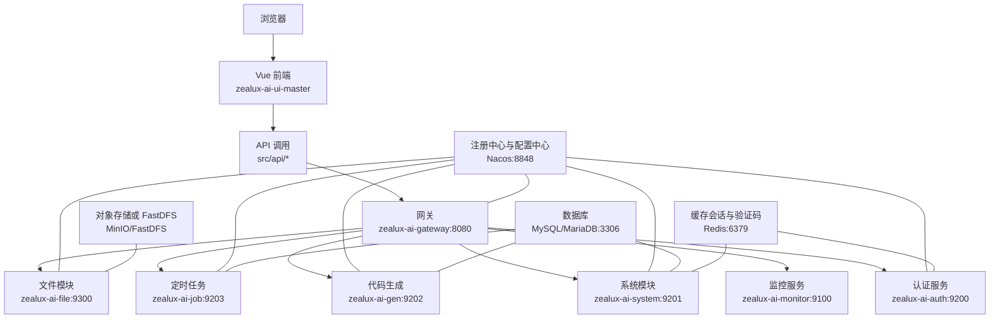
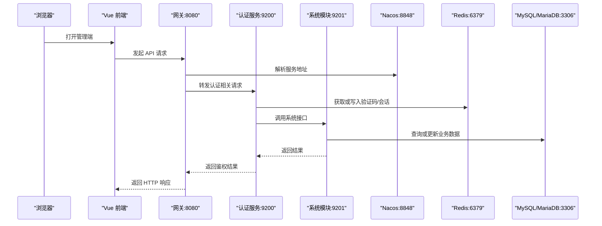
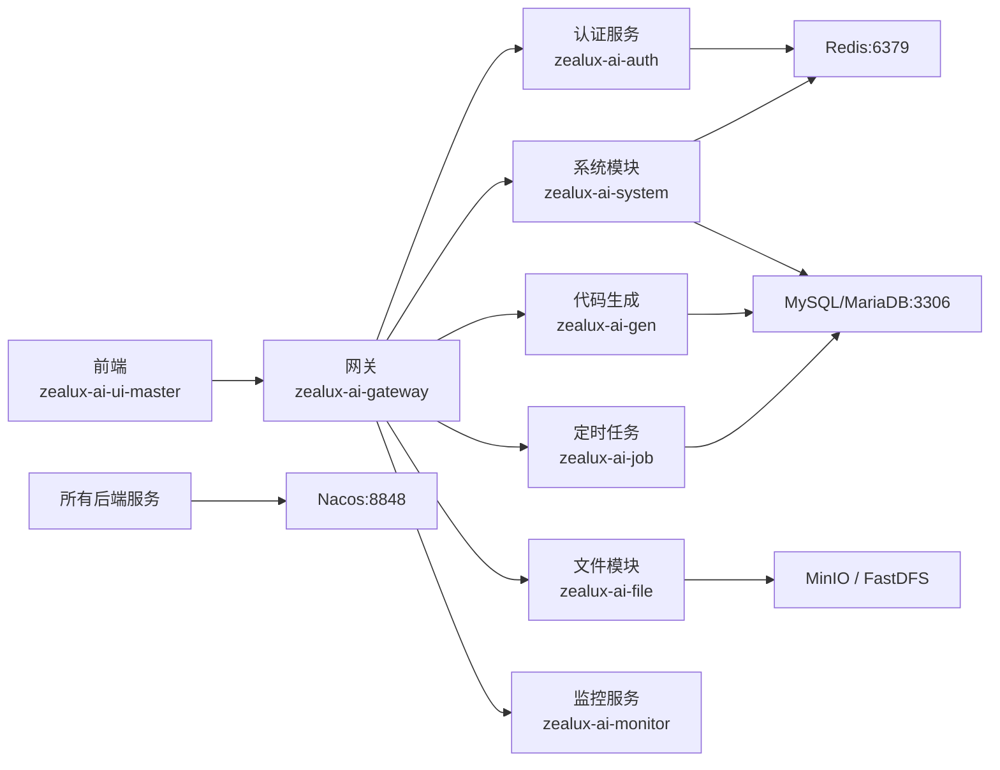
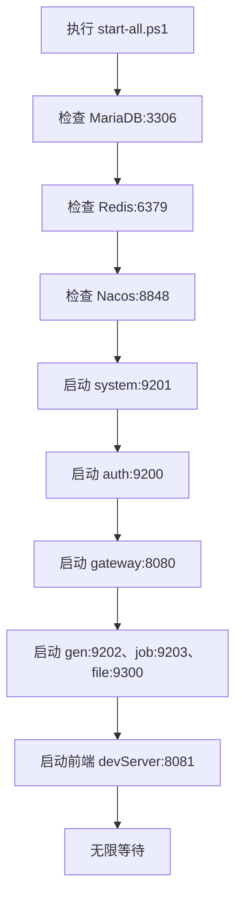

# 部署与运维

<cite>
**本文引用的文件**
- [pom.xml](file://zealux-ai-master/pom.xml)
- [package.json](file://zealux-ai-ui-master/package.json)
- [start-all.ps1](file://_setup/start-all.ps1)
- [gateway-watch.ps1](file://_setup/gateway-watch.ps1)
- [bootstrap.yml（网关）](file://zealux-ai-master/zealux-ai-gateway/src/main/resources/bootstrap.yml)
- [bootstrap.yml（认证服务）](file://zealux-ai-master/zealux-ai-auth/src/main/resources/bootstrap.yml)
- [bootstrap.yml（系统模块）](file://zealux-ai-master/zealux-ai-modules/zealux-ai-system/src/main/resources/bootstrap.yml)
- [bootstrap.yml（代码生成模块）](file://zealux-ai-master/zealux-ai-modules/zealux-ai-gen/src/main/resources/bootstrap.yml)
- [bootstrap.yml（定时任务模块）](file://zealux-ai-master/zealux-ai-modules/zealux-ai-job/src/main/resources/bootstrap.yml)
- [bootstrap.yml（文件模块）](file://zealux-ai-master/zealux-ai-modules/zealux-ai-file/src/main/resources/bootstrap.yml)
- [bootstrap.yml（监控模块）](file://zealux-ai-master/zealux-ai-visual/zealux-ai-monitor/src/main/resources/bootstrap.yml)
- [application-dev.yml（Nacos 共享配置）](file://_setup/stack/nacos/nacos/data/config-data/DEFAULT_GROUP/application-dev.yml)
- [zealux-ai-system-dev.yml（系统模块 Nacos 配置）](file://_setup/stack/nacos/nacos/data/config-data/DEFAULT_GROUP/zealux-ai-system-dev.yml)
- [zealux-ai-file-dev.yml（文件模块 Nacos 配置）](file://_setup/stack/nacos/nacos/data/config-data/DEFAULT_GROUP/zealux-ai-file-dev.yml)
- [zealux-ai-gen-dev.yml（代码生成模块 Nacos 配置）](file://_setup/stack/nacos/nacos/data/config-data/DEFAULT_GROUP/zealux-ai-gen-dev.yml)
- [zealux-ai-job-dev.yml（定时任务模块 Nacos 配置）](file://_setup/stack/nacos/nacos/data/config-data/DEFAULT_GROUP/zealux-ai-job-dev.yml)
</cite>

## 目录
1. [简介](#简介)
2. [项目结构](#项目结构)
3. [核心组件](#核心组件)
4. [架构总览](#架构总览)
5. [详细组件分析](#详细组件分析)
6. [依赖关系分析](#依赖关系分析)
7. [性能与容量规划](#性能与容量规划)
8. [部署步骤与端口规划](#部署步骤与端口规划)
9. [故障排查清单](#故障排查清单)
10. [结论](#结论)

## 简介
本仓库是开源 RuoYi-Cloud 3.6.5 的重命名二次开发，根 `pom.xml` 的 artifactId 为 `zealux-ai`、版本为 `3.6.5`；前端 `package.json` 名称仍为 `ruoyi@3.6.5`。后端多个启动类仍沿用 `RuoYi*Application.java` 风格，公共库子目录也保留原命名。因此，在描述架构时应明确：它不是从零自研框架，而是基于 Spring Cloud + Nacos + MyBatis-Plus + Druid + MinIO 的微服务后台，并搭配 Vue 2 + Element UI 管理端前端。

需要特别强调三点现状：
- 数据库中不存在任何 `crm_` 前缀表；此前讨论过的 CRM 建表方案并未在本工作区执行，也不应被描述为已具备能力。
- `zealux-ai-leads` 模块当前只有少量 Java 文件，缺少前端页面、菜单、Nacos 配置和网关路由，且本地 Redis 缺 RediSearch 模块，因此该服务不可运行。
- 本地 `_setup` 下的脚本、JDK、Maven、MariaDB、Redis、Nacos 等属于排查环境产物，不是生产部署模板。

## 项目结构
本项目采用 Maven 多模块后端与独立前端仓库的组合：

- 后端根工程：`zealux-ai-master`，使用 Spring Boot 3.3.5、Spring Cloud 2023.0.3、Spring Cloud Alibaba 2023.0.1.2、Java 17。
- 公共库：`zealux-ai-common`，包含 `core`、`security`、`log`、`redis`、`swagger`、`datasource`、`datascope`、`ruoyi-common-sensitive`、`ai` 等非空子模块。
- 网关与服务：`zealux-ai-gateway`、`zealux-ai-auth`、`zealux-ai-modules`（system/gen/job/file/leads）、`zealux-ai-visual`。
- 前端主仓库：`zealux-ai-ui-master`，源码位于 `src/api`、`src/views`、`src/store`、`src/router`、`src/permission.js`、`src/components`、`src/layout` 等层次。
- 后端内嵌的前端拷贝：`zealux-ai-master/zealux-ai-ui` 是重复副本，不参与根 `pom.xml` 构建，应以 `zealux-ai-ui-master` 为准。

**图表来源**
- [bootstrap.yml（网关）](file://zealux-ai-master/zealux-ai-gateway/src/main/resources/bootstrap.yml#L1-L44)
- [bootstrap.yml（认证服务）](file://zealux-ai-master/zealux-ai-auth/src/main/resources/bootstrap.yml#L1-L25)
- [bootstrap.yml（系统模块）](file://zealux-ai-master/zealux-ai-modules/zealux-ai-system/src/main/resources/bootstrap.yml#L1-L25)
- [bootstrap.yml（代码生成模块）](file://zealux-ai-master/zealux-ai-modules/zealux-ai-gen/src/main/resources/bootstrap.yml#L1-L25)
- [bootstrap.yml（定时任务模块）](file://zealux-ai-master/zealux-ai-modules/zealux-ai-job/src/main/resources/bootstrap.yml#L1-L25)
- [bootstrap.yml（文件模块）](file://zealux-ai-master/zealux-ai-modules/zealux-ai-file/src/main/resources/bootstrap.yml#L1-L25)
- [bootstrap.yml（监控模块）](file://zealux-ai-master/zealux-ai-visual/zealux-ai-monitor/src/main/resources/bootstrap.yml#L1-L25)

**章节来源**
- [pom.xml](file://zealux-ai-master/pom.xml#L1-L200)
- [package.json](file://zealux-ai-ui-master/package.json#L1-L90)

## 核心组件
| 组件 | 默认端口 | 主要职责 | 关键配置位置 |
|---|---:|---|---|
| Nacos | 8848 | 服务注册发现、配置中心、Sentinel 规则持久化 | 本地单机启动参数与 Nacos 共享配置 |
| 网关 | 8080 | 统一入口、请求缓存、黑名单校验、验证码过滤、动态路由 | `zealux-ai-gateway/bootstrap.yml` |
| 认证服务 | 9200 | 登录、鉴权、令牌签发与校验 | `zealux-ai-auth/bootstrap.yml`、Nacos 共享配置 |
| 系统模块 | 9201 | 用户、角色、菜单、数据权限、Druid 监控 | `zealux-ai-system/bootstrap.yml`、`zealux-ai-system-dev.yml` |
| 代码生成模块 | 9202 | 模板与代码生成 | `zealux-ai-gen/bootstrap.yml`、`zealux-ai-gen-dev.yml` |
| 定时任务模块 | 9203 | Quartz 调度、JDBC Job Store | `zealux-ai-job/bootstrap.yml`、`zealux-ai-job-dev.yml` |
| 文件模块 | 9300 | 本地上传、FastDFS、MinIO | `zealux-ai-file/bootstrap.yml`、`zealux-ai-file-dev.yml` |
| 监控模块 | 9100 | Spring Boot Admin 监控 | `zealux-ai-monitor/bootstrap.yml` |
| 前端 | 8081 | Vue 2 + Element UI 管理界面 | `vue.config.js`、`src/api/*`、`src/views/*` |

**章节来源**
- [bootstrap.yml（网关）](file://zealux-ai-master/zealux-ai-gateway/src/main/resources/bootstrap.yml#L1-L44)
- [bootstrap.yml（认证服务）](file://zealux-ai-master/zealux-ai-auth/src/main/resources/bootstrap.yml#L1-L25)
- [bootstrap.yml（系统模块）](file://zealux-ai-master/zealux-ai-modules/zealux-ai-system/src/main/resources/bootstrap.yml#L1-L25)
- [bootstrap.yml（代码生成模块）](file://zealux-ai-master/zealux-ai-modules/zealux-ai-gen/src/main/resources/bootstrap.yml#L1-L25)
- [bootstrap.yml（定时任务模块）](file://zealux-ai-master/zealux-ai-modules/zealux-ai-job/src/main/resources/bootstrap.yml#L1-L25)
- [bootstrap.yml（文件模块）](file://zealux-ai-master/zealux-ai-modules/zealux-ai-file/src/main/resources/bootstrap.yml#L1-L25)
- [bootstrap.yml（监控模块）](file://zealux-ai-master/zealux-ai-visual/zealux-ai-monitor/src/main/resources/bootstrap.yml#L1-L25)

## 架构总览
后端整体遵循 Spring Cloud 微服务架构：前端通过网关访问各业务服务；服务通过 Nacos 完成注册与配置拉取；数据库由 MySQL 或 MariaDB 提供，连接池使用 Druid；Redis 用于会话与验证码等缓存；文件模块支持本地路径、FastDFS 与 MinIO。

**图表来源**
- [bootstrap.yml（网关）](file://zealux-ai-master/zealux-ai-gateway/src/main/resources/bootstrap.yml#L1-L44)
- [bootstrap.yml（认证服务）](file://zealux-ai-master/zealux-ai-auth/src/main/resources/bootstrap.yml#L1-L25)
- [bootstrap.yml（系统模块）](file://zealux-ai-master/zealux-ai-modules/zealux-ai-system/src/main/resources/bootstrap.yml#L1-L25)
- [zealux-ai-system-dev.yml（系统模块 Nacos 配置）](file://_setup/stack/nacos/nacos/data/config-data/DEFAULT_GROUP/zealux-ai-system-dev.yml#L1-L55)

## 详细组件分析

### Nacos：注册中心与配置中心
- 单机模式：本地脚本以 `-Dnacos.standalone=true` 启动，使用内置存储。
- 服务名：各服务的 `spring.application.name` 来自各自 `bootstrap.yml`，例如 `zealux-ai-gateway`、`zealux-ai-auth`、`zealux-ai-system`、`zealux-ai-gen`、`zealux-ai-job`、`zealux-ai-file`、`zealux-ai-monitor`。
- dataId：每个服务通过 `shared-configs` 引用 `application-${spring.profiles.active}.yml`，即 `application-dev.yml`；同时存在按服务命名的 dataId，如 `zealux-ai-system-dev.yml`、`zealux-ai-file-dev.yml`、`zealux-ai-gen-dev.yml`、`zealux-ai-job-dev.yml`。
- Sentinel：网关还从 Nacos 加载 Sentinel 网关流控规则，dataId 为 `sentinel-zealux-ai-gateway`，groupId 为 `DEFAULT_GROUP`。

**章节来源**
- [start-all.ps1](file://_setup/start-all.ps1#L1-L71)
- [bootstrap.yml（网关）](file://zealux-ai-master/zealux-ai-gateway/src/main/resources/bootstrap.yml#L1-L44)
- [bootstrap.yml（认证服务）](file://zealux-ai-master/zealux-ai-auth/src/main/resources/bootstrap.yml#L1-L25)
- [bootstrap.yml（系统模块）](file://zealux-ai-master/zealux-ai-modules/zealux-ai-system/src/main/resources/bootstrap.yml#L1-L25)
- [bootstrap.yml（代码生成模块）](file://zealux-ai-master/zealux-ai-modules/zealux-ai-gen/src/main/resources/bootstrap.yml#L1-L25)
- [bootstrap.yml（定时任务模块）](file://zealux-ai-master/zealux-ai-modules/zealux-ai-job/src/main/resources/bootstrap.yml#L1-L25)
- [bootstrap.yml（文件模块）](file://zealux-ai-master/zealux-ai-modules/zealux-ai-file/src/main/resources/bootstrap.yml#L1-L25)
- [bootstrap.yml（监控模块）](file://zealux-ai-master/zealux-ai-visual/zealux-ai-monitor/src/main/resources/bootstrap.yml#L1-L25)
- [application-dev.yml（Nacos 共享配置）](file://_setup/stack/nacos/nacos/data/config-data/DEFAULT_GROUP/application-dev.yml#L1-L35)
- [zealux-ai-system-dev.yml（系统模块 Nacos 配置）](file://_setup/stack/nacos/nacos/data/config-data/DEFAULT_GROUP/zealux-ai-system-dev.yml#L1-L55)
- [zealux-ai-file-dev.yml（文件模块 Nacos 配置）](file://_setup/stack/nacos/nacos/data/config-data/DEFAULT_GROUP/zealux-ai-file-dev.yml#L1-L19)
- [zealux-ai-gen-dev.yml（代码生成模块 Nacos 配置）](file://_setup/stack/nacos/nacos/data/config-data/DEFAULT_GROUP/zealux-ai-gen-dev.yml#L1-L19)
- [zealux-ai-job-dev.yml（定时任务模块 Nacos 配置）](file://_setup/stack/nacos/nacos/data/config-data/DEFAULT_GROUP/zealux-ai-job-dev.yml#L1-L27)

### Redis：会话与验证码缓存
- 服务通过 Nacos 中的 `zealux-ai-*-dev.yml` 配置 Redis 主机、端口和密码。
- 系统模块使用 Druid 时显式排除了 Druid 自动装配，避免与动态数据源冲突。
- 本地脚本默认未启用 Redis 密码；生产应设置强口令并限制访问网络段。

**章节来源**
- [zealux-ai-system-dev.yml（系统模块 Nacos 配置）](file://_setup/stack/nacos/nacos/data/config-data/DEFAULT_GROUP/zealux-ai-system-dev.yml#L1-L55)
- [zealux-ai-gen-dev.yml（代码生成模块 Nacos 配置）](file://_setup/stack/nacos/nacos/data/config-data/DEFAULT_GROUP/zealux-ai-gen-dev.yml#L1-L19)
- [zealux-ai-job-dev.yml（定时任务模块 Nacos 配置）](file://_setup/stack/nacos/nacos/data/config-data/DEFAULT_GROUP/zealux-ai-job-dev.yml#L1-L27)
- [application-dev.yml（Nacos 共享配置）](file://_setup/stack/nacos/nacos/data/config-data/DEFAULT_GROUP/application-dev.yml#L1-L35)

### MySQL / MariaDB：数据库与连接池
- 系统模块使用动态数据源，driver 为 `com.mysql.cj.jdbc.Driver`，URL 指向 `zealux-ai-cloud` 库，用户名与密码在本地配置中为 `root/root`。
- 代码生成与定时任务模块直接使用标准 `spring.datasource`，而非动态数据源。
- Druid 连接池参数包括初始大小、空闲连接、最大连接数、等待超时、空闲驱逐时间、验证语句及慢 SQL 阈值等。

**章节来源**
- [zealux-ai-system-dev.yml（系统模块 Nacos 配置）](file://_setup/stack/nacos/nacos/data/config-data/DEFAULT_GROUP/zealux-ai-system-dev.yml#L1-L55)
- [zealux-ai-gen-dev.yml（代码生成模块 Nacos 配置）](file://_setup/stack/nacos/nacos/data/config-data/DEFAULT_GROUP/zealux-ai-gen-dev.yml#L1-L19)
- [zealux-ai-job-dev.yml（定时任务模块 Nacos 配置）](file://_setup/stack/nacos/nacos/data/config-data/DEFAULT_GROUP/zealux-ai-job-dev.yml#L1-L27)

### MinIO / FastDFS：文件存储
- 文件模块的 Nacos 配置中包含本地上传路径、FastDFS 追踪器地址以及 MinIO 的 URL、accessKey、secretKey 和 bucketName。
- 本地示例中 MinIO 地址与 FastDFS 地址均指向外部测试地址；生产应替换为内部可用地址并重新创建对应 bucket。

**章节来源**
- [zealux-ai-file-dev.yml（文件模块 Nacos 配置）](file://_setup/stack/nacos/nacos/data/config-data/DEFAULT_GROUP/zealux-ai-file-dev.yml#L1-L19)

### 网关与安全
- 网关监听 8080 端口，并通过 Spring Cloud Gateway 过滤器实现验证码校验、请求体缓存和黑名单拦截。
- Sentinel 控制台地址与网关流控规则的 dataId、groupId 均在网关 `bootstrap.yml` 中声明。
- 根据本地核查，网关只暴露 `/auth/**`、`/system/**`、`/code/**`、`/schedule/**`、`/file/**` 五类前缀路由；不存在 `/leads/**` 或 CRM 路由。

**章节来源**
- [bootstrap.yml（网关）](file://zealux-ai-master/zealux-ai-gateway/src/main/resources/bootstrap.yml#L1-L44)

### 前端
- 前端仓库名称仍为 `ruoyi`，版本 `3.6.5`，使用 Node 开发脚本 `npm run dev`。
- 本地脚本会启动前端 devServer 并监听 8081 端口；生产建议构建静态资源后由反向代理或 CDN 托管。
- 前端源码组织应关注 `src/api`、`src/views`、`src/store`、`src/router`、`src/permission.js`、`src/components`、`src/layout`。

**章节来源**
- [package.json](file://zealux-ai-ui-master/package.json#L1-L90)
- [start-all.ps1](file://_setup/start-all.ps1#L1-L71)

## 依赖关系分析

**图表来源**
- [bootstrap.yml（网关）](file://zealux-ai-master/zealux-ai-gateway/src/main/resources/bootstrap.yml#L1-L44)
- [bootstrap.yml（认证服务）](file://zealux-ai-master/zealux-ai-auth/src/main/resources/bootstrap.yml#L1-L25)
- [bootstrap.yml（系统模块）](file://zealux-ai-master/zealux-ai-modules/zealux-ai-system/src/main/resources/bootstrap.yml#L1-L25)
- [bootstrap.yml（代码生成模块）](file://zealux-ai-master/zealux-ai-modules/zealux-ai-gen/src/main/resources/bootstrap.yml#L1-L25)
- [bootstrap.yml（定时任务模块）](file://zealux-ai-master/zealux-ai-modules/zealux-ai-job/src/main/resources/bootstrap.yml#L1-L25)
- [bootstrap.yml（文件模块）](file://zealux-ai-master/zealux-ai-modules/zealux-ai-file/src/main/resources/bootstrap.yml#L1-L25)
- [bootstrap.yml（监控模块）](file://zealux-ai-master/zealux-ai-visual/zealux-ai-monitor/src/main/resources/bootstrap.yml#L1-L25)
- [zealux-ai-system-dev.yml（系统模块 Nacos 配置）](file://_setup/stack/nacos/nacos/data/config-data/DEFAULT_GROUP/zealux-ai-system-dev.yml#L1-L55)
- [zealux-ai-file-dev.yml（文件模块 Nacos 配置）](file://_setup/stack/nacos/nacos/data/config-data/DEFAULT_GROUP/zealux-ai-file-dev.yml#L1-L19)

## 性能与容量规划

### JVM 与进程内存
- 本地脚本为 Nacos 分配 `-Xms512m -Xmx512m -Xmn256m`，为业务服务分配 `-Xms256m -Xmx512m`。
- 生产应按容器规格和业务负载调大堆内存，并开启 GC 日志；对网关、认证、系统模块优先保障堆空间，对定时任务和监控可适当降低内存。

### 连接池与线程池
- Druid 连接池默认初始 5、最大 20，适合开发；生产应根据并发连接数和数据库实例规格提升 `maxActive`，并合理设置 `maxWait`、`validationQuery`、`testWhileIdle`。
- 定时任务模块使用 Quartz JDBC 模式，线程池大小为 5；高并发任务场景下可增大 `thread-count`，但需评估数据库压力。

### 网络与超时
- Feign 默认连接与读取超时为 10 秒，压缩开关已启用；生产应在 Nacos 配置中按服务调整超时与重试策略。
- 网关 Sentinel 流控规则应从 Nacos 加载，避免把限流规则写死在本地磁盘。

### 容量规划建议
- 单节点小规模：1 台 8C16G 服务器可同时承载 Nacos、Redis、MariaDB、网关、认证、系统、文件、监控；数据库和缓存建议单独实例以提升稳定性。
- 生产规模：网关与认证至少双副本；数据库使用主从或云数据库；Redis 使用集群或哨兵；MinIO 使用分布式桶；Nacos 使用集群模式。

[本节为通用运维建议，不直接分析具体文件]

## 部署步骤与端口规划

### 单机依赖安装要求
| 依赖 | 推荐版本 | 安装要点 | 端口 |
|---|---|---|---:|
| JDK | 17 | 后端使用 Spring Boot 3.3.5，要求 Java 17 | — |
| Nacos | 单机模式 | 开发可使用内置存储；生产建议使用 MySQL 持久化 | 8848 |
| Redis | 任意稳定版 | 会话与验证码缓存；生产需设置密码并限制网络 | 6379 |
| MySQL / MariaDB | 5.7+ 或 MariaDB 10.5+ | 初始化 `zealux-ai-cloud` 数据库；注意字符集与时区 | 3306 |
| MinIO 或 FastDFS | 与仓库 MinIO 8.2.2 兼容 | 创建 bucket，配置 endpoint、accessKey、secretKey | MinIO 默认 9000 |

**章节来源**
- [pom.xml](file://zealux-ai-master/pom.xml#L1-L200)
- [bootstrap.yml（网关）](file://zealux-ai-master/zealux-ai-gateway/src/main/resources/bootstrap.yml#L1-L44)
- [zealux-ai-system-dev.yml（系统模块 Nacos 配置）](file://_setup/stack/nacos/nacos/data/config-data/DEFAULT_GROUP/zealux-ai-system-dev.yml#L1-L55)
- [zealux-ai-file-dev.yml（文件模块 Nacos 配置）](file://_setup/stack/nacos/nacos/data/config-data/DEFAULT_GROUP/zealux-ai-file-dev.yml#L1-L19)

### bootstrap.yml 配置模板
以下字段可直接作为生产配置模板的参考项，请替换占位值：

- 服务名：填写实际服务名，例如 `zealux-ai-gateway`、`zealux-ai-auth`、`zealux-ai-system`、`zealux-ai-gen`、`zealux-ai-job`、`zealux-ai-file`、`zealux-ai-monitor`。
- 环境：保持 `active: dev` 或改为 `prod`，并确保 Nacos 中存在对应的 `application-prod.yml`。
- Nacos 地址：填写集群或单节点的 `server-addr`，例如 `nacos:8848` 或 `nacos1:8848,nacos2:8848,nacos3:8848`。
- dataId：使用 `application-${spring.profiles.active}.yml` 作为共享 dataId，并按服务补充 `zealux-ai-{service}-dev.yml`。
- 数据库：填写 `jdbc:mysql://host:3306/database?useUnicode=true&characterEncoding=utf8&useSSL=false&serverTimezone=GMT%2B8`，并配置用户名与口令。
- Redis：填写 host、port、password。
- MinIO：填写 `url`、`accessKey`、`secretKey`、`bucketName`。

**章节来源**
- [bootstrap.yml（网关）](file://zealux-ai-master/zealux-ai-gateway/src/main/resources/bootstrap.yml#L1-L44)
- [bootstrap.yml（认证服务）](file://zealux-ai-master/zealux-ai-auth/src/main/resources/bootstrap.yml#L1-L25)
- [bootstrap.yml（系统模块）](file://zealux-ai-master/zealux-ai-modules/zealux-ai-system/src/main/resources/bootstrap.yml#L1-L25)
- [bootstrap.yml（代码生成模块）](file://zealux-ai-master/zealux-ai-modules/zealux-ai-gen/src/main/resources/bootstrap.yml#L1-L25)
- [bootstrap.yml（定时任务模块）](file://zealux-ai-master/zealux-ai-modules/zealux-ai-job/src/main/resources/bootstrap.yml#L1-L25)
- [bootstrap.yml（文件模块）](file://zealux-ai-master/zealux-ai-modules/zealux-ai-file/src/main/resources/bootstrap.yml#L1-L25)
- [bootstrap.yml（监控模块）](file://zealux-ai-master/zealux-ai-visual/zealux-ai-monitor/src/main/resources/bootstrap.yml#L1-L25)
- [zealux-ai-system-dev.yml（系统模块 Nacos 配置）](file://_setup/stack/nacos/nacos/data/config-data/DEFAULT_GROUP/zealux-ai-system-dev.yml#L1-L55)
- [zealux-ai-file-dev.yml（文件模块 Nacos 配置）](file://_setup/stack/nacos/nacos/data/config-data/DEFAULT_GROUP/zealux-ai-file-dev.yml#L1-L19)

### Windows 本地脚本说明
- `_setup/start-all.ps1`：检查并启动 MariaDB、Redis、Nacos，再按顺序启动 system、auth、gateway、gen、job、file 六个服务，最后启动前端 devServer。它会轮询端口等待依赖就绪，并把日志输出到 `_setup/logs`。
- `_setup/gateway-watch.ps1`：循环检测 8080 端口是否监听，若网关进程退出则重新启动，用于本地调试网关崩溃恢复。

这两个脚本都硬编码了本地 JDK、JAR 包路径和日志路径，属于本地开发辅助脚本，不应直接当作生产部署方案。

**图表来源**
- [start-all.ps1](file://_setup/start-all.ps1#L1-L71)

**章节来源**
- [start-all.ps1](file://_setup/start-all.ps1#L1-L71)
- [gateway-watch.ps1](file://_setup/gateway-watch.ps1#L1-L15)

### Docker / Kubernetes 部署建议
- 将每个服务打包为独立镜像，镜像基础镜像使用 OpenJDK 17。
- 通过 ConfigMap/Secret 注入 Nacos 地址、数据库连接串、Redis 密码、MinIO 凭据；不要把明文凭据写进镜像。
- 网关暴露 8080 端口，前端静态资源可由 Nginx 或 Ingress 托管；如需直连前端 devServer，仅用于开发环境。
- 使用 Deployment 管理副本数，StatefulSet 或云托管服务承载 Nacos、MySQL、Redis、MinIO。
- 健康检查使用 Spring Boot Actuator 暴露的端点；Nacos 可通过 HTTP 探测 8848 端口。
- 日志建议输出到 stdout/stderr，并由 Sidecar 或 DaemonSet 收集到集中日志平台。

[本节为概念性部署建议，不直接分析具体文件]

### 服务启动顺序
推荐顺序：
1. Nacos
2. Redis
3. MySQL / MariaDB
4. 系统模块
5. 认证服务
6. 网关
7. 代码生成、定时任务、文件模块
8. 监控模块
9. 前端 devServer 或静态资源

该顺序与本地脚本一致：认证依赖系统模块提供的 Nacos 配置，网关依赖认证服务对外暴露的路由。

**章节来源**
- [start-all.ps1](file://_setup/start-all.ps1#L1-L71)

### 端口规划
| 服务 | 端口 | 用途 |
|---:|---|---|
| Nacos | 8848 | 注册中心与配置中心 |
| 网关 | 8080 | 统一入口 |
| 认证服务 | 9200 | 登录与鉴权 |
| 系统模块 | 9201 | 系统管理接口 |
| 代码生成 | 9202 | 代码生成接口 |
| 定时任务 | 9203 | 调度任务 |
| 文件模块 | 9300 | 文件上传与下载 |
| 监控服务 | 9100 | Spring Boot Admin |
| 前端 devServer | 8081 | 本地开发代理 |
| MySQL / MariaDB | 3306 | 数据库 |
| Redis | 6379 | 缓存与会话 |
| MinIO | 9000 | 对象存储 |

**章节来源**
- [bootstrap.yml（网关）](file://zealux-ai-master/zealux-ai-gateway/src/main/resources/bootstrap.yml#L1-L44)
- [bootstrap.yml（认证服务）](file://zealux-ai-master/zealux-ai-auth/src/main/resources/bootstrap.yml#L1-L25)
- [bootstrap.yml（系统模块）](file://zealux-ai-master/zealux-ai-modules/zealux-ai-system/src/main/resources/bootstrap.yml#L1-L25)
- [bootstrap.yml（代码生成模块）](file://zealux-ai-master/zealux-ai-modules/zealux-ai-gen/src/main/resources/bootstrap.yml#L1-L25)
- [bootstrap.yml（定时任务模块）](file://zealux-ai-master/zealux-ai-modules/zealux-ai-job/src/main/resources/bootstrap.yml#L1-L25)
- [bootstrap.yml（文件模块）](file://zealux-ai-master/zealux-ai-modules/zealux-ai-file/src/main/resources/bootstrap.yml#L1-L25)
- [bootstrap.yml（监控模块）](file://zealux-ai-master/zealux-ai-visual/zealux-ai-monitor/src/main/resources/bootstrap.yml#L1-L25)
- [start-all.ps1](file://_setup/start-all.ps1#L1-L71)

### 日志收集
- 本地脚本将 Nacos、MariaDB、Redis、各服务、前端 devServer 的 stdout 和 stderr 重定向到 `_setup/logs`。
- 生产建议：
  - 后端服务统一输出 JSON 日志到 stdout。
  - 使用 Filebeat、Fluent Bit 或 Logstash 采集到 Elasticsearch / Loki。
  - 对 Nacos、数据库、Redis、MinIO 分别保留独立日志目录。
  - 不要将真实账号、口令、token、api-key 写入日志；示例中涉及凭据的地方应替换为环境变量或密钥管理系统。

**章节来源**
- [start-all.ps1](file://_setup/start-all.ps1#L1-L71)
- [gateway-watch.ps1](file://_setup/gateway-watch.ps1#L1-L15)

## 故障排查清单

### Nacos 连接失败
- 确认 Nacos 进程已启动，8848 端口处于监听状态。
- 检查各服务 `bootstrap.yml` 中 `spring.cloud.nacos.discovery.server-addr` 与 `config.server-addr`。
- 检查 Nacos 共享 dataId `application-dev.yml` 和各服务 dataId `zealux-ai-*-dev.yml` 是否存在。
- 若使用集群，确认所有节点可达，并检查防火墙与 DNS。
- 查看 Nacos 启动日志和服务端配置文件。

**章节来源**
- [bootstrap.yml（网关）](file://zealux-ai-master/zealux-ai-gateway/src/main/resources/bootstrap.yml#L1-L44)
- [bootstrap.yml（认证服务）](file://zealux-ai-master/zealux-ai-auth/src/main/resources/bootstrap.yml#L1-L25)
- [bootstrap.yml（系统模块）](file://zealux-ai-master/zealux-ai-modules/zealux-ai-system/src/main/resources/bootstrap.yml#L1-L25)
- [application-dev.yml（Nacos 共享配置）](file://_setup/stack/nacos/nacos/data/config-data/DEFAULT_GROUP/application-dev.yml#L1-L35)

### Redis 无响应
- 检查 6379 端口是否开放。
- 核对 Nacos 中 `zealux-ai-*-dev.yml` 的 Redis host、port、password。
- 如果启用了密码，确保客户端配置与 Redis 配置一致。
- 检查 Redis 内存、持久化、AOF/RDB 是否异常。

**章节来源**
- [zealux-ai-system-dev.yml（系统模块 Nacos 配置）](file://_setup/stack/nacos/nacos/data/config-data/DEFAULT_GROUP/zealux-ai-system-dev.yml#L1-L55)
- [zealux-ai-gen-dev.yml（代码生成模块 Nacos 配置）](file://_setup/stack/nacos/nacos/data/config-data/DEFAULT_GROUP/zealux-ai-gen-dev.yml#L1-L19)
- [zealux-ai-job-dev.yml（定时任务模块 Nacos 配置）](file://_setup/stack/nacos/nacos/data/config-data/DEFAULT_GROUP/zealux-ai-job-dev.yml#L1-L27)

### MySQL 连接池耗尽
- 现象：请求长时间等待、出现连接获取超时或连接池满错误。
- 排查：
  - 检查 Druid 最大连接数是否过小。
  - 检查是否有长事务或未关闭连接。
  - 检查慢 SQL 与高频查询。
  - 检查数据库连接数上限、CPU 和 IO 瓶颈。
- 调整：适当提升 `maxActive`，缩短事务，增加索引，必要时扩容数据库。

**章节来源**
- [zealux-ai-system-dev.yml（系统模块 Nacos 配置）](file://_setup/stack/nacos/nacos/data/config-data/DEFAULT_GROUP/zealux-ai-system-dev.yml#L1-L55)

### 网关 401 / 403
- 401：通常表示未携带有效令牌或令牌过期。
- 403：通常表示有令牌但权限不足。
- 排查：
  - 检查前端是否成功登录并拿到 token。
  - 检查网关是否正确转发到认证服务。
  - 检查认证服务是否可正常访问 Redis 与系统模块。
  - 检查 Nacos 共享配置中 Feign、Sentinel、监控端点等是否影响网关行为。

**章节来源**
- [bootstrap.yml（网关）](file://zealux-ai-master/zealux-ai-gateway/src/main/resources/bootstrap.yml#L1-L44)
- [bootstrap.yml（认证服务）](file://zealux-ai-master/zealux-ai-auth/src/main/resources/bootstrap.yml#L1-L25)
- [application-dev.yml（Nacos 共享配置）](file://_setup/stack/nacos/nacos/data/config-data/DEFAULT_GROUP/application-dev.yml#L1-L35)

### 服务启动 OOM
- 现象：服务启动后立即被操作系统或容器管理器杀死。
- 排查：
  - 检查 JVM 堆大小是否过小。
  - 检查是否加载了大量静态资源或大字典。
  - 检查数据库连接池、线程池是否过大。
  - 检查容器内存限制。
- 处理：逐步调大 `-Xmx`，开启 GC 日志，定位大对象来源。

**章节来源**
- [start-all.ps1](file://_setup/start-all.ps1#L1-L71)

### 前端 devServer 无法代理后端
- 现象：浏览器能打开前端，但 API 请求失败。
- 排查：
  - 确认后端服务已启动，网关 8080 可访问。
  - 检查前端 devServer 是否启动在 8081。
  - 检查前端代理目标是否指向网关。
  - 检查跨域、cookie、token 传递。
  - 检查本地脚本是否因端口占用而跳过启动某个服务。

**章节来源**
- [package.json](file://zealux-ai-ui-master/package.json#L1-L90)
- [start-all.ps1](file://_setup/start-all.ps1#L1-L71)

## 结论
本系统是基于 RuoYi-Cloud 3.6.5 的微服务后台，核心依赖为 Nacos、Redis、MySQL/MariaDB 与 MinIO/FastDFS。生产部署应明确区分本地脚本与生产方案：`_setup/start-all.ps1` 与 `_setup/gateway-watch.ps1` 仅适用于本地开发；生产应采用容器化部署、集中配置、独立中间件实例、安全凭据管理和集中日志采集。部署时需先启动 Nacos、Redis、数据库，再按 system → auth → gateway → 其他服务的顺序启动后端，最后上线前端静态资源。运维过程中应重点监控 Nacos 连通性、Redis 可用性、数据库连接池、网关鉴权和 JVM 内存。