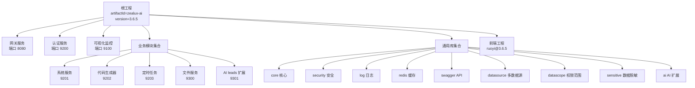
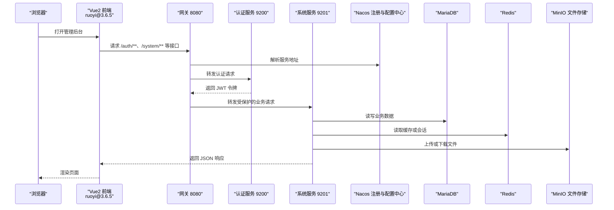
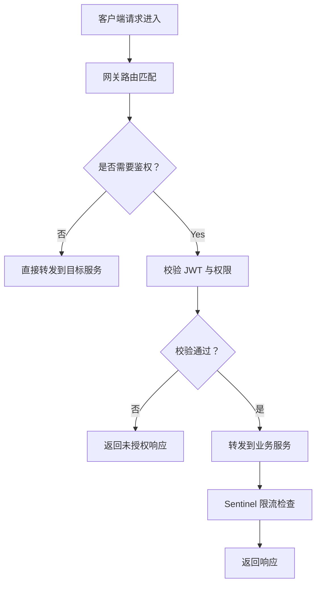
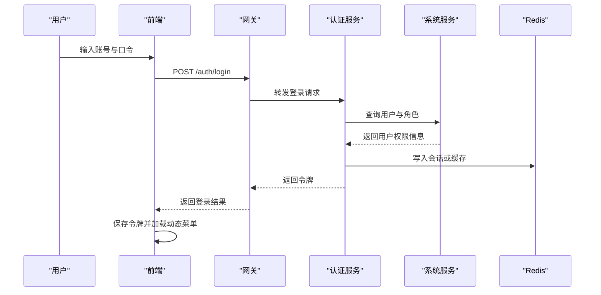
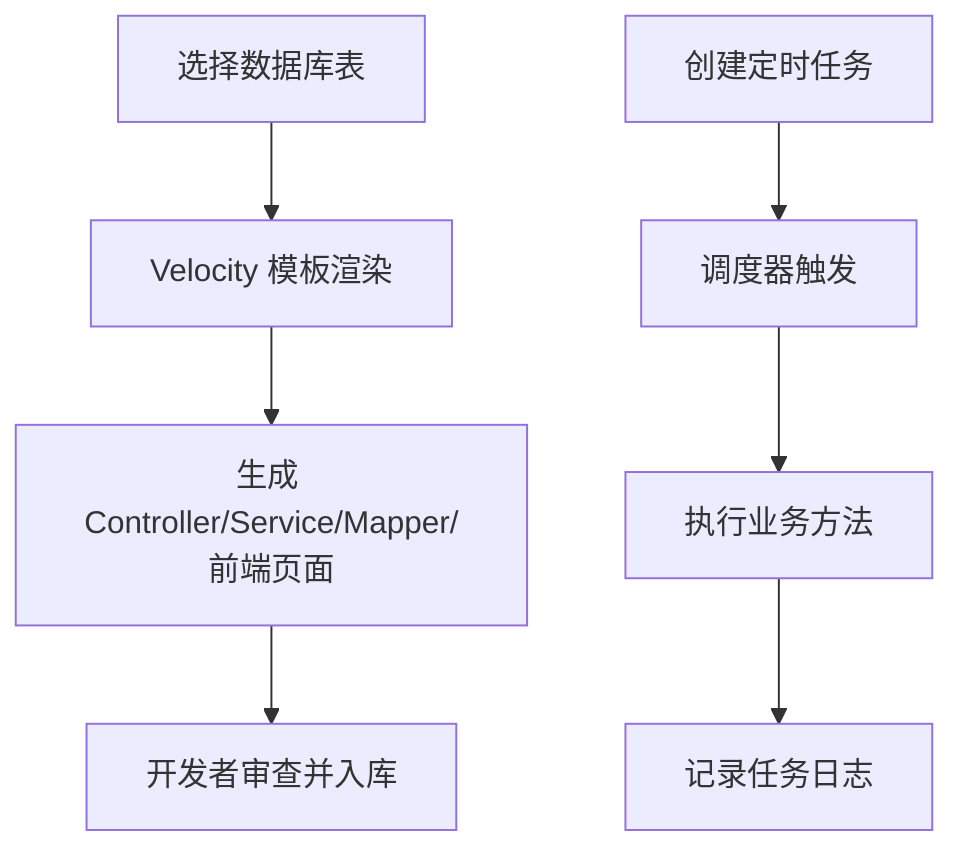
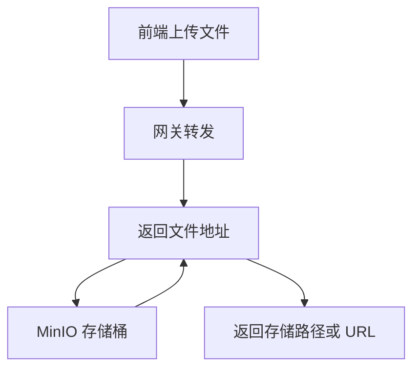
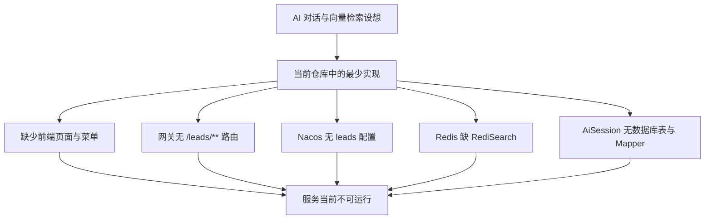
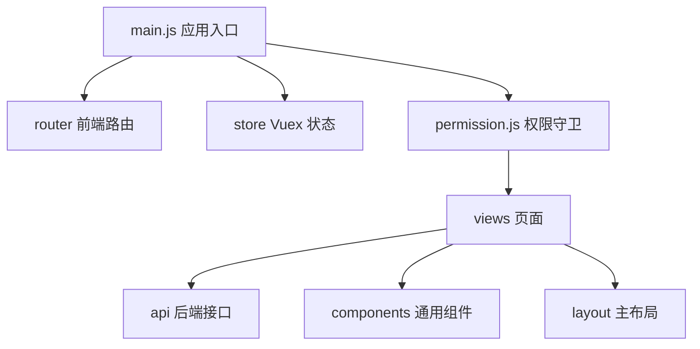
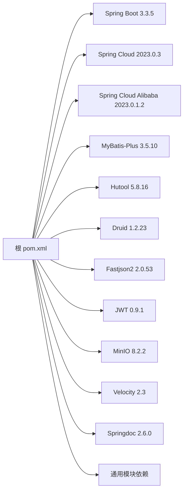
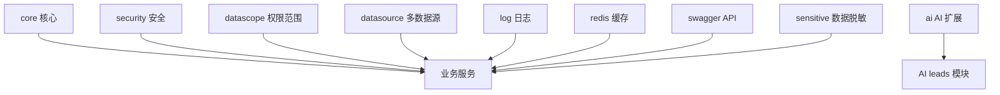

# 项目概述

<cite>
**本文引用的文件**   
- [根 pom.xml](file://zealux-ai-master/pom.xml)
- [前端 package.json](file://zealux-ai-ui-master/package.json)
- [网关启动类 RuoYiGatewayApplication.java](file://zealux-ai-master/zealux-ai-gateway/src/main/java/com/zealux/gateway/RuoYiGatewayApplication.java)
- [认证启动类 RuoYiAuthApplication.java](file://zealux-ai-master/zealux-ai-auth/src/main/java/com/zealux/auth/RuoYiAuthApplication.java)
- [系统服务启动类 RuoYiSystemApplication.java](file://zealux-ai-master/zealux-ai-modules/zealux-ai-system/src/main/java/com/zealux/system/RuoYiSystemApplication.java)
- [代码生成器启动类 RuoYiGenApplication.java](file://zealux-ai-master/zealux-ai-modules/zealux-ai-gen/src/main/java/com/zealux/gen/RuoYiGenApplication.java)
- [定时任务启动类 RuoYiJobApplication.java](file://zealux-ai-master/zealux-ai-modules/zealux-ai-job/src/main/java/com/zealux/job/RuoYiJobApplication.java)
- [文件服务启动类 RuoYiFileApplication.java](file://zealux-ai-master/zealux-ai-modules/zealux-ai-file/src/main/java/com/zealux/file/RuoYiFileApplication.java)
- [AI leads 启动类 ZealuxAiLeadsApplication.java](file://zealux-ai-master/zealux-ai-modules/zealux-ai-leads/src/main/java/com/zealux/leads/ZealuxAiLeadsApplication.java)
- [可视化监控启动类 RuoYiMonitorApplication.java](file://zealux-ai-master/zealux-ai-visual/zealux-ai-monitor/src/main/java/com/zealux/modules/monitor/RuoYiMonitorApplication.java)
- [网关 bootstrap.yml](file://zealux-ai-master/zealux-ai-gateway/src/main/resources/bootstrap.yml)
- [前端入口 main.js](file://zealux-ai-ui-master/src/main.js)
- [前端权限控制 permission.js](file://zealux-ai-ui-master/src/permission.js)
- [前端应用状态 store/index.js](file://zealux-ai-ui-master/src/store/index.js)
- [通用核心模块 zealux-ai-common-core](file://zealux-ai-master/zealux-ai-common/zealux-ai-common-core/src/main/java/com/zealux/common/core/)
- [安全模块 zealux-ai-common-security](file://zealux-ai-master/zealux-ai-common/zealux-ai-common-security/src/main/java/com/zealux/common/security/)
- [数据脱敏模块 ruoyi-common-sensitive](file://zealux-ai-master/zealux-ai-common/ruoyi-common-sensitive/src/main/java/com/ruoyi/common/sensitive/)
- [AI 配置模块 zealux-ai-common-ai](file://zealux-ai-master/zealux-ai-common/zealux-ai-common-ai/src/main/java/com/zealux/common/ai/config/)
</cite>

## 目录
1. [引言](#引言)
2. [项目结构](#项目结构)
3. [核心组件](#核心组件)
4. [架构总览](#架构总览)
5. [详细组件分析](#详细组件分析)
6. [依赖关系分析](#依赖关系分析)
7. [性能与可扩展性](#性能与可扩展性)
8. [常见问题排查](#常见问题排查)
9. [结论](#结论)
10. [附录：技术栈版本表](#附录技术栈版本表)

## 引言
本仓库是开源 RuoYi-Cloud 3.6.5 的重命名二次开发产物，工程根 `pom.xml` 的 `artifactId=zealux-ai`、`version=3.6.5`；前端 `package.json` 的名称仍为 `ruoyi@3.6.5`。尽管包名已改为 `com.zealux`，但七个后端服务的启动类仍保留 `RuoYi*Application.java` 命名，公共库子目录 `zealux-ai-common/ruoyi-common-sensitive` 的目录名也未被重命名。这说明本项目应被理解为“基于 RuoYi-Cloud 的微服务二次开发基座”，而不是从零自研框架。

系统采用 Spring Cloud Alibaba + Vue2/Element UI 的前后端分离架构，已实现的核心能力包括：
- RBAC 角色权限模型
- Nacos 服务注册与配置中心
- Sentinel 流量治理
- Seata 分布式事务扩展点
- MyBatis-Plus 持久层
- 代码生成器
- 定时任务
- MinIO 文件服务
- AI 对话与向量检索扩展（当前处于不完整扩展阶段）

需要特别注意：**本仓库中没有 CRM 相关数据库表或完整 CRM 业务接口**，也没有 `/leads/**` 网关路由；`zealux-ai-leads` 模块当前仅有少量 Java 文件，且本地 Redis 缺少 RediSearch 模块，因此该服务在当前工作区中不可运行。

## 项目结构
项目由 Maven 多模块构成，主要划分为四类：
- 根聚合工程：`zealux-ai-master/pom.xml`
- 基础设施模块：`zealux-ai-gateway`、`zealux-ai-auth`、`zealux-ai-visual`
- 业务模块：`zealux-ai-modules/{system,gen,job,file,leads}`
- 通用库模块：`zealux-ai-common/*`
- 前端工程：`zealux-ai-ui-master`（独立仓库），以及一份不参与构建的重复拷贝 `zealux-ai-master/zealux-ai-ui`

**图表来源**
- [根 pom.xml:1-12](file://zealux-ai-master/pom.xml#L1-L12)
- [根 pom.xml:12-130](file://zealux-ai-master/pom.xml#L12-L130)
- [根 pom.xml:261-331](file://zealux-ai-master/pom.xml#L261-L331)

**章节来源**
- [根 pom.xml:1-12](file://zealux-ai-master/pom.xml#L1-L12)
- [根 pom.xml:12-130](file://zealux-ai-master/pom.xml#L12-L130)
- [根 pom.xml:261-331](file://zealux-ai-master/pom.xml#L261-L331)
- [前端 package.json:1-20](file://zealux-ai-ui-master/package.json#L1-L20)

## 核心组件
| 组件 | 类型 | 端口 | 职责 | 是否已实现 |
|---|---|---:|---|---|
| 网关 | Spring Cloud Gateway | 8080 | 统一入口、Nacos 发现、Sentinel 网关限流 | 已实现 |
| 认证 | OAuth2/JWT 认证服务 | 9200 | 登录、令牌签发与校验、RBAC 鉴权 | 已实现 |
| 系统 | 系统管理服务 | 9201 | 用户、角色、菜单、字典、操作日志等基础功能 | 已实现 |
| 代码生成器 | 模板代码生成服务 | 9202 | 根据数据库元信息生成前后端代码 | 已实现 |
| 定时任务 | XXL-JOB 调度服务 | 9203 | 任务定义、执行与日志 | 已实现 |
| 文件服务 | MinIO 文件上传下载服务 | 9300 | 文件存储、预览与管理 | 已实现 |
| AI leads | AI 对话与向量检索扩展 | 9301 | 仅含少量控制器、领域对象与服务骨架 | 未完成 |
| 可视化监控 | Spring Boot Admin 监控 | 9100 | 微服务健康与运行状态监控 | 已实现 |

上述服务启动类名称可直接作为定位依据：
- 网关：`RuoYiGatewayApplication.java`
- 认证：`RuoYiAuthApplication.java`
- 系统：`RuoYiSystemApplication.java`
- 代码生成器：`RuoYiGenApplication.java`
- 定时任务：`RuoYiJobApplication.java`
- 文件服务：`RuoYiFileApplication.java`
- AI leads：`ZealuxAiLeadsApplication.java`
- 监控：`RuoYiMonitorApplication.java`

**章节来源**
- [网关启动类 RuoYiGatewayApplication.java](file://zealux-ai-master/zealux-ai-gateway/src/main/java/com/zealux/gateway/RuoYiGatewayApplication.java)
- [认证启动类 RuoYiAuthApplication.java](file://zealux-ai-master/zealux-ai-auth/src/main/java/com/zealux/auth/RuoYiAuthApplication.java)
- [系统服务启动类 RuoYiSystemApplication.java](file://zealux-ai-master/zealux-ai-modules/zealux-ai-system/src/main/java/com/zealux/system/RuoYiSystemApplication.java)
- [代码生成器启动类 RuoYiGenApplication.java](file://zealux-ai-master/zealux-ai-modules/zealux-ai-gen/src/main/java/com/zealux/gen/RuoYiGenApplication.java)
- [定时任务启动类 RuoYiJobApplication.java](file://zealux-ai-master/zealux-ai-modules/zealux-ai-job/src/main/java/com/zealux/job/RuoYiJobApplication.java)
- [文件服务启动类 RuoYiFileApplication.java](file://zealux-ai-master/zealux-ai-modules/zealux-ai-file/src/main/java/com/zealux/file/RuoYiFileApplication.java)
- [AI leads 启动类 ZealuxAiLeadsApplication.java](file://zealux-ai-master/zealux-ai-modules/zealux-ai-leads/src/main/java/com/zealux/leads/ZealuxAiLeadsApplication.java)
- [可视化监控启动类 RuoYiMonitorApplication.java](file://zealux-ai-master/zealux-ai-visual/zealux-ai-monitor/src/main/java/com/zealux/modules/monitor/RuoYiMonitorApplication.java)

## 架构总览
系统整体遵循典型的微服务分层：浏览器通过前端 SPA 访问网关，网关再转发到认证、系统、代码生成、定时任务、文件服务和监控服务。所有服务通过 Nacos 完成服务注册与配置获取，并集成 Sentinel 进行流量治理。数据库使用 MariaDB，缓存使用 Redis，MinIO 提供文件存储，Seata 作为分布式事务扩展点引入。

**图表来源**
- [网关 bootstrap.yml:1-44](file://zealux-ai-master/zealux-ai-gateway/src/main/resources/bootstrap.yml#L1-L44)
- [前端入口 main.js](file://zealux-ai-ui-master/src/main.js)
- [前端权限控制 permission.js](file://zealux-ai-ui-master/src/permission.js)

从前端视角看，SPA 通过 Axios 调用后端 REST 接口，路由与权限由前端 `router`、`store`、`permission.js` 共同维护；从后端视角看，网关承担统一入口和鉴权拦截，各业务服务只暴露最小 API 集。

**章节来源**
- [网关 bootstrap.yml:1-44](file://zealux-ai-master/zealux-ai-gateway/src/main/resources/bootstrap.yml#L1-L44)
- [前端入口 main.js](file://zealux-ai-ui-master/src/main.js)
- [前端权限控制 permission.js](file://zealux-ai-ui-master/src/permission.js)

## 详细组件分析

### 微服务与网关
网关服务监听 8080 端口，使用 Spring Cloud Gateway 接入 Nacos 服务发现与配置中心，并启用 Sentinel 网关流控规则。网关配置中明确指定 Nacos 地址 `127.0.0.1:8848`，同时声明共享配置文件与 Sentinel 控制台地址。

**图表来源**
- [网关 bootstrap.yml:1-44](file://zealux-ai-master/zealux-ai-gateway/src/main/resources/bootstrap.yml#L1-L44)

**章节来源**
- [网关 bootstrap.yml:1-44](file://zealux-ai-master/zealux-ai-gateway/src/main/resources/bootstrap.yml#L1-L44)

### 认证与 RBAC 权限
认证服务负责登录、令牌签发与权限校验；系统服务则承载 RBAC 所需的基础数据，如用户、角色、菜单与权限码。前端通过 `permission.js` 与 `store/modules/permission.js` 维护动态路由与按钮级权限，后端通过注解或拦截器控制接口访问。

**图表来源**
- [认证启动类 RuoYiAuthApplication.java](file://zealux-ai-master/zealux-ai-auth/src/main/java/com/zealux/auth/RuoYiAuthApplication.java)
- [系统服务启动类 RuoYiSystemApplication.java](file://zealux-ai-master/zealux-ai-modules/zealux-ai-system/src/main/java/com/zealux/system/RuoYiSystemApplication.java)
- [前端权限控制 permission.js](file://zealux-ai-ui-master/src/permission.js)

面向初学者的说明：
- **微服务**：把一个大应用拆成多个小服务，每个服务负责一个业务能力，可独立部署。
- **前后端分离**：前端用 Vue2 和 Element UI 构建界面，后端用 Spring Boot 提供 REST API，两者通过 HTTP 通信。
- **RBAC**：以“用户—角色—权限”为核心，用户拥有角色，角色拥有菜单或接口权限，从而决定能看到哪些页面、能调用哪些接口。

**章节来源**
- [认证启动类 RuoYiAuthApplication.java](file://zealux-ai-master/zealux-ai-auth/src/main/java/com/zealux/auth/RuoYiAuthApplication.java)
- [系统服务启动类 RuoYiSystemApplication.java](file://zealux-ai-master/zealux-ai-modules/zealux-ai-system/src/main/java/com/zealux/system/RuoYiSystemApplication.java)
- [前端权限控制 permission.js](file://zealux-ai-ui-master/src/permission.js)

### 代码生成器与定时任务
代码生成器基于 Velocity 模板与数据库元信息生成前后端代码；定时任务模块集成调度框架，提供任务定义、执行与日志查看。两者都通过网关暴露接口，并由系统权限模型控制访问。

**图表来源**
- [代码生成器启动类 RuoYiGenApplication.java](file://zealux-ai-master/zealux-ai-modules/zealux-ai-gen/src/main/java/com/zealux/gen/RuoYiGenApplication.java)
- [定时任务启动类 RuoYiJobApplication.java](file://zealux-ai-master/zealux-ai-modules/zealux-ai-job/src/main/java/com/zealux/job/RuoYiJobApplication.java)

**章节来源**
- [代码生成器启动类 RuoYiGenApplication.java](file://zealux-ai-master/zealux-ai-modules/zealux-ai-gen/src/main/java/com/zealux/gen/RuoYiGenApplication.java)
- [定时任务启动类 RuoYiJobApplication.java](file://zealux-ai-master/zealux-ai-modules/zealux-ai-job/src/main/java/com/zealux/job/RuoYiJobApplication.java)

### 文件服务与 MinIO
文件服务封装了文件上传、下载与管理逻辑，底层使用 MinIO 作为对象存储。前端提供图片与文件上传组件，后端将文件路径或 URL 返回给前端展示。

**图表来源**
- [文件服务启动类 RuoYiFileApplication.java](file://zealux-ai-master/zealux-ai-modules/zealux-ai-file/src/main/java/com/zealux/file/RuoYiFileApplication.java)

**章节来源**
- [文件服务启动类 RuoYiFileApplication.java](file://zealux-ai-master/zealux-ai-modules/zealux-ai-file/src/main/java/com/zealux/file/RuoYiFileApplication.java)

### AI leads 扩展：现状与未完成点
`zealux-ai-leads` 模块包含 `ZealuxAiLeadsApplication.java`、控制器、领域对象、Mapper、内存上下文和服务类等少量 Java 文件，其意图是扩展 AI 对话与文档 ETL、向量检索能力。但在当前仓库中，它存在以下关键缺失：
1. 没有对应的前端页面与菜单入口。
2. Nacos 中没有 `zealux-ai-leads-dev.yml` 配置。
3. 网关没有 `/leads/**` 路由。
4. 本地 Redis 缺少 RediSearch 模块，导致向量检索依赖无法正常运行。
5. `AiSession` 只有实体类，不存在对应的数据库表、Mapper 或接口。

因此，不能把 AI leads 描述为“系统已具备的 CRM 或对话能力”，只能把它视为尚未完成的扩展点。

**图表来源**
- [AI leads 启动类 ZealuxAiLeadsApplication.java](file://zealux-ai-master/zealux-ai-modules/zealux-ai-leads/src/main/java/com/zealux/leads/ZealuxAiLeadsApplication.java)
- [AI 配置模块 zealux-ai-common-ai](file://zealux-ai-master/zealux-ai-common/zealux-ai-common-ai/src/main/java/com/zealux/common/ai/config/)

**章节来源**
- [AI leads 启动类 ZealuxAiLeadsApplication.java](file://zealux-ai-master/zealux-ai-modules/zealux-ai-leads/src/main/java/com/zealux/leads/ZealuxAiLeadsApplication.java)
- [AI 配置模块 zealux-ai-common-ai](file://zealux-ai-master/zealux-ai-common/zealux-ai-common-ai/src/main/java/com/zealux/common/ai/config/)

### 前端工程结构
前端位于 `zealux-ai-ui-master/src`，采用 Vue2、Vue Router、Vuex 和 Element UI。其目录结构可以按职责分为七层：
- `api/`：Axios 封装后的后端接口调用
- `views/`：页面视图
- `store/`：全局状态管理
- `router/`：前端路由
- `permission.js`：全局权限守卫
- `components/`：可复用组件
- `layout/`：主布局与侧边栏

**图表来源**
- [前端入口 main.js](file://zealux-ai-ui-master/src/main.js)
- [前端权限控制 permission.js](file://zealux-ai-ui-master/src/permission.js)
- [前端应用状态 store/index.js](file://zealux-ai-ui-master/src/store/index.js)

需要注意：`zealux-ai-master/zealux-ai-ui` 是与 `zealux-ai-ui-master` 逐字节相同的重复拷贝，不在根 `pom.xml` 的 `<modules>` 中，也不参与构建。文档以后端嵌入的这份拷贝不作为独立前端模块引用。

**章节来源**
- [前端入口 main.js](file://zealux-ai-ui-master/src/main.js)
- [前端权限控制 permission.js](file://zealux-ai-ui-master/src/permission.js)
- [前端应用状态 store/index.js](file://zealux-ai-ui-master/src/store/index.js)
- [前端 package.json:1-20](file://zealux-ai-ui-master/package.json#L1-L20)

## 依赖关系分析
根 `pom.xml` 通过 `dependencyManagement` 统一管理 Spring Boot、Spring Cloud、Spring Cloud Alibaba、MyBatis、MyBatis-Plus、Hutool、Druid、Fastjson2、JWT、MinIO、Velocity、Springdoc 等第三方依赖，并通过内部 common 模块聚合核心能力。

**图表来源**
- [根 pom.xml:12-130](file://zealux-ai-master/pom.xml#L12-L130)

通用模块之间的依赖关系可概括为：
- `core` 提供基础常量、异常、工具与 Web 抽象
- `security` 提供鉴权与安全相关能力
- `datascope` 提供数据权限范围
- `datasource` 提供多数据源注解
- `log` 提供操作日志切面
- `redis` 提供 Redis 工具与自动装配
- `swagger` 提供 OpenAPI/Swagger 配置
- `sensitive` 提供数据脱敏注解与序列化
- `ai` 提供 ChatClient 与 Redis 向量配置

**图表来源**
- [根 pom.xml:130-260](file://zealux-ai-master/pom.xml#L130-L260)
- [通用核心模块 zealux-ai-common-core](file://zealux-ai-master/zealux-ai-common/zealux-ai-common-core/src/main/java/com/zealux/common/core/)
- [安全模块 zealux-ai-common-security](file://zealux-ai-master/zealux-ai-common/zealux-ai-common-security/src/main/java/com/zealux/common/security/)
- [数据脱敏模块 ruoyi-common-sensitive](file://zealux-ai-master/zealux-ai-common/ruoyi-common-sensitive/src/main/java/com/ruoyi/common/sensitive/)
- [AI 配置模块 zealux-ai-common-ai](file://zealux-ai-master/zealux-ai-common/zealux-ai-common-ai/src/main/java/com/zealux/common/ai/config/)

**章节来源**
- [根 pom.xml:12-130](file://zealux-ai-master/pom.xml#L12-L130)
- [根 pom.xml:130-260](file://zealux-ai-master/pom.xml#L130-L260)
- [通用核心模块 zealux-ai-common-core](file://zealux-ai-master/zealux-ai-common/zealux-ai-common-core/src/main/java/com/zealux/common/core/)
- [安全模块 zealux-ai-common-security](file://zealux-ai-master/zealux-ai-common/zealux-ai-common-security/src/main/java/com/zealux/common/security/)
- [数据脱敏模块 ruoyi-common-sensitive](file://zealux-ai-master/zealux-ai-common/ruoyi-common-sensitive/src/main/java/com/ruoyi/common/sensitive/)
- [AI 配置模块 zealux-ai-common-ai](file://zealux-ai-master/zealux-ai-common/zealux-ai-common-ai/src/main/java/com/zealux/common/ai/config/)

## 性能与可扩展性
- 网关层可通过 Sentinel 配置限流规则，防止突发流量打垮下游服务。
- Redis 用于缓存热点数据与部分会话信息，减少数据库压力。
- MyBatis-Plus 提供分页、条件构造器等能力，配合 Druid 连接池提升数据库访问效率。
- MinIO 支持横向扩展的对象存储，适合企业级文件增长场景。
- Seata 在工程中作为依赖引入，可作为分布式事务扩展点；是否实际启用取决于具体业务模块的配置与事务边界设计。
- AI 扩展目前仅提供了 ChatClient 与 Redis 向量配置骨架，若要真正落地向量检索，还需要补齐 Redis RediSearch、索引构建、向量存储表或服务间调用链路。

[本节为通用建议，不直接分析具体源码文件]

## 常见问题排查
- **Nacos 无法连接**：检查网关 `bootstrap.yml` 中的 Nacos 地址是否为 `127.0.0.1:8848`，并确保 Nacos 服务已启动且配置 dataId 正确。
- **网关 404 或路由失败**：确认请求前缀是否属于网关已配置的 `/auth/**`、`/system/**`、`/code/**`、`/schedule/**`、`/file/**`，当前仓库没有 `/leads/**` 路由。
- **AI leads 服务不可运行**：除 Redis 缺少 RediSearch 外，还需补充 Nacos 配置、网关路由、前端页面及必要的数据库表与 Mapper。
- **前端权限不生效**：检查 `permission.js` 是否正确处理登录态、动态路由与按钮权限指令。
- **数据库初始化脚本误读**：`_setup/sql` 下的 `ry_20240629.sql`、`quartz.sql`、`ry_config_20240902.sql` 是 RuoYi-Cloud 与 Nacos 的第三方初始化脚本，不是本项目的数据库设计文件。

**章节来源**
- [网关 bootstrap.yml:1-44](file://zealux-ai-master/zealux-ai-gateway/src/main/resources/bootstrap.yml#L1-L44)
- [前端权限控制 permission.js](file://zealux-ai-ui-master/src/permission.js)

## 结论
Zealux-AI 是一个基于 RuoYi-Cloud 3.6.5 的企业级微服务快速开发平台二次开发分支。它保留了 RuoYi 的成熟架构与常见后端能力，并在包名、工程名和部分扩展点上做了品牌化调整。对于初学者，可以把该项目当作学习 Spring Cloud Alibaba、微服务拆分、RBAC 权限和前后端分离的入门样板；对于有经验的开发者，它可以作为进一步扩展 AI 对话、向量检索、CRM 等业务能力的基座。

需要严格区分“已实现”和“未完成”：
- 已实现：网关、认证、系统、代码生成器、定时任务、文件服务、可视化监控、RBAC、Nacos、Sentinel、MyBatis-Plus、MinIO、Seata 依赖。
- 未完成：AI leads 的完整运行链路、CRM 业务模块、CRM 数据库表、`/leads/**` 网关路由、`AiSession` 的数据库映射。

**章节来源**
- [根 pom.xml:1-12](file://zealux-ai-master/pom.xml#L1-L12)
- [根 pom.xml:12-130](file://zealux-ai-master/pom.xml#L12-L130)
- [AI leads 启动类 ZealuxAiLeadsApplication.java](file://zealux-ai-master/zealux-ai-modules/zealux-ai-leads/src/main/java/com/zealux/leads/ZealuxAiLeadsApplication.java)

## 附录：技术栈版本表
| 类别 | 组件 | 版本 |
|---|---|---:|
| 运行时 | JDK | 17 |
| 后端框架 | Spring Boot | 3.3.5 |
| 微服务框架 | Spring Cloud | 2023.0.3 |
| 阿里微服务生态 | Spring Cloud Alibaba | 2023.0.1.2 |
| 持久层 | MyBatis-Plus | 3.5.10 |
| 通用工具 | Hutool | 5.8.16 |
| 数据库连接池 | Druid | 1.2.23 |
| JSON | Fastjson2 | 2.0.53 |
| 令牌 | JWT | 0.9.1 |
| 文件存储 | MinIO | 8.2.2 |
| 代码模板 | Velocity | 2.3 |
| API 文档 | Springdoc | 2.6.0 |
| 前端框架 | Vue | 2.6.12 |
| 前端 UI | Element UI | 2.15.14 |
| 前端包名与版本 | `ruoyi@3.6.5` | 3.6.5 |
| 后端工程 artifactId | `zealux-ai` | 3.6.5 |

**章节来源**
- [根 pom.xml:12-130](file://zealux-ai-master/pom.xml#L12-L130)
- [前端 package.json:1-20](file://zealux-ai-ui-master/package.json#L1-L20)